# Series temporales de la batería

Cada gráfica muestra, con el mismo eje de tiempo: usuarios y errores; heap usado y comprometido; recolecciones completas y tiempo en GC; y CPU y memoria. Las líneas verticales marcan el primer fallo y los demás eventos detectados.

### CAPACIDAD-2G, 100 usuarios, repetición 0

- Duración observada: 287 s; 6299 peticiones, 7 con fallo.
- **Primer fallo a los 17 s, con 16 usuarios activos.**

| t (s) | Operación | Estado | Duración (ms) | Error de k6 |
|---|---|---|---|---|
| 17.0 | cita | 400 | 190 |  |
| 23.0 | cita | 400 | 126 |  |
| 40.0 | cita | 400 | 46 |  |
| 82.0 | cita | 400 | 24 |  |
| 193.0 | cita | 400 | 16 |  |
| 195.0 | cita | 400 | 18 |  |
| 263.0 | cita | 400 | 16 |  |

- Operaciones con fallos en los 30 s siguientes al primero: cita (3).
- **Qué ocurre primero** (segundos desde el inicio de k6): 11 s: cpu del backend al tope; 17 s: primer fallo de k6.
- **En los 30 s previos al primer fallo:** heap usado al inicio 163 MB, heap usado máx. 190 MB de 1024, RssAnon máx. 511 MB, contenedor 518 MB de 2048, CPU del backend 84 %, CPU de PostgreSQL 7 %, tiempo en GC 3.3 % con 2 GC completos.

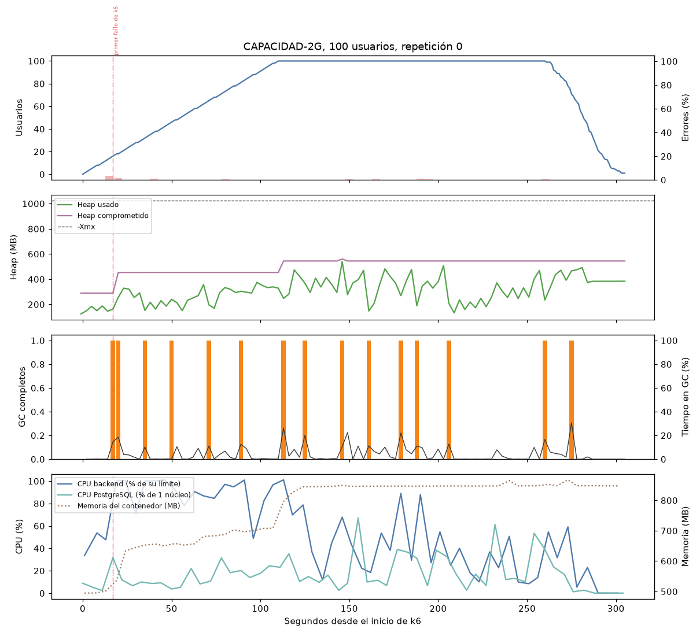

### PRODUCCION-512M, 100 usuarios, repetición 0

- Duración observada: 345 s; 762 peticiones, 562 con fallo.
- **Primer fallo a los 16 s, con 15 usuarios activos.**

| t (s) | Operación | Estado | Duración (ms) | Error de k6 |
|---|---|---|---|---|
| 16.0 | cita | 400 | 169 |  |
| 45.0 | reporte_clinico | 0 | 30000 | request timeout |
| 54.0 | login | 0 | 30001 | request timeout |
| 55.0 | login | 0 | 30001 | request timeout |
| 56.0 | login | 0 | 30000 | request timeout |
| 57.0 | login | 0 | 30000 | request timeout |
| 59.0 | login | 0 | 30001 | request timeout |
| 60.0 | login | 0 | 30000 | request timeout |
| 61.0 | login | 0 | 30001 | request timeout |
| 62.0 | login | 0 | 30000 | request timeout |
| 63.0 | login | 0 | 30001 | request timeout |
| 63.0 | cerrar_consulta | 0 | 30001 | request timeout |

- Operaciones con fallos en los 30 s siguientes al primero: cita (1), reporte_clinico (1).
- **Qué ocurre primero** (segundos desde el inicio de k6): 16 s: primer fallo de k6; 16 s: heap usado sobre 90pct del tope; 16 s: primera rafaga de gc completo; 16 s: contenedor sobre 80pct de memoria; 16 s: cpu del backend al tope; 113 s: primer tiempo agotado del pool; 113 s: primer OutOfMemoryError.
- **En los 30 s previos al primer fallo:** heap usado al inicio 145 MB, heap usado máx. 185 MB de 192, RssAnon máx. 409 MB, contenedor 416 MB de 512, CPU del backend 46 %, CPU de PostgreSQL 6 %, tiempo en GC 3.1 % con 3 GC completos.
- OutOfMemoryError en el registro: 13 líneas (ejemplo: `Exception in thread "http-nio-8080-Acceptor" java.lang.OutOfMemoryError: Java heap space`).
- Esperas de conexión agotadas en el registro: 23.

### CAPACIDAD-2G, 100 usuarios, repetición 0

- Duración observada: 286 s; 6290 peticiones, 11 con fallo.
- **Primer fallo a los 16 s, con 15 usuarios activos.**

| t (s) | Operación | Estado | Duración (ms) | Error de k6 |
|---|---|---|---|---|
| 16.0 | cita | 400 | 203 |  |
| 23.0 | cita | 400 | 127 |  |
| 40.0 | cita | 400 | 61 |  |
| 69.0 | cita | 400 | 41 |  |
| 82.0 | cita | 400 | 29 |  |
| 103.0 | cita | 400 | 14 |  |
| 132.0 | cita | 400 | 24 |  |
| 193.0 | cita | 400 | 28 |  |
| 195.0 | cita | 400 | 11 |  |
| 210.0 | cita | 400 | 13 |  |
| 263.0 | cita | 400 | 16 |  |

- Operaciones con fallos en los 30 s siguientes al primero: cita (3).
- **Qué ocurre primero** (segundos desde el inicio de k6): 16 s: primer fallo de k6; 19 s: cpu del backend al tope.
- **En los 30 s previos al primer fallo:** heap usado al inicio 187 MB, heap usado máx. 192 MB de 1024, RssAnon máx. 565 MB, contenedor 573 MB de 2048, CPU del backend 49 %, CPU de PostgreSQL 7 %, tiempo en GC 1.6 % con 1 GC completos.

### PRODUCCION-512M, 100 usuarios, repetición 0

- Duración observada: 346 s; 748 peticiones, 564 con fallo.
- **Primer fallo a los 17 s, con 16 usuarios activos.**

| t (s) | Operación | Estado | Duración (ms) | Error de k6 |
|---|---|---|---|---|
| 17.0 | cita | 400 | 110 |  |
| 46.0 | reporte_clinico | 0 | 30001 | request timeout |
| 52.0 | login | 0 | 30000 | request timeout |
| 53.0 | login | 0 | 30001 | request timeout |
| 54.0 | login | 0 | 30000 | request timeout |
| 55.0 | login | 0 | 30000 | request timeout |
| 56.0 | login | 0 | 30000 | request timeout |
| 57.0 | login | 0 | 30000 | request timeout |
| 58.0 | login | 0 | 30001 | request timeout |
| 59.0 | login | 0 | 30000 | request timeout |
| 60.0 | login | 0 | 30000 | request timeout |
| 62.0 | login | 0 | 30001 | request timeout |

- Operaciones con fallos en los 30 s siguientes al primero: cita (1), reporte_clinico (1).
- **Qué ocurre primero** (segundos desde el inicio de k6): 11 s: contenedor sobre 80pct de memoria; 17 s: primer fallo de k6; 17 s: heap usado sobre 90pct del tope; 17 s: primera rafaga de gc completo; 19 s: cpu del backend al tope; 214 s: primer OutOfMemoryError; 218 s: primer tiempo agotado del pool.
- **En los 30 s previos al primer fallo:** heap usado al inicio 146 MB, heap usado máx. 185 MB de 192, RssAnon máx. 412 MB, contenedor 419 MB de 512, CPU del backend 39 %, CPU de PostgreSQL 8 %, tiempo en GC 3.0 % con 3 GC completos.
- OutOfMemoryError en el registro: 34 líneas (ejemplo: `Exception in thread "http-nio-8080-Acceptor" java.lang.OutOfMemoryError: Java heap space`).
- Esperas de conexión agotadas en el registro: 4.

### CAPACIDAD-2G, 100 usuarios, repetición 0

- Duración observada: 287 s; 6281 peticiones, 5 con fallo.
- **Primer fallo a los 17 s, con 16 usuarios activos.**

| t (s) | Operación | Estado | Duración (ms) | Error de k6 |
|---|---|---|---|---|
| 17.0 | cita | 400 | 167 |  |
| 40.0 | cita | 400 | 39 |  |
| 41.0 | cita | 400 | 77 |  |
| 170.0 | iniciar | 400 | 56 |  |
| 196.0 | cita | 400 | 17 |  |

- Operaciones con fallos en los 30 s siguientes al primero: cita (3).
- **Qué ocurre primero** (segundos desde el inicio de k6): 17 s: primer fallo de k6; 19 s: cpu del backend al tope.
- **En los 30 s previos al primer fallo:** heap usado al inicio 181 MB, heap usado máx. 192 MB de 1024, RssAnon máx. 520 MB, contenedor 527 MB de 2048, CPU del backend 48 %, CPU de PostgreSQL 8 %, tiempo en GC 1.8 % con 2 GC completos.

### PRODUCCION-512M, 100 usuarios, repetición 0

- Duración observada: 348 s; 753 peticiones, 566 con fallo.
- **Primer fallo a los 17 s, con 16 usuarios activos.**

| t (s) | Operación | Estado | Duración (ms) | Error de k6 |
|---|---|---|---|---|
| 17.0 | cita | 400 | 149 |  |
| 25.0 | cita | 400 | 647 |  |
| 46.0 | reporte_clinico | 0 | 30000 | request timeout |
| 53.0 | login | 0 | 30001 | request timeout |
| 54.0 | login | 0 | 30000 | request timeout |
| 55.0 | login | 0 | 30001 | request timeout |
| 56.0 | login | 0 | 30001 | request timeout |
| 57.0 | login | 0 | 30001 | request timeout |
| 58.0 | login | 0 | 30000 | request timeout |
| 59.0 | login | 0 | 30001 | request timeout |
| 60.0 | login | 0 | 30000 | request timeout |
| 62.0 | login | 0 | 30000 | request timeout |

- Operaciones con fallos en los 30 s siguientes al primero: cita (2), reporte_clinico (1).
- **Qué ocurre primero** (segundos desde el inicio de k6): 17 s: primer fallo de k6; 17 s: heap usado sobre 90pct del tope; 17 s: primera rafaga de gc completo; 17 s: contenedor sobre 80pct de memoria; 17 s: cpu del backend al tope; 287 s: primer OutOfMemoryError; 287 s: primer tiempo agotado del pool.
- **En los 30 s previos al primer fallo:** heap usado al inicio 152 MB, heap usado máx. 183 MB de 192, RssAnon máx. 410 MB, contenedor 418 MB de 512, CPU del backend 49 %, CPU de PostgreSQL 5 %, tiempo en GC 2.3 % con 2 GC completos.
- OutOfMemoryError en el registro: 38 líneas (ejemplo: `Exception in thread "http-nio-8080-Acceptor" java.lang.OutOfMemoryError: Java heap space`).
- Esperas de conexión agotadas en el registro: 1.

### CAPACIDAD-2G, 100 usuarios, repetición 0

- Duración observada: 285 s; 6260 peticiones, 6 con fallo.
- **Primer fallo a los 17 s, con 16 usuarios activos.**

| t (s) | Operación | Estado | Duración (ms) | Error de k6 |
|---|---|---|---|---|
| 17.0 | cita | 400 | 220 |  |
| 40.0 | cita | 400 | 73 |  |
| 41.0 | cita | 400 | 72 |  |
| 113.0 | iniciar | 400 | 34 |  |
| 170.0 | iniciar | 400 | 50 |  |
| 196.0 | cita | 400 | 21 |  |

- Operaciones con fallos en los 30 s siguientes al primero: cita (3).
- **Qué ocurre primero** (segundos desde el inicio de k6): 17 s: primer fallo de k6; 19 s: cpu del backend al tope.
- **En los 30 s previos al primer fallo:** heap usado al inicio 168 MB, heap usado máx. 179 MB de 1024, RssAnon máx. 538 MB, contenedor 546 MB de 2048, CPU del backend 53 %, CPU de PostgreSQL 8 %, tiempo en GC 3.5 % con 2 GC completos.

### PRODUCCION-512M, 100 usuarios, repetición 0

- Duración observada: 342 s; 740 peticiones, 564 con fallo.
- **Primer fallo a los 17 s, con 16 usuarios activos.**

| t (s) | Operación | Estado | Duración (ms) | Error de k6 |
|---|---|---|---|---|
| 17.0 | cita | 400 | 140 |  |
| 26.0 | cita | 400 | 1243 |  |
| 46.0 | reporte_clinico | 0 | 30000 | request timeout |
| 51.0 | login | 0 | 30000 | request timeout |
| 53.0 | login | 0 | 30000 | request timeout |
| 54.0 | login | 0 | 30001 | request timeout |
| 55.0 | login | 0 | 30001 | request timeout |
| 56.0 | login | 0 | 30000 | request timeout |
| 57.0 | login | 0 | 30000 | request timeout |
| 58.0 | login | 0 | 30000 | request timeout |
| 59.0 | login | 0 | 30000 | request timeout |
| 60.0 | login | 0 | 30000 | request timeout |

- Operaciones con fallos en los 30 s siguientes al primero: cita (2), reporte_clinico (1).
- **Qué ocurre primero** (segundos desde el inicio de k6): 14 s: contenedor sobre 80pct de memoria; 17 s: primer fallo de k6; 17 s: heap usado sobre 90pct del tope; 17 s: cpu del backend al tope; 20 s: primera rafaga de gc completo; 353 s: primer OutOfMemoryError.
- **En los 30 s previos al primer fallo:** heap usado al inicio 140 MB, heap usado máx. 185 MB de 192, RssAnon máx. 409 MB, contenedor 417 MB de 512, CPU del backend 49 %, CPU de PostgreSQL 5 %, tiempo en GC 3.4 % con 2 GC completos.
- OutOfMemoryError en el registro: 7 líneas (ejemplo: `Exception in thread "http-nio-8080-Acceptor" java.lang.OutOfMemoryError: Java heap space`).

### CAPACIDAD-2G, 100 usuarios, repetición 0

- Duración observada: 287 s; 6289 peticiones, 12 con fallo.
- **Primer fallo a los 16 s, con 15 usuarios activos.**

| t (s) | Operación | Estado | Duración (ms) | Error de k6 |
|---|---|---|---|---|
| 16.0 | cita | 400 | 165 |  |
| 23.0 | cita | 400 | 156 |  |
| 39.0 | cita | 400 | 69 |  |
| 69.0 | cita | 400 | 61 |  |
| 82.0 | cita | 400 | 28 |  |
| 102.0 | cita | 400 | 29 |  |
| 132.0 | cita | 400 | 10 |  |
| 151.0 | iniciar | 400 | 15 |  |
| 192.0 | cita | 400 | 15 |  |
| 194.0 | cita | 400 | 10 |  |
| 208.0 | cita | 400 | 9 |  |
| 263.0 | cita | 400 | 10 |  |

- Operaciones con fallos en los 30 s siguientes al primero: cita (3).
- **Qué ocurre primero** (segundos desde el inicio de k6): 16 s: primer fallo de k6; 19 s: cpu del backend al tope.
- **En los 30 s previos al primer fallo:** heap usado al inicio 189 MB, heap usado máx. 191 MB de 1024, RssAnon máx. 570 MB, contenedor 578 MB de 2048, CPU del backend 51 %, CPU de PostgreSQL 5 %, tiempo en GC 0.1 % con 0 GC completos.

### PRODUCCION-512M, 100 usuarios, repetición 0

- Duración observada: 345 s; 717 peticiones, 562 con fallo.
- **Primer fallo a los 17 s, con 16 usuarios activos.**

| t (s) | Operación | Estado | Duración (ms) | Error de k6 |
|---|---|---|---|---|
| 17.0 | cita | 400 | 150 |  |
| 45.0 | reporte_clinico | 0 | 30001 | request timeout |
| 50.0 | login | 0 | 30001 | request timeout |
| 51.0 | login | 0 | 30001 | request timeout |
| 52.0 | login | 0 | 30001 | request timeout |
| 54.0 | login | 0 | 30001 | request timeout |
| 55.0 | login | 0 | 30001 | request timeout |
| 56.0 | login | 0 | 30000 | request timeout |
| 57.0 | login | 0 | 30001 | request timeout |
| 58.0 | historia | 0 | 30000 | request timeout |
| 58.0 | login | 0 | 30000 | request timeout |
| 58.0 | apoderado | 0 | 30001 | request timeout |

- Operaciones con fallos en los 30 s siguientes al primero: cita (1), reporte_clinico (1).
- **Qué ocurre primero** (segundos desde el inicio de k6): 17 s: primer fallo de k6; 17 s: heap usado sobre 90pct del tope; 17 s: primera rafaga de gc completo; 17 s: contenedor sobre 80pct de memoria; 19 s: cpu del backend al tope; 231 s: primer OutOfMemoryError; 232 s: primer tiempo agotado del pool.
- **En los 30 s previos al primer fallo:** heap usado al inicio 139 MB, heap usado máx. 183 MB de 192, RssAnon máx. 408 MB, contenedor 416 MB de 512, CPU del backend 40 %, CPU de PostgreSQL 5 %, tiempo en GC 2.9 % con 3 GC completos.
- OutOfMemoryError en el registro: 39 líneas (ejemplo: `Exception in thread "http-nio-8080-Acceptor" java.lang.OutOfMemoryError: Java heap space`).
- Esperas de conexión agotadas en el registro: 2.

### CAPACIDAD-2G, 100 usuarios, repetición 0

- Duración observada: 286 s; 6283 peticiones, 9 con fallo.
- **Primer fallo a los 17 s, con 16 usuarios activos.**

| t (s) | Operación | Estado | Duración (ms) | Error de k6 |
|---|---|---|---|---|
| 17.0 | cita | 400 | 185 |  |
| 23.0 | cita | 400 | 136 |  |
| 40.0 | cita | 400 | 68 |  |
| 82.0 | cita | 400 | 20 |  |
| 151.0 | iniciar | 400 | 11 |  |
| 169.0 | iniciar | 400 | 29 |  |
| 193.0 | cita | 400 | 19 |  |
| 195.0 | cita | 400 | 11 |  |
| 264.0 | cita | 400 | 15 |  |

- Operaciones con fallos en los 30 s siguientes al primero: cita (3).
- **Qué ocurre primero** (segundos desde el inicio de k6): 17 s: primer fallo de k6; 19 s: cpu del backend al tope.
- **En los 30 s previos al primer fallo:** heap usado al inicio 163 MB, heap usado máx. 188 MB de 1024, RssAnon máx. 520 MB, contenedor 528 MB de 2048, CPU del backend 48 %, CPU de PostgreSQL 7 %, tiempo en GC 2.5 % con 1 GC completos.

### PRODUCCION-512M, 100 usuarios, repetición 0

- Duración observada: 344 s; 720 peticiones, 564 con fallo.
- **Primer fallo a los 16 s, con 15 usuarios activos.**

| t (s) | Operación | Estado | Duración (ms) | Error de k6 |
|---|---|---|---|---|
| 16.0 | cita | 400 | 147 |  |
| 45.0 | reporte_clinico | 0 | 30001 | request timeout |
| 50.0 | login | 0 | 30000 | request timeout |
| 51.0 | login | 0 | 30000 | request timeout |
| 52.0 | login | 0 | 30001 | request timeout |
| 53.0 | login | 0 | 30000 | request timeout |
| 54.0 | login | 0 | 30000 | request timeout |
| 55.0 | login | 0 | 30000 | request timeout |
| 56.0 | historia | 0 | 30000 | request timeout |
| 56.0 | login | 0 | 30000 | request timeout |
| 57.0 | login | 0 | 30001 | request timeout |
| 58.0 | apoderado | 0 | 30001 | request timeout |

- Operaciones con fallos en los 30 s siguientes al primero: cita (1), reporte_clinico (1).
- **Qué ocurre primero** (segundos desde el inicio de k6): 16 s: primer fallo de k6; 16 s: cpu del backend al tope; 17 s: primera rafaga de gc completo; 17 s: contenedor sobre 80pct de memoria; 20 s: heap usado sobre 90pct del tope; 271 s: primer OutOfMemoryError; 348 s: primer tiempo agotado del pool.
- **En los 30 s previos al primer fallo:** heap usado al inicio 146 MB, heap usado máx. 152 MB de 192, RssAnon máx. 402 MB, contenedor 409 MB de 512, CPU del backend 48 %, CPU de PostgreSQL 5 %, tiempo en GC 1.8 % con 1 GC completos.
- OutOfMemoryError en el registro: 53 líneas (ejemplo: `Exception in thread "http-nio-8080-Poller" Exception in thread "http-nio-8080-Acceptor" java.lang.OutOfMemoryError: Java heap space`).
- Esperas de conexión agotadas en el registro: 4.

### desconocido, 100 usuarios, repetición 0

- Duración observada: 345 s; 696 peticiones, 564 con fallo.
- **Primer fallo a los 45 s, con 41 usuarios activos.**

| t (s) | Operación | Estado | Duración (ms) | Error de k6 |
|---|---|---|---|---|
| 45.0 | reporte_clinico | 0 | 30001 | request timeout |
| 49.0 | login | 0 | 30000 | request timeout |
| 50.0 | login | 0 | 30000 | request timeout |
| 51.0 | login | 0 | 30001 | request timeout |
| 52.0 | citas_del_mes | 0 | 30001 | request timeout |
| 52.0 | lista_de_historias | 0 | 30001 | request timeout |
| 52.0 | login | 0 | 30001 | request timeout |
| 52.0 | apoderado | 0 | 30001 | request timeout |
| 53.0 | checkin | 0 | 30001 | request timeout |
| 53.0 | apoderado | 0 | 30001 | request timeout |
| 54.0 | login | 0 | 30001 | request timeout |
| 54.0 | mascota | 0 | 30001 | request timeout |

- Operaciones con fallos en los 30 s siguientes al primero: login (24), apoderado (6), checkin (2), avisos_de_cumplimiento (2), reporte_clinico (1), citas_del_mes (1), lista_de_historias (1), mascota (1).
- **Qué ocurre primero** (segundos desde el inicio de k6): 17 s: heap usado sobre 90pct del tope; 17 s: primera rafaga de gc completo; 17 s: contenedor sobre 80pct de memoria; 17 s: cpu del backend al tope; 45 s: primer fallo de k6; 87 s: primer tiempo agotado del pool; 87 s: primer OutOfMemoryError.
- **En los 30 s previos al primer fallo:** heap usado al inicio 138 MB, heap usado máx. 186 MB de 192, RssAnon máx. 418 MB, contenedor 427 MB de 512, CPU del backend 101 %, CPU de PostgreSQL 1 %, tiempo en GC 77.9 % con 71 GC completos.
- OutOfMemoryError en el registro: 14 líneas (ejemplo: `Exception in thread "http-nio-8080-Acceptor" java.lang.OutOfMemoryError: Java heap space`).
- Esperas de conexión agotadas en el registro: 4.

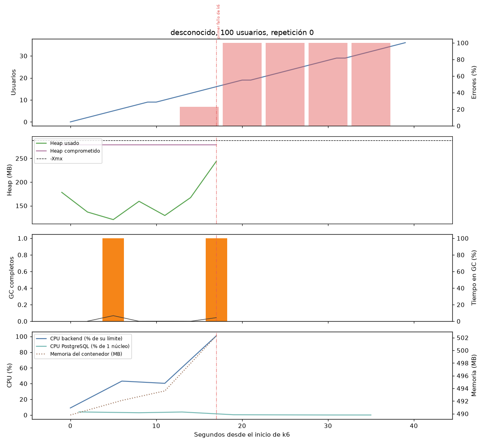

### desconocido, 50 usuarios, repetición 0

- Duración observada: 284 s; 390 peticiones, 262 con fallo.
- **Primer fallo a los 16 s, con 15 usuarios activos.**

| t (s) | Operación | Estado | Duración (ms) | Error de k6 |
|---|---|---|---|---|
| 16.0 | cita | 400 | 428 |  |
| 45.0 | reporte_clinico | 0 | 30001 | request timeout |
| 49.0 | login | 0 | 30000 | request timeout |
| 50.0 | login | 0 | 30001 | request timeout |
| 51.0 | login | 0 | 30000 | request timeout |
| 51.0 | cita | 0 | 30001 | request timeout |
| 52.0 | citas_del_mes | 0 | 30001 | request timeout |
| 52.0 | lista_de_historias | 0 | 30001 | request timeout |
| 52.0 | apoderado | 0 | 30001 | request timeout |
| 52.0 | login | 0 | 30001 | request timeout |
| 53.0 | checkin | 0 | 30001 | request timeout |
| 53.0 | login | 0 | 30001 | request timeout |

- Operaciones con fallos en los 30 s siguientes al primero: cita (1), reporte_clinico (1).
- **Qué ocurre primero** (segundos desde el inicio de k6): 14 s: contenedor sobre 80pct de memoria; 16 s: primer fallo de k6; 17 s: primera rafaga de gc completo; 17 s: cpu del backend al tope; 20 s: heap usado sobre 90pct del tope; 125 s: primer tiempo agotado del pool; 182 s: primer OutOfMemoryError.
- **En los 30 s previos al primer fallo:** heap usado al inicio 149 MB, heap usado máx. 157 MB de 192, RssAnon máx. 402 MB, contenedor 410 MB de 512, CPU del backend 35 %, CPU de PostgreSQL 3 %, tiempo en GC 1.5 % con 1 GC completos.
- OutOfMemoryError en el registro: 25 líneas (ejemplo: `Exception in thread "http-nio-8080-Acceptor" java.lang.OutOfMemoryError: Java heap space`).
- Esperas de conexión agotadas en el registro: 7.

### desconocido, 100 usuarios, repetición 0

- Duración observada: 289 s; 3934 peticiones, 358 con fallo.
- **Primer fallo a los 56 s, con 51 usuarios activos.**

| t (s) | Operación | Estado | Duración (ms) | Error de k6 |
|---|---|---|---|---|
| 56.0 | login | 401 | 291 |  |
| 57.0 | login | 401 | 294 |  |
| 58.0 | login | 401 | 229 |  |
| 59.0 | login | 401 | 354 |  |
| 60.0 | login | 401 | 251 |  |
| 62.0 | login | 401 | 1110 |  |
| 63.0 | login | 401 | 696 |  |
| 64.0 | login | 401 | 233 |  |
| 65.0 | login | 401 | 278 |  |
| 66.0 | login | 401 | 240 |  |
| 67.0 | login | 401 | 242 |  |
| 68.0 | login | 401 | 270 |  |

- Operaciones con fallos en los 30 s siguientes al primero: login (31).
- **Qué ocurre primero** (segundos desde el inicio de k6): 17 s: primera rafaga de gc completo; 17 s: contenedor sobre 80pct de memoria; 17 s: cpu del backend al tope; 56 s: primer fallo de k6; 62 s: heap usado sobre 90pct del tope.
- **En los 30 s previos al primer fallo:** heap usado al inicio 151 MB, heap usado máx. 158 MB de 192, RssAnon máx. 415 MB, contenedor 423 MB de 512, CPU del backend 35 %, CPU de PostgreSQL 5 %, tiempo en GC 0.8 % con 1 GC completos.

### desconocido, 50 usuarios, repetición 0

- Duración observada: 231 s; 2791 peticiones, 1 con fallo.
- **Primer fallo a los 194 s, con 50 usuarios activos.**

| t (s) | Operación | Estado | Duración (ms) | Error de k6 |
|---|---|---|---|---|
| 194.0 | cita | 400 | 17 |  |

- Operaciones con fallos en los 30 s siguientes al primero: cita (1).
- **Qué ocurre primero** (segundos desde el inicio de k6): 11 s: contenedor sobre 80pct de memoria; 17 s: primera rafaga de gc completo; 62 s: heap usado sobre 90pct del tope; 194 s: primer fallo de k6.
- **En los 30 s previos al primer fallo:** heap usado al inicio 139 MB, heap usado máx. 164 MB de 192, RssAnon máx. 416 MB, contenedor 424 MB de 512, CPU del backend 20 %, CPU de PostgreSQL 3 %, tiempo en GC 3.1 % con 5 GC completos.

### desconocido, 100 usuarios, repetición 0

- Duración observada: 287 s; 3988 peticiones, 356 con fallo.
- **Primer fallo a los 56 s, con 51 usuarios activos.**

| t (s) | Operación | Estado | Duración (ms) | Error de k6 |
|---|---|---|---|---|
| 56.0 | login | 401 | 268 |  |
| 57.0 | login | 401 | 260 |  |
| 58.0 | login | 401 | 298 |  |
| 59.0 | login | 401 | 274 |  |
| 60.0 | login | 401 | 270 |  |
| 61.0 | login | 401 | 250 |  |
| 62.0 | login | 401 | 257 |  |
| 63.0 | login | 401 | 239 |  |
| 65.0 | login | 401 | 267 |  |
| 66.0 | login | 401 | 299 |  |
| 67.0 | login | 401 | 236 |  |
| 68.0 | login | 401 | 257 |  |

- Operaciones con fallos en los 30 s siguientes al primero: login (31).
- **Qué ocurre primero** (segundos desde el inicio de k6): 11 s: contenedor sobre 80pct de memoria; 56 s: primer fallo de k6.
- **En los 30 s previos al primer fallo:** heap usado al inicio 145 MB, heap usado máx. 158 MB de 192, RssAnon máx. 419 MB, contenedor 427 MB de 512, CPU del backend 37 %, CPU de PostgreSQL 4 %, tiempo en GC 1.5 % con 2 GC completos.

### desconocido, 50 usuarios, repetición 0

- Duración observada: 231 s; 2825 peticiones, 3 con fallo.
- **Primer fallo a los 39 s, con 36 usuarios activos.**

| t (s) | Operación | Estado | Duración (ms) | Error de k6 |
|---|---|---|---|---|
| 39.0 | cita | 400 | 23 |  |
| 39.0 | cita | 400 | 14 |  |
| 192.0 | cita | 400 | 14 |  |

- Operaciones con fallos en los 30 s siguientes al primero: cita (2).
- **Qué ocurre primero** (segundos desde el inicio de k6): 14 s: contenedor sobre 80pct de memoria; 39 s: primer fallo de k6.
- **En los 30 s previos al primer fallo:** heap usado al inicio 157 MB, heap usado máx. 164 MB de 192, RssAnon máx. 417 MB, contenedor 425 MB de 512, CPU del backend 41 %, CPU de PostgreSQL 4 %, tiempo en GC 1.6 % con 2 GC completos.

### desconocido, 100 usuarios, repetición 0

- Duración observada: 286 s; 3947 peticiones, 359 con fallo.
- **Primer fallo a los 56 s, con 51 usuarios activos.**

| t (s) | Operación | Estado | Duración (ms) | Error de k6 |
|---|---|---|---|---|
| 56.0 | login | 401 | 289 |  |
| 57.0 | login | 401 | 278 |  |
| 58.0 | login | 401 | 236 |  |
| 59.0 | login | 401 | 244 |  |
| 60.0 | login | 401 | 295 |  |
| 62.0 | login | 401 | 873 |  |
| 63.0 | login | 401 | 1400 |  |
| 64.0 | login | 401 | 1028 |  |
| 65.0 | login | 401 | 884 |  |
| 66.0 | login | 401 | 486 |  |
| 66.0 | login | 401 | 238 |  |
| 68.0 | login | 401 | 298 |  |

- Operaciones con fallos en los 30 s siguientes al primero: login (32).
- **Qué ocurre primero** (segundos desde el inicio de k6): -1 s: contenedor sobre 80pct de memoria; 17 s: cpu del backend al tope; 20 s: heap usado sobre 90pct del tope; 20 s: primera rafaga de gc completo; 56 s: primer fallo de k6.
- **En los 30 s previos al primer fallo:** heap usado al inicio 168 MB, heap usado máx. 191 MB de 256, RssAnon máx. 480 MB, contenedor 488 MB de 512, CPU del backend 43 %, CPU de PostgreSQL 8 %, tiempo en GC 0.8 % con 1 GC completos.

### desconocido, 50 usuarios, repetición 0

- Duración observada: 231 s; 2787 peticiones, 5 con fallo.
- **Primer fallo a los 15 s, con 14 usuarios activos.**

| t (s) | Operación | Estado | Duración (ms) | Error de k6 |
|---|---|---|---|---|
| 15.0 | cita | 400 | 183 |  |
| 22.0 | cita | 400 | 42 |  |
| 38.0 | cita | 400 | 13 |  |
| 38.0 | cita | 400 | 40 |  |
| 191.0 | cita | 400 | 11 |  |

- Operaciones con fallos en los 30 s siguientes al primero: cita (4).
- **Qué ocurre primero** (segundos desde el inicio de k6): -2 s: contenedor sobre 80pct de memoria; 15 s: primer fallo de k6; 16 s: primera rafaga de gc completo; 18 s: cpu del backend al tope; 19 s: heap usado sobre 90pct del tope.
- **En los 30 s previos al primer fallo:** heap usado al inicio 151 MB, heap usado máx. 168 MB de 256, RssAnon máx. 445 MB, contenedor 453 MB de 512, CPU del backend 37 %, CPU de PostgreSQL 4 %, tiempo en GC 0.0 % con 0 GC completos.

### desconocido, 100 usuarios, repetición 0

- Duración observada: 39 s; 198 peticiones, 78 con fallo.
- **Primer fallo a los 19 s, con 18 usuarios activos.**

| t (s) | Operación | Estado | Duración (ms) | Error de k6 |
|---|---|---|---|---|
| 19.0 | navegacion | 0 | 181 | unexpected EOF |
| 19.0 | privacidad | 0 | 1 | EOF |
| 19.0 | cumplimiento | 0 | 0 | EOF |
| 19.0 | reporte_de_ventas | 0 | 1 | read: connection reset by peer |
| 19.0 | notificaciones | 0 | 0 | EOF |
| 19.0 | pacientes_inactivos | 0 | 1 | read: connection reset by peer |
| 19.0 | avisos_de_cumplimiento | 0 | 0 | EOF |
| 19.0 | panel | 0 | 0 | read: connection reset by peer |
| 19.0 | login | 0 | 0 | dial: connection refused |
| 20.0 | apoderado | 0 | 0 | dial: connection refused |
| 20.0 | login | 0 | 0 | dial: connection refused |
| 21.0 | login | 0 | 0 | dial: connection refused |

- Operaciones con fallos en los 30 s siguientes al primero: login (19), apoderado (12), navegacion (6), privacidad (6), cumplimiento (6), notificaciones (6), avisos_de_cumplimiento (6), panel (6).
- **Qué ocurre primero** (segundos desde el inicio de k6): -1 s: contenedor sobre 80pct de memoria; 17 s: primera rafaga de gc completo; 19 s: primer fallo de k6; 19 s: cpu del backend al tope.
- **En los 30 s previos al primer fallo:** heap usado al inicio 147 MB, heap usado máx. 253 MB de 288, RssAnon máx. 489 MB, contenedor 497 MB de 512, CPU del backend 38 %, CPU de PostgreSQL 5 %, tiempo en GC 2.0 % con 2 GC completos.

### desconocido, 50 usuarios, repetición 0

- Duración observada: 40 s; 220 peticiones, 85 con fallo.
- **Primer fallo a los 15 s, con 14 usuarios activos.**

| t (s) | Operación | Estado | Duración (ms) | Error de k6 |
|---|---|---|---|---|
| 15.0 | cita | 400 | 116 |  |
| 19.0 | mascota | 0 | 93 | EOF |
| 20.0 | login | 0 | 0 | dial: connection refused |
| 21.0 | login | 0 | 0 | dial: connection refused |
| 21.0 | apoderado | 0 | 0 | dial: connection refused |
| 21.0 | navegacion | 0 | 0 | dial: connection refused |
| 21.0 | privacidad | 0 | 0 | dial: connection refused |
| 21.0 | cumplimiento | 0 | 0 | dial: connection refused |
| 21.0 | notificaciones | 0 | 0 | dial: connection refused |
| 21.0 | avisos_de_cumplimiento | 0 | 0 | dial: connection refused |
| 21.0 | panel | 0 | 0 | dial: connection refused |
| 21.0 | citas_del_mes | 0 | 0 | dial: connection refused |

- Operaciones con fallos en los 30 s siguientes al primero: login (20), apoderado (14), navegacion (7), privacidad (7), cumplimiento (7), notificaciones (7), avisos_de_cumplimiento (7), panel (7).
- **Qué ocurre primero** (segundos desde el inicio de k6): -2 s: contenedor sobre 80pct de memoria; 15 s: primer fallo de k6; 16 s: primera rafaga de gc completo; 18 s: cpu del backend al tope; 19 s: heap usado sobre 90pct del tope.
- **En los 30 s previos al primer fallo:** heap usado al inicio 170 MB, heap usado máx. 176 MB de 288, RssAnon máx. 464 MB, contenedor 472 MB de 512, CPU del backend 37 %, CPU de PostgreSQL 4 %, tiempo en GC 0.0 % con 0 GC completos.

### desconocido, 100 usuarios, repetición 0

- Duración observada: 345 s; 695 peticiones, 560 con fallo.
- **Primer fallo a los 45 s, con 41 usuarios activos.**

| t (s) | Operación | Estado | Duración (ms) | Error de k6 |
|---|---|---|---|---|
| 45.0 | reporte_clinico | 0 | 30001 | request timeout |
| 49.0 | login | 0 | 30000 | request timeout |
| 50.0 | login | 0 | 30001 | request timeout |
| 51.0 | login | 0 | 30000 | request timeout |
| 52.0 | lista_de_historias | 0 | 30001 | request timeout |
| 52.0 | login | 0 | 30001 | request timeout |
| 53.0 | login | 0 | 30000 | request timeout |
| 54.0 | cita | 0 | 30001 | request timeout |
| 54.0 | apoderado | 0 | 30001 | request timeout |
| 54.0 | apoderado | 0 | 30001 | request timeout |
| 54.0 | login | 0 | 30001 | request timeout |
| 55.0 | login | 0 | 30000 | request timeout |

- Operaciones con fallos en los 30 s siguientes al primero: login (25), apoderado (5), reporte_clinico (1), lista_de_historias (1), cita (1), privacidad (1), panel (1), mascota (1).
- **Qué ocurre primero** (segundos desde el inicio de k6): 14 s: contenedor sobre 80pct de memoria; 17 s: primera rafaga de gc completo; 19 s: cpu del backend al tope; 20 s: heap usado sobre 90pct del tope; 45 s: primer fallo de k6; 148 s: primer OutOfMemoryError; 148 s: primer tiempo agotado del pool.
- **En los 30 s previos al primer fallo:** heap usado al inicio 139 MB, heap usado máx. 186 MB de 192, RssAnon máx. 418 MB, contenedor 427 MB de 512, CPU del backend 100 %, CPU de PostgreSQL 1 %, tiempo en GC 78.1 % con 82 GC completos.
- OutOfMemoryError en el registro: 38 líneas (ejemplo: `Exception: java.lang.OutOfMemoryError thrown from the UncaughtExceptionHandler in thread "http-nio-8080-Acceptor"`).
- Esperas de conexión agotadas en el registro: 1.

### desconocido, 50 usuarios, repetición 0

- Duración observada: 285 s; 399 peticiones, 256 con fallo.
- **Primer fallo a los 45 s, con 41 usuarios activos.**

| t (s) | Operación | Estado | Duración (ms) | Error de k6 |
|---|---|---|---|---|
| 45.0 | reporte_clinico | 0 | 30001 | request timeout |
| 49.0 | login | 0 | 30001 | request timeout |
| 50.0 | login | 0 | 30000 | request timeout |
| 51.0 | login | 0 | 30001 | request timeout |
| 52.0 | login | 0 | 30001 | request timeout |
| 53.0 | login | 0 | 30000 | request timeout |
| 54.0 | apoderado | 0 | 30001 | request timeout |
| 54.0 | login | 0 | 30000 | request timeout |
| 55.0 | panel | 0 | 30000 | request timeout |
| 55.0 | iniciar | 0 | 30001 | request timeout |
| 55.0 | panel | 0 | 30001 | request timeout |
| 55.0 | login | 0 | 30001 | request timeout |

- Operaciones con fallos en los 30 s siguientes al primero: login (25), apoderado (5), panel (2), cancelar_cita (2), reporte_clinico (1), iniciar (1), historia (1), cita (1).
- **Qué ocurre primero** (segundos desde el inicio de k6): 14 s: contenedor sobre 80pct de memoria; 17 s: heap usado sobre 90pct del tope; 17 s: primera rafaga de gc completo; 19 s: cpu del backend al tope; 45 s: primer fallo de k6; 103 s: primer OutOfMemoryError; 103 s: primer tiempo agotado del pool.
- **En los 30 s previos al primer fallo:** heap usado al inicio 157 MB, heap usado máx. 186 MB de 192, RssAnon máx. 418 MB, contenedor 427 MB de 512, CPU del backend 100 %, CPU de PostgreSQL 2 %, tiempo en GC 76.2 % con 73 GC completos.
- OutOfMemoryError en el registro: 13 líneas (ejemplo: `Exception: java.lang.OutOfMemoryError thrown from the UncaughtExceptionHandler in thread "http-nio-8080-Acceptor"`).
- Esperas de conexión agotadas en el registro: 3.

### desconocido, 100 usuarios, repetición 0

- Duración observada: 286 s; 3923 peticiones, 357 con fallo.
- **Primer fallo a los 55 s, con 50 usuarios activos.**

| t (s) | Operación | Estado | Duración (ms) | Error de k6 |
|---|---|---|---|---|
| 55.0 | login | 401 | 345 |  |
| 56.0 | login | 401 | 340 |  |
| 57.0 | login | 401 | 296 |  |
| 58.0 | login | 401 | 298 |  |
| 59.0 | login | 401 | 333 |  |
| 61.0 | login | 401 | 1200 |  |
| 62.0 | login | 401 | 460 |  |
| 63.0 | login | 401 | 304 |  |
| 64.0 | login | 401 | 341 |  |
| 65.0 | login | 401 | 296 |  |
| 66.0 | login | 401 | 336 |  |
| 67.0 | login | 401 | 326 |  |

- Operaciones con fallos en los 30 s siguientes al primero: login (31).
- **Qué ocurre primero** (segundos desde el inicio de k6): 16 s: heap usado sobre 90pct del tope; 16 s: primera rafaga de gc completo; 16 s: contenedor sobre 80pct de memoria; 16 s: cpu del backend al tope; 55 s: primer fallo de k6.
- **En los 30 s previos al primer fallo:** heap usado al inicio 145 MB, heap usado máx. 165 MB de 192, RssAnon máx. 414 MB, contenedor 422 MB de 512, CPU del backend 42 %, CPU de PostgreSQL 4 %, tiempo en GC 0.8 % con 1 GC completos.

### desconocido, 50 usuarios, repetición 0

- Duración observada: 230 s; 2786 peticiones, 4 con fallo.
- **Primer fallo a los 15 s, con 14 usuarios activos.**

| t (s) | Operación | Estado | Duración (ms) | Error de k6 |
|---|---|---|---|---|
| 15.0 | cita | 400 | 121 |  |
| 68.0 | cita | 400 | 14 |  |
| 166.0 | cita | 400 | 16 |  |
| 221.0 | cita | 400 | 11 |  |

- Operaciones con fallos en los 30 s siguientes al primero: cita (1).
- **Qué ocurre primero** (segundos desde el inicio de k6): 15 s: primer fallo de k6; 16 s: heap usado sobre 90pct del tope; 16 s: primera rafaga de gc completo; 16 s: contenedor sobre 80pct de memoria; 18 s: cpu del backend al tope.
- **En los 30 s previos al primer fallo:** heap usado al inicio 141 MB, heap usado máx. 150 MB de 192, RssAnon máx. 402 MB, contenedor 409 MB de 512, CPU del backend 40 %, CPU de PostgreSQL 3 %, tiempo en GC 1.4 % con 1 GC completos.

### desconocido, 100 usuarios, repetición 0

- Duración observada: 287 s; 3976 peticiones, 357 con fallo.
- **Primer fallo a los 56 s, con 51 usuarios activos.**

| t (s) | Operación | Estado | Duración (ms) | Error de k6 |
|---|---|---|---|---|
| 56.0 | login | 401 | 323 |  |
| 57.0 | login | 401 | 373 |  |
| 58.0 | login | 401 | 366 |  |
| 59.0 | login | 401 | 372 |  |
| 60.0 | login | 401 | 321 |  |
| 61.0 | login | 401 | 337 |  |
| 62.0 | login | 401 | 302 |  |
| 63.0 | login | 401 | 297 |  |
| 64.0 | login | 401 | 339 |  |
| 66.0 | login | 401 | 358 |  |
| 67.0 | login | 401 | 322 |  |
| 68.0 | login | 401 | 322 |  |

- Operaciones con fallos en los 30 s siguientes al primero: login (31).
- **Qué ocurre primero** (segundos desde el inicio de k6): 17 s: contenedor sobre 80pct de memoria; 17 s: cpu del backend al tope; 56 s: primer fallo de k6.
- **En los 30 s previos al primer fallo:** heap usado al inicio 148 MB, heap usado máx. 164 MB de 192, RssAnon máx. 419 MB, contenedor 427 MB de 512, CPU del backend 42 %, CPU de PostgreSQL 7 %, tiempo en GC 1.6 % con 2 GC completos.

### desconocido, 50 usuarios, repetición 0

- Duración observada: 230 s; 2817 peticiones, 4 con fallo.
- **Primer fallo a los 15 s, con 14 usuarios activos.**

| t (s) | Operación | Estado | Duración (ms) | Error de k6 |
|---|---|---|---|---|
| 15.0 | cita | 400 | 68 |  |
| 22.0 | cita | 400 | 36 |  |
| 38.0 | cita | 400 | 30 |  |
| 191.0 | cita | 400 | 17 |  |

- Operaciones con fallos en los 30 s siguientes al primero: cita (3).
- **Qué ocurre primero** (segundos desde el inicio de k6): 13 s: contenedor sobre 80pct de memoria; 15 s: primer fallo de k6.
- **En los 30 s previos al primer fallo:** heap usado al inicio 154 MB, heap usado máx. 161 MB de 192, RssAnon máx. 403 MB, contenedor 410 MB de 512, CPU del backend 40 %, CPU de PostgreSQL 4 %, tiempo en GC 0.1 % con 0 GC completos.

### desconocido, 100 usuarios, repetición 0

- Duración observada: 344 s; 3904 peticiones, 374 con fallo.
- **Primer fallo a los 55 s, con 50 usuarios activos.**

| t (s) | Operación | Estado | Duración (ms) | Error de k6 |
|---|---|---|---|---|
| 55.0 | login | 401 | 389 |  |
| 57.0 | login | 401 | 355 |  |
| 58.0 | login | 401 | 296 |  |
| 59.0 | login | 401 | 425 |  |
| 60.0 | login | 401 | 324 |  |
| 62.0 | login | 401 | 1019 |  |
| 63.0 | login | 401 | 1534 |  |
| 64.0 | login | 401 | 1339 |  |
| 66.0 | login | 401 | 1738 |  |
| 66.0 | login | 401 | 974 |  |
| 66.0 | login | 401 | 376 |  |
| 68.0 | login | 401 | 336 |  |

- Operaciones con fallos en los 30 s siguientes al primero: login (31).
- **Qué ocurre primero** (segundos desde el inicio de k6): -1 s: contenedor sobre 80pct de memoria; 17 s: primera rafaga de gc completo; 19 s: cpu del backend al tope; 55 s: primer fallo de k6; 77 s: heap usado sobre 90pct del tope; 341 s: primer OutOfMemoryError.
- **En los 30 s previos al primer fallo:** heap usado al inicio 159 MB, heap usado máx. 190 MB de 256, RssAnon máx. 478 MB, contenedor 486 MB de 512, CPU del backend 40 %, CPU de PostgreSQL 6 %, tiempo en GC 0.9 % con 1 GC completos.
- OutOfMemoryError en el registro: 3 líneas (ejemplo: `Exception in thread "http-nio-8080-Acceptor" java.lang.OutOfMemoryError: Java heap space`).

### desconocido, 50 usuarios, repetición 0

- Duración observada: 231 s; 2786 peticiones, 5 con fallo.
- **Primer fallo a los 16 s, con 15 usuarios activos.**

| t (s) | Operación | Estado | Duración (ms) | Error de k6 |
|---|---|---|---|---|
| 16.0 | cita | 400 | 123 |  |
| 38.0 | cita | 400 | 39 |  |
| 39.0 | cita | 400 | 12 |  |
| 128.0 | iniciar | 400 | 17 |  |
| 192.0 | cita | 400 | 27 |  |

- Operaciones con fallos en los 30 s siguientes al primero: cita (3).
- **Qué ocurre primero** (segundos desde el inicio de k6): -1 s: contenedor sobre 80pct de memoria; 16 s: primer fallo de k6; 17 s: heap usado sobre 90pct del tope; 17 s: primera rafaga de gc completo; 17 s: cpu del backend al tope.
- **En los 30 s previos al primer fallo:** heap usado al inicio 159 MB, heap usado máx. 164 MB de 256, RssAnon máx. 455 MB, contenedor 464 MB de 512, CPU del backend 42 %, CPU de PostgreSQL 4 %, tiempo en GC 0.1 % con 0 GC completos.

### desconocido, 100 usuarios, repetición 0

- Duración observada: 41 s; 220 peticiones, 85 con fallo.
- **Primer fallo a los 20 s, con 19 usuarios activos.**

| t (s) | Operación | Estado | Duración (ms) | Error de k6 |
|---|---|---|---|---|
| 20.0 | apoderado | 0 | 13 | EOF |
| 20.0 | login | 0 | 0 | dial: connection refused |
| 21.0 | login | 0 | 0 | dial: connection refused |
| 21.0 | apoderado | 0 | 0 | dial: connection refused |
| 22.0 | navegacion | 0 | 0 | dial: connection refused |
| 22.0 | privacidad | 0 | 0 | dial: connection refused |
| 22.0 | cumplimiento | 0 | 0 | dial: connection refused |
| 22.0 | notificaciones | 0 | 0 | dial: connection refused |
| 22.0 | avisos_de_cumplimiento | 0 | 0 | dial: connection refused |
| 22.0 | panel | 0 | 0 | dial: connection refused |
| 22.0 | citas_del_mes | 0 | 0 | dial: connection refused |
| 22.0 | empleados | 0 | 0 | dial: connection refused |

- Operaciones con fallos en los 30 s siguientes al primero: login (20), apoderado (14), navegacion (7), privacidad (7), cumplimiento (7), notificaciones (7), avisos_de_cumplimiento (7), panel (7).
- **Qué ocurre primero** (segundos desde el inicio de k6): -1 s: contenedor sobre 80pct de memoria; 17 s: cpu del backend al tope; 20 s: primer fallo de k6; 20 s: heap usado sobre 90pct del tope; 20 s: primera rafaga de gc completo.
- **En los 30 s previos al primer fallo:** heap usado al inicio 172 MB, heap usado máx. 267 MB de 288, RssAnon máx. 491 MB, contenedor 499 MB de 512, CPU del backend 42 %, CPU de PostgreSQL 4 %, tiempo en GC 7.0 % con 4 GC completos.

### desconocido, 50 usuarios, repetición 0

- Duración observada: 41 s; 219 peticiones, 86 con fallo.
- **Primer fallo a los 16 s, con 15 usuarios activos.**

| t (s) | Operación | Estado | Duración (ms) | Error de k6 |
|---|---|---|---|---|
| 16.0 | cita | 400 | 90 |  |
| 20.0 | panel | 0 | 2 | read: connection reset by peer |
| 20.0 | login | 0 | 0 | dial: connection refused |
| 20.0 | apoderado | 0 | 0 | dial: connection refused |
| 21.0 | login | 0 | 0 | dial: connection refused |
| 21.0 | apoderado | 0 | 0 | dial: connection refused |
| 22.0 | navegacion | 0 | 0 | dial: connection refused |
| 22.0 | privacidad | 0 | 0 | dial: connection refused |
| 22.0 | cumplimiento | 0 | 0 | dial: connection refused |
| 22.0 | notificaciones | 0 | 0 | dial: connection refused |
| 22.0 | avisos_de_cumplimiento | 0 | 0 | dial: connection refused |
| 22.0 | panel | 0 | 0 | dial: connection refused |

- Operaciones con fallos en los 30 s siguientes al primero: login (20), apoderado (15), panel (8), navegacion (7), privacidad (7), cumplimiento (7), notificaciones (7), avisos_de_cumplimiento (7).
- **Qué ocurre primero** (segundos desde el inicio de k6): -1 s: contenedor sobre 80pct de memoria; 16 s: primer fallo de k6; 19 s: cpu del backend al tope; 20 s: primera rafaga de gc completo.
- **En los 30 s previos al primer fallo:** heap usado al inicio 146 MB, heap usado máx. 189 MB de 288, RssAnon máx. 457 MB, contenedor 465 MB de 512, CPU del backend 40 %, CPU de PostgreSQL 4 %, tiempo en GC 1.6 % con 1 GC completos.

### desconocido, 100 usuarios, repetición 0

- Duración observada: 347 s; 731 peticiones, 560 con fallo.
- **Primer fallo a los 45 s, con 41 usuarios activos.**

| t (s) | Operación | Estado | Duración (ms) | Error de k6 |
|---|---|---|---|---|
| 45.0 | reporte_clinico | 0 | 30001 | request timeout |
| 50.0 | login | 0 | 30001 | request timeout |
| 51.0 | login | 0 | 30000 | request timeout |
| 52.0 | login | 0 | 30000 | request timeout |
| 53.0 | login | 0 | 30000 | request timeout |
| 55.0 | login | 0 | 30000 | request timeout |
| 56.0 | login | 0 | 30000 | request timeout |
| 57.0 | login | 0 | 30000 | request timeout |
| 58.0 | login | 0 | 30001 | request timeout |
| 59.0 | login | 0 | 30000 | request timeout |
| 60.0 | login | 0 | 30000 | request timeout |
| 61.0 | login | 0 | 30000 | request timeout |

- Operaciones con fallos en los 30 s siguientes al primero: login (24), apoderado (5), cancelar_cita (2), navegacion (2), reporte_clinico (1), panel (1), checkin (1), lista_de_historias (1).
- **Qué ocurre primero** (segundos desde el inicio de k6): 11 s: contenedor sobre 80pct de memoria; 17 s: heap usado sobre 90pct del tope; 17 s: primera rafaga de gc completo; 19 s: cpu del backend al tope; 45 s: primer fallo de k6; 136 s: primer OutOfMemoryError.
- **En los 30 s previos al primer fallo:** heap usado al inicio 148 MB, heap usado máx. 186 MB de 192, RssAnon máx. 418 MB, contenedor 426 MB de 512, CPU del backend 100 %, CPU de PostgreSQL 3 %, tiempo en GC 65.6 % con 60 GC completos.
- OutOfMemoryError en el registro: 20 líneas (ejemplo: `Exception: java.lang.OutOfMemoryError thrown from the UncaughtExceptionHandler in thread "http-nio-8080-Acceptor"`).

### desconocido, 50 usuarios, repetición 0

- Duración observada: 289 s; 412 peticiones, 260 con fallo.
- **Primer fallo a los 16 s, con 15 usuarios activos.**

| t (s) | Operación | Estado | Duración (ms) | Error de k6 |
|---|---|---|---|---|
| 16.0 | cita | 400 | 109 |  |
| 45.0 | reporte_clinico | 0 | 30001 | request timeout |
| 49.0 | login | 0 | 30000 | request timeout |
| 50.0 | login | 0 | 30001 | request timeout |
| 51.0 | login | 0 | 30001 | request timeout |
| 52.0 | login | 0 | 30001 | request timeout |
| 53.0 | login | 0 | 30001 | request timeout |
| 55.0 | login | 0 | 30001 | request timeout |
| 56.0 | login | 0 | 30001 | request timeout |
| 57.0 | login | 0 | 30001 | request timeout |
| 57.0 | historia | 0 | 30001 | request timeout |
| 58.0 | login | 0 | 30000 | request timeout |

- Operaciones con fallos en los 30 s siguientes al primero: cita (1), reporte_clinico (1).
- **Qué ocurre primero** (segundos desde el inicio de k6): 16 s: primer fallo de k6; 17 s: primera rafaga de gc completo; 17 s: contenedor sobre 80pct de memoria; 17 s: cpu del backend al tope; 20 s: heap usado sobre 90pct del tope; 74 s: primer OutOfMemoryError; 74 s: primer tiempo agotado del pool.
- **En los 30 s previos al primer fallo:** heap usado al inicio 150 MB, heap usado máx. 161 MB de 192, RssAnon máx. 402 MB, contenedor 409 MB de 512, CPU del backend 54 %, CPU de PostgreSQL 3 %, tiempo en GC 1.5 % con 1 GC completos.
- OutOfMemoryError en el registro: 11 líneas (ejemplo: `Exception in thread "http-nio-8080-Acceptor" java.lang.OutOfMemoryError: Java heap space`).
- Esperas de conexión agotadas en el registro: 5.

### desconocido, 100 usuarios, repetición 0

- Duración observada: 285 s; 3905 peticiones, 355 con fallo.
- **Primer fallo a los 55 s, con 50 usuarios activos.**

| t (s) | Operación | Estado | Duración (ms) | Error de k6 |
|---|---|---|---|---|
| 55.0 | login | 401 | 400 |  |
| 56.0 | login | 401 | 472 |  |
| 57.0 | login | 401 | 382 |  |
| 58.0 | login | 401 | 407 |  |
| 60.0 | login | 401 | 493 |  |
| 61.0 | login | 401 | 1232 |  |
| 63.0 | login | 401 | 1656 |  |
| 63.0 | login | 401 | 804 |  |
| 64.0 | login | 401 | 423 |  |
| 65.0 | login | 401 | 466 |  |
| 66.0 | login | 401 | 433 |  |
| 67.0 | login | 401 | 447 |  |

- Operaciones con fallos en los 30 s siguientes al primero: login (31).
- **Qué ocurre primero** (segundos desde el inicio de k6): 13 s: contenedor sobre 80pct de memoria; 16 s: heap usado sobre 90pct del tope; 18 s: cpu del backend al tope; 19 s: primera rafaga de gc completo; 55 s: primer fallo de k6.
- **En los 30 s previos al primer fallo:** heap usado al inicio 141 MB, heap usado máx. 167 MB de 192, RssAnon máx. 420 MB, contenedor 428 MB de 512, CPU del backend 53 %, CPU de PostgreSQL 5 %, tiempo en GC 2.4 % con 3 GC completos.

### desconocido, 50 usuarios, repetición 0

- Duración observada: 231 s; 2773 peticiones, 1 con fallo.
- **Primer fallo a los 16 s, con 15 usuarios activos.**

| t (s) | Operación | Estado | Duración (ms) | Error de k6 |
|---|---|---|---|---|
| 16.0 | cita | 400 | 130 |  |

- Operaciones con fallos en los 30 s siguientes al primero: cita (1).
- **Qué ocurre primero** (segundos desde el inicio de k6): 14 s: contenedor sobre 80pct de memoria; 16 s: primer fallo de k6; 17 s: heap usado sobre 90pct del tope; 17 s: primera rafaga de gc completo; 19 s: cpu del backend al tope.
- **En los 30 s previos al primer fallo:** heap usado al inicio 147 MB, heap usado máx. 156 MB de 192, RssAnon máx. 402 MB, contenedor 410 MB de 512, CPU del backend 43 %, CPU de PostgreSQL 4 %, tiempo en GC 1.7 % con 1 GC completos.

### desconocido, 100 usuarios, repetición 0

- Duración observada: 288 s; 3964 peticiones, 351 con fallo.
- **Primer fallo a los 56 s, con 51 usuarios activos.**

| t (s) | Operación | Estado | Duración (ms) | Error de k6 |
|---|---|---|---|---|
| 56.0 | login | 401 | 564 |  |
| 57.0 | login | 401 | 381 |  |
| 58.0 | login | 401 | 385 |  |
| 59.0 | login | 401 | 408 |  |
| 60.0 | login | 401 | 416 |  |
| 61.0 | login | 401 | 527 |  |
| 62.0 | login | 401 | 410 |  |
| 63.0 | login | 401 | 383 |  |
| 64.0 | login | 401 | 379 |  |
| 66.0 | login | 401 | 481 |  |
| 67.0 | login | 401 | 428 |  |
| 68.0 | login | 401 | 440 |  |

- Operaciones con fallos en los 30 s siguientes al primero: login (32).
- **Qué ocurre primero** (segundos desde el inicio de k6): 11 s: contenedor sobre 80pct de memoria; 56 s: primer fallo de k6; 85 s: cpu del backend al tope.
- **En los 30 s previos al primer fallo:** heap usado al inicio 145 MB, heap usado máx. 167 MB de 192, RssAnon máx. 418 MB, contenedor 426 MB de 512, CPU del backend 59 %, CPU de PostgreSQL 9 %, tiempo en GC 1.0 % con 1 GC completos.

### desconocido, 50 usuarios, repetición 0

- Duración observada: 232 s; 2807 peticiones, 3 con fallo.
- **Primer fallo a los 39 s, con 36 usuarios activos.**

| t (s) | Operación | Estado | Duración (ms) | Error de k6 |
|---|---|---|---|---|
| 39.0 | cita | 400 | 41 |  |
| 42.0 | cita | 400 | 38 |  |
| 195.0 | cita | 400 | 23 |  |

- Operaciones con fallos en los 30 s siguientes al primero: cita (2).
- **Qué ocurre primero** (segundos desde el inicio de k6): 14 s: contenedor sobre 80pct de memoria; 17 s: cpu del backend al tope; 39 s: primer fallo de k6.
- **En los 30 s previos al primer fallo:** heap usado al inicio 143 MB, heap usado máx. 171 MB de 192, RssAnon máx. 416 MB, contenedor 424 MB de 512, CPU del backend 53 %, CPU de PostgreSQL 5 %, tiempo en GC 1.9 % con 2 GC completos.

### desconocido, 100 usuarios, repetición 0

- Duración observada: 346 s; 2557 peticiones, 488 con fallo.
- **Primer fallo a los 56 s, con 51 usuarios activos.**

| t (s) | Operación | Estado | Duración (ms) | Error de k6 |
|---|---|---|---|---|
| 56.0 | login | 401 | 603 |  |
| 57.0 | login | 401 | 445 |  |
| 58.0 | login | 401 | 450 |  |
| 59.0 | login | 401 | 408 |  |
| 60.0 | login | 401 | 427 |  |
| 62.0 | login | 401 | 979 |  |
| 64.0 | login | 401 | 2408 |  |
| 65.0 | login | 401 | 2179 |  |
| 66.0 | login | 401 | 2544 |  |
| 68.0 | login | 401 | 2835 |  |
| 68.0 | login | 401 | 2198 |  |
| 69.0 | login | 401 | 1675 |  |

- Operaciones con fallos en los 30 s siguientes al primero: login (32).
- **Qué ocurre primero** (segundos desde el inicio de k6): -1 s: contenedor sobre 80pct de memoria; 17 s: cpu del backend al tope; 20 s: heap usado sobre 90pct del tope; 20 s: primera rafaga de gc completo; 56 s: primer fallo de k6; 226 s: primer tiempo agotado del pool; 265 s: primer OutOfMemoryError.
- **En los 30 s previos al primer fallo:** heap usado al inicio 163 MB, heap usado máx. 191 MB de 256, RssAnon máx. 479 MB, contenedor 487 MB de 512, CPU del backend 55 %, CPU de PostgreSQL 7 %, tiempo en GC 0.9 % con 1 GC completos.
- OutOfMemoryError en el registro: 14 líneas (ejemplo: `Exception in thread "http-nio-8080-Acceptor" java.lang.OutOfMemoryError: Java heap space`).
- Esperas de conexión agotadas en el registro: 72.

### desconocido, 50 usuarios, repetición 0

- Duración observada: 232 s; 2788 peticiones, 10 con fallo.
- **Primer fallo a los 16 s, con 15 usuarios activos.**

| t (s) | Operación | Estado | Duración (ms) | Error de k6 |
|---|---|---|---|---|
| 16.0 | cita | 400 | 96 |  |
| 22.0 | cita | 400 | 114 |  |
| 39.0 | cita | 400 | 36 |  |
| 69.0 | cita | 400 | 14 |  |
| 82.0 | cita | 400 | 22 |  |
| 101.0 | cita | 400 | 29 |  |
| 130.0 | cita | 400 | 13 |  |
| 192.0 | cita | 400 | 14 |  |
| 194.0 | cita | 400 | 13 |  |
| 209.0 | cita | 400 | 13 |  |

- Operaciones con fallos en los 30 s siguientes al primero: cita (3).
- **Qué ocurre primero** (segundos desde el inicio de k6): -2 s: contenedor sobre 80pct de memoria; 16 s: primer fallo de k6; 16 s: cpu del backend al tope; 20 s: primera rafaga de gc completo; 88 s: heap usado sobre 90pct del tope.
- **En los 30 s previos al primer fallo:** heap usado al inicio 165 MB, heap usado máx. 201 MB de 256, RssAnon máx. 470 MB, contenedor 478 MB de 512, CPU del backend 59 %, CPU de PostgreSQL 2 %, tiempo en GC 1.9 % con 1 GC completos.

### desconocido, 100 usuarios, repetición 0

- Duración observada: 41 s; 213 peticiones, 89 con fallo.
- **Primer fallo a los 20 s, con 18 usuarios activos.**

| t (s) | Operación | Estado | Duración (ms) | Error de k6 |
|---|---|---|---|---|
| 20.0 | login | 0 | 865 | EOF |
| 20.0 | reporte_clinico | 0 | 1 | read: connection reset by peer |
| 20.0 | panel | 0 | 1 | read: connection reset by peer |
| 20.0 | reporte_de_ventas | 0 | 0 | read: connection reset by peer |
| 20.0 | pacientes_inactivos | 0 | 0 | read: connection reset by peer |
| 20.0 | apoderado | 0 | 0 | dial: connection refused |
| 20.0 | login | 0 | 0 | dial: connection refused |
| 21.0 | login | 0 | 0 | dial: connection refused |
| 22.0 | apoderado | 0 | 0 | dial: connection refused |
| 22.0 | navegacion | 0 | 0 | dial: connection refused |
| 22.0 | privacidad | 0 | 0 | dial: connection refused |
| 22.0 | cumplimiento | 0 | 0 | dial: connection refused |

- Operaciones con fallos en los 30 s siguientes al primero: login (21), apoderado (13), panel (8), navegacion (7), privacidad (7), cumplimiento (7), notificaciones (7), avisos_de_cumplimiento (7).
- **Qué ocurre primero** (segundos desde el inicio de k6): -1 s: contenedor sobre 80pct de memoria; 19 s: cpu del backend al tope; 20 s: primer fallo de k6; 20 s: heap usado sobre 90pct del tope; 20 s: primera rafaga de gc completo.
- **En los 30 s previos al primer fallo:** heap usado al inicio 169 MB, heap usado máx. 275 MB de 288, RssAnon máx. 491 MB, contenedor 499 MB de 512, CPU del backend 43 %, CPU de PostgreSQL 6 %, tiempo en GC 5.8 % con 3 GC completos.

### desconocido, 50 usuarios, repetición 0

- Duración observada: 41 s; 215 peticiones, 87 con fallo.
- **Primer fallo a los 21 s, con 19 usuarios activos.**

| t (s) | Operación | Estado | Duración (ms) | Error de k6 |
|---|---|---|---|---|
| 21.0 | login | 0 | 943 | EOF |
| 21.0 | reporte_clinico | 0 | 5783 | unexpected EOF |
| 21.0 | login | 0 | 2044 | EOF |
| 21.0 | reporte_de_ventas | 0 | 0 | EOF |
| 21.0 | pacientes_inactivos | 0 | 0 | EOF |
| 21.0 | login | 0 | 0 | dial: connection refused |
| 21.0 | apoderado | 0 | 0 | dial: connection refused |
| 21.0 | navegacion | 0 | 0 | dial: connection refused |
| 21.0 | privacidad | 0 | 0 | dial: connection refused |
| 21.0 | cumplimiento | 0 | 0 | dial: connection refused |
| 21.0 | notificaciones | 0 | 0 | dial: connection refused |
| 21.0 | avisos_de_cumplimiento | 0 | 0 | dial: connection refused |

- Operaciones con fallos en los 30 s siguientes al primero: login (21), apoderado (12), navegacion (7), privacidad (7), cumplimiento (7), notificaciones (7), avisos_de_cumplimiento (7), panel (7).
- **Qué ocurre primero** (segundos desde el inicio de k6): -2 s: contenedor sobre 80pct de memoria; 18 s: cpu del backend al tope; 20 s: primera rafaga de gc completo; 21 s: primer fallo de k6.
- **En los 30 s previos al primer fallo:** heap usado al inicio 162 MB, heap usado máx. 238 MB de 288, RssAnon máx. 499 MB, contenedor 507 MB de 512, CPU del backend 44 %, CPU de PostgreSQL 7 %, tiempo en GC 5.3 % con 3 GC completos.

### desconocido, 100 usuarios, repetición 0

- Duración observada: 344 s; 697 peticiones, 561 con fallo.
- **Primer fallo a los 45 s, con 41 usuarios activos.**

| t (s) | Operación | Estado | Duración (ms) | Error de k6 |
|---|---|---|---|---|
| 45.0 | reporte_clinico | 0 | 30001 | request timeout |
| 49.0 | login | 0 | 30001 | request timeout |
| 50.0 | login | 0 | 30001 | request timeout |
| 51.0 | login | 0 | 30001 | request timeout |
| 52.0 | lista_de_historias | 0 | 30001 | request timeout |
| 52.0 | login | 0 | 30001 | request timeout |
| 53.0 | cita | 0 | 30000 | request timeout |
| 53.0 | login | 0 | 30000 | request timeout |
| 54.0 | mascota | 0 | 30001 | request timeout |
| 54.0 | apoderado | 0 | 30000 | request timeout |
| 54.0 | login | 0 | 30000 | request timeout |
| 55.0 | apoderado | 0 | 30001 | request timeout |

- Operaciones con fallos en los 30 s siguientes al primero: login (25), apoderado (5), reporte_clinico (1), lista_de_historias (1), cita (1), mascota (1), panel (1), privacidad (1).
- **Qué ocurre primero** (segundos desde el inicio de k6): -1 s: contenedor sobre 80pct de memoria; 17 s: primera rafaga de gc completo; 19 s: cpu del backend al tope; 20 s: heap usado sobre 90pct del tope; 45 s: primer fallo de k6; 98 s: primer OutOfMemoryError; 98 s: primer tiempo agotado del pool.
- **En los 30 s previos al primer fallo:** heap usado al inicio 154 MB, heap usado máx. 186 MB de 192, RssAnon máx. 426 MB, contenedor 436 MB de 512, CPU del backend 100 %, CPU de PostgreSQL 1 %, tiempo en GC 78.4 % con 84 GC completos.
- OutOfMemoryError en el registro: 24 líneas (ejemplo: `Exception in thread "http-nio-8080-Acceptor" java.lang.OutOfMemoryError: Java heap space`).
- Esperas de conexión agotadas en el registro: 1.

### desconocido, 50 usuarios, repetición 0

- Duración observada: 287 s; 385 peticiones, 260 con fallo.
- **Primer fallo a los 16 s, con 15 usuarios activos.**

| t (s) | Operación | Estado | Duración (ms) | Error de k6 |
|---|---|---|---|---|
| 16.0 | cita | 400 | 81 |  |
| 45.0 | reporte_clinico | 0 | 30001 | request timeout |
| 48.0 | login | 0 | 30000 | request timeout |
| 49.0 | login | 0 | 30000 | request timeout |
| 50.0 | login | 0 | 30001 | request timeout |
| 51.0 | login | 0 | 30001 | request timeout |
| 52.0 | cita | 0 | 30000 | request timeout |
| 52.0 | citas_del_mes | 0 | 30000 | request timeout |
| 52.0 | lista_de_historias | 0 | 30001 | request timeout |
| 52.0 | login | 0 | 30001 | request timeout |
| 53.0 | apoderado | 0 | 30001 | request timeout |
| 53.0 | privacidad | 0 | 30001 | request timeout |

- Operaciones con fallos en los 30 s siguientes al primero: cita (1), reporte_clinico (1).
- **Qué ocurre primero** (segundos desde el inicio de k6): -1 s: contenedor sobre 80pct de memoria; 16 s: primer fallo de k6; 17 s: heap usado sobre 90pct del tope; 17 s: primera rafaga de gc completo; 19 s: cpu del backend al tope; 58 s: primer OutOfMemoryError; 58 s: primer tiempo agotado del pool.
- **En los 30 s previos al primer fallo:** heap usado al inicio 132 MB, heap usado máx. 146 MB de 192, RssAnon máx. 411 MB, contenedor 418 MB de 512, CPU del backend 42 %, CPU de PostgreSQL 4 %, tiempo en GC 1.3 % con 1 GC completos.
- OutOfMemoryError en el registro: 8 líneas (ejemplo: `Exception in thread "http-nio-8080-Acceptor" java.lang.OutOfMemoryError: Java heap space`).
- Esperas de conexión agotadas en el registro: 4.

### desconocido, 100 usuarios, repetición 0

- Duración observada: 292 s; 3938 peticiones, 360 con fallo.
- **Primer fallo a los 56 s, con 51 usuarios activos.**

| t (s) | Operación | Estado | Duración (ms) | Error de k6 |
|---|---|---|---|---|
| 56.0 | login | 401 | 381 |  |
| 57.0 | login | 401 | 330 |  |
| 58.0 | login | 401 | 291 |  |
| 59.0 | login | 401 | 397 |  |
| 60.0 | login | 401 | 297 |  |
| 62.0 | login | 401 | 842 |  |
| 63.0 | login | 401 | 1389 |  |
| 64.0 | login | 401 | 1351 |  |
| 65.0 | login | 401 | 672 |  |
| 66.0 | login | 401 | 572 |  |
| 67.0 | login | 401 | 336 |  |
| 68.0 | login | 401 | 341 |  |

- Operaciones con fallos en los 30 s siguientes al primero: login (32).
- **Qué ocurre primero** (segundos desde el inicio de k6): -1 s: contenedor sobre 80pct de memoria; 17 s: primera rafaga de gc completo; 17 s: cpu del backend al tope; 20 s: heap usado sobre 90pct del tope; 56 s: primer fallo de k6; 289 s: primer OutOfMemoryError.
- **En los 30 s previos al primer fallo:** heap usado al inicio 159 MB, heap usado máx. 192 MB de 256, RssAnon máx. 489 MB, contenedor 498 MB de 512, CPU del backend 42 %, CPU de PostgreSQL 5 %, tiempo en GC 0.8 % con 1 GC completos.
- OutOfMemoryError en el registro: 2 líneas (ejemplo: `2026-11-23T20:48:03.234Z ERROR 1 --- [vargasvet] [io-8080-exec-12] o.a.c.c.C.[.[.[.[dispatcherServlet]      : Servlet.service() for servlet [dispatcherServlet] `).

### desconocido, 50 usuarios, repetición 0

- Duración observada: 231 s; 2787 peticiones, 5 con fallo.
- **Primer fallo a los 15 s, con 14 usuarios activos.**

| t (s) | Operación | Estado | Duración (ms) | Error de k6 |
|---|---|---|---|---|
| 15.0 | cita | 400 | 114 |  |
| 22.0 | cita | 400 | 38 |  |
| 38.0 | cita | 400 | 37 |  |
| 38.0 | cita | 400 | 36 |  |
| 191.0 | cita | 400 | 13 |  |

- Operaciones con fallos en los 30 s siguientes al primero: cita (4).
- **Qué ocurre primero** (segundos desde el inicio de k6): -2 s: contenedor sobre 80pct de memoria; 15 s: primer fallo de k6; 16 s: primera rafaga de gc completo; 18 s: cpu del backend al tope; 19 s: heap usado sobre 90pct del tope.
- **En los 30 s previos al primer fallo:** heap usado al inicio 154 MB, heap usado máx. 171 MB de 256, RssAnon máx. 467 MB, contenedor 475 MB de 512, CPU del backend 41 %, CPU de PostgreSQL 4 %, tiempo en GC 0.0 % con 0 GC completos.

### desconocido, 100 usuarios, repetición 0

- Duración observada: 39 s; 187 peticiones, 76 con fallo.
- **Primer fallo a los 17 s, con 16 usuarios activos.**

| t (s) | Operación | Estado | Duración (ms) | Error de k6 |
|---|---|---|---|---|
| 17.0 | login | 0 | 486 | EOF |
| 17.0 | reporte_clinico | 0 | 1 | read: connection reset by peer |
| 17.0 | reporte_de_ventas | 0 | 0 | read: connection reset by peer |
| 17.0 | pacientes_inactivos | 0 | 0 | read: connection reset by peer |
| 18.0 | login | 0 | 0 | dial: connection refused |
| 19.0 | login | 0 | 0 | dial: connection refused |
| 20.0 | apoderado | 0 | 0 | dial: connection refused |
| 20.0 | login | 0 | 0 | dial: connection refused |
| 21.0 | login | 0 | 0 | dial: connection refused |
| 22.0 | apoderado | 0 | 0 | dial: connection refused |
| 22.0 | navegacion | 0 | 0 | dial: connection refused |
| 22.0 | privacidad | 0 | 0 | dial: connection refused |

- Operaciones con fallos en los 30 s siguientes al primero: login (22), apoderado (13), navegacion (5), privacidad (5), cumplimiento (5), notificaciones (5), avisos_de_cumplimiento (5), panel (5).
- **Qué ocurre primero** (segundos desde el inicio de k6): -1 s: contenedor sobre 80pct de memoria; 17 s: primer fallo de k6; 17 s: cpu del backend al tope.
- **En los 30 s previos al primer fallo:** heap usado al inicio 148 MB, heap usado máx. 244 MB de 288, RssAnon máx. 499 MB, contenedor 507 MB de 512, CPU del backend 42 %, CPU de PostgreSQL 4 %, tiempo en GC 1.9 % con 2 GC completos.

### desconocido, 50 usuarios, repetición 0

- Duración observada: 37 s; 174 peticiones, 71 con fallo.
- **Primer fallo a los 16 s, con 15 usuarios activos.**

| t (s) | Operación | Estado | Duración (ms) | Error de k6 |
|---|---|---|---|---|
| 16.0 | cita | 400 | 112 |  |
| 17.0 | login | 0 | 850 | EOF |
| 17.0 | reporte_clinico | 0 | 1454 | EOF |
| 17.0 | reporte_de_ventas | 0 | 0 | read: connection reset by peer |
| 17.0 | pacientes_inactivos | 0 | 0 | EOF |
| 17.0 | login | 0 | 0 | dial: connection refused |
| 18.0 | login | 0 | 0 | dial: connection refused |
| 19.0 | login | 0 | 0 | dial: connection refused |
| 20.0 | apoderado | 0 | 0 | dial: connection refused |
| 20.0 | login | 0 | 0 | dial: connection refused |
| 21.0 | login | 0 | 0 | dial: connection refused |
| 22.0 | apoderado | 0 | 0 | dial: connection refused |

- Operaciones con fallos en los 30 s siguientes al primero: login (20), apoderado (11), navegacion (5), privacidad (5), cumplimiento (5), notificaciones (5), avisos_de_cumplimiento (5), panel (5).
- **Qué ocurre primero** (segundos desde el inicio de k6): -1 s: contenedor sobre 80pct de memoria; 16 s: primer fallo de k6.
- **En los 30 s previos al primer fallo:** heap usado al inicio 156 MB, heap usado máx. 191 MB de 288, RssAnon máx. 494 MB, contenedor 502 MB de 512, CPU del backend 40 %, CPU de PostgreSQL 4 %, tiempo en GC 0.0 % con 0 GC completos.

### CAPACIDAD-2G, 250 usuarios, repetición 0

- Duración observada: 429 s; 19865 peticiones, 36 con fallo.
- **Primer fallo a los 16 s, con 16 usuarios activos.**

| t (s) | Operación | Estado | Duración (ms) | Error de k6 |
|---|---|---|---|---|
| 16.0 | cita | 400 | 106 |  |
| 22.0 | cita | 400 | 51 |  |
| 38.0 | cita | 400 | 47 |  |
| 68.0 | cita | 400 | 16 |  |
| 82.0 | cita | 400 | 30 |  |
| 101.0 | cita | 400 | 32 |  |
| 130.0 | cita | 400 | 29 |  |
| 159.0 | iniciar | 400 | 63 |  |
| 183.0 | cita | 400 | 19 |  |
| 192.0 | cita | 400 | 53 |  |
| 192.0 | cita | 400 | 46 |  |
| 199.0 | iniciar | 400 | 24 |  |

- Operaciones con fallos en los 30 s siguientes al primero: cita (3).
- **Qué ocurre primero** (segundos desde el inicio de k6): 16 s: primer fallo de k6; 17 s: cpu del backend al tope.
- **En los 30 s previos al primer fallo:** heap usado al inicio 186 MB, heap usado máx. 187 MB de 1024, RssAnon máx. 528 MB, contenedor 533 MB de 2048, CPU del backend 55 %, CPU de PostgreSQL 1 %, tiempo en GC 1.3 % con 1 GC completos.

### CAPACIDAD-2G, 250 usuarios, repetición 0

- Duración observada: 429 s; 19962 peticiones, 25 con fallo.
- **Primer fallo a los 15 s, con 15 usuarios activos.**

| t (s) | Operación | Estado | Duración (ms) | Error de k6 |
|---|---|---|---|---|
| 15.0 | cita | 400 | 100 |  |
| 21.0 | cita | 400 | 48 |  |
| 38.0 | cita | 400 | 64 |  |
| 81.0 | cita | 400 | 39 |  |
| 182.0 | cita | 400 | 71 |  |
| 192.0 | cita | 400 | 76 |  |
| 192.0 | cita | 400 | 94 |  |
| 198.0 | iniciar | 400 | 33 |  |
| 198.0 | iniciar | 400 | 31 |  |
| 215.0 | iniciar | 400 | 52 |  |
| 242.0 | iniciar | 400 | 10 |  |
| 262.0 | cita | 400 | 10 |  |

- Operaciones con fallos en los 30 s siguientes al primero: cita (3).
- **Qué ocurre primero** (segundos desde el inicio de k6): 15 s: primer fallo de k6; 16 s: cpu del backend al tope.
- **En los 30 s previos al primer fallo:** heap usado al inicio 174 MB, heap usado máx. 181 MB de 1024, RssAnon máx. 524 MB, contenedor 532 MB de 2048, CPU del backend 55 %, CPU de PostgreSQL 4 %, tiempo en GC 1.7 % con 2 GC completos.

### CAPACIDAD-2G, 250 usuarios, repetición 0

- Duración observada: 428 s; 19935 peticiones, 20 con fallo.
- **Primer fallo a los 16 s, con 16 usuarios activos.**

| t (s) | Operación | Estado | Duración (ms) | Error de k6 |
|---|---|---|---|---|
| 16.0 | cita | 400 | 174 |  |
| 38.0 | cita | 400 | 40 |  |
| 38.0 | cita | 400 | 43 |  |
| 159.0 | iniciar | 400 | 61 |  |
| 181.0 | iniciar | 400 | 24 |  |
| 191.0 | cita | 400 | 35 |  |
| 197.0 | iniciar | 400 | 45 |  |
| 257.0 | iniciar | 400 | 59 |  |
| 260.0 | iniciar | 400 | 41 |  |
| 263.0 | cita | 400 | 36 |  |
| 266.0 | iniciar | 400 | 27 |  |
| 290.0 | cita | 400 | 38 |  |

- Operaciones con fallos en los 30 s siguientes al primero: cita (3).
- **Qué ocurre primero** (segundos desde el inicio de k6): 16 s: primer fallo de k6; 19 s: cpu del backend al tope; 407 s: heap usado sobre 90pct del tope.
- **En los 30 s previos al primer fallo:** heap usado al inicio 163 MB, heap usado máx. 170 MB de 1024, RssAnon máx. 506 MB, contenedor 513 MB de 2048, CPU del backend 46 %, CPU de PostgreSQL 9 %, tiempo en GC 1.8 % con 1 GC completos.

### CAPACIDAD-2G, 250 usuarios, repetición 0

- Duración observada: 428 s; 19929 peticiones, 17 con fallo.
- **Primer fallo a los 37 s, con 37 usuarios activos.**

| t (s) | Operación | Estado | Duración (ms) | Error de k6 |
|---|---|---|---|---|
| 37.0 | cita | 400 | 32 |  |
| 38.0 | cita | 400 | 43 |  |
| 154.0 | iniciar | 400 | 18 |  |
| 190.0 | cita | 400 | 33 |  |
| 254.0 | iniciar | 400 | 46 |  |
| 258.0 | cita | 400 | 59 |  |
| 259.0 | iniciar | 400 | 51 |  |
| 263.0 | cita | 400 | 64 |  |
| 274.0 | iniciar | 400 | 55 |  |
| 282.0 | iniciar | 400 | 58 |  |
| 322.0 | cita | 400 | 14 |  |
| 329.0 | iniciar | 400 | 15 |  |

- Operaciones con fallos en los 30 s siguientes al primero: cita (2).
- **Qué ocurre primero** (segundos desde el inicio de k6): 18 s: cpu del backend al tope; 37 s: primer fallo de k6; 403 s: heap usado sobre 90pct del tope.
- **En los 30 s previos al primer fallo:** heap usado al inicio 173 MB, heap usado máx. 315 MB de 1024, RssAnon máx. 646 MB, contenedor 654 MB de 2048, CPU del backend 93 %, CPU de PostgreSQL 10 %, tiempo en GC 3.5 % con 3 GC completos.

### CAPACIDAD-2G, 250 usuarios, repetición 0

- Duración observada: 428 s; 19948 peticiones, 19 con fallo.
- **Primer fallo a los 16 s, con 16 usuarios activos.**

| t (s) | Operación | Estado | Duración (ms) | Error de k6 |
|---|---|---|---|---|
| 16.0 | cita | 400 | 91 |  |
| 38.0 | cita | 400 | 47 |  |
| 38.0 | cita | 400 | 36 |  |
| 128.0 | iniciar | 400 | 15 |  |
| 159.0 | iniciar | 400 | 14 |  |
| 191.0 | cita | 400 | 36 |  |
| 230.0 | iniciar | 400 | 108 |  |
| 257.0 | iniciar | 400 | 439 |  |
| 259.0 | cita | 400 | 87 |  |
| 260.0 | iniciar | 400 | 61 |  |
| 263.0 | cita | 400 | 100 |  |
| 277.0 | iniciar | 400 | 82 |  |

- Operaciones con fallos en los 30 s siguientes al primero: cita (3).
- **Qué ocurre primero** (segundos desde el inicio de k6): 16 s: primer fallo de k6; 17 s: cpu del backend al tope.
- **En los 30 s previos al primer fallo:** heap usado al inicio 182 MB, heap usado máx. 188 MB de 1024, RssAnon máx. 525 MB, contenedor 532 MB de 2048, CPU del backend 41 %, CPU de PostgreSQL 4 %, tiempo en GC 1.4 % con 1 GC completos.

### CAPACIDAD-2G, 250 usuarios, repetición 0

- Duración observada: 429 s; 20050 peticiones, 18 con fallo.
- **Primer fallo a los 16 s, con 16 usuarios activos.**

| t (s) | Operación | Estado | Duración (ms) | Error de k6 |
|---|---|---|---|---|
| 16.0 | cita | 400 | 152 |  |
| 38.0 | cita | 400 | 35 |  |
| 38.0 | cita | 400 | 38 |  |
| 128.0 | iniciar | 400 | 21 |  |
| 159.0 | iniciar | 400 | 16 |  |
| 191.0 | cita | 400 | 43 |  |
| 197.0 | iniciar | 400 | 30 |  |
| 198.0 | iniciar | 400 | 27 |  |
| 215.0 | iniciar | 400 | 12 |  |
| 263.0 | cita | 400 | 33 |  |
| 281.0 | iniciar | 400 | 24 |  |
| 287.0 | cita | 400 | 21 |  |

- Operaciones con fallos en los 30 s siguientes al primero: cita (3).
- **Qué ocurre primero** (segundos desde el inicio de k6): 16 s: primer fallo de k6; 17 s: cpu del backend al tope.
- **En los 30 s previos al primer fallo:** heap usado al inicio 174 MB, heap usado máx. 209 MB de 1024, RssAnon máx. 599 MB, contenedor 607 MB de 2048, CPU del backend 45 %, CPU de PostgreSQL 7 %, tiempo en GC 1.5 % con 1 GC completos.

### CAPACIDAD-2G, 250 usuarios, repetición 0

- Duración observada: 429 s; 20066 peticiones, 21 con fallo.
- **Primer fallo a los 16 s, con 16 usuarios activos.**

| t (s) | Operación | Estado | Duración (ms) | Error de k6 |
|---|---|---|---|---|
| 16.0 | cita | 400 | 86 |  |
| 22.0 | cita | 400 | 45 |  |
| 38.0 | cita | 400 | 40 |  |
| 81.0 | cita | 400 | 16 |  |
| 154.0 | iniciar | 400 | 25 |  |
| 182.0 | cita | 400 | 29 |  |
| 190.0 | cita | 400 | 28 |  |
| 191.0 | cita | 400 | 75 |  |
| 196.0 | iniciar | 400 | 11 |  |
| 262.0 | cita | 400 | 21 |  |
| 288.0 | cita | 400 | 20 |  |
| 293.0 | cita | 400 | 24 |  |

- Operaciones con fallos en los 30 s siguientes al primero: cita (3).
- **Qué ocurre primero** (segundos desde el inicio de k6): 16 s: primer fallo de k6; 17 s: cpu del backend al tope.
- **En los 30 s previos al primer fallo:** heap usado al inicio 168 MB, heap usado máx. 182 MB de 1024, RssAnon máx. 537 MB, contenedor 545 MB de 2048, CPU del backend 53 %, CPU de PostgreSQL 3 %, tiempo en GC 1.6 % con 1 GC completos.

### CAPACIDAD-2G, 250 usuarios, repetición 0

- Duración observada: 429 s; 19950 peticiones, 32 con fallo.
- **Primer fallo a los 16 s, con 16 usuarios activos.**

| t (s) | Operación | Estado | Duración (ms) | Error de k6 |
|---|---|---|---|---|
| 16.0 | cita | 400 | 138 |  |
| 22.0 | cita | 400 | 72 |  |
| 38.0 | cita | 400 | 25 |  |
| 68.0 | cita | 400 | 19 |  |
| 82.0 | cita | 400 | 37 |  |
| 101.0 | cita | 400 | 15 |  |
| 130.0 | cita | 400 | 8 |  |
| 147.0 | iniciar | 400 | 49 |  |
| 147.0 | iniciar | 400 | 38 |  |
| 155.0 | iniciar | 400 | 21 |  |
| 183.0 | cita | 400 | 42 |  |
| 192.0 | cita | 400 | 29 |  |

- Operaciones con fallos en los 30 s siguientes al primero: cita (3).
- **Qué ocurre primero** (segundos desde el inicio de k6): 16 s: primer fallo de k6; 17 s: cpu del backend al tope; 356 s: heap usado sobre 90pct del tope.
- **En los 30 s previos al primer fallo:** heap usado al inicio 180 MB, heap usado máx. 189 MB de 1024, RssAnon máx. 539 MB, contenedor 546 MB de 2048, CPU del backend 77 %, CPU de PostgreSQL 4 %, tiempo en GC 1.5 % con 1 GC completos.

### CAPACIDAD-2G, 250 usuarios, repetición 0

- Duración observada: 427 s; 19810 peticiones, 23 con fallo.
- **Primer fallo a los 16 s, con 16 usuarios activos.**

| t (s) | Operación | Estado | Duración (ms) | Error de k6 |
|---|---|---|---|---|
| 16.0 | cita | 400 | 158 |  |
| 38.0 | cita | 400 | 30 |  |
| 38.0 | cita | 400 | 49 |  |
| 159.0 | iniciar | 400 | 149 |  |
| 192.0 | cita | 400 | 47 |  |
| 197.0 | iniciar | 400 | 72 |  |
| 198.0 | iniciar | 400 | 35 |  |
| 251.0 | iniciar | 400 | 145 |  |
| 264.0 | cita | 400 | 819 |  |
| 277.0 | iniciar | 400 | 494 |  |
| 277.0 | iniciar | 400 | 247 |  |
| 278.0 | iniciar | 400 | 112 |  |

- Operaciones con fallos en los 30 s siguientes al primero: cita (3).
- **Qué ocurre primero** (segundos desde el inicio de k6): 16 s: primer fallo de k6; 18 s: cpu del backend al tope.
- **En los 30 s previos al primer fallo:** heap usado al inicio 161 MB, heap usado máx. 201 MB de 1024, RssAnon máx. 580 MB, contenedor 587 MB de 2048, CPU del backend 56 %, CPU de PostgreSQL 11 %, tiempo en GC 2.2 % con 1 GC completos.

### CAPACIDAD-2G, 250 usuarios, repetición 0

- Duración observada: 428 s; 19688 peticiones, 38 con fallo.
- **Primer fallo a los 16 s, con 16 usuarios activos.**

| t (s) | Operación | Estado | Duración (ms) | Error de k6 |
|---|---|---|---|---|
| 16.0 | cita | 400 | 184 |  |
| 22.0 | cita | 400 | 82 |  |
| 38.0 | cita | 400 | 60 |  |
| 68.0 | cita | 400 | 28 |  |
| 82.0 | cita | 400 | 16 |  |
| 101.0 | cita | 400 | 53 |  |
| 111.0 | iniciar | 400 | 27 |  |
| 131.0 | cita | 400 | 16 |  |
| 147.0 | iniciar | 400 | 16 |  |
| 183.0 | cita | 400 | 54 |  |
| 192.0 | cita | 400 | 55 |  |
| 194.0 | cita | 400 | 170 |  |

- Operaciones con fallos en los 30 s siguientes al primero: cita (3).
- **Qué ocurre primero** (segundos desde el inicio de k6): 16 s: primer fallo de k6; 19 s: cpu del backend al tope; 311 s: heap usado sobre 90pct del tope.
- **En los 30 s previos al primer fallo:** heap usado al inicio 153 MB, heap usado máx. 179 MB de 1024, RssAnon máx. 504 MB, contenedor 511 MB de 2048, CPU del backend 48 %, CPU de PostgreSQL 11 %, tiempo en GC 1.5 % con 1 GC completos.

### CAPACIDAD-2G, 250 usuarios, repetición 0

- Duración observada: 428 s; 19756 peticiones, 24 con fallo.
- **Primer fallo a los 38 s, con 38 usuarios activos.**

| t (s) | Operación | Estado | Duración (ms) | Error de k6 |
|---|---|---|---|---|
| 38.0 | cita | 400 | 370 |  |
| 39.0 | cita | 400 | 43 |  |
| 159.0 | iniciar | 400 | 71 |  |
| 194.0 | cita | 400 | 83 |  |
| 198.0 | iniciar | 400 | 38 |  |
| 198.0 | iniciar | 400 | 23 |  |
| 208.0 | iniciar | 400 | 74 |  |
| 214.0 | iniciar | 400 | 40 |  |
| 259.0 | cita | 400 | 101 |  |
| 265.0 | cita | 400 | 72 |  |
| 267.0 | iniciar | 400 | 79 |  |
| 279.0 | iniciar | 400 | 17 |  |

- Operaciones con fallos en los 30 s siguientes al primero: cita (2).
- **Qué ocurre primero** (segundos desde el inicio de k6): 18 s: cpu del backend al tope; 38 s: primer fallo de k6; 352 s: heap usado sobre 90pct del tope.
- **En los 30 s previos al primer fallo:** heap usado al inicio 170 MB, heap usado máx. 328 MB de 1024, RssAnon máx. 661 MB, contenedor 668 MB de 2048, CPU del backend 53 %, CPU de PostgreSQL 13 %, tiempo en GC 4.6 % con 3 GC completos.

### CAPACIDAD-2G, 250 usuarios, repetición 0

- Duración observada: 428 s; 19874 peticiones, 26 con fallo.
- **Primer fallo a los 15 s, con 15 usuarios activos.**

| t (s) | Operación | Estado | Duración (ms) | Error de k6 |
|---|---|---|---|---|
| 15.0 | cita | 400 | 137 |  |
| 22.0 | cita | 400 | 85 |  |
| 38.0 | cita | 400 | 35 |  |
| 81.0 | cita | 400 | 27 |  |
| 182.0 | cita | 400 | 34 |  |
| 192.0 | cita | 400 | 51 |  |
| 192.0 | cita | 400 | 44 |  |
| 197.0 | iniciar | 400 | 40 |  |
| 258.0 | iniciar | 400 | 82 |  |
| 260.0 | iniciar | 400 | 35 |  |
| 263.0 | cita | 400 | 32 |  |
| 265.0 | iniciar | 400 | 49 |  |

- Operaciones con fallos en los 30 s siguientes al primero: cita (3).
- **Qué ocurre primero** (segundos desde el inicio de k6): 15 s: primer fallo de k6; 18 s: cpu del backend al tope; 346 s: heap usado sobre 90pct del tope.
- **En los 30 s previos al primer fallo:** heap usado al inicio 188 MB, heap usado máx. 191 MB de 1024, RssAnon máx. 576 MB, contenedor 583 MB de 2048, CPU del backend 51 %, CPU de PostgreSQL 10 %, tiempo en GC 0.0 % con 1 GC completos.

### afin: fijo-CAPACIDAD-2G, 100 usuarios, repetición 1

- Duración observada: 287 s; 6299 peticiones, 7 con fallo.
- **Primer fallo a los 17 s, con 16 usuarios activos.**

| t (s) | Operación | Estado | Duración (ms) | Error de k6 |
|---|---|---|---|---|
| 17.0 | cita | 400 | 190 |  |
| 23.0 | cita | 400 | 126 |  |
| 40.0 | cita | 400 | 46 |  |
| 82.0 | cita | 400 | 24 |  |
| 193.0 | cita | 400 | 16 |  |
| 195.0 | cita | 400 | 18 |  |
| 263.0 | cita | 400 | 16 |  |

- Operaciones con fallos en los 30 s siguientes al primero: cita (3).
- **Qué ocurre primero** (segundos desde el inicio de k6): 11 s: cpu del backend al tope; 17 s: primer fallo de k6.
- **En los 30 s previos al primer fallo:** heap usado al inicio 163 MB, heap usado máx. 190 MB de 1024, RssAnon máx. 511 MB, contenedor 518 MB de 2048, CPU del backend 84 %, CPU de PostgreSQL 7 %, tiempo en GC 3.3 % con 2 GC completos.

### afin: fijo-PRODUCCION-512M, 100 usuarios, repetición 1

- Duración observada: 345 s; 762 peticiones, 562 con fallo.
- **Primer fallo a los 16 s, con 15 usuarios activos.**

| t (s) | Operación | Estado | Duración (ms) | Error de k6 |
|---|---|---|---|---|
| 16.0 | cita | 400 | 169 |  |
| 45.0 | reporte_clinico | 0 | 30000 | request timeout |
| 54.0 | login | 0 | 30001 | request timeout |
| 55.0 | login | 0 | 30001 | request timeout |
| 56.0 | login | 0 | 30000 | request timeout |
| 57.0 | login | 0 | 30000 | request timeout |
| 59.0 | login | 0 | 30001 | request timeout |
| 60.0 | login | 0 | 30000 | request timeout |
| 61.0 | login | 0 | 30001 | request timeout |
| 62.0 | login | 0 | 30000 | request timeout |
| 63.0 | login | 0 | 30001 | request timeout |
| 63.0 | cerrar_consulta | 0 | 30001 | request timeout |

- Operaciones con fallos en los 30 s siguientes al primero: cita (1), reporte_clinico (1).
- **Qué ocurre primero** (segundos desde el inicio de k6): 16 s: primer fallo de k6; 16 s: heap usado sobre 90pct del tope; 16 s: primera rafaga de gc completo; 16 s: contenedor sobre 80pct de memoria; 16 s: cpu del backend al tope; 113 s: primer tiempo agotado del pool; 113 s: primer OutOfMemoryError.
- **En los 30 s previos al primer fallo:** heap usado al inicio 145 MB, heap usado máx. 185 MB de 192, RssAnon máx. 409 MB, contenedor 416 MB de 512, CPU del backend 46 %, CPU de PostgreSQL 6 %, tiempo en GC 3.1 % con 3 GC completos.
- OutOfMemoryError en el registro: 13 líneas (ejemplo: `Exception in thread "http-nio-8080-Acceptor" java.lang.OutOfMemoryError: Java heap space`).
- Esperas de conexión agotadas en el registro: 23.

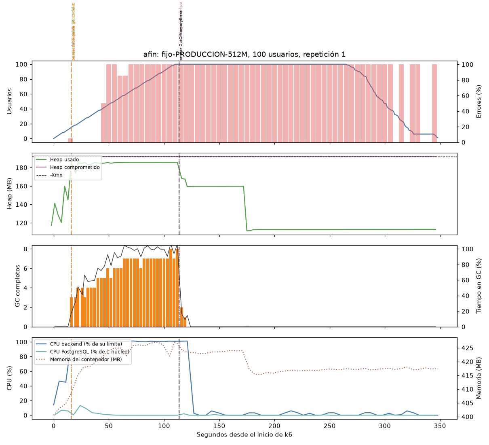

### afin: topologia-CAPACIDAD-2G, 100 usuarios, repetición 1

- Duración observada: 286 s; 6290 peticiones, 11 con fallo.
- **Primer fallo a los 16 s, con 15 usuarios activos.**

| t (s) | Operación | Estado | Duración (ms) | Error de k6 |
|---|---|---|---|---|
| 16.0 | cita | 400 | 203 |  |
| 23.0 | cita | 400 | 127 |  |
| 40.0 | cita | 400 | 61 |  |
| 69.0 | cita | 400 | 41 |  |
| 82.0 | cita | 400 | 29 |  |
| 103.0 | cita | 400 | 14 |  |
| 132.0 | cita | 400 | 24 |  |
| 193.0 | cita | 400 | 28 |  |
| 195.0 | cita | 400 | 11 |  |
| 210.0 | cita | 400 | 13 |  |
| 263.0 | cita | 400 | 16 |  |

- Operaciones con fallos en los 30 s siguientes al primero: cita (3).
- **Qué ocurre primero** (segundos desde el inicio de k6): 16 s: primer fallo de k6; 19 s: cpu del backend al tope.
- **En los 30 s previos al primer fallo:** heap usado al inicio 187 MB, heap usado máx. 192 MB de 1024, RssAnon máx. 565 MB, contenedor 573 MB de 2048, CPU del backend 49 %, CPU de PostgreSQL 7 %, tiempo en GC 1.6 % con 1 GC completos.

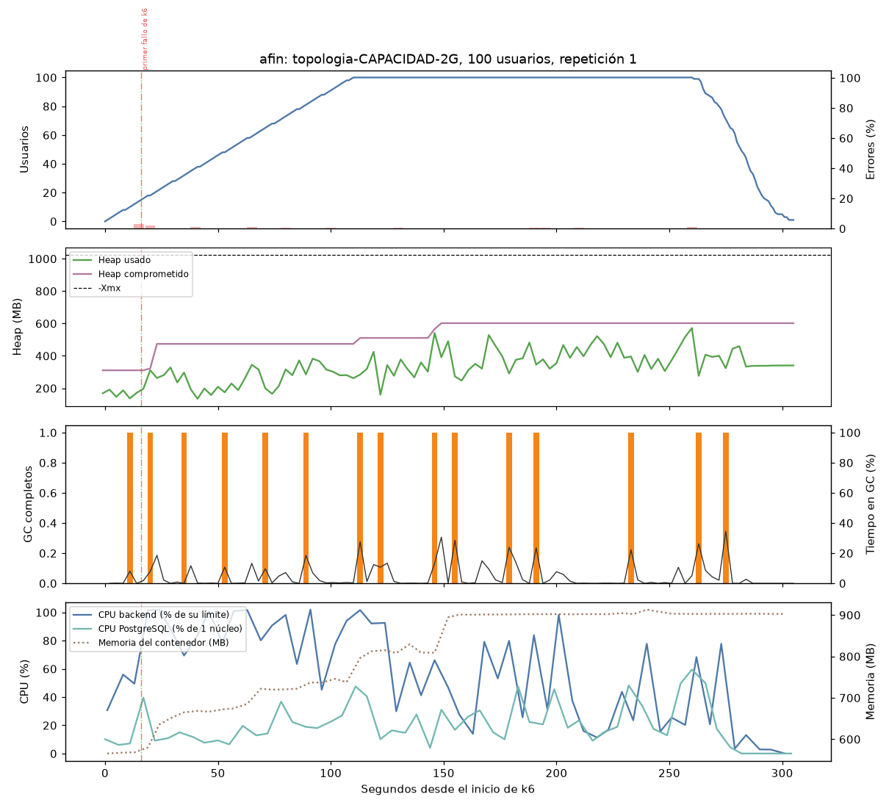

### afin: topologia-PRODUCCION-512M, 100 usuarios, repetición 1

- Duración observada: 346 s; 748 peticiones, 564 con fallo.
- **Primer fallo a los 17 s, con 16 usuarios activos.**

| t (s) | Operación | Estado | Duración (ms) | Error de k6 |
|---|---|---|---|---|
| 17.0 | cita | 400 | 110 |  |
| 46.0 | reporte_clinico | 0 | 30001 | request timeout |
| 52.0 | login | 0 | 30000 | request timeout |
| 53.0 | login | 0 | 30001 | request timeout |
| 54.0 | login | 0 | 30000 | request timeout |
| 55.0 | login | 0 | 30000 | request timeout |
| 56.0 | login | 0 | 30000 | request timeout |
| 57.0 | login | 0 | 30000 | request timeout |
| 58.0 | login | 0 | 30001 | request timeout |
| 59.0 | login | 0 | 30000 | request timeout |
| 60.0 | login | 0 | 30000 | request timeout |
| 62.0 | login | 0 | 30001 | request timeout |

- Operaciones con fallos en los 30 s siguientes al primero: cita (1), reporte_clinico (1).
- **Qué ocurre primero** (segundos desde el inicio de k6): 11 s: contenedor sobre 80pct de memoria; 17 s: primer fallo de k6; 17 s: heap usado sobre 90pct del tope; 17 s: primera rafaga de gc completo; 19 s: cpu del backend al tope; 214 s: primer OutOfMemoryError; 218 s: primer tiempo agotado del pool.
- **En los 30 s previos al primer fallo:** heap usado al inicio 146 MB, heap usado máx. 185 MB de 192, RssAnon máx. 412 MB, contenedor 419 MB de 512, CPU del backend 39 %, CPU de PostgreSQL 8 %, tiempo en GC 3.0 % con 3 GC completos.
- OutOfMemoryError en el registro: 34 líneas (ejemplo: `Exception in thread "http-nio-8080-Acceptor" java.lang.OutOfMemoryError: Java heap space`).
- Esperas de conexión agotadas en el registro: 4.

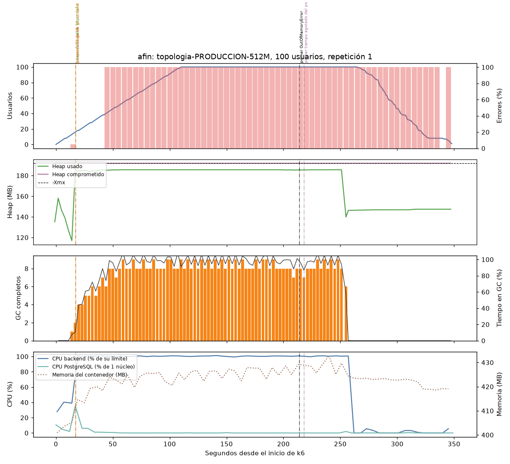

### afin: fijo-CAPACIDAD-2G, 100 usuarios, repetición 2

- Duración observada: 287 s; 6281 peticiones, 5 con fallo.
- **Primer fallo a los 17 s, con 16 usuarios activos.**

| t (s) | Operación | Estado | Duración (ms) | Error de k6 |
|---|---|---|---|---|
| 17.0 | cita | 400 | 167 |  |
| 40.0 | cita | 400 | 39 |  |
| 41.0 | cita | 400 | 77 |  |
| 170.0 | iniciar | 400 | 56 |  |
| 196.0 | cita | 400 | 17 |  |

- Operaciones con fallos en los 30 s siguientes al primero: cita (3).
- **Qué ocurre primero** (segundos desde el inicio de k6): 17 s: primer fallo de k6; 19 s: cpu del backend al tope.
- **En los 30 s previos al primer fallo:** heap usado al inicio 181 MB, heap usado máx. 192 MB de 1024, RssAnon máx. 520 MB, contenedor 527 MB de 2048, CPU del backend 48 %, CPU de PostgreSQL 8 %, tiempo en GC 1.8 % con 2 GC completos.

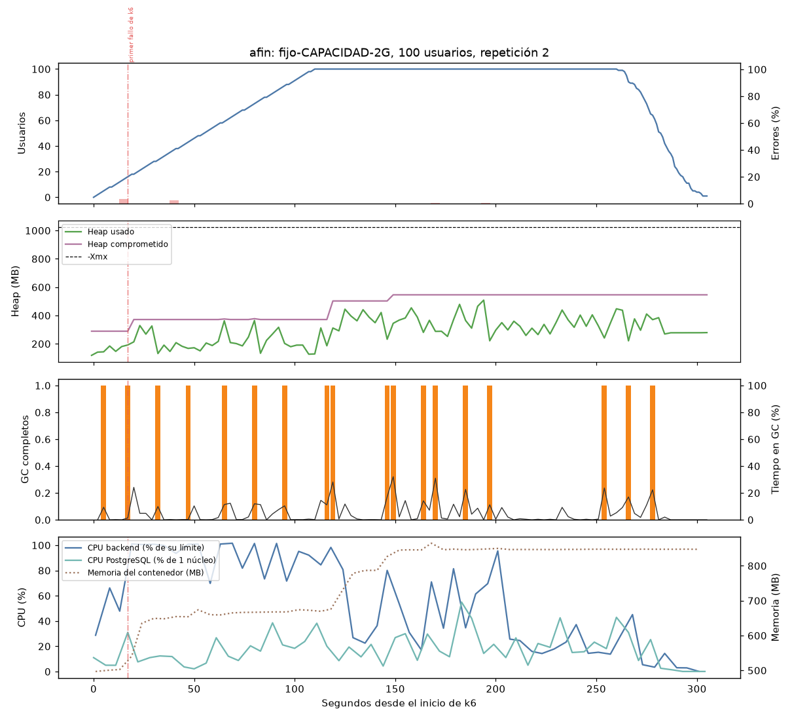

### afin: fijo-PRODUCCION-512M, 100 usuarios, repetición 2

- Duración observada: 348 s; 753 peticiones, 566 con fallo.
- **Primer fallo a los 17 s, con 16 usuarios activos.**

| t (s) | Operación | Estado | Duración (ms) | Error de k6 |
|---|---|---|---|---|
| 17.0 | cita | 400 | 149 |  |
| 25.0 | cita | 400 | 647 |  |
| 46.0 | reporte_clinico | 0 | 30000 | request timeout |
| 53.0 | login | 0 | 30001 | request timeout |
| 54.0 | login | 0 | 30000 | request timeout |
| 55.0 | login | 0 | 30001 | request timeout |
| 56.0 | login | 0 | 30001 | request timeout |
| 57.0 | login | 0 | 30001 | request timeout |
| 58.0 | login | 0 | 30000 | request timeout |
| 59.0 | login | 0 | 30001 | request timeout |
| 60.0 | login | 0 | 30000 | request timeout |
| 62.0 | login | 0 | 30000 | request timeout |

- Operaciones con fallos en los 30 s siguientes al primero: cita (2), reporte_clinico (1).
- **Qué ocurre primero** (segundos desde el inicio de k6): 17 s: primer fallo de k6; 17 s: heap usado sobre 90pct del tope; 17 s: primera rafaga de gc completo; 17 s: contenedor sobre 80pct de memoria; 17 s: cpu del backend al tope; 287 s: primer OutOfMemoryError; 287 s: primer tiempo agotado del pool.
- **En los 30 s previos al primer fallo:** heap usado al inicio 152 MB, heap usado máx. 183 MB de 192, RssAnon máx. 410 MB, contenedor 418 MB de 512, CPU del backend 49 %, CPU de PostgreSQL 5 %, tiempo en GC 2.3 % con 2 GC completos.
- OutOfMemoryError en el registro: 38 líneas (ejemplo: `Exception in thread "http-nio-8080-Acceptor" java.lang.OutOfMemoryError: Java heap space`).
- Esperas de conexión agotadas en el registro: 1.

### afin: topologia-CAPACIDAD-2G, 100 usuarios, repetición 2

- Duración observada: 285 s; 6260 peticiones, 6 con fallo.
- **Primer fallo a los 17 s, con 16 usuarios activos.**

| t (s) | Operación | Estado | Duración (ms) | Error de k6 |
|---|---|---|---|---|
| 17.0 | cita | 400 | 220 |  |
| 40.0 | cita | 400 | 73 |  |
| 41.0 | cita | 400 | 72 |  |
| 113.0 | iniciar | 400 | 34 |  |
| 170.0 | iniciar | 400 | 50 |  |
| 196.0 | cita | 400 | 21 |  |

- Operaciones con fallos en los 30 s siguientes al primero: cita (3).
- **Qué ocurre primero** (segundos desde el inicio de k6): 17 s: primer fallo de k6; 19 s: cpu del backend al tope.
- **En los 30 s previos al primer fallo:** heap usado al inicio 168 MB, heap usado máx. 179 MB de 1024, RssAnon máx. 538 MB, contenedor 546 MB de 2048, CPU del backend 53 %, CPU de PostgreSQL 8 %, tiempo en GC 3.5 % con 2 GC completos.

### afin: topologia-PRODUCCION-512M, 100 usuarios, repetición 2

- Duración observada: 342 s; 740 peticiones, 564 con fallo.
- **Primer fallo a los 17 s, con 16 usuarios activos.**

| t (s) | Operación | Estado | Duración (ms) | Error de k6 |
|---|---|---|---|---|
| 17.0 | cita | 400 | 140 |  |
| 26.0 | cita | 400 | 1243 |  |
| 46.0 | reporte_clinico | 0 | 30000 | request timeout |
| 51.0 | login | 0 | 30000 | request timeout |
| 53.0 | login | 0 | 30000 | request timeout |
| 54.0 | login | 0 | 30001 | request timeout |
| 55.0 | login | 0 | 30001 | request timeout |
| 56.0 | login | 0 | 30000 | request timeout |
| 57.0 | login | 0 | 30000 | request timeout |
| 58.0 | login | 0 | 30000 | request timeout |
| 59.0 | login | 0 | 30000 | request timeout |
| 60.0 | login | 0 | 30000 | request timeout |

- Operaciones con fallos en los 30 s siguientes al primero: cita (2), reporte_clinico (1).
- **Qué ocurre primero** (segundos desde el inicio de k6): 14 s: contenedor sobre 80pct de memoria; 17 s: primer fallo de k6; 17 s: heap usado sobre 90pct del tope; 17 s: cpu del backend al tope; 20 s: primera rafaga de gc completo; 353 s: primer OutOfMemoryError.
- **En los 30 s previos al primer fallo:** heap usado al inicio 140 MB, heap usado máx. 185 MB de 192, RssAnon máx. 409 MB, contenedor 417 MB de 512, CPU del backend 49 %, CPU de PostgreSQL 5 %, tiempo en GC 3.4 % con 2 GC completos.
- OutOfMemoryError en el registro: 7 líneas (ejemplo: `Exception in thread "http-nio-8080-Acceptor" java.lang.OutOfMemoryError: Java heap space`).

### afin: fijo-CAPACIDAD-2G, 100 usuarios, repetición 3

- Duración observada: 287 s; 6289 peticiones, 12 con fallo.
- **Primer fallo a los 16 s, con 15 usuarios activos.**

| t (s) | Operación | Estado | Duración (ms) | Error de k6 |
|---|---|---|---|---|
| 16.0 | cita | 400 | 165 |  |
| 23.0 | cita | 400 | 156 |  |
| 39.0 | cita | 400 | 69 |  |
| 69.0 | cita | 400 | 61 |  |
| 82.0 | cita | 400 | 28 |  |
| 102.0 | cita | 400 | 29 |  |
| 132.0 | cita | 400 | 10 |  |
| 151.0 | iniciar | 400 | 15 |  |
| 192.0 | cita | 400 | 15 |  |
| 194.0 | cita | 400 | 10 |  |
| 208.0 | cita | 400 | 9 |  |
| 263.0 | cita | 400 | 10 |  |

- Operaciones con fallos en los 30 s siguientes al primero: cita (3).
- **Qué ocurre primero** (segundos desde el inicio de k6): 16 s: primer fallo de k6; 19 s: cpu del backend al tope.
- **En los 30 s previos al primer fallo:** heap usado al inicio 189 MB, heap usado máx. 191 MB de 1024, RssAnon máx. 570 MB, contenedor 578 MB de 2048, CPU del backend 51 %, CPU de PostgreSQL 5 %, tiempo en GC 0.1 % con 0 GC completos.

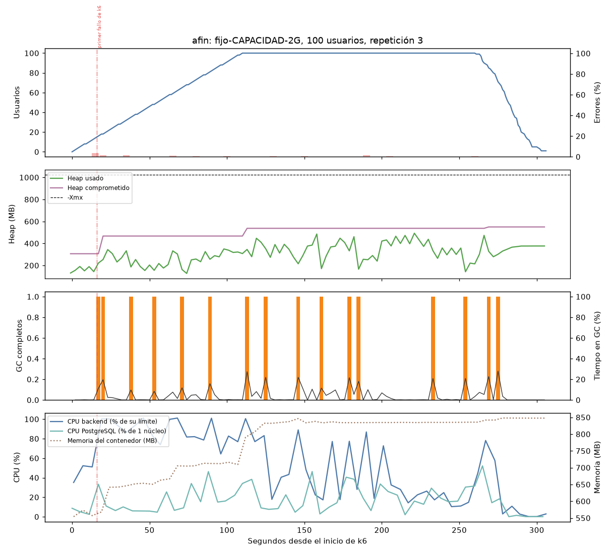

### afin: fijo-PRODUCCION-512M, 100 usuarios, repetición 3

- Duración observada: 345 s; 717 peticiones, 562 con fallo.
- **Primer fallo a los 17 s, con 16 usuarios activos.**

| t (s) | Operación | Estado | Duración (ms) | Error de k6 |
|---|---|---|---|---|
| 17.0 | cita | 400 | 150 |  |
| 45.0 | reporte_clinico | 0 | 30001 | request timeout |
| 50.0 | login | 0 | 30001 | request timeout |
| 51.0 | login | 0 | 30001 | request timeout |
| 52.0 | login | 0 | 30001 | request timeout |
| 54.0 | login | 0 | 30001 | request timeout |
| 55.0 | login | 0 | 30001 | request timeout |
| 56.0 | login | 0 | 30000 | request timeout |
| 57.0 | login | 0 | 30001 | request timeout |
| 58.0 | historia | 0 | 30000 | request timeout |
| 58.0 | login | 0 | 30000 | request timeout |
| 58.0 | apoderado | 0 | 30001 | request timeout |

- Operaciones con fallos en los 30 s siguientes al primero: cita (1), reporte_clinico (1).
- **Qué ocurre primero** (segundos desde el inicio de k6): 17 s: primer fallo de k6; 17 s: heap usado sobre 90pct del tope; 17 s: primera rafaga de gc completo; 17 s: contenedor sobre 80pct de memoria; 19 s: cpu del backend al tope; 231 s: primer OutOfMemoryError; 232 s: primer tiempo agotado del pool.
- **En los 30 s previos al primer fallo:** heap usado al inicio 139 MB, heap usado máx. 183 MB de 192, RssAnon máx. 408 MB, contenedor 416 MB de 512, CPU del backend 40 %, CPU de PostgreSQL 5 %, tiempo en GC 2.9 % con 3 GC completos.
- OutOfMemoryError en el registro: 39 líneas (ejemplo: `Exception in thread "http-nio-8080-Acceptor" java.lang.OutOfMemoryError: Java heap space`).
- Esperas de conexión agotadas en el registro: 2.

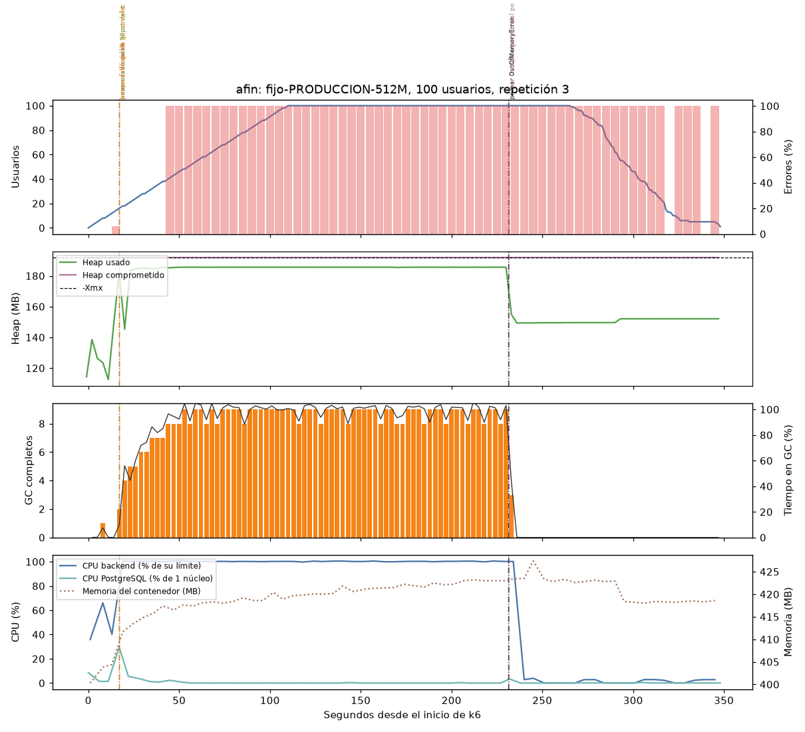

### afin: topologia-CAPACIDAD-2G, 100 usuarios, repetición 3

- Duración observada: 286 s; 6283 peticiones, 9 con fallo.
- **Primer fallo a los 17 s, con 16 usuarios activos.**

| t (s) | Operación | Estado | Duración (ms) | Error de k6 |
|---|---|---|---|---|
| 17.0 | cita | 400 | 185 |  |
| 23.0 | cita | 400 | 136 |  |
| 40.0 | cita | 400 | 68 |  |
| 82.0 | cita | 400 | 20 |  |
| 151.0 | iniciar | 400 | 11 |  |
| 169.0 | iniciar | 400 | 29 |  |
| 193.0 | cita | 400 | 19 |  |
| 195.0 | cita | 400 | 11 |  |
| 264.0 | cita | 400 | 15 |  |

- Operaciones con fallos en los 30 s siguientes al primero: cita (3).
- **Qué ocurre primero** (segundos desde el inicio de k6): 17 s: primer fallo de k6; 19 s: cpu del backend al tope.
- **En los 30 s previos al primer fallo:** heap usado al inicio 163 MB, heap usado máx. 188 MB de 1024, RssAnon máx. 520 MB, contenedor 528 MB de 2048, CPU del backend 48 %, CPU de PostgreSQL 7 %, tiempo en GC 2.5 % con 1 GC completos.

### afin: topologia-PRODUCCION-512M, 100 usuarios, repetición 3

- Duración observada: 344 s; 720 peticiones, 564 con fallo.
- **Primer fallo a los 16 s, con 15 usuarios activos.**

| t (s) | Operación | Estado | Duración (ms) | Error de k6 |
|---|---|---|---|---|
| 16.0 | cita | 400 | 147 |  |
| 45.0 | reporte_clinico | 0 | 30001 | request timeout |
| 50.0 | login | 0 | 30000 | request timeout |
| 51.0 | login | 0 | 30000 | request timeout |
| 52.0 | login | 0 | 30001 | request timeout |
| 53.0 | login | 0 | 30000 | request timeout |
| 54.0 | login | 0 | 30000 | request timeout |
| 55.0 | login | 0 | 30000 | request timeout |
| 56.0 | historia | 0 | 30000 | request timeout |
| 56.0 | login | 0 | 30000 | request timeout |
| 57.0 | login | 0 | 30001 | request timeout |
| 58.0 | apoderado | 0 | 30001 | request timeout |

- Operaciones con fallos en los 30 s siguientes al primero: cita (1), reporte_clinico (1).
- **Qué ocurre primero** (segundos desde el inicio de k6): 16 s: primer fallo de k6; 16 s: cpu del backend al tope; 17 s: primera rafaga de gc completo; 17 s: contenedor sobre 80pct de memoria; 20 s: heap usado sobre 90pct del tope; 271 s: primer OutOfMemoryError; 348 s: primer tiempo agotado del pool.
- **En los 30 s previos al primer fallo:** heap usado al inicio 146 MB, heap usado máx. 152 MB de 192, RssAnon máx. 402 MB, contenedor 409 MB de 512, CPU del backend 48 %, CPU de PostgreSQL 5 %, tiempo en GC 1.8 % con 1 GC completos.
- OutOfMemoryError en el registro: 53 líneas (ejemplo: `Exception in thread "http-nio-8080-Poller" Exception in thread "http-nio-8080-Acceptor" java.lang.OutOfMemoryError: Java heap space`).
- Esperas de conexión agotadas en el registro: 4.

### heap: EXP-HEAP-192M, 100 usuarios, repetición 1

- Duración observada: 345 s; 696 peticiones, 564 con fallo.
- **Primer fallo a los 45 s, con 41 usuarios activos.**

| t (s) | Operación | Estado | Duración (ms) | Error de k6 |
|---|---|---|---|---|
| 45.0 | reporte_clinico | 0 | 30001 | request timeout |
| 49.0 | login | 0 | 30000 | request timeout |
| 50.0 | login | 0 | 30000 | request timeout |
| 51.0 | login | 0 | 30001 | request timeout |
| 52.0 | citas_del_mes | 0 | 30001 | request timeout |
| 52.0 | lista_de_historias | 0 | 30001 | request timeout |
| 52.0 | login | 0 | 30001 | request timeout |
| 52.0 | apoderado | 0 | 30001 | request timeout |
| 53.0 | checkin | 0 | 30001 | request timeout |
| 53.0 | apoderado | 0 | 30001 | request timeout |
| 54.0 | login | 0 | 30001 | request timeout |
| 54.0 | mascota | 0 | 30001 | request timeout |

- Operaciones con fallos en los 30 s siguientes al primero: login (24), apoderado (6), checkin (2), avisos_de_cumplimiento (2), reporte_clinico (1), citas_del_mes (1), lista_de_historias (1), mascota (1).
- **Qué ocurre primero** (segundos desde el inicio de k6): 17 s: heap usado sobre 90pct del tope; 17 s: primera rafaga de gc completo; 17 s: contenedor sobre 80pct de memoria; 17 s: cpu del backend al tope; 45 s: primer fallo de k6; 87 s: primer tiempo agotado del pool; 87 s: primer OutOfMemoryError.
- **En los 30 s previos al primer fallo:** heap usado al inicio 138 MB, heap usado máx. 186 MB de 192, RssAnon máx. 418 MB, contenedor 427 MB de 512, CPU del backend 101 %, CPU de PostgreSQL 1 %, tiempo en GC 77.9 % con 71 GC completos.
- OutOfMemoryError en el registro: 14 líneas (ejemplo: `Exception in thread "http-nio-8080-Acceptor" java.lang.OutOfMemoryError: Java heap space`).
- Esperas de conexión agotadas en el registro: 4.

### heap: EXP-HEAP-192M, 50 usuarios, repetición 1

- Duración observada: 284 s; 390 peticiones, 262 con fallo.
- **Primer fallo a los 16 s, con 15 usuarios activos.**

| t (s) | Operación | Estado | Duración (ms) | Error de k6 |
|---|---|---|---|---|
| 16.0 | cita | 400 | 428 |  |
| 45.0 | reporte_clinico | 0 | 30001 | request timeout |
| 49.0 | login | 0 | 30000 | request timeout |
| 50.0 | login | 0 | 30001 | request timeout |
| 51.0 | login | 0 | 30000 | request timeout |
| 51.0 | cita | 0 | 30001 | request timeout |
| 52.0 | citas_del_mes | 0 | 30001 | request timeout |
| 52.0 | lista_de_historias | 0 | 30001 | request timeout |
| 52.0 | apoderado | 0 | 30001 | request timeout |
| 52.0 | login | 0 | 30001 | request timeout |
| 53.0 | checkin | 0 | 30001 | request timeout |
| 53.0 | login | 0 | 30001 | request timeout |

- Operaciones con fallos en los 30 s siguientes al primero: cita (1), reporte_clinico (1).
- **Qué ocurre primero** (segundos desde el inicio de k6): 14 s: contenedor sobre 80pct de memoria; 16 s: primer fallo de k6; 17 s: primera rafaga de gc completo; 17 s: cpu del backend al tope; 20 s: heap usado sobre 90pct del tope; 125 s: primer tiempo agotado del pool; 182 s: primer OutOfMemoryError.
- **En los 30 s previos al primer fallo:** heap usado al inicio 149 MB, heap usado máx. 157 MB de 192, RssAnon máx. 402 MB, contenedor 410 MB de 512, CPU del backend 35 %, CPU de PostgreSQL 3 %, tiempo en GC 1.5 % con 1 GC completos.
- OutOfMemoryError en el registro: 25 líneas (ejemplo: `Exception in thread "http-nio-8080-Acceptor" java.lang.OutOfMemoryError: Java heap space`).
- Esperas de conexión agotadas en el registro: 7.

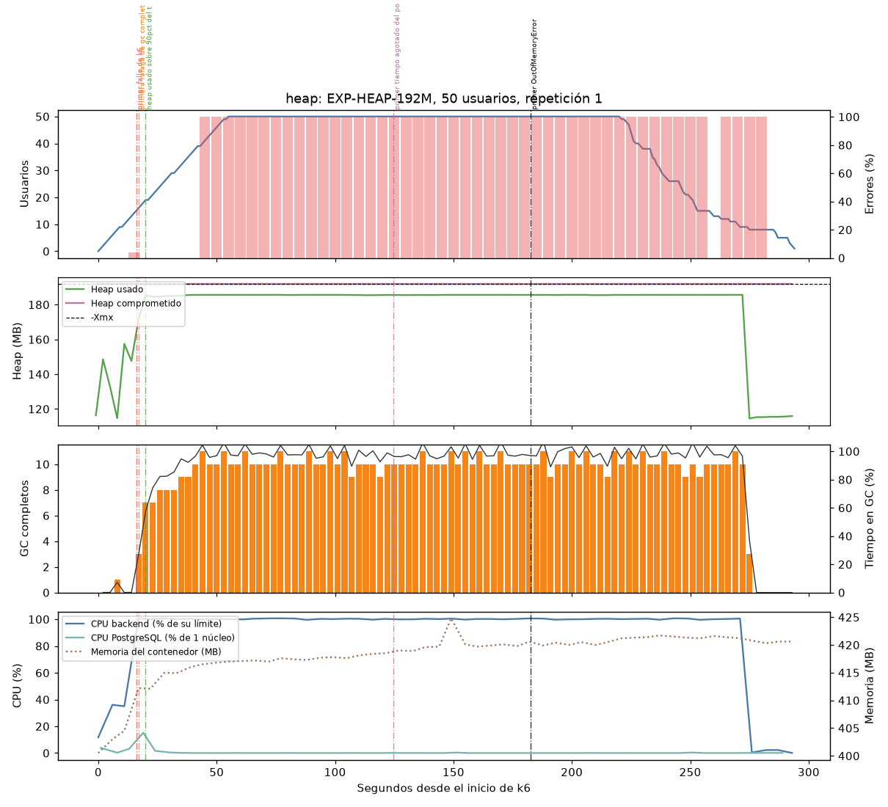

### heap: EXP-HEAP-192M-citas6000, 100 usuarios, repetición 1

- Duración observada: 289 s; 3934 peticiones, 358 con fallo.
- **Primer fallo a los 56 s, con 51 usuarios activos.**

| t (s) | Operación | Estado | Duración (ms) | Error de k6 |
|---|---|---|---|---|
| 56.0 | login | 401 | 291 |  |
| 57.0 | login | 401 | 294 |  |
| 58.0 | login | 401 | 229 |  |
| 59.0 | login | 401 | 354 |  |
| 60.0 | login | 401 | 251 |  |
| 62.0 | login | 401 | 1110 |  |
| 63.0 | login | 401 | 696 |  |
| 64.0 | login | 401 | 233 |  |
| 65.0 | login | 401 | 278 |  |
| 66.0 | login | 401 | 240 |  |
| 67.0 | login | 401 | 242 |  |
| 68.0 | login | 401 | 270 |  |

- Operaciones con fallos en los 30 s siguientes al primero: login (31).
- **Qué ocurre primero** (segundos desde el inicio de k6): 17 s: primera rafaga de gc completo; 17 s: contenedor sobre 80pct de memoria; 17 s: cpu del backend al tope; 56 s: primer fallo de k6; 62 s: heap usado sobre 90pct del tope.
- **En los 30 s previos al primer fallo:** heap usado al inicio 151 MB, heap usado máx. 158 MB de 192, RssAnon máx. 415 MB, contenedor 423 MB de 512, CPU del backend 35 %, CPU de PostgreSQL 5 %, tiempo en GC 0.8 % con 1 GC completos.

### heap: EXP-HEAP-192M-citas6000, 50 usuarios, repetición 1

- Duración observada: 231 s; 2791 peticiones, 1 con fallo.
- **Primer fallo a los 194 s, con 50 usuarios activos.**

| t (s) | Operación | Estado | Duración (ms) | Error de k6 |
|---|---|---|---|---|
| 194.0 | cita | 400 | 17 |  |

- Operaciones con fallos en los 30 s siguientes al primero: cita (1).
- **Qué ocurre primero** (segundos desde el inicio de k6): 11 s: contenedor sobre 80pct de memoria; 17 s: primera rafaga de gc completo; 62 s: heap usado sobre 90pct del tope; 194 s: primer fallo de k6.
- **En los 30 s previos al primer fallo:** heap usado al inicio 139 MB, heap usado máx. 164 MB de 192, RssAnon máx. 416 MB, contenedor 424 MB de 512, CPU del backend 20 %, CPU de PostgreSQL 3 %, tiempo en GC 3.1 % con 5 GC completos.

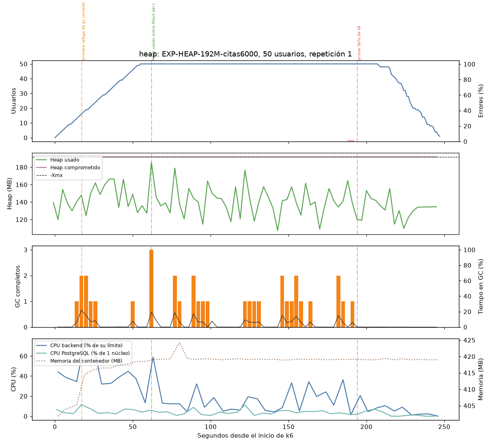

### heap: EXP-HEAP-192M-sin-informes, 100 usuarios, repetición 1

- Duración observada: 287 s; 3988 peticiones, 356 con fallo.
- **Primer fallo a los 56 s, con 51 usuarios activos.**

| t (s) | Operación | Estado | Duración (ms) | Error de k6 |
|---|---|---|---|---|
| 56.0 | login | 401 | 268 |  |
| 57.0 | login | 401 | 260 |  |
| 58.0 | login | 401 | 298 |  |
| 59.0 | login | 401 | 274 |  |
| 60.0 | login | 401 | 270 |  |
| 61.0 | login | 401 | 250 |  |
| 62.0 | login | 401 | 257 |  |
| 63.0 | login | 401 | 239 |  |
| 65.0 | login | 401 | 267 |  |
| 66.0 | login | 401 | 299 |  |
| 67.0 | login | 401 | 236 |  |
| 68.0 | login | 401 | 257 |  |

- Operaciones con fallos en los 30 s siguientes al primero: login (31).
- **Qué ocurre primero** (segundos desde el inicio de k6): 11 s: contenedor sobre 80pct de memoria; 56 s: primer fallo de k6.
- **En los 30 s previos al primer fallo:** heap usado al inicio 145 MB, heap usado máx. 158 MB de 192, RssAnon máx. 419 MB, contenedor 427 MB de 512, CPU del backend 37 %, CPU de PostgreSQL 4 %, tiempo en GC 1.5 % con 2 GC completos.

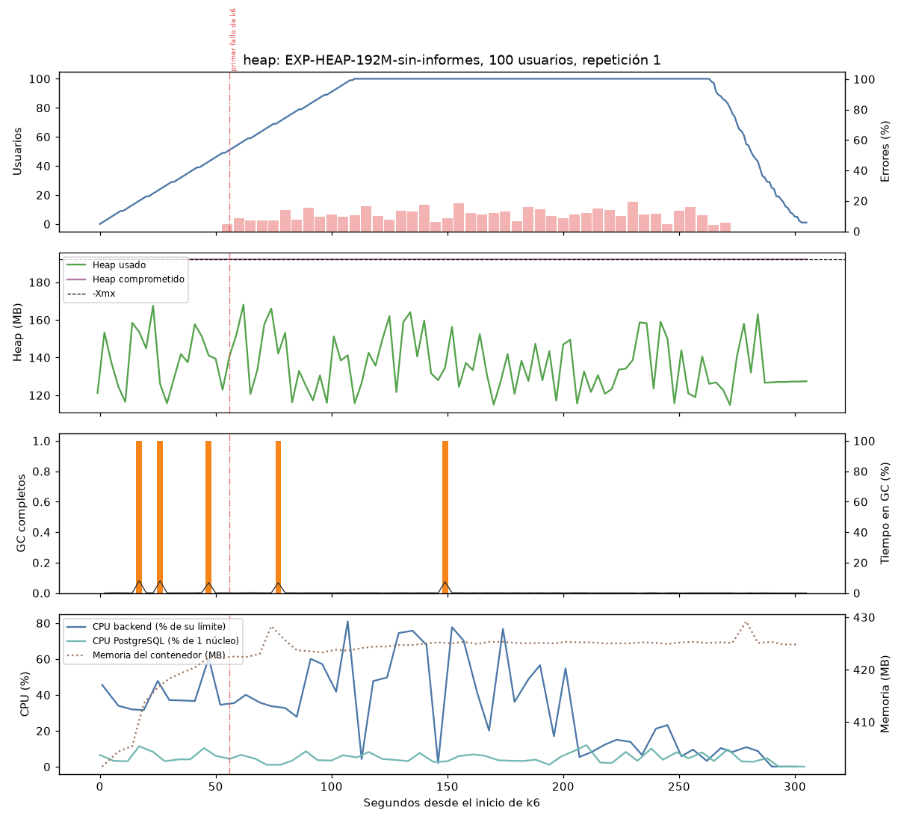

### heap: EXP-HEAP-192M-sin-informes, 50 usuarios, repetición 1

- Duración observada: 231 s; 2825 peticiones, 3 con fallo.
- **Primer fallo a los 39 s, con 36 usuarios activos.**

| t (s) | Operación | Estado | Duración (ms) | Error de k6 |
|---|---|---|---|---|
| 39.0 | cita | 400 | 23 |  |
| 39.0 | cita | 400 | 14 |  |
| 192.0 | cita | 400 | 14 |  |

- Operaciones con fallos en los 30 s siguientes al primero: cita (2).
- **Qué ocurre primero** (segundos desde el inicio de k6): 14 s: contenedor sobre 80pct de memoria; 39 s: primer fallo de k6.
- **En los 30 s previos al primer fallo:** heap usado al inicio 157 MB, heap usado máx. 164 MB de 192, RssAnon máx. 417 MB, contenedor 425 MB de 512, CPU del backend 41 %, CPU de PostgreSQL 4 %, tiempo en GC 1.6 % con 2 GC completos.

### heap: EXP-HEAP-256M, 100 usuarios, repetición 1

- Duración observada: 286 s; 3947 peticiones, 359 con fallo.
- **Primer fallo a los 56 s, con 51 usuarios activos.**

| t (s) | Operación | Estado | Duración (ms) | Error de k6 |
|---|---|---|---|---|
| 56.0 | login | 401 | 289 |  |
| 57.0 | login | 401 | 278 |  |
| 58.0 | login | 401 | 236 |  |
| 59.0 | login | 401 | 244 |  |
| 60.0 | login | 401 | 295 |  |
| 62.0 | login | 401 | 873 |  |
| 63.0 | login | 401 | 1400 |  |
| 64.0 | login | 401 | 1028 |  |
| 65.0 | login | 401 | 884 |  |
| 66.0 | login | 401 | 486 |  |
| 66.0 | login | 401 | 238 |  |
| 68.0 | login | 401 | 298 |  |

- Operaciones con fallos en los 30 s siguientes al primero: login (32).
- **Qué ocurre primero** (segundos desde el inicio de k6): -1 s: contenedor sobre 80pct de memoria; 17 s: cpu del backend al tope; 20 s: heap usado sobre 90pct del tope; 20 s: primera rafaga de gc completo; 56 s: primer fallo de k6.
- **En los 30 s previos al primer fallo:** heap usado al inicio 168 MB, heap usado máx. 191 MB de 256, RssAnon máx. 480 MB, contenedor 488 MB de 512, CPU del backend 43 %, CPU de PostgreSQL 8 %, tiempo en GC 0.8 % con 1 GC completos.

### heap: EXP-HEAP-256M, 50 usuarios, repetición 1

- Duración observada: 231 s; 2787 peticiones, 5 con fallo.
- **Primer fallo a los 15 s, con 14 usuarios activos.**

| t (s) | Operación | Estado | Duración (ms) | Error de k6 |
|---|---|---|---|---|
| 15.0 | cita | 400 | 183 |  |
| 22.0 | cita | 400 | 42 |  |
| 38.0 | cita | 400 | 13 |  |
| 38.0 | cita | 400 | 40 |  |
| 191.0 | cita | 400 | 11 |  |

- Operaciones con fallos en los 30 s siguientes al primero: cita (4).
- **Qué ocurre primero** (segundos desde el inicio de k6): -2 s: contenedor sobre 80pct de memoria; 15 s: primer fallo de k6; 16 s: primera rafaga de gc completo; 18 s: cpu del backend al tope; 19 s: heap usado sobre 90pct del tope.
- **En los 30 s previos al primer fallo:** heap usado al inicio 151 MB, heap usado máx. 168 MB de 256, RssAnon máx. 445 MB, contenedor 453 MB de 512, CPU del backend 37 %, CPU de PostgreSQL 4 %, tiempo en GC 0.0 % con 0 GC completos.

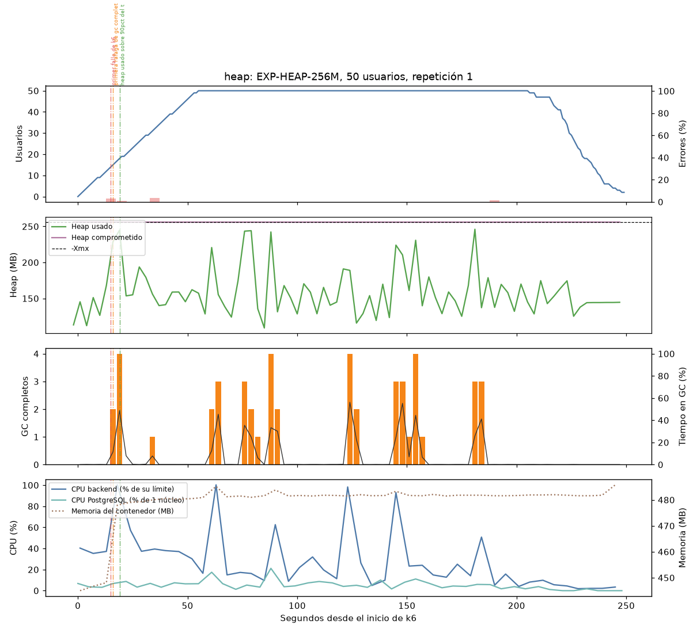

### heap: EXP-HEAP-288M, 100 usuarios, repetición 1

- Duración observada: 39 s; 198 peticiones, 78 con fallo.
- **Primer fallo a los 19 s, con 18 usuarios activos.**

| t (s) | Operación | Estado | Duración (ms) | Error de k6 |
|---|---|---|---|---|
| 19.0 | navegacion | 0 | 181 | unexpected EOF |
| 19.0 | privacidad | 0 | 1 | EOF |
| 19.0 | cumplimiento | 0 | 0 | EOF |
| 19.0 | reporte_de_ventas | 0 | 1 | read: connection reset by peer |
| 19.0 | notificaciones | 0 | 0 | EOF |
| 19.0 | pacientes_inactivos | 0 | 1 | read: connection reset by peer |
| 19.0 | avisos_de_cumplimiento | 0 | 0 | EOF |
| 19.0 | panel | 0 | 0 | read: connection reset by peer |
| 19.0 | login | 0 | 0 | dial: connection refused |
| 20.0 | apoderado | 0 | 0 | dial: connection refused |
| 20.0 | login | 0 | 0 | dial: connection refused |
| 21.0 | login | 0 | 0 | dial: connection refused |

- Operaciones con fallos en los 30 s siguientes al primero: login (19), apoderado (12), navegacion (6), privacidad (6), cumplimiento (6), notificaciones (6), avisos_de_cumplimiento (6), panel (6).
- **Qué ocurre primero** (segundos desde el inicio de k6): -1 s: contenedor sobre 80pct de memoria; 17 s: primera rafaga de gc completo; 19 s: primer fallo de k6; 19 s: cpu del backend al tope.
- **En los 30 s previos al primer fallo:** heap usado al inicio 147 MB, heap usado máx. 253 MB de 288, RssAnon máx. 489 MB, contenedor 497 MB de 512, CPU del backend 38 %, CPU de PostgreSQL 5 %, tiempo en GC 2.0 % con 2 GC completos.

### heap: EXP-HEAP-288M, 50 usuarios, repetición 1

- Duración observada: 40 s; 220 peticiones, 85 con fallo.
- **Primer fallo a los 15 s, con 14 usuarios activos.**

| t (s) | Operación | Estado | Duración (ms) | Error de k6 |
|---|---|---|---|---|
| 15.0 | cita | 400 | 116 |  |
| 19.0 | mascota | 0 | 93 | EOF |
| 20.0 | login | 0 | 0 | dial: connection refused |
| 21.0 | login | 0 | 0 | dial: connection refused |
| 21.0 | apoderado | 0 | 0 | dial: connection refused |
| 21.0 | navegacion | 0 | 0 | dial: connection refused |
| 21.0 | privacidad | 0 | 0 | dial: connection refused |
| 21.0 | cumplimiento | 0 | 0 | dial: connection refused |
| 21.0 | notificaciones | 0 | 0 | dial: connection refused |
| 21.0 | avisos_de_cumplimiento | 0 | 0 | dial: connection refused |
| 21.0 | panel | 0 | 0 | dial: connection refused |
| 21.0 | citas_del_mes | 0 | 0 | dial: connection refused |

- Operaciones con fallos en los 30 s siguientes al primero: login (20), apoderado (14), navegacion (7), privacidad (7), cumplimiento (7), notificaciones (7), avisos_de_cumplimiento (7), panel (7).
- **Qué ocurre primero** (segundos desde el inicio de k6): -2 s: contenedor sobre 80pct de memoria; 15 s: primer fallo de k6; 16 s: primera rafaga de gc completo; 18 s: cpu del backend al tope; 19 s: heap usado sobre 90pct del tope.
- **En los 30 s previos al primer fallo:** heap usado al inicio 170 MB, heap usado máx. 176 MB de 288, RssAnon máx. 464 MB, contenedor 472 MB de 512, CPU del backend 37 %, CPU de PostgreSQL 4 %, tiempo en GC 0.0 % con 0 GC completos.

### heap: EXP-HEAP-192M, 100 usuarios, repetición 2

- Duración observada: 345 s; 695 peticiones, 560 con fallo.
- **Primer fallo a los 45 s, con 41 usuarios activos.**

| t (s) | Operación | Estado | Duración (ms) | Error de k6 |
|---|---|---|---|---|
| 45.0 | reporte_clinico | 0 | 30001 | request timeout |
| 49.0 | login | 0 | 30000 | request timeout |
| 50.0 | login | 0 | 30001 | request timeout |
| 51.0 | login | 0 | 30000 | request timeout |
| 52.0 | lista_de_historias | 0 | 30001 | request timeout |
| 52.0 | login | 0 | 30001 | request timeout |
| 53.0 | login | 0 | 30000 | request timeout |
| 54.0 | cita | 0 | 30001 | request timeout |
| 54.0 | apoderado | 0 | 30001 | request timeout |
| 54.0 | apoderado | 0 | 30001 | request timeout |
| 54.0 | login | 0 | 30001 | request timeout |
| 55.0 | login | 0 | 30000 | request timeout |

- Operaciones con fallos en los 30 s siguientes al primero: login (25), apoderado (5), reporte_clinico (1), lista_de_historias (1), cita (1), privacidad (1), panel (1), mascota (1).
- **Qué ocurre primero** (segundos desde el inicio de k6): 14 s: contenedor sobre 80pct de memoria; 17 s: primera rafaga de gc completo; 19 s: cpu del backend al tope; 20 s: heap usado sobre 90pct del tope; 45 s: primer fallo de k6; 148 s: primer OutOfMemoryError; 148 s: primer tiempo agotado del pool.
- **En los 30 s previos al primer fallo:** heap usado al inicio 139 MB, heap usado máx. 186 MB de 192, RssAnon máx. 418 MB, contenedor 427 MB de 512, CPU del backend 100 %, CPU de PostgreSQL 1 %, tiempo en GC 78.1 % con 82 GC completos.
- OutOfMemoryError en el registro: 38 líneas (ejemplo: `Exception: java.lang.OutOfMemoryError thrown from the UncaughtExceptionHandler in thread "http-nio-8080-Acceptor"`).
- Esperas de conexión agotadas en el registro: 1.

### heap: EXP-HEAP-192M, 50 usuarios, repetición 2

- Duración observada: 285 s; 399 peticiones, 256 con fallo.
- **Primer fallo a los 45 s, con 41 usuarios activos.**

| t (s) | Operación | Estado | Duración (ms) | Error de k6 |
|---|---|---|---|---|
| 45.0 | reporte_clinico | 0 | 30001 | request timeout |
| 49.0 | login | 0 | 30001 | request timeout |
| 50.0 | login | 0 | 30000 | request timeout |
| 51.0 | login | 0 | 30001 | request timeout |
| 52.0 | login | 0 | 30001 | request timeout |
| 53.0 | login | 0 | 30000 | request timeout |
| 54.0 | apoderado | 0 | 30001 | request timeout |
| 54.0 | login | 0 | 30000 | request timeout |
| 55.0 | panel | 0 | 30000 | request timeout |
| 55.0 | iniciar | 0 | 30001 | request timeout |
| 55.0 | panel | 0 | 30001 | request timeout |
| 55.0 | login | 0 | 30001 | request timeout |

- Operaciones con fallos en los 30 s siguientes al primero: login (25), apoderado (5), panel (2), cancelar_cita (2), reporte_clinico (1), iniciar (1), historia (1), cita (1).
- **Qué ocurre primero** (segundos desde el inicio de k6): 14 s: contenedor sobre 80pct de memoria; 17 s: heap usado sobre 90pct del tope; 17 s: primera rafaga de gc completo; 19 s: cpu del backend al tope; 45 s: primer fallo de k6; 103 s: primer OutOfMemoryError; 103 s: primer tiempo agotado del pool.
- **En los 30 s previos al primer fallo:** heap usado al inicio 157 MB, heap usado máx. 186 MB de 192, RssAnon máx. 418 MB, contenedor 427 MB de 512, CPU del backend 100 %, CPU de PostgreSQL 2 %, tiempo en GC 76.2 % con 73 GC completos.
- OutOfMemoryError en el registro: 13 líneas (ejemplo: `Exception: java.lang.OutOfMemoryError thrown from the UncaughtExceptionHandler in thread "http-nio-8080-Acceptor"`).
- Esperas de conexión agotadas en el registro: 3.

### heap: EXP-HEAP-192M-citas6000, 100 usuarios, repetición 2

- Duración observada: 286 s; 3923 peticiones, 357 con fallo.
- **Primer fallo a los 55 s, con 50 usuarios activos.**

| t (s) | Operación | Estado | Duración (ms) | Error de k6 |
|---|---|---|---|---|
| 55.0 | login | 401 | 345 |  |
| 56.0 | login | 401 | 340 |  |
| 57.0 | login | 401 | 296 |  |
| 58.0 | login | 401 | 298 |  |
| 59.0 | login | 401 | 333 |  |
| 61.0 | login | 401 | 1200 |  |
| 62.0 | login | 401 | 460 |  |
| 63.0 | login | 401 | 304 |  |
| 64.0 | login | 401 | 341 |  |
| 65.0 | login | 401 | 296 |  |
| 66.0 | login | 401 | 336 |  |
| 67.0 | login | 401 | 326 |  |

- Operaciones con fallos en los 30 s siguientes al primero: login (31).
- **Qué ocurre primero** (segundos desde el inicio de k6): 16 s: heap usado sobre 90pct del tope; 16 s: primera rafaga de gc completo; 16 s: contenedor sobre 80pct de memoria; 16 s: cpu del backend al tope; 55 s: primer fallo de k6.
- **En los 30 s previos al primer fallo:** heap usado al inicio 145 MB, heap usado máx. 165 MB de 192, RssAnon máx. 414 MB, contenedor 422 MB de 512, CPU del backend 42 %, CPU de PostgreSQL 4 %, tiempo en GC 0.8 % con 1 GC completos.

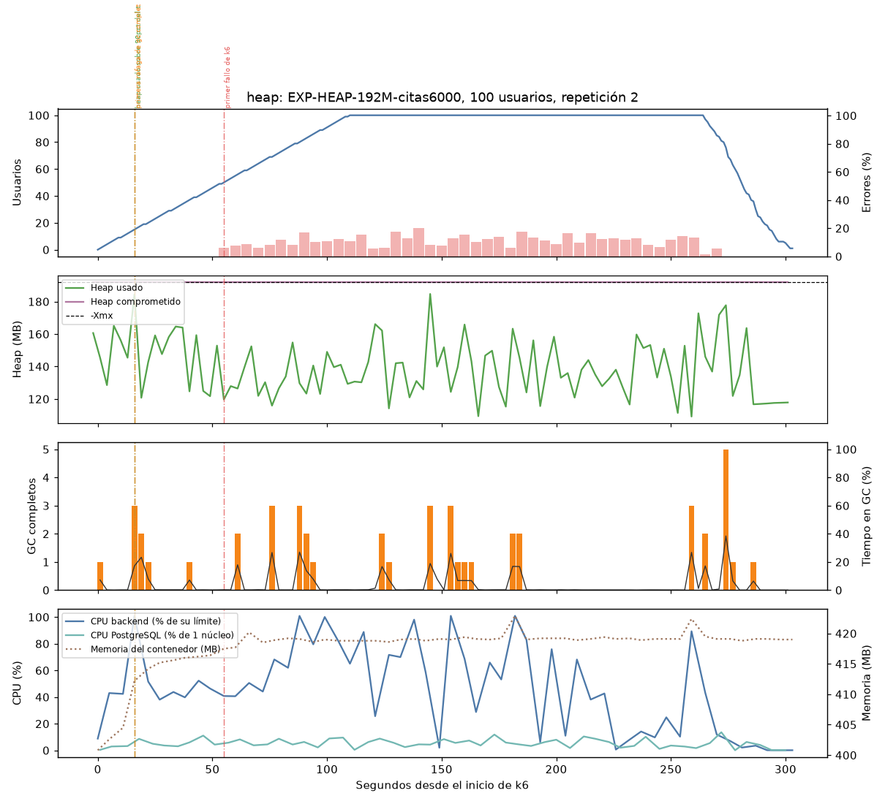

### heap: EXP-HEAP-192M-citas6000, 50 usuarios, repetición 2

- Duración observada: 230 s; 2786 peticiones, 4 con fallo.
- **Primer fallo a los 15 s, con 14 usuarios activos.**

| t (s) | Operación | Estado | Duración (ms) | Error de k6 |
|---|---|---|---|---|
| 15.0 | cita | 400 | 121 |  |
| 68.0 | cita | 400 | 14 |  |
| 166.0 | cita | 400 | 16 |  |
| 221.0 | cita | 400 | 11 |  |

- Operaciones con fallos en los 30 s siguientes al primero: cita (1).
- **Qué ocurre primero** (segundos desde el inicio de k6): 15 s: primer fallo de k6; 16 s: heap usado sobre 90pct del tope; 16 s: primera rafaga de gc completo; 16 s: contenedor sobre 80pct de memoria; 18 s: cpu del backend al tope.
- **En los 30 s previos al primer fallo:** heap usado al inicio 141 MB, heap usado máx. 150 MB de 192, RssAnon máx. 402 MB, contenedor 409 MB de 512, CPU del backend 40 %, CPU de PostgreSQL 3 %, tiempo en GC 1.4 % con 1 GC completos.

### heap: EXP-HEAP-192M-sin-informes, 100 usuarios, repetición 2

- Duración observada: 287 s; 3976 peticiones, 357 con fallo.
- **Primer fallo a los 56 s, con 51 usuarios activos.**

| t (s) | Operación | Estado | Duración (ms) | Error de k6 |
|---|---|---|---|---|
| 56.0 | login | 401 | 323 |  |
| 57.0 | login | 401 | 373 |  |
| 58.0 | login | 401 | 366 |  |
| 59.0 | login | 401 | 372 |  |
| 60.0 | login | 401 | 321 |  |
| 61.0 | login | 401 | 337 |  |
| 62.0 | login | 401 | 302 |  |
| 63.0 | login | 401 | 297 |  |
| 64.0 | login | 401 | 339 |  |
| 66.0 | login | 401 | 358 |  |
| 67.0 | login | 401 | 322 |  |
| 68.0 | login | 401 | 322 |  |

- Operaciones con fallos en los 30 s siguientes al primero: login (31).
- **Qué ocurre primero** (segundos desde el inicio de k6): 17 s: contenedor sobre 80pct de memoria; 17 s: cpu del backend al tope; 56 s: primer fallo de k6.
- **En los 30 s previos al primer fallo:** heap usado al inicio 148 MB, heap usado máx. 164 MB de 192, RssAnon máx. 419 MB, contenedor 427 MB de 512, CPU del backend 42 %, CPU de PostgreSQL 7 %, tiempo en GC 1.6 % con 2 GC completos.

### heap: EXP-HEAP-192M-sin-informes, 50 usuarios, repetición 2

- Duración observada: 230 s; 2817 peticiones, 4 con fallo.
- **Primer fallo a los 15 s, con 14 usuarios activos.**

| t (s) | Operación | Estado | Duración (ms) | Error de k6 |
|---|---|---|---|---|
| 15.0 | cita | 400 | 68 |  |
| 22.0 | cita | 400 | 36 |  |
| 38.0 | cita | 400 | 30 |  |
| 191.0 | cita | 400 | 17 |  |

- Operaciones con fallos en los 30 s siguientes al primero: cita (3).
- **Qué ocurre primero** (segundos desde el inicio de k6): 13 s: contenedor sobre 80pct de memoria; 15 s: primer fallo de k6.
- **En los 30 s previos al primer fallo:** heap usado al inicio 154 MB, heap usado máx. 161 MB de 192, RssAnon máx. 403 MB, contenedor 410 MB de 512, CPU del backend 40 %, CPU de PostgreSQL 4 %, tiempo en GC 0.1 % con 0 GC completos.

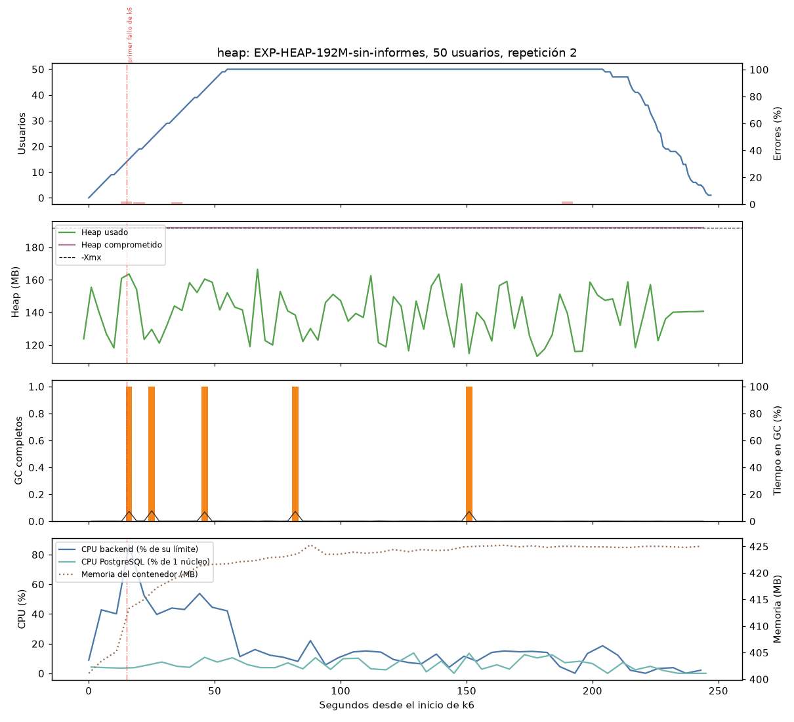

### heap: EXP-HEAP-256M, 100 usuarios, repetición 2

- Duración observada: 344 s; 3904 peticiones, 374 con fallo.
- **Primer fallo a los 55 s, con 50 usuarios activos.**

| t (s) | Operación | Estado | Duración (ms) | Error de k6 |
|---|---|---|---|---|
| 55.0 | login | 401 | 389 |  |
| 57.0 | login | 401 | 355 |  |
| 58.0 | login | 401 | 296 |  |
| 59.0 | login | 401 | 425 |  |
| 60.0 | login | 401 | 324 |  |
| 62.0 | login | 401 | 1019 |  |
| 63.0 | login | 401 | 1534 |  |
| 64.0 | login | 401 | 1339 |  |
| 66.0 | login | 401 | 1738 |  |
| 66.0 | login | 401 | 974 |  |
| 66.0 | login | 401 | 376 |  |
| 68.0 | login | 401 | 336 |  |

- Operaciones con fallos en los 30 s siguientes al primero: login (31).
- **Qué ocurre primero** (segundos desde el inicio de k6): -1 s: contenedor sobre 80pct de memoria; 17 s: primera rafaga de gc completo; 19 s: cpu del backend al tope; 55 s: primer fallo de k6; 77 s: heap usado sobre 90pct del tope; 341 s: primer OutOfMemoryError.
- **En los 30 s previos al primer fallo:** heap usado al inicio 159 MB, heap usado máx. 190 MB de 256, RssAnon máx. 478 MB, contenedor 486 MB de 512, CPU del backend 40 %, CPU de PostgreSQL 6 %, tiempo en GC 0.9 % con 1 GC completos.
- OutOfMemoryError en el registro: 3 líneas (ejemplo: `Exception in thread "http-nio-8080-Acceptor" java.lang.OutOfMemoryError: Java heap space`).

### heap: EXP-HEAP-256M, 50 usuarios, repetición 2

- Duración observada: 231 s; 2786 peticiones, 5 con fallo.
- **Primer fallo a los 16 s, con 15 usuarios activos.**

| t (s) | Operación | Estado | Duración (ms) | Error de k6 |
|---|---|---|---|---|
| 16.0 | cita | 400 | 123 |  |
| 38.0 | cita | 400 | 39 |  |
| 39.0 | cita | 400 | 12 |  |
| 128.0 | iniciar | 400 | 17 |  |
| 192.0 | cita | 400 | 27 |  |

- Operaciones con fallos en los 30 s siguientes al primero: cita (3).
- **Qué ocurre primero** (segundos desde el inicio de k6): -1 s: contenedor sobre 80pct de memoria; 16 s: primer fallo de k6; 17 s: heap usado sobre 90pct del tope; 17 s: primera rafaga de gc completo; 17 s: cpu del backend al tope.
- **En los 30 s previos al primer fallo:** heap usado al inicio 159 MB, heap usado máx. 164 MB de 256, RssAnon máx. 455 MB, contenedor 464 MB de 512, CPU del backend 42 %, CPU de PostgreSQL 4 %, tiempo en GC 0.1 % con 0 GC completos.

### heap: EXP-HEAP-288M, 100 usuarios, repetición 2

- Duración observada: 41 s; 220 peticiones, 85 con fallo.
- **Primer fallo a los 20 s, con 19 usuarios activos.**

| t (s) | Operación | Estado | Duración (ms) | Error de k6 |
|---|---|---|---|---|
| 20.0 | apoderado | 0 | 13 | EOF |
| 20.0 | login | 0 | 0 | dial: connection refused |
| 21.0 | login | 0 | 0 | dial: connection refused |
| 21.0 | apoderado | 0 | 0 | dial: connection refused |
| 22.0 | navegacion | 0 | 0 | dial: connection refused |
| 22.0 | privacidad | 0 | 0 | dial: connection refused |
| 22.0 | cumplimiento | 0 | 0 | dial: connection refused |
| 22.0 | notificaciones | 0 | 0 | dial: connection refused |
| 22.0 | avisos_de_cumplimiento | 0 | 0 | dial: connection refused |
| 22.0 | panel | 0 | 0 | dial: connection refused |
| 22.0 | citas_del_mes | 0 | 0 | dial: connection refused |
| 22.0 | empleados | 0 | 0 | dial: connection refused |

- Operaciones con fallos en los 30 s siguientes al primero: login (20), apoderado (14), navegacion (7), privacidad (7), cumplimiento (7), notificaciones (7), avisos_de_cumplimiento (7), panel (7).
- **Qué ocurre primero** (segundos desde el inicio de k6): -1 s: contenedor sobre 80pct de memoria; 17 s: cpu del backend al tope; 20 s: primer fallo de k6; 20 s: heap usado sobre 90pct del tope; 20 s: primera rafaga de gc completo.
- **En los 30 s previos al primer fallo:** heap usado al inicio 172 MB, heap usado máx. 267 MB de 288, RssAnon máx. 491 MB, contenedor 499 MB de 512, CPU del backend 42 %, CPU de PostgreSQL 4 %, tiempo en GC 7.0 % con 4 GC completos.

### heap: EXP-HEAP-288M, 50 usuarios, repetición 2

- Duración observada: 41 s; 219 peticiones, 86 con fallo.
- **Primer fallo a los 16 s, con 15 usuarios activos.**

| t (s) | Operación | Estado | Duración (ms) | Error de k6 |
|---|---|---|---|---|
| 16.0 | cita | 400 | 90 |  |
| 20.0 | panel | 0 | 2 | read: connection reset by peer |
| 20.0 | login | 0 | 0 | dial: connection refused |
| 20.0 | apoderado | 0 | 0 | dial: connection refused |
| 21.0 | login | 0 | 0 | dial: connection refused |
| 21.0 | apoderado | 0 | 0 | dial: connection refused |
| 22.0 | navegacion | 0 | 0 | dial: connection refused |
| 22.0 | privacidad | 0 | 0 | dial: connection refused |
| 22.0 | cumplimiento | 0 | 0 | dial: connection refused |
| 22.0 | notificaciones | 0 | 0 | dial: connection refused |
| 22.0 | avisos_de_cumplimiento | 0 | 0 | dial: connection refused |
| 22.0 | panel | 0 | 0 | dial: connection refused |

- Operaciones con fallos en los 30 s siguientes al primero: login (20), apoderado (15), panel (8), navegacion (7), privacidad (7), cumplimiento (7), notificaciones (7), avisos_de_cumplimiento (7).
- **Qué ocurre primero** (segundos desde el inicio de k6): -1 s: contenedor sobre 80pct de memoria; 16 s: primer fallo de k6; 19 s: cpu del backend al tope; 20 s: primera rafaga de gc completo.
- **En los 30 s previos al primer fallo:** heap usado al inicio 146 MB, heap usado máx. 189 MB de 288, RssAnon máx. 457 MB, contenedor 465 MB de 512, CPU del backend 40 %, CPU de PostgreSQL 4 %, tiempo en GC 1.6 % con 1 GC completos.

### heap: EXP-HEAP-192M, 100 usuarios, repetición 3

- Duración observada: 347 s; 731 peticiones, 560 con fallo.
- **Primer fallo a los 45 s, con 41 usuarios activos.**

| t (s) | Operación | Estado | Duración (ms) | Error de k6 |
|---|---|---|---|---|
| 45.0 | reporte_clinico | 0 | 30001 | request timeout |
| 50.0 | login | 0 | 30001 | request timeout |
| 51.0 | login | 0 | 30000 | request timeout |
| 52.0 | login | 0 | 30000 | request timeout |
| 53.0 | login | 0 | 30000 | request timeout |
| 55.0 | login | 0 | 30000 | request timeout |
| 56.0 | login | 0 | 30000 | request timeout |
| 57.0 | login | 0 | 30000 | request timeout |
| 58.0 | login | 0 | 30001 | request timeout |
| 59.0 | login | 0 | 30000 | request timeout |
| 60.0 | login | 0 | 30000 | request timeout |
| 61.0 | login | 0 | 30000 | request timeout |

- Operaciones con fallos en los 30 s siguientes al primero: login (24), apoderado (5), cancelar_cita (2), navegacion (2), reporte_clinico (1), panel (1), checkin (1), lista_de_historias (1).
- **Qué ocurre primero** (segundos desde el inicio de k6): 11 s: contenedor sobre 80pct de memoria; 17 s: heap usado sobre 90pct del tope; 17 s: primera rafaga de gc completo; 19 s: cpu del backend al tope; 45 s: primer fallo de k6; 136 s: primer OutOfMemoryError.
- **En los 30 s previos al primer fallo:** heap usado al inicio 148 MB, heap usado máx. 186 MB de 192, RssAnon máx. 418 MB, contenedor 426 MB de 512, CPU del backend 100 %, CPU de PostgreSQL 3 %, tiempo en GC 65.6 % con 60 GC completos.
- OutOfMemoryError en el registro: 20 líneas (ejemplo: `Exception: java.lang.OutOfMemoryError thrown from the UncaughtExceptionHandler in thread "http-nio-8080-Acceptor"`).

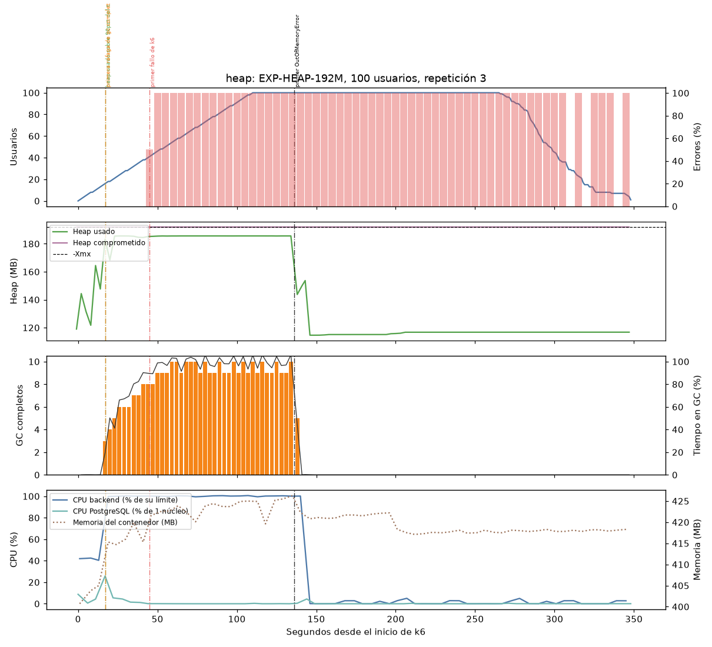

### heap: EXP-HEAP-192M, 50 usuarios, repetición 3

- Duración observada: 289 s; 412 peticiones, 260 con fallo.
- **Primer fallo a los 16 s, con 15 usuarios activos.**

| t (s) | Operación | Estado | Duración (ms) | Error de k6 |
|---|---|---|---|---|
| 16.0 | cita | 400 | 109 |  |
| 45.0 | reporte_clinico | 0 | 30001 | request timeout |
| 49.0 | login | 0 | 30000 | request timeout |
| 50.0 | login | 0 | 30001 | request timeout |
| 51.0 | login | 0 | 30001 | request timeout |
| 52.0 | login | 0 | 30001 | request timeout |
| 53.0 | login | 0 | 30001 | request timeout |
| 55.0 | login | 0 | 30001 | request timeout |
| 56.0 | login | 0 | 30001 | request timeout |
| 57.0 | login | 0 | 30001 | request timeout |
| 57.0 | historia | 0 | 30001 | request timeout |
| 58.0 | login | 0 | 30000 | request timeout |

- Operaciones con fallos en los 30 s siguientes al primero: cita (1), reporte_clinico (1).
- **Qué ocurre primero** (segundos desde el inicio de k6): 16 s: primer fallo de k6; 17 s: primera rafaga de gc completo; 17 s: contenedor sobre 80pct de memoria; 17 s: cpu del backend al tope; 20 s: heap usado sobre 90pct del tope; 74 s: primer OutOfMemoryError; 74 s: primer tiempo agotado del pool.
- **En los 30 s previos al primer fallo:** heap usado al inicio 150 MB, heap usado máx. 161 MB de 192, RssAnon máx. 402 MB, contenedor 409 MB de 512, CPU del backend 54 %, CPU de PostgreSQL 3 %, tiempo en GC 1.5 % con 1 GC completos.
- OutOfMemoryError en el registro: 11 líneas (ejemplo: `Exception in thread "http-nio-8080-Acceptor" java.lang.OutOfMemoryError: Java heap space`).
- Esperas de conexión agotadas en el registro: 5.

### heap: EXP-HEAP-192M-citas6000, 100 usuarios, repetición 3

- Duración observada: 285 s; 3905 peticiones, 355 con fallo.
- **Primer fallo a los 55 s, con 50 usuarios activos.**

| t (s) | Operación | Estado | Duración (ms) | Error de k6 |
|---|---|---|---|---|
| 55.0 | login | 401 | 400 |  |
| 56.0 | login | 401 | 472 |  |
| 57.0 | login | 401 | 382 |  |
| 58.0 | login | 401 | 407 |  |
| 60.0 | login | 401 | 493 |  |
| 61.0 | login | 401 | 1232 |  |
| 63.0 | login | 401 | 1656 |  |
| 63.0 | login | 401 | 804 |  |
| 64.0 | login | 401 | 423 |  |
| 65.0 | login | 401 | 466 |  |
| 66.0 | login | 401 | 433 |  |
| 67.0 | login | 401 | 447 |  |

- Operaciones con fallos en los 30 s siguientes al primero: login (31).
- **Qué ocurre primero** (segundos desde el inicio de k6): 13 s: contenedor sobre 80pct de memoria; 16 s: heap usado sobre 90pct del tope; 18 s: cpu del backend al tope; 19 s: primera rafaga de gc completo; 55 s: primer fallo de k6.
- **En los 30 s previos al primer fallo:** heap usado al inicio 141 MB, heap usado máx. 167 MB de 192, RssAnon máx. 420 MB, contenedor 428 MB de 512, CPU del backend 53 %, CPU de PostgreSQL 5 %, tiempo en GC 2.4 % con 3 GC completos.

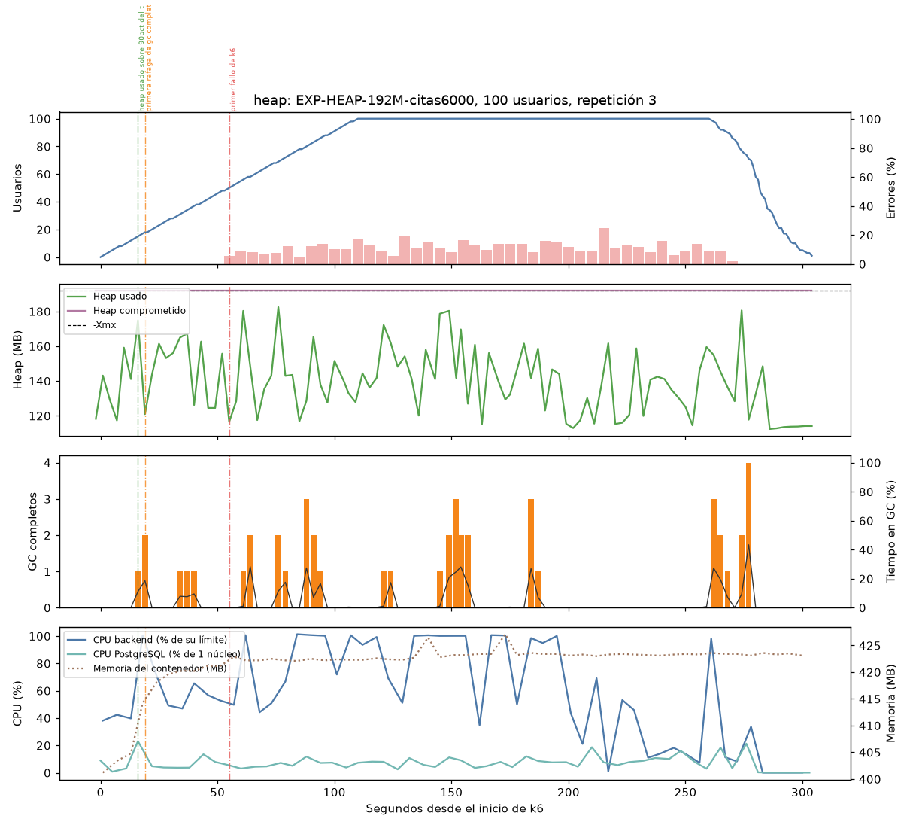

### heap: EXP-HEAP-192M-citas6000, 50 usuarios, repetición 3

- Duración observada: 231 s; 2773 peticiones, 1 con fallo.
- **Primer fallo a los 16 s, con 15 usuarios activos.**

| t (s) | Operación | Estado | Duración (ms) | Error de k6 |
|---|---|---|---|---|
| 16.0 | cita | 400 | 130 |  |

- Operaciones con fallos en los 30 s siguientes al primero: cita (1).
- **Qué ocurre primero** (segundos desde el inicio de k6): 14 s: contenedor sobre 80pct de memoria; 16 s: primer fallo de k6; 17 s: heap usado sobre 90pct del tope; 17 s: primera rafaga de gc completo; 19 s: cpu del backend al tope.
- **En los 30 s previos al primer fallo:** heap usado al inicio 147 MB, heap usado máx. 156 MB de 192, RssAnon máx. 402 MB, contenedor 410 MB de 512, CPU del backend 43 %, CPU de PostgreSQL 4 %, tiempo en GC 1.7 % con 1 GC completos.

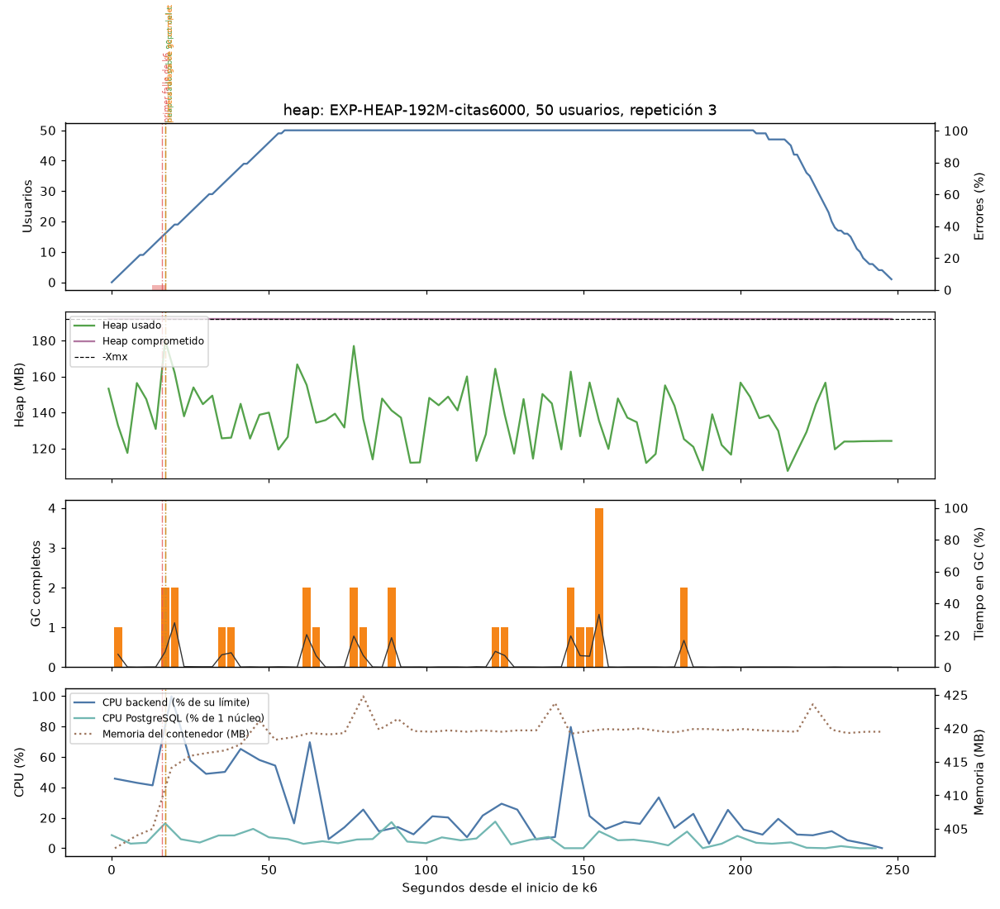

### heap: EXP-HEAP-192M-sin-informes, 100 usuarios, repetición 3

- Duración observada: 288 s; 3964 peticiones, 351 con fallo.
- **Primer fallo a los 56 s, con 51 usuarios activos.**

| t (s) | Operación | Estado | Duración (ms) | Error de k6 |
|---|---|---|---|---|
| 56.0 | login | 401 | 564 |  |
| 57.0 | login | 401 | 381 |  |
| 58.0 | login | 401 | 385 |  |
| 59.0 | login | 401 | 408 |  |
| 60.0 | login | 401 | 416 |  |
| 61.0 | login | 401 | 527 |  |
| 62.0 | login | 401 | 410 |  |
| 63.0 | login | 401 | 383 |  |
| 64.0 | login | 401 | 379 |  |
| 66.0 | login | 401 | 481 |  |
| 67.0 | login | 401 | 428 |  |
| 68.0 | login | 401 | 440 |  |

- Operaciones con fallos en los 30 s siguientes al primero: login (32).
- **Qué ocurre primero** (segundos desde el inicio de k6): 11 s: contenedor sobre 80pct de memoria; 56 s: primer fallo de k6; 85 s: cpu del backend al tope.
- **En los 30 s previos al primer fallo:** heap usado al inicio 145 MB, heap usado máx. 167 MB de 192, RssAnon máx. 418 MB, contenedor 426 MB de 512, CPU del backend 59 %, CPU de PostgreSQL 9 %, tiempo en GC 1.0 % con 1 GC completos.

### heap: EXP-HEAP-192M-sin-informes, 50 usuarios, repetición 3

- Duración observada: 232 s; 2807 peticiones, 3 con fallo.
- **Primer fallo a los 39 s, con 36 usuarios activos.**

| t (s) | Operación | Estado | Duración (ms) | Error de k6 |
|---|---|---|---|---|
| 39.0 | cita | 400 | 41 |  |
| 42.0 | cita | 400 | 38 |  |
| 195.0 | cita | 400 | 23 |  |

- Operaciones con fallos en los 30 s siguientes al primero: cita (2).
- **Qué ocurre primero** (segundos desde el inicio de k6): 14 s: contenedor sobre 80pct de memoria; 17 s: cpu del backend al tope; 39 s: primer fallo de k6.
- **En los 30 s previos al primer fallo:** heap usado al inicio 143 MB, heap usado máx. 171 MB de 192, RssAnon máx. 416 MB, contenedor 424 MB de 512, CPU del backend 53 %, CPU de PostgreSQL 5 %, tiempo en GC 1.9 % con 2 GC completos.

### heap: EXP-HEAP-256M, 100 usuarios, repetición 3

- Duración observada: 346 s; 2557 peticiones, 488 con fallo.
- **Primer fallo a los 56 s, con 51 usuarios activos.**

| t (s) | Operación | Estado | Duración (ms) | Error de k6 |
|---|---|---|---|---|
| 56.0 | login | 401 | 603 |  |
| 57.0 | login | 401 | 445 |  |
| 58.0 | login | 401 | 450 |  |
| 59.0 | login | 401 | 408 |  |
| 60.0 | login | 401 | 427 |  |
| 62.0 | login | 401 | 979 |  |
| 64.0 | login | 401 | 2408 |  |
| 65.0 | login | 401 | 2179 |  |
| 66.0 | login | 401 | 2544 |  |
| 68.0 | login | 401 | 2835 |  |
| 68.0 | login | 401 | 2198 |  |
| 69.0 | login | 401 | 1675 |  |

- Operaciones con fallos en los 30 s siguientes al primero: login (32).
- **Qué ocurre primero** (segundos desde el inicio de k6): -1 s: contenedor sobre 80pct de memoria; 17 s: cpu del backend al tope; 20 s: heap usado sobre 90pct del tope; 20 s: primera rafaga de gc completo; 56 s: primer fallo de k6; 226 s: primer tiempo agotado del pool; 265 s: primer OutOfMemoryError.
- **En los 30 s previos al primer fallo:** heap usado al inicio 163 MB, heap usado máx. 191 MB de 256, RssAnon máx. 479 MB, contenedor 487 MB de 512, CPU del backend 55 %, CPU de PostgreSQL 7 %, tiempo en GC 0.9 % con 1 GC completos.
- OutOfMemoryError en el registro: 14 líneas (ejemplo: `Exception in thread "http-nio-8080-Acceptor" java.lang.OutOfMemoryError: Java heap space`).
- Esperas de conexión agotadas en el registro: 72.

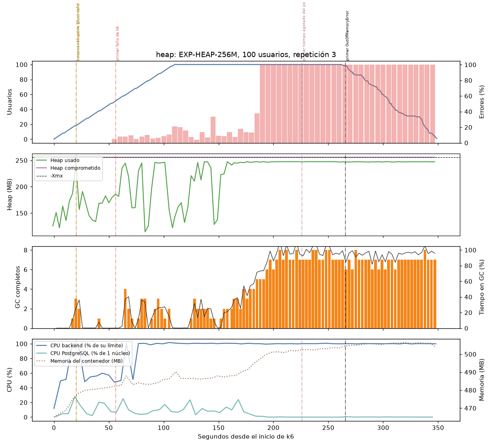

### heap: EXP-HEAP-256M, 50 usuarios, repetición 3

- Duración observada: 232 s; 2788 peticiones, 10 con fallo.
- **Primer fallo a los 16 s, con 15 usuarios activos.**

| t (s) | Operación | Estado | Duración (ms) | Error de k6 |
|---|---|---|---|---|
| 16.0 | cita | 400 | 96 |  |
| 22.0 | cita | 400 | 114 |  |
| 39.0 | cita | 400 | 36 |  |
| 69.0 | cita | 400 | 14 |  |
| 82.0 | cita | 400 | 22 |  |
| 101.0 | cita | 400 | 29 |  |
| 130.0 | cita | 400 | 13 |  |
| 192.0 | cita | 400 | 14 |  |
| 194.0 | cita | 400 | 13 |  |
| 209.0 | cita | 400 | 13 |  |

- Operaciones con fallos en los 30 s siguientes al primero: cita (3).
- **Qué ocurre primero** (segundos desde el inicio de k6): -2 s: contenedor sobre 80pct de memoria; 16 s: primer fallo de k6; 16 s: cpu del backend al tope; 20 s: primera rafaga de gc completo; 88 s: heap usado sobre 90pct del tope.
- **En los 30 s previos al primer fallo:** heap usado al inicio 165 MB, heap usado máx. 201 MB de 256, RssAnon máx. 470 MB, contenedor 478 MB de 512, CPU del backend 59 %, CPU de PostgreSQL 2 %, tiempo en GC 1.9 % con 1 GC completos.

### heap: EXP-HEAP-288M, 100 usuarios, repetición 3

- Duración observada: 41 s; 213 peticiones, 89 con fallo.
- **Primer fallo a los 20 s, con 18 usuarios activos.**

| t (s) | Operación | Estado | Duración (ms) | Error de k6 |
|---|---|---|---|---|
| 20.0 | login | 0 | 865 | EOF |
| 20.0 | reporte_clinico | 0 | 1 | read: connection reset by peer |
| 20.0 | panel | 0 | 1 | read: connection reset by peer |
| 20.0 | reporte_de_ventas | 0 | 0 | read: connection reset by peer |
| 20.0 | pacientes_inactivos | 0 | 0 | read: connection reset by peer |
| 20.0 | apoderado | 0 | 0 | dial: connection refused |
| 20.0 | login | 0 | 0 | dial: connection refused |
| 21.0 | login | 0 | 0 | dial: connection refused |
| 22.0 | apoderado | 0 | 0 | dial: connection refused |
| 22.0 | navegacion | 0 | 0 | dial: connection refused |
| 22.0 | privacidad | 0 | 0 | dial: connection refused |
| 22.0 | cumplimiento | 0 | 0 | dial: connection refused |

- Operaciones con fallos en los 30 s siguientes al primero: login (21), apoderado (13), panel (8), navegacion (7), privacidad (7), cumplimiento (7), notificaciones (7), avisos_de_cumplimiento (7).
- **Qué ocurre primero** (segundos desde el inicio de k6): -1 s: contenedor sobre 80pct de memoria; 19 s: cpu del backend al tope; 20 s: primer fallo de k6; 20 s: heap usado sobre 90pct del tope; 20 s: primera rafaga de gc completo.
- **En los 30 s previos al primer fallo:** heap usado al inicio 169 MB, heap usado máx. 275 MB de 288, RssAnon máx. 491 MB, contenedor 499 MB de 512, CPU del backend 43 %, CPU de PostgreSQL 6 %, tiempo en GC 5.8 % con 3 GC completos.

### heap: EXP-HEAP-288M, 50 usuarios, repetición 3

- Duración observada: 41 s; 215 peticiones, 87 con fallo.
- **Primer fallo a los 21 s, con 19 usuarios activos.**

| t (s) | Operación | Estado | Duración (ms) | Error de k6 |
|---|---|---|---|---|
| 21.0 | login | 0 | 943 | EOF |
| 21.0 | reporte_clinico | 0 | 5783 | unexpected EOF |
| 21.0 | login | 0 | 2044 | EOF |
| 21.0 | reporte_de_ventas | 0 | 0 | EOF |
| 21.0 | pacientes_inactivos | 0 | 0 | EOF |
| 21.0 | login | 0 | 0 | dial: connection refused |
| 21.0 | apoderado | 0 | 0 | dial: connection refused |
| 21.0 | navegacion | 0 | 0 | dial: connection refused |
| 21.0 | privacidad | 0 | 0 | dial: connection refused |
| 21.0 | cumplimiento | 0 | 0 | dial: connection refused |
| 21.0 | notificaciones | 0 | 0 | dial: connection refused |
| 21.0 | avisos_de_cumplimiento | 0 | 0 | dial: connection refused |

- Operaciones con fallos en los 30 s siguientes al primero: login (21), apoderado (12), navegacion (7), privacidad (7), cumplimiento (7), notificaciones (7), avisos_de_cumplimiento (7), panel (7).
- **Qué ocurre primero** (segundos desde el inicio de k6): -2 s: contenedor sobre 80pct de memoria; 18 s: cpu del backend al tope; 20 s: primera rafaga de gc completo; 21 s: primer fallo de k6.
- **En los 30 s previos al primer fallo:** heap usado al inicio 162 MB, heap usado máx. 238 MB de 288, RssAnon máx. 499 MB, contenedor 507 MB de 512, CPU del backend 44 %, CPU de PostgreSQL 7 %, tiempo en GC 5.3 % con 3 GC completos.

### heap: EXP-HEAP-192M-nmt, 100 usuarios, repetición 4

- Duración observada: 344 s; 697 peticiones, 561 con fallo.
- **Primer fallo a los 45 s, con 41 usuarios activos.**

| t (s) | Operación | Estado | Duración (ms) | Error de k6 |
|---|---|---|---|---|
| 45.0 | reporte_clinico | 0 | 30001 | request timeout |
| 49.0 | login | 0 | 30001 | request timeout |
| 50.0 | login | 0 | 30001 | request timeout |
| 51.0 | login | 0 | 30001 | request timeout |
| 52.0 | lista_de_historias | 0 | 30001 | request timeout |
| 52.0 | login | 0 | 30001 | request timeout |
| 53.0 | cita | 0 | 30000 | request timeout |
| 53.0 | login | 0 | 30000 | request timeout |
| 54.0 | mascota | 0 | 30001 | request timeout |
| 54.0 | apoderado | 0 | 30000 | request timeout |
| 54.0 | login | 0 | 30000 | request timeout |
| 55.0 | apoderado | 0 | 30001 | request timeout |

- Operaciones con fallos en los 30 s siguientes al primero: login (25), apoderado (5), reporte_clinico (1), lista_de_historias (1), cita (1), mascota (1), panel (1), privacidad (1).
- **Qué ocurre primero** (segundos desde el inicio de k6): -1 s: contenedor sobre 80pct de memoria; 17 s: primera rafaga de gc completo; 19 s: cpu del backend al tope; 20 s: heap usado sobre 90pct del tope; 45 s: primer fallo de k6; 98 s: primer OutOfMemoryError; 98 s: primer tiempo agotado del pool.
- **En los 30 s previos al primer fallo:** heap usado al inicio 154 MB, heap usado máx. 186 MB de 192, RssAnon máx. 426 MB, contenedor 436 MB de 512, CPU del backend 100 %, CPU de PostgreSQL 1 %, tiempo en GC 78.4 % con 84 GC completos.
- OutOfMemoryError en el registro: 24 líneas (ejemplo: `Exception in thread "http-nio-8080-Acceptor" java.lang.OutOfMemoryError: Java heap space`).
- Esperas de conexión agotadas en el registro: 1.

### heap: EXP-HEAP-192M-nmt, 50 usuarios, repetición 4

- Duración observada: 287 s; 385 peticiones, 260 con fallo.
- **Primer fallo a los 16 s, con 15 usuarios activos.**

| t (s) | Operación | Estado | Duración (ms) | Error de k6 |
|---|---|---|---|---|
| 16.0 | cita | 400 | 81 |  |
| 45.0 | reporte_clinico | 0 | 30001 | request timeout |
| 48.0 | login | 0 | 30000 | request timeout |
| 49.0 | login | 0 | 30000 | request timeout |
| 50.0 | login | 0 | 30001 | request timeout |
| 51.0 | login | 0 | 30001 | request timeout |
| 52.0 | cita | 0 | 30000 | request timeout |
| 52.0 | citas_del_mes | 0 | 30000 | request timeout |
| 52.0 | lista_de_historias | 0 | 30001 | request timeout |
| 52.0 | login | 0 | 30001 | request timeout |
| 53.0 | apoderado | 0 | 30001 | request timeout |
| 53.0 | privacidad | 0 | 30001 | request timeout |

- Operaciones con fallos en los 30 s siguientes al primero: cita (1), reporte_clinico (1).
- **Qué ocurre primero** (segundos desde el inicio de k6): -1 s: contenedor sobre 80pct de memoria; 16 s: primer fallo de k6; 17 s: heap usado sobre 90pct del tope; 17 s: primera rafaga de gc completo; 19 s: cpu del backend al tope; 58 s: primer OutOfMemoryError; 58 s: primer tiempo agotado del pool.
- **En los 30 s previos al primer fallo:** heap usado al inicio 132 MB, heap usado máx. 146 MB de 192, RssAnon máx. 411 MB, contenedor 418 MB de 512, CPU del backend 42 %, CPU de PostgreSQL 4 %, tiempo en GC 1.3 % con 1 GC completos.
- OutOfMemoryError en el registro: 8 líneas (ejemplo: `Exception in thread "http-nio-8080-Acceptor" java.lang.OutOfMemoryError: Java heap space`).
- Esperas de conexión agotadas en el registro: 4.

### heap: EXP-HEAP-256M-nmt, 100 usuarios, repetición 4

- Duración observada: 292 s; 3938 peticiones, 360 con fallo.
- **Primer fallo a los 56 s, con 51 usuarios activos.**

| t (s) | Operación | Estado | Duración (ms) | Error de k6 |
|---|---|---|---|---|
| 56.0 | login | 401 | 381 |  |
| 57.0 | login | 401 | 330 |  |
| 58.0 | login | 401 | 291 |  |
| 59.0 | login | 401 | 397 |  |
| 60.0 | login | 401 | 297 |  |
| 62.0 | login | 401 | 842 |  |
| 63.0 | login | 401 | 1389 |  |
| 64.0 | login | 401 | 1351 |  |
| 65.0 | login | 401 | 672 |  |
| 66.0 | login | 401 | 572 |  |
| 67.0 | login | 401 | 336 |  |
| 68.0 | login | 401 | 341 |  |

- Operaciones con fallos en los 30 s siguientes al primero: login (32).
- **Qué ocurre primero** (segundos desde el inicio de k6): -1 s: contenedor sobre 80pct de memoria; 17 s: primera rafaga de gc completo; 17 s: cpu del backend al tope; 20 s: heap usado sobre 90pct del tope; 56 s: primer fallo de k6; 289 s: primer OutOfMemoryError.
- **En los 30 s previos al primer fallo:** heap usado al inicio 159 MB, heap usado máx. 192 MB de 256, RssAnon máx. 489 MB, contenedor 498 MB de 512, CPU del backend 42 %, CPU de PostgreSQL 5 %, tiempo en GC 0.8 % con 1 GC completos.
- OutOfMemoryError en el registro: 2 líneas (ejemplo: `2026-11-23T20:48:03.234Z ERROR 1 --- [vargasvet] [io-8080-exec-12] o.a.c.c.C.[.[.[.[dispatcherServlet]      : Servlet.service() for servlet [dispatcherServlet] `).

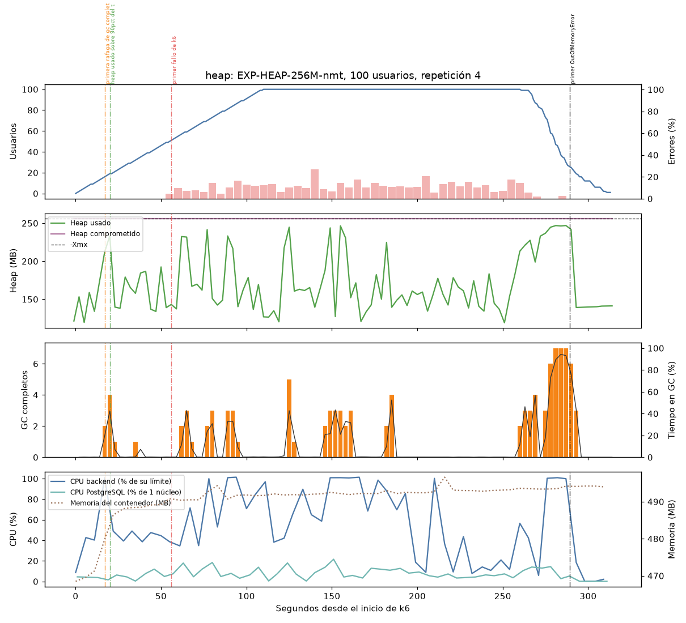

### heap: EXP-HEAP-256M-nmt, 50 usuarios, repetición 4

- Duración observada: 231 s; 2787 peticiones, 5 con fallo.
- **Primer fallo a los 15 s, con 14 usuarios activos.**

| t (s) | Operación | Estado | Duración (ms) | Error de k6 |
|---|---|---|---|---|
| 15.0 | cita | 400 | 114 |  |
| 22.0 | cita | 400 | 38 |  |
| 38.0 | cita | 400 | 37 |  |
| 38.0 | cita | 400 | 36 |  |
| 191.0 | cita | 400 | 13 |  |

- Operaciones con fallos en los 30 s siguientes al primero: cita (4).
- **Qué ocurre primero** (segundos desde el inicio de k6): -2 s: contenedor sobre 80pct de memoria; 15 s: primer fallo de k6; 16 s: primera rafaga de gc completo; 18 s: cpu del backend al tope; 19 s: heap usado sobre 90pct del tope.
- **En los 30 s previos al primer fallo:** heap usado al inicio 154 MB, heap usado máx. 171 MB de 256, RssAnon máx. 467 MB, contenedor 475 MB de 512, CPU del backend 41 %, CPU de PostgreSQL 4 %, tiempo en GC 0.0 % con 0 GC completos.

### heap: EXP-HEAP-288M-nmt, 100 usuarios, repetición 4

- Duración observada: 39 s; 187 peticiones, 76 con fallo.
- **Primer fallo a los 17 s, con 16 usuarios activos.**

| t (s) | Operación | Estado | Duración (ms) | Error de k6 |
|---|---|---|---|---|
| 17.0 | login | 0 | 486 | EOF |
| 17.0 | reporte_clinico | 0 | 1 | read: connection reset by peer |
| 17.0 | reporte_de_ventas | 0 | 0 | read: connection reset by peer |
| 17.0 | pacientes_inactivos | 0 | 0 | read: connection reset by peer |
| 18.0 | login | 0 | 0 | dial: connection refused |
| 19.0 | login | 0 | 0 | dial: connection refused |
| 20.0 | apoderado | 0 | 0 | dial: connection refused |
| 20.0 | login | 0 | 0 | dial: connection refused |
| 21.0 | login | 0 | 0 | dial: connection refused |
| 22.0 | apoderado | 0 | 0 | dial: connection refused |
| 22.0 | navegacion | 0 | 0 | dial: connection refused |
| 22.0 | privacidad | 0 | 0 | dial: connection refused |

- Operaciones con fallos en los 30 s siguientes al primero: login (22), apoderado (13), navegacion (5), privacidad (5), cumplimiento (5), notificaciones (5), avisos_de_cumplimiento (5), panel (5).
- **Qué ocurre primero** (segundos desde el inicio de k6): -1 s: contenedor sobre 80pct de memoria; 17 s: primer fallo de k6; 17 s: cpu del backend al tope.
- **En los 30 s previos al primer fallo:** heap usado al inicio 148 MB, heap usado máx. 244 MB de 288, RssAnon máx. 499 MB, contenedor 507 MB de 512, CPU del backend 42 %, CPU de PostgreSQL 4 %, tiempo en GC 1.9 % con 2 GC completos.

### heap: EXP-HEAP-288M-nmt, 50 usuarios, repetición 4

- Duración observada: 37 s; 174 peticiones, 71 con fallo.
- **Primer fallo a los 16 s, con 15 usuarios activos.**

| t (s) | Operación | Estado | Duración (ms) | Error de k6 |
|---|---|---|---|---|
| 16.0 | cita | 400 | 112 |  |
| 17.0 | login | 0 | 850 | EOF |
| 17.0 | reporte_clinico | 0 | 1454 | EOF |
| 17.0 | reporte_de_ventas | 0 | 0 | read: connection reset by peer |
| 17.0 | pacientes_inactivos | 0 | 0 | EOF |
| 17.0 | login | 0 | 0 | dial: connection refused |
| 18.0 | login | 0 | 0 | dial: connection refused |
| 19.0 | login | 0 | 0 | dial: connection refused |
| 20.0 | apoderado | 0 | 0 | dial: connection refused |
| 20.0 | login | 0 | 0 | dial: connection refused |
| 21.0 | login | 0 | 0 | dial: connection refused |
| 22.0 | apoderado | 0 | 0 | dial: connection refused |

- Operaciones con fallos en los 30 s siguientes al primero: login (20), apoderado (11), navegacion (5), privacidad (5), cumplimiento (5), notificaciones (5), avisos_de_cumplimiento (5), panel (5).
- **Qué ocurre primero** (segundos desde el inicio de k6): -1 s: contenedor sobre 80pct de memoria; 16 s: primer fallo de k6.
- **En los 30 s previos al primer fallo:** heap usado al inicio 156 MB, heap usado máx. 191 MB de 288, RssAnon máx. 494 MB, contenedor 502 MB de 512, CPU del backend 40 %, CPU de PostgreSQL 4 %, tiempo en GC 0.0 % con 0 GC completos.

### pool: POOL-10, 250 usuarios, repetición 1

- Duración observada: 429 s; 19865 peticiones, 36 con fallo.
- **Primer fallo a los 16 s, con 16 usuarios activos.**

| t (s) | Operación | Estado | Duración (ms) | Error de k6 |
|---|---|---|---|---|
| 16.0 | cita | 400 | 106 |  |
| 22.0 | cita | 400 | 51 |  |
| 38.0 | cita | 400 | 47 |  |
| 68.0 | cita | 400 | 16 |  |
| 82.0 | cita | 400 | 30 |  |
| 101.0 | cita | 400 | 32 |  |
| 130.0 | cita | 400 | 29 |  |
| 159.0 | iniciar | 400 | 63 |  |
| 183.0 | cita | 400 | 19 |  |
| 192.0 | cita | 400 | 53 |  |
| 192.0 | cita | 400 | 46 |  |
| 199.0 | iniciar | 400 | 24 |  |

- Operaciones con fallos en los 30 s siguientes al primero: cita (3).
- **Qué ocurre primero** (segundos desde el inicio de k6): 16 s: primer fallo de k6; 17 s: cpu del backend al tope.
- **En los 30 s previos al primer fallo:** heap usado al inicio 186 MB, heap usado máx. 187 MB de 1024, RssAnon máx. 528 MB, contenedor 533 MB de 2048, CPU del backend 55 %, CPU de PostgreSQL 1 %, tiempo en GC 1.3 % con 1 GC completos.

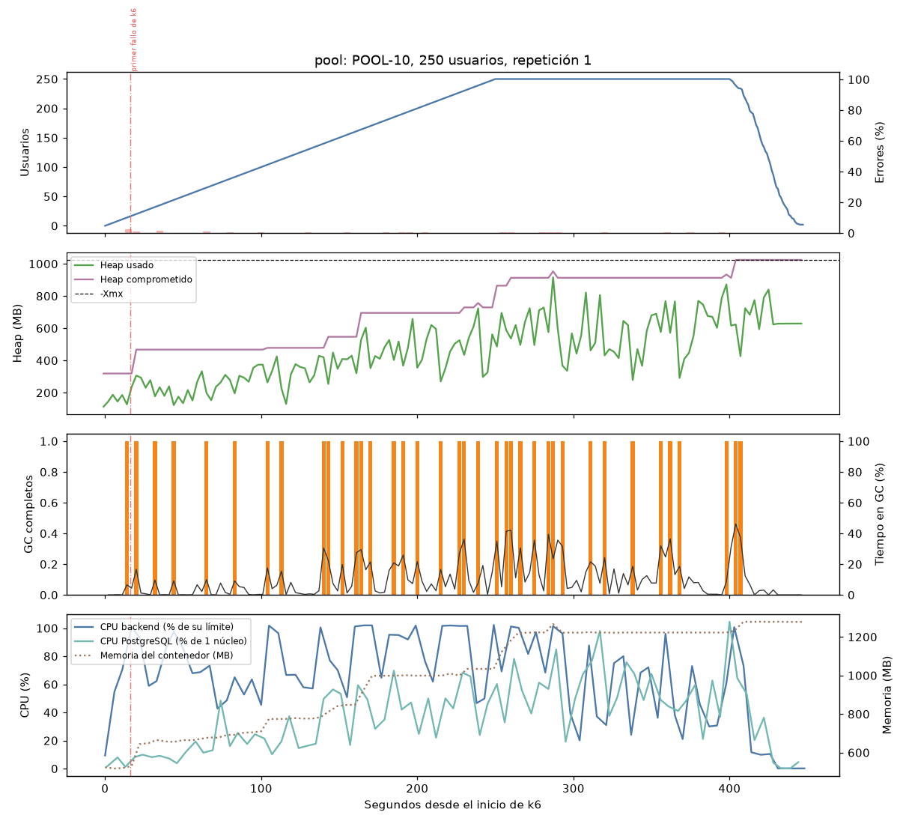

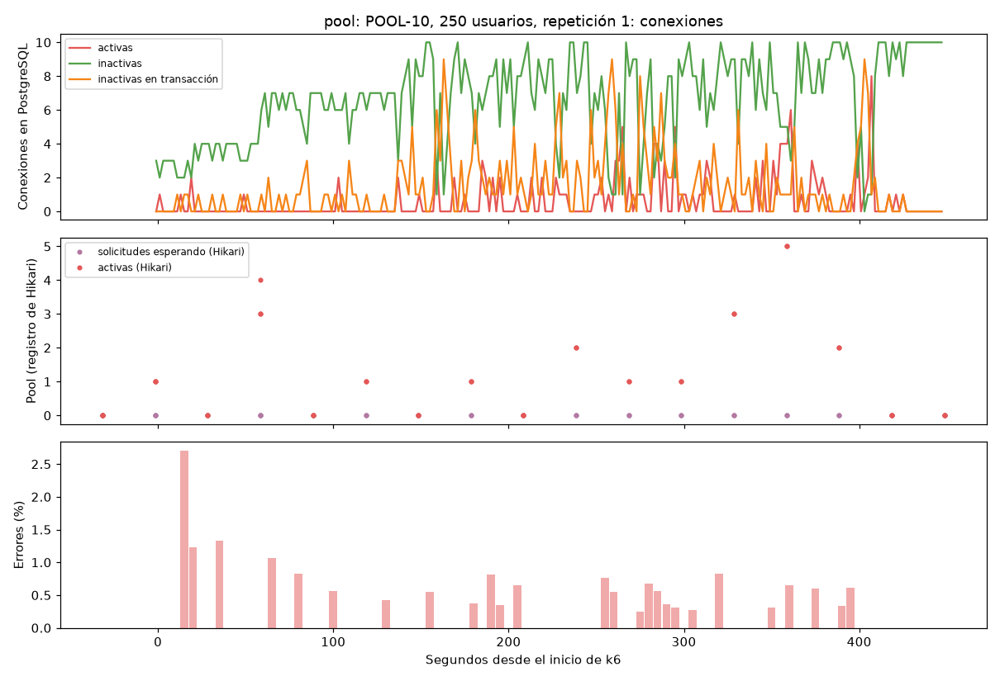

### pool: POOL-20, 250 usuarios, repetición 1

- Duración observada: 429 s; 19962 peticiones, 25 con fallo.
- **Primer fallo a los 15 s, con 15 usuarios activos.**

| t (s) | Operación | Estado | Duración (ms) | Error de k6 |
|---|---|---|---|---|
| 15.0 | cita | 400 | 100 |  |
| 21.0 | cita | 400 | 48 |  |
| 38.0 | cita | 400 | 64 |  |
| 81.0 | cita | 400 | 39 |  |
| 182.0 | cita | 400 | 71 |  |
| 192.0 | cita | 400 | 76 |  |
| 192.0 | cita | 400 | 94 |  |
| 198.0 | iniciar | 400 | 33 |  |
| 198.0 | iniciar | 400 | 31 |  |
| 215.0 | iniciar | 400 | 52 |  |
| 242.0 | iniciar | 400 | 10 |  |
| 262.0 | cita | 400 | 10 |  |

- Operaciones con fallos en los 30 s siguientes al primero: cita (3).
- **Qué ocurre primero** (segundos desde el inicio de k6): 15 s: primer fallo de k6; 16 s: cpu del backend al tope.
- **En los 30 s previos al primer fallo:** heap usado al inicio 174 MB, heap usado máx. 181 MB de 1024, RssAnon máx. 524 MB, contenedor 532 MB de 2048, CPU del backend 55 %, CPU de PostgreSQL 4 %, tiempo en GC 1.7 % con 2 GC completos.

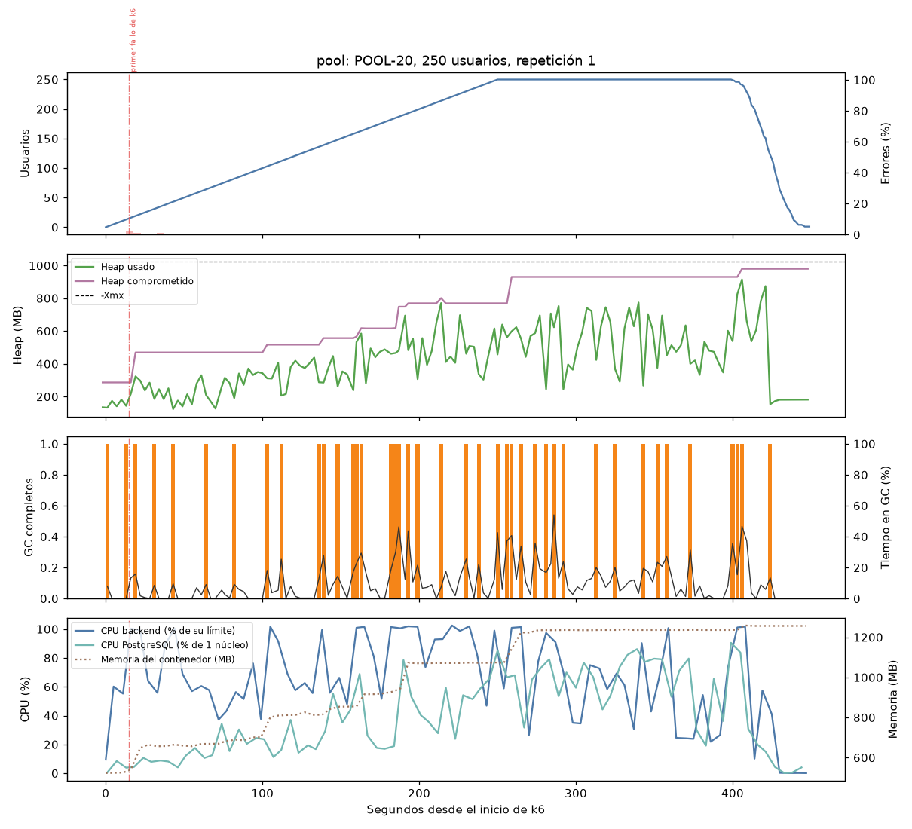

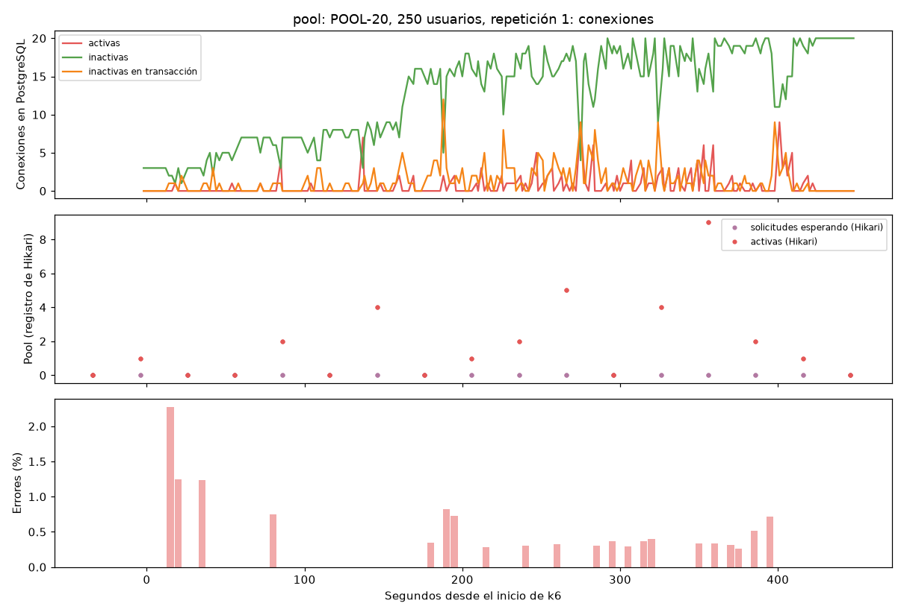

### pool: POOL-40, 250 usuarios, repetición 1

- Duración observada: 428 s; 19935 peticiones, 20 con fallo.
- **Primer fallo a los 16 s, con 16 usuarios activos.**

| t (s) | Operación | Estado | Duración (ms) | Error de k6 |
|---|---|---|---|---|
| 16.0 | cita | 400 | 174 |  |
| 38.0 | cita | 400 | 40 |  |
| 38.0 | cita | 400 | 43 |  |
| 159.0 | iniciar | 400 | 61 |  |
| 181.0 | iniciar | 400 | 24 |  |
| 191.0 | cita | 400 | 35 |  |
| 197.0 | iniciar | 400 | 45 |  |
| 257.0 | iniciar | 400 | 59 |  |
| 260.0 | iniciar | 400 | 41 |  |
| 263.0 | cita | 400 | 36 |  |
| 266.0 | iniciar | 400 | 27 |  |
| 290.0 | cita | 400 | 38 |  |

- Operaciones con fallos en los 30 s siguientes al primero: cita (3).
- **Qué ocurre primero** (segundos desde el inicio de k6): 16 s: primer fallo de k6; 19 s: cpu del backend al tope; 407 s: heap usado sobre 90pct del tope.
- **En los 30 s previos al primer fallo:** heap usado al inicio 163 MB, heap usado máx. 170 MB de 1024, RssAnon máx. 506 MB, contenedor 513 MB de 2048, CPU del backend 46 %, CPU de PostgreSQL 9 %, tiempo en GC 1.8 % con 1 GC completos.

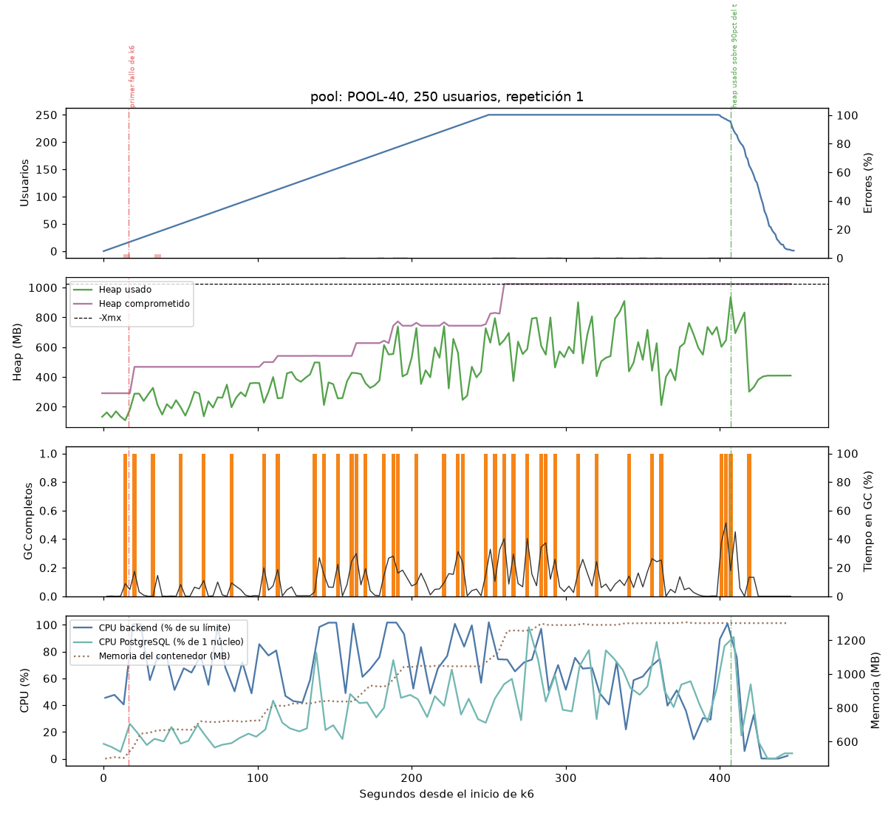

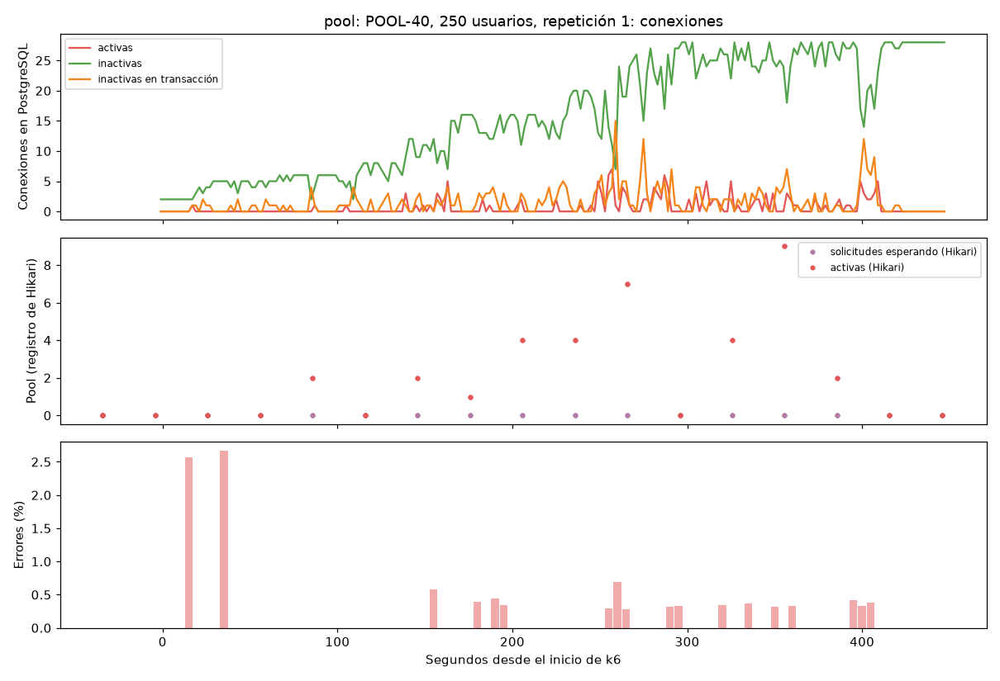

### pool: POOL-80, 250 usuarios, repetición 1

- Duración observada: 428 s; 19929 peticiones, 17 con fallo.
- **Primer fallo a los 37 s, con 37 usuarios activos.**

| t (s) | Operación | Estado | Duración (ms) | Error de k6 |
|---|---|---|---|---|
| 37.0 | cita | 400 | 32 |  |
| 38.0 | cita | 400 | 43 |  |
| 154.0 | iniciar | 400 | 18 |  |
| 190.0 | cita | 400 | 33 |  |
| 254.0 | iniciar | 400 | 46 |  |
| 258.0 | cita | 400 | 59 |  |
| 259.0 | iniciar | 400 | 51 |  |
| 263.0 | cita | 400 | 64 |  |
| 274.0 | iniciar | 400 | 55 |  |
| 282.0 | iniciar | 400 | 58 |  |
| 322.0 | cita | 400 | 14 |  |
| 329.0 | iniciar | 400 | 15 |  |

- Operaciones con fallos en los 30 s siguientes al primero: cita (2).
- **Qué ocurre primero** (segundos desde el inicio de k6): 18 s: cpu del backend al tope; 37 s: primer fallo de k6; 403 s: heap usado sobre 90pct del tope.
- **En los 30 s previos al primer fallo:** heap usado al inicio 173 MB, heap usado máx. 315 MB de 1024, RssAnon máx. 646 MB, contenedor 654 MB de 2048, CPU del backend 93 %, CPU de PostgreSQL 10 %, tiempo en GC 3.5 % con 3 GC completos.

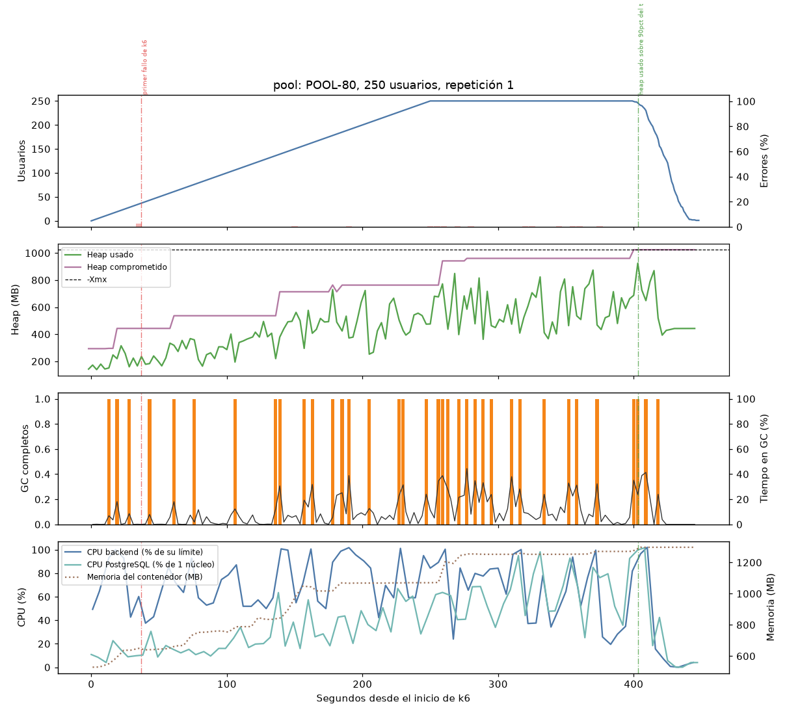

### pool: POOL-10, 250 usuarios, repetición 2

- Duración observada: 428 s; 19948 peticiones, 19 con fallo.
- **Primer fallo a los 16 s, con 16 usuarios activos.**

| t (s) | Operación | Estado | Duración (ms) | Error de k6 |
|---|---|---|---|---|
| 16.0 | cita | 400 | 91 |  |
| 38.0 | cita | 400 | 47 |  |
| 38.0 | cita | 400 | 36 |  |
| 128.0 | iniciar | 400 | 15 |  |
| 159.0 | iniciar | 400 | 14 |  |
| 191.0 | cita | 400 | 36 |  |
| 230.0 | iniciar | 400 | 108 |  |
| 257.0 | iniciar | 400 | 439 |  |
| 259.0 | cita | 400 | 87 |  |
| 260.0 | iniciar | 400 | 61 |  |
| 263.0 | cita | 400 | 100 |  |
| 277.0 | iniciar | 400 | 82 |  |

- Operaciones con fallos en los 30 s siguientes al primero: cita (3).
- **Qué ocurre primero** (segundos desde el inicio de k6): 16 s: primer fallo de k6; 17 s: cpu del backend al tope.
- **En los 30 s previos al primer fallo:** heap usado al inicio 182 MB, heap usado máx. 188 MB de 1024, RssAnon máx. 525 MB, contenedor 532 MB de 2048, CPU del backend 41 %, CPU de PostgreSQL 4 %, tiempo en GC 1.4 % con 1 GC completos.

### pool: POOL-20, 250 usuarios, repetición 2

- Duración observada: 429 s; 20050 peticiones, 18 con fallo.
- **Primer fallo a los 16 s, con 16 usuarios activos.**

| t (s) | Operación | Estado | Duración (ms) | Error de k6 |
|---|---|---|---|---|
| 16.0 | cita | 400 | 152 |  |
| 38.0 | cita | 400 | 35 |  |
| 38.0 | cita | 400 | 38 |  |
| 128.0 | iniciar | 400 | 21 |  |
| 159.0 | iniciar | 400 | 16 |  |
| 191.0 | cita | 400 | 43 |  |
| 197.0 | iniciar | 400 | 30 |  |
| 198.0 | iniciar | 400 | 27 |  |
| 215.0 | iniciar | 400 | 12 |  |
| 263.0 | cita | 400 | 33 |  |
| 281.0 | iniciar | 400 | 24 |  |
| 287.0 | cita | 400 | 21 |  |

- Operaciones con fallos en los 30 s siguientes al primero: cita (3).
- **Qué ocurre primero** (segundos desde el inicio de k6): 16 s: primer fallo de k6; 17 s: cpu del backend al tope.
- **En los 30 s previos al primer fallo:** heap usado al inicio 174 MB, heap usado máx. 209 MB de 1024, RssAnon máx. 599 MB, contenedor 607 MB de 2048, CPU del backend 45 %, CPU de PostgreSQL 7 %, tiempo en GC 1.5 % con 1 GC completos.

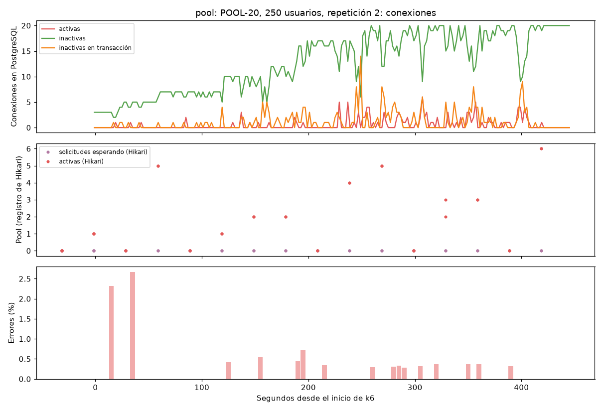

### pool: POOL-40, 250 usuarios, repetición 2

- Duración observada: 429 s; 20066 peticiones, 21 con fallo.
- **Primer fallo a los 16 s, con 16 usuarios activos.**

| t (s) | Operación | Estado | Duración (ms) | Error de k6 |
|---|---|---|---|---|
| 16.0 | cita | 400 | 86 |  |
| 22.0 | cita | 400 | 45 |  |
| 38.0 | cita | 400 | 40 |  |
| 81.0 | cita | 400 | 16 |  |
| 154.0 | iniciar | 400 | 25 |  |
| 182.0 | cita | 400 | 29 |  |
| 190.0 | cita | 400 | 28 |  |
| 191.0 | cita | 400 | 75 |  |
| 196.0 | iniciar | 400 | 11 |  |
| 262.0 | cita | 400 | 21 |  |
| 288.0 | cita | 400 | 20 |  |
| 293.0 | cita | 400 | 24 |  |

- Operaciones con fallos en los 30 s siguientes al primero: cita (3).
- **Qué ocurre primero** (segundos desde el inicio de k6): 16 s: primer fallo de k6; 17 s: cpu del backend al tope.
- **En los 30 s previos al primer fallo:** heap usado al inicio 168 MB, heap usado máx. 182 MB de 1024, RssAnon máx. 537 MB, contenedor 545 MB de 2048, CPU del backend 53 %, CPU de PostgreSQL 3 %, tiempo en GC 1.6 % con 1 GC completos.

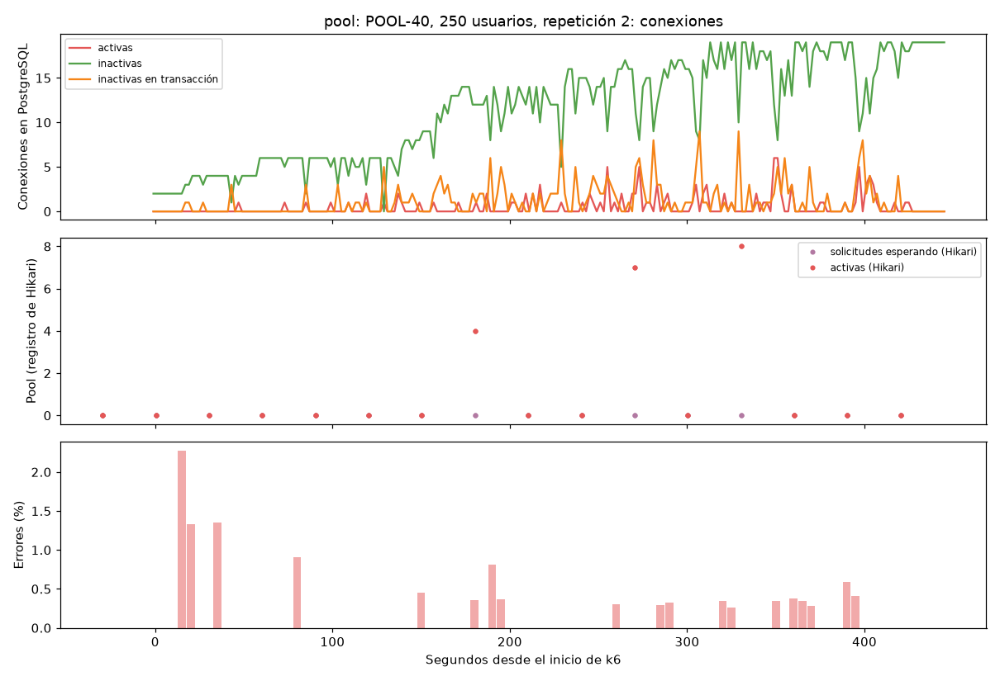

### pool: POOL-80, 250 usuarios, repetición 2

- Duración observada: 429 s; 19950 peticiones, 32 con fallo.
- **Primer fallo a los 16 s, con 16 usuarios activos.**

| t (s) | Operación | Estado | Duración (ms) | Error de k6 |
|---|---|---|---|---|
| 16.0 | cita | 400 | 138 |  |
| 22.0 | cita | 400 | 72 |  |
| 38.0 | cita | 400 | 25 |  |
| 68.0 | cita | 400 | 19 |  |
| 82.0 | cita | 400 | 37 |  |
| 101.0 | cita | 400 | 15 |  |
| 130.0 | cita | 400 | 8 |  |
| 147.0 | iniciar | 400 | 49 |  |
| 147.0 | iniciar | 400 | 38 |  |
| 155.0 | iniciar | 400 | 21 |  |
| 183.0 | cita | 400 | 42 |  |
| 192.0 | cita | 400 | 29 |  |

- Operaciones con fallos en los 30 s siguientes al primero: cita (3).
- **Qué ocurre primero** (segundos desde el inicio de k6): 16 s: primer fallo de k6; 17 s: cpu del backend al tope; 356 s: heap usado sobre 90pct del tope.
- **En los 30 s previos al primer fallo:** heap usado al inicio 180 MB, heap usado máx. 189 MB de 1024, RssAnon máx. 539 MB, contenedor 546 MB de 2048, CPU del backend 77 %, CPU de PostgreSQL 4 %, tiempo en GC 1.5 % con 1 GC completos.

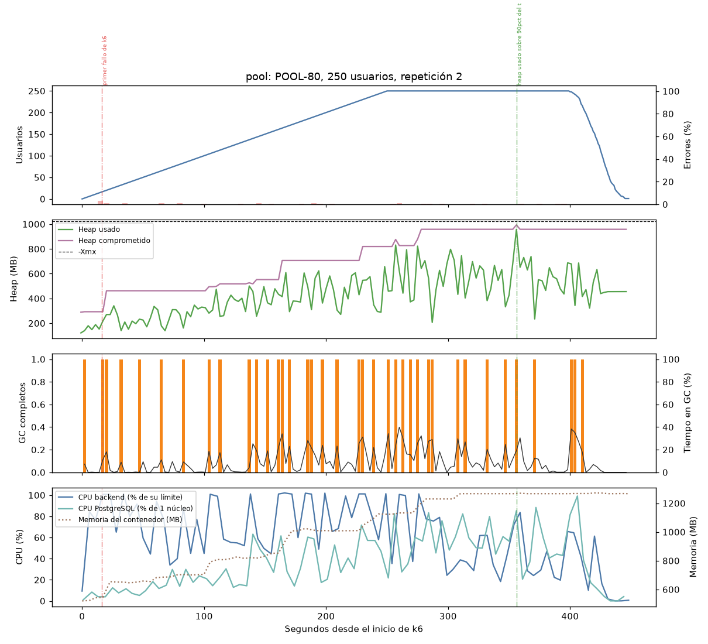

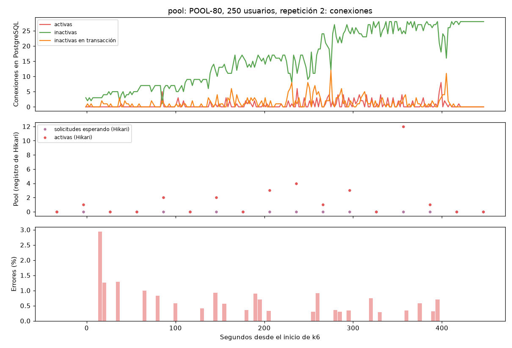

### pool: POOL-10, 250 usuarios, repetición 3

- Duración observada: 427 s; 19810 peticiones, 23 con fallo.
- **Primer fallo a los 16 s, con 16 usuarios activos.**

| t (s) | Operación | Estado | Duración (ms) | Error de k6 |
|---|---|---|---|---|
| 16.0 | cita | 400 | 158 |  |
| 38.0 | cita | 400 | 30 |  |
| 38.0 | cita | 400 | 49 |  |
| 159.0 | iniciar | 400 | 149 |  |
| 192.0 | cita | 400 | 47 |  |
| 197.0 | iniciar | 400 | 72 |  |
| 198.0 | iniciar | 400 | 35 |  |
| 251.0 | iniciar | 400 | 145 |  |
| 264.0 | cita | 400 | 819 |  |
| 277.0 | iniciar | 400 | 494 |  |
| 277.0 | iniciar | 400 | 247 |  |
| 278.0 | iniciar | 400 | 112 |  |

- Operaciones con fallos en los 30 s siguientes al primero: cita (3).
- **Qué ocurre primero** (segundos desde el inicio de k6): 16 s: primer fallo de k6; 18 s: cpu del backend al tope.
- **En los 30 s previos al primer fallo:** heap usado al inicio 161 MB, heap usado máx. 201 MB de 1024, RssAnon máx. 580 MB, contenedor 587 MB de 2048, CPU del backend 56 %, CPU de PostgreSQL 11 %, tiempo en GC 2.2 % con 1 GC completos.

### pool: POOL-20, 250 usuarios, repetición 3

- Duración observada: 428 s; 19688 peticiones, 38 con fallo.
- **Primer fallo a los 16 s, con 16 usuarios activos.**

| t (s) | Operación | Estado | Duración (ms) | Error de k6 |
|---|---|---|---|---|
| 16.0 | cita | 400 | 184 |  |
| 22.0 | cita | 400 | 82 |  |
| 38.0 | cita | 400 | 60 |  |
| 68.0 | cita | 400 | 28 |  |
| 82.0 | cita | 400 | 16 |  |
| 101.0 | cita | 400 | 53 |  |
| 111.0 | iniciar | 400 | 27 |  |
| 131.0 | cita | 400 | 16 |  |
| 147.0 | iniciar | 400 | 16 |  |
| 183.0 | cita | 400 | 54 |  |
| 192.0 | cita | 400 | 55 |  |
| 194.0 | cita | 400 | 170 |  |

- Operaciones con fallos en los 30 s siguientes al primero: cita (3).
- **Qué ocurre primero** (segundos desde el inicio de k6): 16 s: primer fallo de k6; 19 s: cpu del backend al tope; 311 s: heap usado sobre 90pct del tope.
- **En los 30 s previos al primer fallo:** heap usado al inicio 153 MB, heap usado máx. 179 MB de 1024, RssAnon máx. 504 MB, contenedor 511 MB de 2048, CPU del backend 48 %, CPU de PostgreSQL 11 %, tiempo en GC 1.5 % con 1 GC completos.

### pool: POOL-40, 250 usuarios, repetición 3

- Duración observada: 428 s; 19756 peticiones, 24 con fallo.
- **Primer fallo a los 38 s, con 38 usuarios activos.**

| t (s) | Operación | Estado | Duración (ms) | Error de k6 |
|---|---|---|---|---|
| 38.0 | cita | 400 | 370 |  |
| 39.0 | cita | 400 | 43 |  |
| 159.0 | iniciar | 400 | 71 |  |
| 194.0 | cita | 400 | 83 |  |
| 198.0 | iniciar | 400 | 38 |  |
| 198.0 | iniciar | 400 | 23 |  |
| 208.0 | iniciar | 400 | 74 |  |
| 214.0 | iniciar | 400 | 40 |  |
| 259.0 | cita | 400 | 101 |  |
| 265.0 | cita | 400 | 72 |  |
| 267.0 | iniciar | 400 | 79 |  |
| 279.0 | iniciar | 400 | 17 |  |

- Operaciones con fallos en los 30 s siguientes al primero: cita (2).
- **Qué ocurre primero** (segundos desde el inicio de k6): 18 s: cpu del backend al tope; 38 s: primer fallo de k6; 352 s: heap usado sobre 90pct del tope.
- **En los 30 s previos al primer fallo:** heap usado al inicio 170 MB, heap usado máx. 328 MB de 1024, RssAnon máx. 661 MB, contenedor 668 MB de 2048, CPU del backend 53 %, CPU de PostgreSQL 13 %, tiempo en GC 4.6 % con 3 GC completos.

### pool: POOL-80, 250 usuarios, repetición 3

- Duración observada: 428 s; 19874 peticiones, 26 con fallo.
- **Primer fallo a los 15 s, con 15 usuarios activos.**

| t (s) | Operación | Estado | Duración (ms) | Error de k6 |
|---|---|---|---|---|
| 15.0 | cita | 400 | 137 |  |
| 22.0 | cita | 400 | 85 |  |
| 38.0 | cita | 400 | 35 |  |
| 81.0 | cita | 400 | 27 |  |
| 182.0 | cita | 400 | 34 |  |
| 192.0 | cita | 400 | 51 |  |
| 192.0 | cita | 400 | 44 |  |
| 197.0 | iniciar | 400 | 40 |  |
| 258.0 | iniciar | 400 | 82 |  |
| 260.0 | iniciar | 400 | 35 |  |
| 263.0 | cita | 400 | 32 |  |
| 265.0 | iniciar | 400 | 49 |  |

- Operaciones con fallos en los 30 s siguientes al primero: cita (3).
- **Qué ocurre primero** (segundos desde el inicio de k6): 15 s: primer fallo de k6; 18 s: cpu del backend al tope; 346 s: heap usado sobre 90pct del tope.
- **En los 30 s previos al primer fallo:** heap usado al inicio 188 MB, heap usado máx. 191 MB de 1024, RssAnon máx. 576 MB, contenedor 583 MB de 2048, CPU del backend 51 %, CPU de PostgreSQL 10 %, tiempo en GC 0.0 % con 1 GC completos.

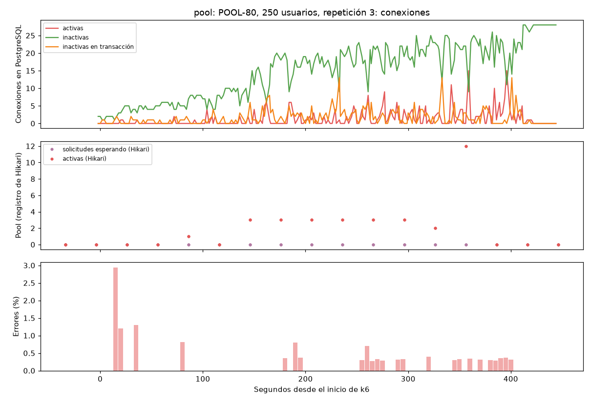

