# Series temporales de la batería

Cada gráfica muestra, con el mismo eje de tiempo: usuarios y errores; heap usado y comprometido; recolecciones completas y tiempo en GC; y CPU y memoria. Las líneas verticales marcan el primer fallo y los demás eventos detectados.

### CAPACIDAD-2G, 100 usuarios, repetición 0

- Duración observada: 286 s; 6330 peticiones, 8 con fallo.
- **Primer fallo a los 24 s, con 22 usuarios activos.**

| t (s) | Operación | Estado | Duración (ms) | Error de k6 |
|---|---|---|---|---|
| 24.0 | cita | 400 | 74 |  |
| 33.0 | cita | 400 | 46 |  |
| 43.0 | cita | 400 | 22 |  |
| 100.0 | cita | 400 | 24 |  |
| 108.0 | cita | 400 | 13 |  |
| 152.0 | cita | 400 | 30 |  |
| 178.0 | cita | 400 | 14 |  |
| 191.0 | cita | 400 | 8 |  |

- Operaciones con fallos en los 30 s siguientes al primero: cita (3).
- **Qué ocurre primero** (segundos desde el inicio de k6): 16 s: cpu del backend al tope; 24 s: primer fallo de k6.
- **En los 30 s previos al primer fallo:** heap usado al inicio 180 MB, heap usado máx. 348 MB de 1024, RssAnon máx. 628 MB, contenedor 637 MB de 2048, CPU del backend 57 %, CPU de PostgreSQL 1 %, tiempo en GC 3.8 % con 2 GC completos.

### PRODUCCION-512M, 100 usuarios, repetición 0

- Duración observada: 345 s; 1577 peticiones, 555 con fallo.
- **Primer fallo a los 45 s, con 41 usuarios activos.**

| t (s) | Operación | Estado | Duración (ms) | Error de k6 |
|---|---|---|---|---|
| 45.0 | reporte_clinico | 0 | 30001 | request timeout |
| 89.0 | cita | 400 | 2737 |  |
| 109.0 | reporte_clinico | 0 | 30001 | request timeout |
| 112.0 | login | 0 | 30000 | request timeout |
| 113.0 | login | 0 | 30001 | request timeout |
| 114.0 | login | 0 | 30001 | request timeout |
| 115.0 | login | 0 | 30000 | request timeout |
| 116.0 | login | 0 | 30000 | request timeout |
| 117.0 | login | 0 | 30001 | request timeout |
| 118.0 | login | 0 | 30001 | request timeout |
| 119.0 | mascota | 0 | 30001 | request timeout |
| 119.0 | receta | 0 | 30000 | request timeout |

- Operaciones con fallos en los 30 s siguientes al primero: reporte_clinico (1).
- **Qué ocurre primero** (segundos desde el inicio de k6): 17 s: heap usado sobre 90pct del tope; 17 s: primera rafaga de gc completo; 17 s: contenedor sobre 80pct de memoria; 17 s: cpu del backend al tope; 45 s: primer fallo de k6; 47 s: primer OutOfMemoryError; 221 s: primer tiempo agotado del pool.
- **En los 30 s previos al primer fallo:** heap usado al inicio 147 MB, heap usado máx. 186 MB de 192, RssAnon máx. 417 MB, contenedor 426 MB de 512, CPU del backend 100 %, CPU de PostgreSQL 1 %, tiempo en GC 77.8 % con 82 GC completos.
- OutOfMemoryError en el registro: 45 líneas (ejemplo: `2026-11-27T05:01:48.625Z ERROR 1 --- [vargasvet] [nio-8080-exec-4] o.a.c.c.C.[.[.[.[dispatcherServlet]      : Servlet.service() for servlet [dispatcherServlet] `).
- Esperas de conexión agotadas en el registro: 29.

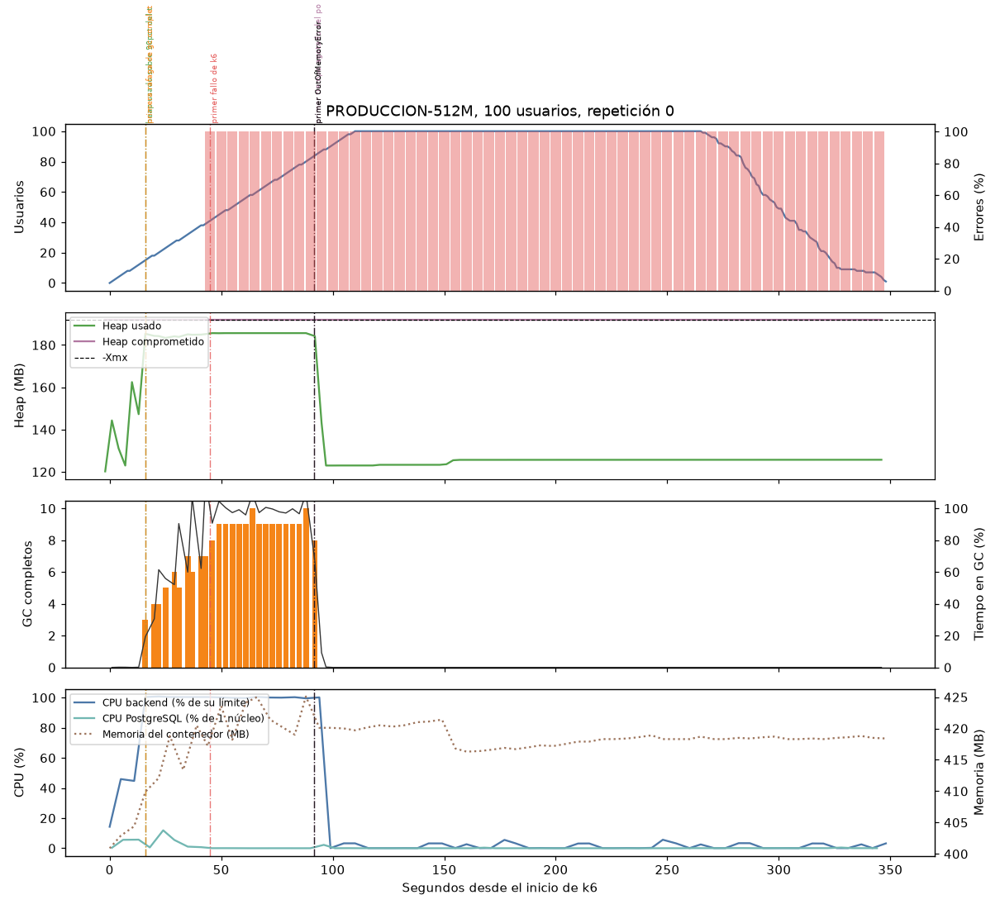

### CAPACIDAD-2G, 100 usuarios, repetición 0

- Duración observada: 286 s; 6324 peticiones, 9 con fallo.
- **Primer fallo a los 24 s, con 22 usuarios activos.**

| t (s) | Operación | Estado | Duración (ms) | Error de k6 |
|---|---|---|---|---|
| 24.0 | cita | 400 | 42 |  |
| 34.0 | cita | 400 | 55 |  |
| 43.0 | cita | 400 | 37 |  |
| 100.0 | cita | 400 | 18 |  |
| 109.0 | cita | 400 | 8 |  |
| 152.0 | cita | 400 | 10 |  |
| 178.0 | cita | 400 | 15 |  |
| 192.0 | cita | 400 | 8 |  |
| 248.0 | iniciar | 400 | 21 |  |

- Operaciones con fallos en los 30 s siguientes al primero: cita (3).
- **Qué ocurre primero** (segundos desde el inicio de k6): 17 s: cpu del backend al tope; 24 s: primer fallo de k6.
- **En los 30 s previos al primer fallo:** heap usado al inicio 173 MB, heap usado máx. 328 MB de 1024, RssAnon máx. 636 MB, contenedor 645 MB de 2048, CPU del backend 52 %, CPU de PostgreSQL 4 %, tiempo en GC 4.7 % con 3 GC completos.

### PRODUCCION-512M, 100 usuarios, repetición 0

- Duración observada: 344 s; 689 peticiones, 564 con fallo.
- **Primer fallo a los 45 s, con 41 usuarios activos.**

| t (s) | Operación | Estado | Duración (ms) | Error de k6 |
|---|---|---|---|---|
| 45.0 | reporte_clinico | 0 | 30001 | request timeout |
| 48.0 | login | 0 | 30000 | request timeout |
| 49.0 | login | 0 | 30000 | request timeout |
| 50.0 | login | 0 | 30001 | request timeout |
| 51.0 | login | 0 | 30001 | request timeout |
| 52.0 | citas_del_mes | 0 | 30001 | request timeout |
| 52.0 | lista_de_historias | 0 | 30000 | request timeout |
| 52.0 | login | 0 | 30001 | request timeout |
| 52.0 | apoderado | 0 | 30001 | request timeout |
| 53.0 | checkin | 0 | 30001 | request timeout |
| 53.0 | mascota | 0 | 30001 | request timeout |
| 53.0 | login | 0 | 30000 | request timeout |

- Operaciones con fallos en los 30 s siguientes al primero: login (26), apoderado (6), checkin (2), navegacion (2), reporte_clinico (1), citas_del_mes (1), lista_de_historias (1), mascota (1).
- **Qué ocurre primero** (segundos desde el inicio de k6): 17 s: primera rafaga de gc completo; 17 s: contenedor sobre 80pct de memoria; 17 s: cpu del backend al tope; 20 s: heap usado sobre 90pct del tope; 45 s: primer fallo de k6; 115 s: primer OutOfMemoryError.
- **En los 30 s previos al primer fallo:** heap usado al inicio 153 MB, heap usado máx. 186 MB de 192, RssAnon máx. 411 MB, contenedor 423 MB de 512, CPU del backend 100 %, CPU de PostgreSQL 0 %, tiempo en GC 81.5 % con 88 GC completos.
- OutOfMemoryError en el registro: 24 líneas (ejemplo: `Exception in thread "http-nio-8080-Acceptor" java.lang.OutOfMemoryError: Java heap space`).

### CAPACIDAD-2G, 100 usuarios, repetición 0

- Duración observada: 286 s; 6289 peticiones, 16 con fallo.
- **Primer fallo a los 33 s, con 30 usuarios activos.**

| t (s) | Operación | Estado | Duración (ms) | Error de k6 |
|---|---|---|---|---|
| 33.0 | cita | 400 | 64 |  |
| 43.0 | cita | 400 | 44 |  |
| 97.0 | cita | 400 | 42 |  |
| 98.0 | cita | 400 | 40 |  |
| 100.0 | cita | 400 | 29 |  |
| 109.0 | cita | 400 | 17 |  |
| 153.0 | cita | 400 | 27 |  |
| 168.0 | iniciar | 400 | 48 |  |
| 181.0 | cita | 400 | 32 |  |
| 195.0 | cita | 400 | 25 |  |
| 252.0 | cita | 400 | 65 |  |
| 254.0 | cita | 400 | 9 |  |

- Operaciones con fallos en los 30 s siguientes al primero: cita (2).
- **Qué ocurre primero** (segundos desde el inicio de k6): 18 s: cpu del backend al tope; 33 s: primer fallo de k6.
- **En los 30 s previos al primer fallo:** heap usado al inicio 164 MB, heap usado máx. 282 MB de 1024, RssAnon máx. 651 MB, contenedor 659 MB de 2048, CPU del backend 84 %, CPU de PostgreSQL 8 %, tiempo en GC 3.8 % con 2 GC completos.

### PRODUCCION-512M, 100 usuarios, repetición 0

- Duración observada: 345 s; 734 peticiones, 562 con fallo.
- **Primer fallo a los 28 s, con 26 usuarios activos.**

| t (s) | Operación | Estado | Duración (ms) | Error de k6 |
|---|---|---|---|---|
| 28.0 | cita | 400 | 1153 |  |
| 45.0 | reporte_clinico | 0 | 30001 | request timeout |
| 51.0 | login | 0 | 30001 | request timeout |
| 52.0 | login | 0 | 30000 | request timeout |
| 54.0 | login | 0 | 30000 | request timeout |
| 55.0 | login | 0 | 30001 | request timeout |
| 56.0 | login | 0 | 30000 | request timeout |
| 57.0 | login | 0 | 30000 | request timeout |
| 58.0 | login | 0 | 30001 | request timeout |
| 59.0 | login | 0 | 30000 | request timeout |
| 60.0 | login | 0 | 30000 | request timeout |
| 61.0 | login | 0 | 30000 | request timeout |

- Operaciones con fallos en los 30 s siguientes al primero: login (7), cita (1), reporte_clinico (1).
- **Qué ocurre primero** (segundos desde el inicio de k6): 17 s: heap usado sobre 90pct del tope; 17 s: primera rafaga de gc completo; 17 s: contenedor sobre 80pct de memoria; 17 s: cpu del backend al tope; 28 s: primer fallo de k6; 79 s: primer tiempo agotado del pool; 79 s: primer OutOfMemoryError.
- **En los 30 s previos al primer fallo:** heap usado al inicio 144 MB, heap usado máx. 185 MB de 192, RssAnon máx. 415 MB, contenedor 423 MB de 512, CPU del backend 74 %, CPU de PostgreSQL 5 %, tiempo en GC 18.5 % con 16 GC completos.
- OutOfMemoryError en el registro: 5 líneas (ejemplo: `Exception in thread "http-nio-8080-Acceptor" java.lang.OutOfMemoryError: Java heap space`).
- Esperas de conexión agotadas en el registro: 6.

### CAPACIDAD-2G, 100 usuarios, repetición 0

- Duración observada: 285 s; 6276 peticiones, 12 con fallo.
- **Primer fallo a los 66 s, con 60 usuarios activos.**

| t (s) | Operación | Estado | Duración (ms) | Error de k6 |
|---|---|---|---|---|
| 66.0 | cita | 400 | 47 |  |
| 74.0 | cita | 400 | 23 |  |
| 76.0 | cita | 400 | 49 |  |
| 82.0 | cita | 400 | 38 |  |
| 127.0 | iniciar | 400 | 12 |  |
| 147.0 | cita | 400 | 166 |  |
| 194.0 | cita | 400 | 11 |  |
| 230.0 | iniciar | 400 | 11 |  |
| 234.0 | cita | 400 | 21 |  |
| 251.0 | cita | 400 | 25 |  |
| 263.0 | cita | 400 | 11 |  |
| 263.0 | cita | 400 | 11 |  |

- Operaciones con fallos en los 30 s siguientes al primero: cita (4).
- **Qué ocurre primero** (segundos desde el inicio de k6): 18 s: cpu del backend al tope; 66 s: primer fallo de k6.
- **En los 30 s previos al primer fallo:** heap usado al inicio 152 MB, heap usado máx. 303 MB de 1024, RssAnon máx. 702 MB, contenedor 711 MB de 2048, CPU del backend 100 %, CPU de PostgreSQL 10 %, tiempo en GC 3.7 % con 2 GC completos.

### PRODUCCION-512M, 100 usuarios, repetición 0

- Duración observada: 346 s; 740 peticiones, 565 con fallo.
- **Primer fallo a los 29 s, con 27 usuarios activos.**

| t (s) | Operación | Estado | Duración (ms) | Error de k6 |
|---|---|---|---|---|
| 29.0 | cita | 400 | 1627 |  |
| 46.0 | reporte_clinico | 0 | 30000 | request timeout |
| 51.0 | login | 0 | 30001 | request timeout |
| 53.0 | login | 0 | 30001 | request timeout |
| 54.0 | login | 0 | 30000 | request timeout |
| 55.0 | login | 0 | 30000 | request timeout |
| 56.0 | login | 0 | 30001 | request timeout |
| 57.0 | login | 0 | 30000 | request timeout |
| 58.0 | login | 0 | 30001 | request timeout |
| 59.0 | login | 0 | 30000 | request timeout |
| 60.0 | login | 0 | 30001 | request timeout |
| 61.0 | login | 0 | 30001 | request timeout |

- Operaciones con fallos en los 30 s siguientes al primero: login (8), cita (1), reporte_clinico (1).
- **Qué ocurre primero** (segundos desde el inicio de k6): 17 s: heap usado sobre 90pct del tope; 17 s: primera rafaga de gc completo; 17 s: contenedor sobre 80pct de memoria; 19 s: cpu del backend al tope; 29 s: primer fallo de k6; 199 s: primer OutOfMemoryError.
- **En los 30 s previos al primer fallo:** heap usado al inicio 148 MB, heap usado máx. 186 MB de 192, RssAnon máx. 414 MB, contenedor 422 MB de 512, CPU del backend 45 %, CPU de PostgreSQL 8 %, tiempo en GC 22.7 % con 21 GC completos.
- OutOfMemoryError en el registro: 26 líneas (ejemplo: `Exception in thread "http-nio-8080-Acceptor" java.lang.OutOfMemoryError: Java heap space`).

### CAPACIDAD-2G, 100 usuarios, repetición 0

- Duración observada: 287 s; 6261 peticiones, 11 con fallo.
- **Primer fallo a los 24 s, con 22 usuarios activos.**

| t (s) | Operación | Estado | Duración (ms) | Error de k6 |
|---|---|---|---|---|
| 24.0 | cita | 400 | 184 |  |
| 34.0 | cita | 400 | 58 |  |
| 44.0 | cita | 400 | 70 |  |
| 101.0 | cita | 400 | 25 |  |
| 109.0 | cita | 400 | 57 |  |
| 112.0 | iniciar | 400 | 13 |  |
| 153.0 | cita | 400 | 23 |  |
| 169.0 | iniciar | 400 | 73 |  |
| 183.0 | cita | 400 | 12 |  |
| 195.0 | cita | 400 | 11 |  |
| 247.0 | iniciar | 400 | 10 |  |

- Operaciones con fallos en los 30 s siguientes al primero: cita (3).
- **Qué ocurre primero** (segundos desde el inicio de k6): 16 s: cpu del backend al tope; 24 s: primer fallo de k6.
- **En los 30 s previos al primer fallo:** heap usado al inicio 164 MB, heap usado máx. 275 MB de 1024, RssAnon máx. 589 MB, contenedor 596 MB de 2048, CPU del backend 94 %, CPU de PostgreSQL 6 %, tiempo en GC 4.5 % con 2 GC completos.

### PRODUCCION-512M, 100 usuarios, repetición 0

- Duración observada: 346 s; 765 peticiones, 566 con fallo.
- **Primer fallo a los 45 s, con 41 usuarios activos.**

| t (s) | Operación | Estado | Duración (ms) | Error de k6 |
|---|---|---|---|---|
| 45.0 | reporte_clinico | 0 | 30001 | request timeout |
| 55.0 | login | 0 | 30000 | request timeout |
| 56.0 | login | 0 | 30001 | request timeout |
| 57.0 | login | 0 | 30001 | request timeout |
| 58.0 | login | 0 | 30000 | request timeout |
| 59.0 | login | 0 | 30000 | request timeout |
| 60.0 | login | 0 | 30000 | request timeout |
| 60.0 | cerrar_consulta | 0 | 30000 | request timeout |
| 61.0 | login | 0 | 30001 | request timeout |
| 62.0 | login | 0 | 30000 | request timeout |
| 63.0 | login | 0 | 30001 | request timeout |
| 64.0 | panel | 0 | 30001 | request timeout |

- Operaciones con fallos en los 30 s siguientes al primero: login (20), apoderado (6), navegacion (4), reporte_clinico (1), cerrar_consulta (1), panel (1), mascota (1), notificaciones (1).
- **Qué ocurre primero** (segundos desde el inicio de k6): 17 s: heap usado sobre 90pct del tope; 17 s: primera rafaga de gc completo; 17 s: contenedor sobre 80pct de memoria; 19 s: cpu del backend al tope; 45 s: primer fallo de k6; 216 s: primer OutOfMemoryError; 297 s: primer tiempo agotado del pool.
- **En los 30 s previos al primer fallo:** heap usado al inicio 149 MB, heap usado máx. 186 MB de 192, RssAnon máx. 418 MB, contenedor 426 MB de 512, CPU del backend 100 %, CPU de PostgreSQL 4 %, tiempo en GC 55.1 % con 48 GC completos.
- OutOfMemoryError en el registro: 38 líneas (ejemplo: `Exception in thread "http-nio-8080-Acceptor" java.lang.OutOfMemoryError: Java heap space`).
- Esperas de conexión agotadas en el registro: 1.

### CAPACIDAD-2G, 100 usuarios, repetición 0

- Duración observada: 284 s; 6282 peticiones, 9 con fallo.
- **Primer fallo a los 24 s, con 22 usuarios activos.**

| t (s) | Operación | Estado | Duración (ms) | Error de k6 |
|---|---|---|---|---|
| 24.0 | cita | 400 | 148 |  |
| 34.0 | cita | 400 | 62 |  |
| 44.0 | cita | 400 | 34 |  |
| 101.0 | cita | 400 | 25 |  |
| 110.0 | cita | 400 | 24 |  |
| 154.0 | cita | 400 | 75 |  |
| 181.0 | cita | 400 | 28 |  |
| 195.0 | cita | 400 | 16 |  |
| 247.0 | iniciar | 400 | 26 |  |

- Operaciones con fallos en los 30 s siguientes al primero: cita (3).
- **Qué ocurre primero** (segundos desde el inicio de k6): 19 s: cpu del backend al tope; 24 s: primer fallo de k6.
- **En los 30 s previos al primer fallo:** heap usado al inicio 154 MB, heap usado máx. 302 MB de 1024, RssAnon máx. 583 MB, contenedor 590 MB de 2048, CPU del backend 75 %, CPU de PostgreSQL 9 %, tiempo en GC 3.8 % con 2 GC completos.

### PRODUCCION-512M, 100 usuarios, repetición 0

- Duración observada: 346 s; 753 peticiones, 568 con fallo.
- **Primer fallo a los 45 s, con 41 usuarios activos.**

| t (s) | Operación | Estado | Duración (ms) | Error de k6 |
|---|---|---|---|---|
| 45.0 | reporte_clinico | 0 | 30001 | request timeout |
| 52.0 | login | 0 | 30000 | request timeout |
| 53.0 | login | 0 | 30001 | request timeout |
| 54.0 | login | 0 | 30001 | request timeout |
| 55.0 | login | 0 | 30001 | request timeout |
| 56.0 | login | 0 | 30000 | request timeout |
| 57.0 | login | 0 | 30000 | request timeout |
| 59.0 | login | 0 | 30001 | request timeout |
| 60.0 | login | 0 | 30001 | request timeout |
| 61.0 | login | 0 | 30000 | request timeout |
| 62.0 | login | 0 | 30001 | request timeout |
| 62.0 | apoderado | 0 | 30001 | request timeout |

- Operaciones con fallos en los 30 s siguientes al primero: login (22), apoderado (7), navegacion (3), checkin (2), reporte_clinico (1), actualizar_mascota (1), lista_de_historias (1), notificaciones (1).
- **Qué ocurre primero** (segundos desde el inicio de k6): 13 s: contenedor sobre 80pct de memoria; 16 s: heap usado sobre 90pct del tope; 16 s: primera rafaga de gc completo; 16 s: cpu del backend al tope; 45 s: primer fallo de k6; 92 s: primer tiempo agotado del pool; 92 s: primer OutOfMemoryError.
- **En los 30 s previos al primer fallo:** heap usado al inicio 147 MB, heap usado máx. 185 MB de 192, RssAnon máx. 419 MB, contenedor 427 MB de 512, CPU del backend 100 %, CPU de PostgreSQL 1 %, tiempo en GC 59.9 % con 54 GC completos.
- OutOfMemoryError en el registro: 13 líneas (ejemplo: `Exception in thread "http-nio-8080-Acceptor" java.lang.OutOfMemoryError: Java heap space`).
- Esperas de conexión agotadas en el registro: 6.

### desconocido, 100 usuarios, repetición 0

- Duración observada: 345 s; 704 peticiones, 560 con fallo.
- **Primer fallo a los 45 s, con 41 usuarios activos.**

| t (s) | Operación | Estado | Duración (ms) | Error de k6 |
|---|---|---|---|---|
| 45.0 | reporte_clinico | 0 | 30001 | request timeout |
| 49.0 | login | 0 | 30000 | request timeout |
| 50.0 | login | 0 | 30000 | request timeout |
| 51.0 | login | 0 | 30000 | request timeout |
| 52.0 | lista_de_historias | 0 | 30001 | request timeout |
| 52.0 | login | 0 | 30001 | request timeout |
| 53.0 | login | 0 | 30001 | request timeout |
| 54.0 | login | 0 | 30001 | request timeout |
| 55.0 | mascota | 0 | 30001 | request timeout |
| 55.0 | iniciar | 0 | 30001 | request timeout |
| 55.0 | panel | 0 | 30000 | request timeout |
| 55.0 | login | 0 | 30001 | request timeout |

- Operaciones con fallos en los 30 s siguientes al primero: login (25), mascota (3), apoderado (3), panel (2), cancelar_cita (2), reporte_clinico (1), lista_de_historias (1), iniciar (1).
- **Qué ocurre primero** (segundos desde el inicio de k6): 14 s: contenedor sobre 80pct de memoria; 17 s: heap usado sobre 90pct del tope; 17 s: primera rafaga de gc completo; 19 s: cpu del backend al tope; 45 s: primer fallo de k6; 167 s: primer OutOfMemoryError; 227 s: primer tiempo agotado del pool.
- **En los 30 s previos al primer fallo:** heap usado al inicio 146 MB, heap usado máx. 186 MB de 192, RssAnon máx. 413 MB, contenedor 422 MB de 512, CPU del backend 100 %, CPU de PostgreSQL 2 %, tiempo en GC 71.3 % con 67 GC completos.
- OutOfMemoryError en el registro: 35 líneas (ejemplo: `Exception in thread "http-nio-8080-exec-38" java.lang.OutOfMemoryError: Java heap space`).
- Esperas de conexión agotadas en el registro: 5.

### desconocido, 50 usuarios, repetición 0

- Duración observada: 289 s; 417 peticiones, 258 con fallo.
- **Primer fallo a los 45 s, con 41 usuarios activos.**

| t (s) | Operación | Estado | Duración (ms) | Error de k6 |
|---|---|---|---|---|
| 45.0 | reporte_clinico | 0 | 30001 | request timeout |
| 50.0 | login | 0 | 30000 | request timeout |
| 51.0 | login | 0 | 30000 | request timeout |
| 52.0 | login | 0 | 30001 | request timeout |
| 53.0 | login | 0 | 30001 | request timeout |
| 54.0 | login | 0 | 30000 | request timeout |
| 55.0 | historia | 0 | 30001 | request timeout |
| 55.0 | login | 0 | 30001 | request timeout |
| 56.0 | login | 0 | 30000 | request timeout |
| 57.0 | propietarios | 0 | 30001 | request timeout |
| 57.0 | login | 0 | 30001 | request timeout |
| 57.0 | consulta | 0 | 30000 | request timeout |

- Operaciones con fallos en los 30 s siguientes al primero: login (24), apoderado (3), cita (2), cancelar_cita (2), navegacion (2), reporte_clinico (1), historia (1), propietarios (1).
- **Qué ocurre primero** (segundos desde el inicio de k6): 16 s: cpu del backend al tope; 17 s: heap usado sobre 90pct del tope; 17 s: primera rafaga de gc completo; 17 s: contenedor sobre 80pct de memoria; 45 s: primer fallo de k6; 87 s: primer OutOfMemoryError.
- **En los 30 s previos al primer fallo:** heap usado al inicio 151 MB, heap usado máx. 186 MB de 192, RssAnon máx. 418 MB, contenedor 427 MB de 512, CPU del backend 100 %, CPU de PostgreSQL 1 %, tiempo en GC 69.6 % con 66 GC completos.
- OutOfMemoryError en el registro: 17 líneas (ejemplo: `Exception in thread "http-nio-8080-Acceptor" java.lang.OutOfMemoryError: Java heap space`).

### desconocido, 100 usuarios, repetición 0

- Duración observada: 284 s; 6218 peticiones, 7 con fallo.
- **Primer fallo a los 99 s, con 90 usuarios activos.**

| t (s) | Operación | Estado | Duración (ms) | Error de k6 |
|---|---|---|---|---|
| 99.0 | cita | 400 | 20 |  |
| 99.0 | iniciar | 400 | 12 |  |
| 168.0 | iniciar | 400 | 16 |  |
| 191.0 | cita | 400 | 10 |  |
| 230.0 | iniciar | 400 | 149 |  |
| 255.0 | iniciar | 400 | 65 |  |
| 282.0 | cita | 400 | 10 |  |

- Operaciones con fallos en los 30 s siguientes al primero: cita (1), iniciar (1).
- **Qué ocurre primero** (segundos desde el inicio de k6): 16 s: primera rafaga de gc completo; 16 s: contenedor sobre 80pct de memoria; 16 s: cpu del backend al tope; 61 s: heap usado sobre 90pct del tope; 99 s: primer fallo de k6.
- **En los 30 s previos al primer fallo:** heap usado al inicio 148 MB, heap usado máx. 163 MB de 192, RssAnon máx. 424 MB, contenedor 432 MB de 512, CPU del backend 55 %, CPU de PostgreSQL 7 %, tiempo en GC 4.5 % con 5 GC completos.

### desconocido, 50 usuarios, repetición 0

- Duración observada: 230 s; 2776 peticiones, 2 con fallo.
- **Primer fallo a los 98 s, con 50 usuarios activos.**

| t (s) | Operación | Estado | Duración (ms) | Error de k6 |
|---|---|---|---|---|
| 98.0 | cita | 400 | 20 |  |
| 190.0 | cita | 400 | 26 |  |

- Operaciones con fallos en los 30 s siguientes al primero: cita (1).
- **Qué ocurre primero** (segundos desde el inicio de k6): 16 s: heap usado sobre 90pct del tope; 16 s: primera rafaga de gc completo; 16 s: contenedor sobre 80pct de memoria; 16 s: cpu del backend al tope; 98 s: primer fallo de k6.
- **En los 30 s previos al primer fallo:** heap usado al inicio 142 MB, heap usado máx. 173 MB de 192, RssAnon máx. 420 MB, contenedor 429 MB de 512, CPU del backend 11 %, CPU de PostgreSQL 5 %, tiempo en GC 6.0 % con 7 GC completos.

### desconocido, 100 usuarios, repetición 0

- Duración observada: 287 s; 6335 peticiones, 12 con fallo.
- **Primer fallo a los 52 s, con 48 usuarios activos.**

| t (s) | Operación | Estado | Duración (ms) | Error de k6 |
|---|---|---|---|---|
| 52.0 | cita | 400 | 41 |  |
| 65.0 | cita | 400 | 16 |  |
| 74.0 | cita | 400 | 34 |  |
| 74.0 | cita | 400 | 25 |  |
| 82.0 | cita | 400 | 12 |  |
| 146.0 | cita | 400 | 35 |  |
| 168.0 | iniciar | 400 | 16 |  |
| 191.0 | cita | 400 | 11 |  |
| 194.0 | cita | 400 | 32 |  |
| 251.0 | cita | 400 | 11 |  |
| 262.0 | cita | 400 | 22 |  |
| 263.0 | cita | 400 | 12 |  |

- Operaciones con fallos en los 30 s siguientes al primero: cita (5).
- **Qué ocurre primero** (segundos desde el inicio de k6): 17 s: contenedor sobre 80pct de memoria; 17 s: cpu del backend al tope; 52 s: primer fallo de k6.
- **En los 30 s previos al primer fallo:** heap usado al inicio 136 MB, heap usado máx. 156 MB de 192, RssAnon máx. 419 MB, contenedor 426 MB de 512, CPU del backend 48 %, CPU de PostgreSQL 7 %, tiempo en GC 1.7 % con 2 GC completos.

### desconocido, 50 usuarios, repetición 0

- Duración observada: 231 s; 2817 peticiones, 8 con fallo.
- **Primer fallo a los 52 s, con 48 usuarios activos.**

| t (s) | Operación | Estado | Duración (ms) | Error de k6 |
|---|---|---|---|---|
| 52.0 | cita | 400 | 39 |  |
| 65.0 | cita | 400 | 31 |  |
| 74.0 | cita | 400 | 14 |  |
| 74.0 | cita | 400 | 11 |  |
| 81.0 | cita | 400 | 13 |  |
| 146.0 | cita | 400 | 17 |  |
| 191.0 | cita | 400 | 11 |  |
| 194.0 | cita | 400 | 12 |  |

- Operaciones con fallos en los 30 s siguientes al primero: cita (5).
- **Qué ocurre primero** (segundos desde el inicio de k6): 17 s: contenedor sobre 80pct de memoria; 52 s: primer fallo de k6.
- **En los 30 s previos al primer fallo:** heap usado al inicio 136 MB, heap usado máx. 158 MB de 192, RssAnon máx. 416 MB, contenedor 424 MB de 512, CPU del backend 52 %, CPU de PostgreSQL 6 %, tiempo en GC 1.4 % con 2 GC completos.

### desconocido, 100 usuarios, repetición 0

- Duración observada: 339 s; 3670 peticiones, 365 con fallo.
- **Primer fallo a los 33 s, con 30 usuarios activos.**

| t (s) | Operación | Estado | Duración (ms) | Error de k6 |
|---|---|---|---|---|
| 33.0 | cita | 400 | 18 |  |
| 43.0 | cita | 400 | 22 |  |
| 95.0 | cita | 400 | 64 |  |
| 102.0 | cita | 400 | 27 |  |
| 109.0 | cita | 400 | 13 |  |
| 128.0 | iniciar | 400 | 1098 |  |
| 130.0 | iniciar | 400 | 608 |  |
| 130.0 | iniciar | 400 | 732 |  |
| 131.0 | iniciar | 400 | 551 |  |
| 135.0 | iniciar | 400 | 28 |  |
| 141.0 | cita | 400 | 11 |  |
| 147.0 | cita | 400 | 55 |  |

- Operaciones con fallos en los 30 s siguientes al primero: cita (2).
- **Qué ocurre primero** (segundos desde el inicio de k6): -1 s: contenedor sobre 80pct de memoria; 17 s: cpu del backend al tope; 20 s: heap usado sobre 90pct del tope; 20 s: primera rafaga de gc completo; 33 s: primer fallo de k6; 189 s: primer OutOfMemoryError; 189 s: primer tiempo agotado del pool.
- **En los 30 s previos al primer fallo:** heap usado al inicio 146 MB, heap usado máx. 244 MB de 256, RssAnon máx. 476 MB, contenedor 484 MB de 512, CPU del backend 48 %, CPU de PostgreSQL 4 %, tiempo en GC 8.0 % con 7 GC completos.
- OutOfMemoryError en el registro: 17 líneas (ejemplo: `Exception in thread "http-nio-8080-Acceptor" java.lang.OutOfMemoryError: Java heap space`).
- Esperas de conexión agotadas en el registro: 43.

### desconocido, 50 usuarios, repetición 0

- Duración observada: 232 s; 2791 peticiones, 8 con fallo.
- **Primer fallo a los 34 s, con 31 usuarios activos.**

| t (s) | Operación | Estado | Duración (ms) | Error de k6 |
|---|---|---|---|---|
| 34.0 | cita | 400 | 21 |  |
| 43.0 | cita | 400 | 28 |  |
| 94.0 | cita | 400 | 26 |  |
| 101.0 | cita | 400 | 12 |  |
| 109.0 | cita | 400 | 12 |  |
| 153.0 | cita | 400 | 32 |  |
| 179.0 | cita | 400 | 12 |  |
| 192.0 | cita | 400 | 13 |  |

- Operaciones con fallos en los 30 s siguientes al primero: cita (2).
- **Qué ocurre primero** (segundos desde el inicio de k6): -1 s: contenedor sobre 80pct de memoria; 17 s: cpu del backend al tope; 20 s: heap usado sobre 90pct del tope; 20 s: primera rafaga de gc completo; 34 s: primer fallo de k6.
- **En los 30 s previos al primer fallo:** heap usado al inicio 150 MB, heap usado máx. 236 MB de 256, RssAnon máx. 476 MB, contenedor 484 MB de 512, CPU del backend 47 %, CPU de PostgreSQL 5 %, tiempo en GC 7.2 % con 6 GC completos.

### desconocido, 100 usuarios, repetición 0

- Duración observada: 41 s; 213 peticiones, 88 con fallo.
- **Primer fallo a los 20 s, con 19 usuarios activos.**

| t (s) | Operación | Estado | Duración (ms) | Error de k6 |
|---|---|---|---|---|
| 20.0 | login | 0 | 878 | EOF |
| 20.0 | reporte_clinico | 0 | 0 | read: connection reset by peer |
| 20.0 | reporte_de_ventas | 0 | 0 | read: connection reset by peer |
| 20.0 | pacientes_inactivos | 0 | 1 | read: connection reset by peer |
| 20.0 | apoderado | 0 | 0 | dial: connection refused |
| 20.0 | login | 0 | 0 | dial: connection refused |
| 21.0 | login | 0 | 0 | dial: connection refused |
| 21.0 | apoderado | 0 | 0 | dial: connection refused |
| 21.0 | navegacion | 0 | 0 | dial: connection refused |
| 21.0 | privacidad | 0 | 0 | dial: connection refused |
| 21.0 | cumplimiento | 0 | 0 | dial: connection refused |
| 21.0 | notificaciones | 0 | 0 | dial: connection refused |

- Operaciones con fallos en los 30 s siguientes al primero: login (21), apoderado (13), navegacion (7), privacidad (7), cumplimiento (7), notificaciones (7), avisos_de_cumplimiento (7), panel (7).
- **Qué ocurre primero** (segundos desde el inicio de k6): -1 s: contenedor sobre 80pct de memoria; 16 s: cpu del backend al tope; 20 s: primer fallo de k6; 20 s: primera rafaga de gc completo.
- **En los 30 s previos al primer fallo:** heap usado al inicio 168 MB, heap usado máx. 242 MB de 288, RssAnon máx. 499 MB, contenedor 507 MB de 512, CPU del backend 44 %, CPU de PostgreSQL 1 %, tiempo en GC 7.3 % con 4 GC completos.

### desconocido, 50 usuarios, repetición 0

- Duración observada: 41 s; 213 peticiones, 89 con fallo.
- **Primer fallo a los 19 s, con 18 usuarios activos.**

| t (s) | Operación | Estado | Duración (ms) | Error de k6 |
|---|---|---|---|---|
| 19.0 | login | 0 | 418 | EOF |
| 19.0 | panel | 0 | 0 | EOF |
| 19.0 | reporte_clinico | 0 | 1 | EOF |
| 19.0 | reporte_de_ventas | 0 | 0 | read: connection reset by peer |
| 19.0 | pacientes_inactivos | 0 | 0 | read: connection reset by peer |
| 19.0 | apoderado | 0 | 0 | dial: connection refused |
| 20.0 | login | 0 | 0 | dial: connection refused |
| 21.0 | login | 0 | 0 | dial: connection refused |
| 21.0 | apoderado | 0 | 0 | dial: connection refused |
| 21.0 | navegacion | 0 | 0 | dial: connection refused |
| 21.0 | privacidad | 0 | 0 | dial: connection refused |
| 21.0 | cumplimiento | 0 | 0 | dial: connection refused |

- Operaciones con fallos en los 30 s siguientes al primero: login (21), apoderado (13), panel (8), navegacion (7), privacidad (7), cumplimiento (7), notificaciones (7), avisos_de_cumplimiento (7).
- **Qué ocurre primero** (segundos desde el inicio de k6): -2 s: contenedor sobre 80pct de memoria; 16 s: cpu del backend al tope; 19 s: primer fallo de k6.
- **En los 30 s previos al primer fallo:** heap usado al inicio 170 MB, heap usado máx. 241 MB de 288, RssAnon máx. 495 MB, contenedor 503 MB de 512, CPU del backend 44 %, CPU de PostgreSQL 2 %, tiempo en GC 1.7 % con 1 GC completos.

### desconocido, 100 usuarios, repetición 0

- Duración observada: 347 s; 703 peticiones, 560 con fallo.
- **Primer fallo a los 45 s, con 41 usuarios activos.**

| t (s) | Operación | Estado | Duración (ms) | Error de k6 |
|---|---|---|---|---|
| 45.0 | reporte_clinico | 0 | 30001 | request timeout |
| 49.0 | login | 0 | 30001 | request timeout |
| 50.0 | login | 0 | 30000 | request timeout |
| 52.0 | login | 0 | 30001 | request timeout |
| 53.0 | login | 0 | 30001 | request timeout |
| 54.0 | login | 0 | 30001 | request timeout |
| 55.0 | apoderado | 0 | 30000 | request timeout |
| 55.0 | login | 0 | 30000 | request timeout |
| 55.0 | panel | 0 | 30001 | request timeout |
| 55.0 | apoderado | 0 | 30001 | request timeout |
| 55.0 | panel | 0 | 30001 | request timeout |
| 56.0 | login | 0 | 30000 | request timeout |

- Operaciones con fallos en los 30 s siguientes al primero: login (24), apoderado (5), panel (2), cancelar_cita (2), reporte_clinico (1), iniciar (1), cita (1), historia (1).
- **Qué ocurre primero** (segundos desde el inicio de k6): 17 s: heap usado sobre 90pct del tope; 17 s: primera rafaga de gc completo; 17 s: contenedor sobre 80pct de memoria; 19 s: cpu del backend al tope; 45 s: primer fallo de k6; 102 s: primer tiempo agotado del pool; 102 s: primer OutOfMemoryError.
- **En los 30 s previos al primer fallo:** heap usado al inicio 150 MB, heap usado máx. 186 MB de 192, RssAnon máx. 418 MB, contenedor 427 MB de 512, CPU del backend 100 %, CPU de PostgreSQL 1 %, tiempo en GC 77.4 % con 78 GC completos.
- OutOfMemoryError en el registro: 18 líneas (ejemplo: `Exception in thread "http-nio-8080-Acceptor" java.lang.OutOfMemoryError: Java heap space`).
- Esperas de conexión agotadas en el registro: 1.

### desconocido, 50 usuarios, repetición 0

- Duración observada: 285 s; 383 peticiones, 259 con fallo.
- **Primer fallo a los 45 s, con 41 usuarios activos.**

| t (s) | Operación | Estado | Duración (ms) | Error de k6 |
|---|---|---|---|---|
| 45.0 | reporte_clinico | 0 | 30000 | request timeout |
| 48.0 | login | 0 | 30000 | request timeout |
| 49.0 | login | 0 | 30000 | request timeout |
| 50.0 | login | 0 | 30000 | request timeout |
| 51.0 | login | 0 | 30001 | request timeout |
| 52.0 | citas_del_mes | 0 | 30001 | request timeout |
| 52.0 | lista_de_historias | 0 | 30001 | request timeout |
| 52.0 | login | 0 | 30000 | request timeout |
| 53.0 | apoderado | 0 | 30000 | request timeout |
| 53.0 | mascota | 0 | 30001 | request timeout |
| 53.0 | checkin | 0 | 30000 | request timeout |
| 54.0 | login | 0 | 30001 | request timeout |

- Operaciones con fallos en los 30 s siguientes al primero: login (25), apoderado (6), checkin (2), navegacion (2), reporte_clinico (1), citas_del_mes (1), lista_de_historias (1), mascota (1).
- **Qué ocurre primero** (segundos desde el inicio de k6): 14 s: contenedor sobre 80pct de memoria; 17 s: heap usado sobre 90pct del tope; 17 s: primera rafaga de gc completo; 17 s: cpu del backend al tope; 45 s: primer fallo de k6; 173 s: primer OutOfMemoryError.
- **En los 30 s previos al primer fallo:** heap usado al inicio 151 MB, heap usado máx. 186 MB de 192, RssAnon máx. 411 MB, contenedor 421 MB de 512, CPU del backend 101 %, CPU de PostgreSQL 1 %, tiempo en GC 81.4 % con 95 GC completos.
- OutOfMemoryError en el registro: 27 líneas (ejemplo: `Exception in thread "http-nio-8080-Acceptor" java.lang.OutOfMemoryError: Java heap space`).

### desconocido, 100 usuarios, repetición 0

- Duración observada: 287 s; 6264 peticiones, 5 con fallo.
- **Primer fallo a los 100 s, con 91 usuarios activos.**

| t (s) | Operación | Estado | Duración (ms) | Error de k6 |
|---|---|---|---|---|
| 100.0 | cita | 400 | 51 |  |
| 109.0 | cita | 400 | 13 |  |
| 150.0 | iniciar | 400 | 17 |  |
| 153.0 | cita | 400 | 15 |  |
| 168.0 | iniciar | 400 | 16 |  |

- Operaciones con fallos en los 30 s siguientes al primero: cita (2).
- **Qué ocurre primero** (segundos desde el inicio de k6): 17 s: primera rafaga de gc completo; 17 s: contenedor sobre 80pct de memoria; 19 s: cpu del backend al tope; 62 s: heap usado sobre 90pct del tope; 100 s: primer fallo de k6.
- **En los 30 s previos al primer fallo:** heap usado al inicio 143 MB, heap usado máx. 185 MB de 192, RssAnon máx. 421 MB, contenedor 430 MB de 512, CPU del backend 46 %, CPU de PostgreSQL 9 %, tiempo en GC 5.6 % con 7 GC completos.

### desconocido, 50 usuarios, repetición 0

- Duración observada: 231 s; 2785 peticiones, 3 con fallo.
- **Primer fallo a los 99 s, con 50 usuarios activos.**

| t (s) | Operación | Estado | Duración (ms) | Error de k6 |
|---|---|---|---|---|
| 99.0 | cita | 400 | 21 |  |
| 108.0 | cita | 400 | 11 |  |
| 152.0 | cita | 400 | 28 |  |

- Operaciones con fallos en los 30 s siguientes al primero: cita (2).
- **Qué ocurre primero** (segundos desde el inicio de k6): 14 s: contenedor sobre 80pct de memoria; 17 s: primera rafaga de gc completo; 99 s: primer fallo de k6; 146 s: heap usado sobre 90pct del tope.
- **En los 30 s previos al primer fallo:** heap usado al inicio 150 MB, heap usado máx. 164 MB de 192, RssAnon máx. 417 MB, contenedor 425 MB de 512, CPU del backend 13 %, CPU de PostgreSQL 1 %, tiempo en GC 4.7 % con 6 GC completos.

### desconocido, 100 usuarios, repetición 0

- Duración observada: 286 s; 6366 peticiones, 12 con fallo.
- **Primer fallo a los 33 s, con 30 usuarios activos.**

| t (s) | Operación | Estado | Duración (ms) | Error de k6 |
|---|---|---|---|---|
| 33.0 | cita | 400 | 42 |  |
| 43.0 | cita | 400 | 21 |  |
| 98.0 | cita | 400 | 16 |  |
| 108.0 | cita | 400 | 37 |  |
| 150.0 | iniciar | 400 | 12 |  |
| 151.0 | cita | 400 | 21 |  |
| 178.0 | cita | 400 | 10 |  |
| 191.0 | cita | 400 | 10 |  |
| 250.0 | cita | 400 | 11 |  |
| 280.0 | cita | 400 | 11 |  |
| 281.0 | cita | 400 | 11 |  |
| 284.0 | cita | 400 | 14 |  |

- Operaciones con fallos en los 30 s siguientes al primero: cita (2).
- **Qué ocurre primero** (segundos desde el inicio de k6): 17 s: contenedor sobre 80pct de memoria; 33 s: primer fallo de k6.
- **En los 30 s previos al primer fallo:** heap usado al inicio 140 MB, heap usado máx. 163 MB de 192, RssAnon máx. 415 MB, contenedor 423 MB de 512, CPU del backend 40 %, CPU de PostgreSQL 5 %, tiempo en GC 1.5 % con 2 GC completos.

### desconocido, 50 usuarios, repetición 0

- Duración observada: 231 s; 2810 peticiones, 7 con fallo.
- **Primer fallo a los 33 s, con 30 usuarios activos.**

| t (s) | Operación | Estado | Duración (ms) | Error de k6 |
|---|---|---|---|---|
| 33.0 | cita | 400 | 48 |  |
| 43.0 | cita | 400 | 16 |  |
| 99.0 | cita | 400 | 22 |  |
| 108.0 | cita | 400 | 13 |  |
| 150.0 | cita | 400 | 24 |  |
| 177.0 | cita | 400 | 12 |  |
| 191.0 | cita | 400 | 12 |  |

- Operaciones con fallos en los 30 s siguientes al primero: cita (2).
- **Qué ocurre primero** (segundos desde el inicio de k6): 14 s: contenedor sobre 80pct de memoria; 33 s: primer fallo de k6.
- **En los 30 s previos al primer fallo:** heap usado al inicio 145 MB, heap usado máx. 167 MB de 192, RssAnon máx. 415 MB, contenedor 423 MB de 512, CPU del backend 45 %, CPU de PostgreSQL 4 %, tiempo en GC 1.5 % con 2 GC completos.

### desconocido, 100 usuarios, repetición 0

- Duración observada: 200 s; 3544 peticiones, 429 con fallo.
- **Primer fallo a los 52 s, con 48 usuarios activos.**

| t (s) | Operación | Estado | Duración (ms) | Error de k6 |
|---|---|---|---|---|
| 52.0 | cita | 400 | 43 |  |
| 67.0 | cita | 400 | 35 |  |
| 74.0 | cita | 400 | 41 |  |
| 76.0 | cita | 400 | 27 |  |
| 82.0 | cita | 400 | 11 |  |
| 148.0 | cita | 400 | 526 |  |
| 174.0 | reporte_clinico | 0 | 30001 | request timeout |
| 175.0 | reporte_clinico | 0 | 30000 | request timeout |
| 179.0 | privacidad | 0 | 1 | EOF |
| 179.0 | cita | 0 | 1143 | EOF |
| 179.0 | cita | 0 | 4423 | EOF |
| 179.0 | mascota | 0 | 12164 | EOF |

- Operaciones con fallos en los 30 s siguientes al primero: cita (5).
- **Qué ocurre primero** (segundos desde el inicio de k6): -1 s: contenedor sobre 80pct de memoria; 17 s: heap usado sobre 90pct del tope; 17 s: primera rafaga de gc completo; 17 s: cpu del backend al tope; 52 s: primer fallo de k6; 177 s: primer OutOfMemoryError.
- **En los 30 s previos al primer fallo:** heap usado al inicio 158 MB, heap usado máx. 187 MB de 256, RssAnon máx. 478 MB, contenedor 486 MB de 512, CPU del backend 45 %, CPU de PostgreSQL 5 %, tiempo en GC 1.6 % con 1 GC completos.
- OutOfMemoryError en el registro: 3 líneas (ejemplo: `java.lang.OutOfMemoryError: Java heap space`).

### desconocido, 50 usuarios, repetición 0

- Duración observada: 231 s; 2800 peticiones, 7 con fallo.
- **Primer fallo a los 52 s, con 48 usuarios activos.**

| t (s) | Operación | Estado | Duración (ms) | Error de k6 |
|---|---|---|---|---|
| 52.0 | cita | 400 | 41 |  |
| 67.0 | cita | 400 | 12 |  |
| 74.0 | cita | 400 | 14 |  |
| 76.0 | cita | 400 | 29 |  |
| 81.0 | cita | 400 | 11 |  |
| 146.0 | cita | 400 | 38 |  |
| 194.0 | cita | 400 | 11 |  |

- Operaciones con fallos en los 30 s siguientes al primero: cita (5).
- **Qué ocurre primero** (segundos desde el inicio de k6): -1 s: contenedor sobre 80pct de memoria; 17 s: primera rafaga de gc completo; 19 s: cpu del backend al tope; 52 s: primer fallo de k6; 62 s: heap usado sobre 90pct del tope.
- **En los 30 s previos al primer fallo:** heap usado al inicio 161 MB, heap usado máx. 184 MB de 256, RssAnon máx. 478 MB, contenedor 486 MB de 512, CPU del backend 42 %, CPU de PostgreSQL 6 %, tiempo en GC 1.4 % con 2 GC completos.

### desconocido, 100 usuarios, repetición 0

- Duración observada: 37 s; 181 peticiones, 74 con fallo.
- **Primer fallo a los 17 s, con 16 usuarios activos.**

| t (s) | Operación | Estado | Duración (ms) | Error de k6 |
|---|---|---|---|---|
| 17.0 | cumplimiento | 0 | 0 | EOF |
| 17.0 | reporte_clinico | 0 | 0 | EOF |
| 17.0 | notificaciones | 0 | 0 | read: connection reset by peer |
| 17.0 | reporte_de_ventas | 0 | 0 | read: connection reset by peer |
| 17.0 | avisos_de_cumplimiento | 0 | 0 | read: connection reset by peer |
| 17.0 | pacientes_inactivos | 0 | 0 | EOF |
| 17.0 | panel | 0 | 0 | read: connection reset by peer |
| 17.0 | login | 0 | 0 | dial: connection refused |
| 18.0 | login | 0 | 0 | dial: connection refused |
| 19.0 | login | 0 | 0 | dial: connection refused |
| 20.0 | apoderado | 0 | 0 | dial: connection refused |
| 20.0 | login | 0 | 0 | dial: connection refused |

- Operaciones con fallos en los 30 s siguientes al primero: login (19), apoderado (10), cumplimiento (6), notificaciones (6), avisos_de_cumplimiento (6), panel (6), navegacion (5), privacidad (5).
- **Qué ocurre primero** (segundos desde el inicio de k6): -1 s: contenedor sobre 80pct de memoria; 17 s: primer fallo de k6.
- **En los 30 s previos al primer fallo:** heap usado al inicio 148 MB, heap usado máx. 184 MB de 288, RssAnon máx. 489 MB, contenedor 496 MB de 512, CPU del backend 41 %, CPU de PostgreSQL 5 %, tiempo en GC 1.5 % con 1 GC completos.

### desconocido, 50 usuarios, repetición 0

- Duración observada: 37 s; 181 peticiones, 70 con fallo.
- **Primer fallo a los 17 s, con 16 usuarios activos.**

| t (s) | Operación | Estado | Duración (ms) | Error de k6 |
|---|---|---|---|---|
| 17.0 | login | 0 | 192 | EOF |
| 17.0 | reporte_clinico | 0 | 0 | read: connection reset by peer |
| 17.0 | reporte_de_ventas | 0 | 0 | EOF |
| 17.0 | pacientes_inactivos | 0 | 0 | EOF |
| 18.0 | login | 0 | 0 | dial: connection refused |
| 19.0 | login | 0 | 0 | dial: connection refused |
| 20.0 | apoderado | 0 | 0 | dial: connection refused |
| 20.0 | login | 0 | 0 | dial: connection refused |
| 21.0 | login | 0 | 0 | dial: connection refused |
| 21.0 | apoderado | 0 | 0 | dial: connection refused |
| 21.0 | navegacion | 0 | 0 | dial: connection refused |
| 21.0 | privacidad | 0 | 0 | dial: connection refused |

- Operaciones con fallos en los 30 s siguientes al primero: login (19), apoderado (10), navegacion (5), privacidad (5), cumplimiento (5), notificaciones (5), avisos_de_cumplimiento (5), panel (5).
- **Qué ocurre primero** (segundos desde el inicio de k6): -1 s: contenedor sobre 80pct de memoria; 17 s: primer fallo de k6; 17 s: cpu del backend al tope.
- **En los 30 s previos al primer fallo:** heap usado al inicio 161 MB, heap usado máx. 206 MB de 288, RssAnon máx. 489 MB, contenedor 498 MB de 512, CPU del backend 41 %, CPU de PostgreSQL 4 %, tiempo en GC 2.6 % con 1 GC completos.

### desconocido, 100 usuarios, repetición 0

- Duración observada: 344 s; 694 peticiones, 563 con fallo.
- **Primer fallo a los 45 s, con 41 usuarios activos.**

| t (s) | Operación | Estado | Duración (ms) | Error de k6 |
|---|---|---|---|---|
| 45.0 | reporte_clinico | 0 | 30001 | request timeout |
| 48.0 | login | 0 | 30000 | request timeout |
| 49.0 | login | 0 | 30001 | request timeout |
| 51.0 | login | 0 | 30001 | request timeout |
| 51.0 | lista_de_historias | 0 | 30000 | request timeout |
| 52.0 | login | 0 | 30001 | request timeout |
| 52.0 | apoderado | 0 | 30001 | request timeout |
| 52.0 | mascota | 0 | 30001 | request timeout |
| 52.0 | checkin | 0 | 30001 | request timeout |
| 53.0 | apoderado | 0 | 30001 | request timeout |
| 53.0 | login | 0 | 30000 | request timeout |
| 54.0 | apoderado | 0 | 30000 | request timeout |

- Operaciones con fallos en los 30 s siguientes al primero: login (25), apoderado (6), checkin (2), reporte_clinico (1), lista_de_historias (1), mascota (1), privacidad (1), avisos_de_cumplimiento (1).
- **Qué ocurre primero** (segundos desde el inicio de k6): 16 s: primera rafaga de gc completo; 16 s: contenedor sobre 80pct de memoria; 18 s: cpu del backend al tope; 19 s: heap usado sobre 90pct del tope; 45 s: primer fallo de k6; 182 s: primer OutOfMemoryError; 182 s: primer tiempo agotado del pool.
- **En los 30 s previos al primer fallo:** heap usado al inicio 151 MB, heap usado máx. 186 MB de 192, RssAnon máx. 412 MB, contenedor 422 MB de 512, CPU del backend 100 %, CPU de PostgreSQL 1 %, tiempo en GC 79.3 % con 84 GC completos.
- OutOfMemoryError en el registro: 35 líneas (ejemplo: `Exception in thread "http-nio-8080-Acceptor" java.lang.OutOfMemoryError: Java heap space`).
- Esperas de conexión agotadas en el registro: 1.

### desconocido, 50 usuarios, repetición 0

- Duración observada: 284 s; 1063 peticiones, 214 con fallo.
- **Primer fallo a los 37 s, con 34 usuarios activos.**

| t (s) | Operación | Estado | Duración (ms) | Error de k6 |
|---|---|---|---|---|
| 37.0 | login | 0 | 10015 | EOF |
| 37.0 | apoderado | 0 | 10010 | EOF |
| 39.0 | reporte_clinico | 500 | 23925 |  |
| 70.0 | cita | 400 | 42 |  |
| 93.0 | checkin | 0 | 9231 | EOF |
| 93.0 | reporte_clinico | 500 | 24349 |  |
| 93.0 | cancelar_cita | 401 | 11025 |  |
| 94.0 | iniciar | 400 | 874 |  |
| 94.0 | cita | 400 | 461 |  |
| 94.0 | cita | 400 | 124 |  |
| 118.0 | reporte_clinico | 0 | 30001 | request timeout |
| 125.0 | cancelar_cita | 0 | 20209 | EOF |

- Operaciones con fallos en los 30 s siguientes al primero: login (1), apoderado (1), reporte_clinico (1).
- **Qué ocurre primero** (segundos desde el inicio de k6): 17 s: heap usado sobre 90pct del tope; 17 s: primera rafaga de gc completo; 17 s: contenedor sobre 80pct de memoria; 17 s: cpu del backend al tope; 37 s: primer fallo de k6; 39 s: primer OutOfMemoryError.
- **En los 30 s previos al primer fallo:** heap usado al inicio 151 MB, heap usado máx. 186 MB de 192, RssAnon máx. 411 MB, contenedor 419 MB de 512, CPU del backend 100 %, CPU de PostgreSQL 3 %, tiempo en GC 54.5 % con 64 GC completos.
- OutOfMemoryError en el registro: 24 líneas (ejemplo: `java.lang.OutOfMemoryError: Java heap space`).

### desconocido, 100 usuarios, repetición 0

- Duración observada: 286 s; 6254 peticiones, 16 con fallo.
- **Primer fallo a los 99 s, con 90 usuarios activos.**

| t (s) | Operación | Estado | Duración (ms) | Error de k6 |
|---|---|---|---|---|
| 99.0 | cita | 400 | 49 |  |
| 109.0 | cita | 400 | 12 |  |
| 153.0 | cita | 400 | 32 |  |
| 168.0 | iniciar | 400 | 252 |  |
| 168.0 | iniciar | 400 | 17 |  |
| 228.0 | cita | 400 | 16 |  |
| 233.0 | cita | 400 | 13 |  |
| 235.0 | cita | 400 | 11 |  |
| 258.0 | cita | 400 | 10 |  |
| 259.0 | cita | 400 | 43 |  |
| 262.0 | cita | 400 | 10 |  |
| 264.0 | cita | 400 | 279 |  |

- Operaciones con fallos en los 30 s siguientes al primero: cita (2).
- **Qué ocurre primero** (segundos desde el inicio de k6): 17 s: primera rafaga de gc completo; 17 s: contenedor sobre 80pct de memoria; 62 s: heap usado sobre 90pct del tope; 63 s: cpu del backend al tope; 99 s: primer fallo de k6.
- **En los 30 s previos al primer fallo:** heap usado al inicio 133 MB, heap usado máx. 158 MB de 192, RssAnon máx. 415 MB, contenedor 424 MB de 512, CPU del backend 47 %, CPU de PostgreSQL 8 %, tiempo en GC 6.1 % con 7 GC completos.

### desconocido, 50 usuarios, repetición 0

- Duración observada: 231 s; 2776 peticiones, 3 con fallo.
- **Primer fallo a los 99 s, con 50 usuarios activos.**

| t (s) | Operación | Estado | Duración (ms) | Error de k6 |
|---|---|---|---|---|
| 99.0 | cita | 400 | 19 |  |
| 109.0 | cita | 400 | 14 |  |
| 153.0 | cita | 400 | 11 |  |

- Operaciones con fallos en los 30 s siguientes al primero: cita (2).
- **Qué ocurre primero** (segundos desde el inicio de k6): 14 s: contenedor sobre 80pct de memoria; 17 s: heap usado sobre 90pct del tope; 17 s: primera rafaga de gc completo; 17 s: cpu del backend al tope; 99 s: primer fallo de k6.
- **En los 30 s previos al primer fallo:** heap usado al inicio 146 MB, heap usado máx. 160 MB de 192, RssAnon máx. 417 MB, contenedor 425 MB de 512, CPU del backend 12 %, CPU de PostgreSQL 4 %, tiempo en GC 5.0 % con 6 GC completos.

### desconocido, 100 usuarios, repetición 0

- Duración observada: 287 s; 6359 peticiones, 12 con fallo.
- **Primer fallo a los 52 s, con 48 usuarios activos.**

| t (s) | Operación | Estado | Duración (ms) | Error de k6 |
|---|---|---|---|---|
| 52.0 | cita | 400 | 41 |  |
| 58.0 | cita | 400 | 13 |  |
| 74.0 | cita | 400 | 18 |  |
| 98.0 | cita | 400 | 19 |  |
| 128.0 | iniciar | 400 | 14 |  |
| 146.0 | cita | 400 | 24 |  |
| 168.0 | iniciar | 400 | 17 |  |
| 191.0 | cita | 400 | 13 |  |
| 194.0 | cita | 400 | 16 |  |
| 250.0 | cita | 400 | 11 |  |
| 262.0 | cita | 400 | 27 |  |
| 262.0 | cita | 400 | 14 |  |

- Operaciones con fallos en los 30 s siguientes al primero: cita (3).
- **Qué ocurre primero** (segundos desde el inicio de k6): 14 s: contenedor sobre 80pct de memoria; 52 s: primer fallo de k6.
- **En los 30 s previos al primer fallo:** heap usado al inicio 131 MB, heap usado máx. 150 MB de 192, RssAnon máx. 417 MB, contenedor 425 MB de 512, CPU del backend 48 %, CPU de PostgreSQL 7 %, tiempo en GC 1.6 % con 2 GC completos.

### desconocido, 50 usuarios, repetición 0

- Duración observada: 231 s; 2810 peticiones, 7 con fallo.
- **Primer fallo a los 52 s, con 48 usuarios activos.**

| t (s) | Operación | Estado | Duración (ms) | Error de k6 |
|---|---|---|---|---|
| 52.0 | cita | 400 | 42 |  |
| 58.0 | cita | 400 | 13 |  |
| 74.0 | cita | 400 | 14 |  |
| 98.0 | cita | 400 | 12 |  |
| 146.0 | cita | 400 | 24 |  |
| 191.0 | cita | 400 | 12 |  |
| 194.0 | cita | 400 | 27 |  |

- Operaciones con fallos en los 30 s siguientes al primero: cita (3).
- **Qué ocurre primero** (segundos desde el inicio de k6): 14 s: contenedor sobre 80pct de memoria; 52 s: primer fallo de k6.
- **En los 30 s previos al primer fallo:** heap usado al inicio 150 MB, heap usado máx. 165 MB de 192, RssAnon máx. 419 MB, contenedor 427 MB de 512, CPU del backend 45 %, CPU de PostgreSQL 6 %, tiempo en GC 1.7 % con 2 GC completos.

### desconocido, 100 usuarios, repetición 0

- Duración observada: 348 s; 3452 peticiones, 434 con fallo.
- **Primer fallo a los 23 s, con 21 usuarios activos.**

| t (s) | Operación | Estado | Duración (ms) | Error de k6 |
|---|---|---|---|---|
| 23.0 | cita | 400 | 19 |  |
| 33.0 | cita | 400 | 20 |  |
| 42.0 | cita | 400 | 33 |  |
| 101.0 | cita | 400 | 11 |  |
| 108.0 | cita | 400 | 35 |  |
| 174.0 | reporte_clinico | 0 | 30001 | request timeout |
| 175.0 | reporte_clinico | 0 | 30001 | request timeout |
| 180.0 | citas_del_mes | 0 | 30001 | request timeout |
| 180.0 | iniciar | 0 | 30001 | request timeout |
| 181.0 | consulta | 0 | 30001 | request timeout |
| 181.0 | consulta_lectura | 0 | 30000 | request timeout |
| 181.0 | citas_del_mes | 0 | 30001 | request timeout |

- Operaciones con fallos en los 30 s siguientes al primero: cita (3).
- **Qué ocurre primero** (segundos desde el inicio de k6): -2 s: contenedor sobre 80pct de memoria; 18 s: cpu del backend al tope; 20 s: primera rafaga de gc completo; 23 s: primer fallo de k6; 62 s: heap usado sobre 90pct del tope; 302 s: primer tiempo agotado del pool; 302 s: primer OutOfMemoryError.
- **En los 30 s previos al primer fallo:** heap usado al inicio 155 MB, heap usado máx. 193 MB de 256, RssAnon máx. 476 MB, contenedor 484 MB de 512, CPU del backend 47 %, CPU de PostgreSQL 7 %, tiempo en GC 7.7 % con 6 GC completos.
- OutOfMemoryError en el registro: 36 líneas (ejemplo: `Exception in thread "http-nio-8080-Poller" java.lang.OutOfMemoryError: Java heap space`).
- Esperas de conexión agotadas en el registro: 34.

### desconocido, 50 usuarios, repetición 0

- Duración observada: 231 s; 2784 peticiones, 8 con fallo.
- **Primer fallo a los 24 s, con 22 usuarios activos.**

| t (s) | Operación | Estado | Duración (ms) | Error de k6 |
|---|---|---|---|---|
| 24.0 | cita | 400 | 21 |  |
| 33.0 | cita | 400 | 15 |  |
| 42.0 | cita | 400 | 40 |  |
| 100.0 | cita | 400 | 31 |  |
| 108.0 | cita | 400 | 13 |  |
| 152.0 | cita | 400 | 12 |  |
| 178.0 | cita | 400 | 11 |  |
| 191.0 | cita | 400 | 12 |  |

- Operaciones con fallos en los 30 s siguientes al primero: cita (3).
- **Qué ocurre primero** (segundos desde el inicio de k6): -2 s: contenedor sobre 80pct de memoria; 16 s: primera rafaga de gc completo; 16 s: cpu del backend al tope; 19 s: heap usado sobre 90pct del tope; 24 s: primer fallo de k6.
- **En los 30 s previos al primer fallo:** heap usado al inicio 154 MB, heap usado máx. 242 MB de 256, RssAnon máx. 478 MB, contenedor 490 MB de 512, CPU del backend 46 %, CPU de PostgreSQL 4 %, tiempo en GC 11.0 % con 8 GC completos.

### desconocido, 100 usuarios, repetición 0

- Duración observada: 41 s; 213 peticiones, 85 con fallo.
- **Primer fallo a los 20 s, con 19 usuarios activos.**

| t (s) | Operación | Estado | Duración (ms) | Error de k6 |
|---|---|---|---|---|
| 20.0 | login | 0 | 924 | EOF |
| 20.0 | apoderado | 0 | 13 | EOF |
| 20.0 | login | 0 | 0 | dial: connection refused |
| 21.0 | login | 0 | 0 | dial: connection refused |
| 21.0 | apoderado | 0 | 0 | dial: connection refused |
| 22.0 | navegacion | 0 | 0 | dial: connection refused |
| 22.0 | privacidad | 0 | 0 | dial: connection refused |
| 22.0 | cumplimiento | 0 | 0 | dial: connection refused |
| 22.0 | notificaciones | 0 | 0 | dial: connection refused |
| 22.0 | avisos_de_cumplimiento | 0 | 0 | dial: connection refused |
| 22.0 | panel | 0 | 0 | dial: connection refused |
| 22.0 | lista_de_historias | 0 | 0 | dial: connection refused |

- Operaciones con fallos en los 30 s siguientes al primero: login (21), apoderado (13), navegacion (7), privacidad (7), cumplimiento (7), notificaciones (7), avisos_de_cumplimiento (7), panel (7).
- **Qué ocurre primero** (segundos desde el inicio de k6): -1 s: contenedor sobre 80pct de memoria; 17 s: cpu del backend al tope; 20 s: primer fallo de k6; 20 s: primera rafaga de gc completo.
- **En los 30 s previos al primer fallo:** heap usado al inicio 163 MB, heap usado máx. 256 MB de 288, RssAnon máx. 494 MB, contenedor 506 MB de 512, CPU del backend 43 %, CPU de PostgreSQL 4 %, tiempo en GC 7.4 % con 4 GC completos.

### desconocido, 50 usuarios, repetición 0

- Duración observada: 41 s; 220 peticiones, 85 con fallo.
- **Primer fallo a los 20 s, con 19 usuarios activos.**

| t (s) | Operación | Estado | Duración (ms) | Error de k6 |
|---|---|---|---|---|
| 20.0 | apoderado | 0 | 84 | EOF |
| 20.0 | login | 0 | 0 | dial: connection refused |
| 21.0 | login | 0 | 0 | dial: connection refused |
| 21.0 | apoderado | 0 | 0 | dial: connection refused |
| 21.0 | navegacion | 0 | 0 | dial: connection refused |
| 21.0 | privacidad | 0 | 0 | dial: connection refused |
| 21.0 | cumplimiento | 0 | 0 | dial: connection refused |
| 21.0 | notificaciones | 0 | 0 | dial: connection refused |
| 21.0 | avisos_de_cumplimiento | 0 | 0 | dial: connection refused |
| 21.0 | panel | 0 | 0 | dial: connection refused |
| 22.0 | lista_de_historias | 0 | 0 | dial: connection refused |
| 22.0 | citas_del_mes | 0 | 0 | dial: connection refused |

- Operaciones con fallos en los 30 s siguientes al primero: login (20), apoderado (14), navegacion (7), privacidad (7), cumplimiento (7), notificaciones (7), avisos_de_cumplimiento (7), panel (7).
- **Qué ocurre primero** (segundos desde el inicio de k6): -1 s: contenedor sobre 80pct de memoria; 19 s: cpu del backend al tope; 20 s: primer fallo de k6; 20 s: heap usado sobre 90pct del tope; 20 s: primera rafaga de gc completo.
- **En los 30 s previos al primer fallo:** heap usado al inicio 160 MB, heap usado máx. 263 MB de 288, RssAnon máx. 489 MB, contenedor 497 MB de 512, CPU del backend 45 %, CPU de PostgreSQL 6 %, tiempo en GC 7.1 % con 4 GC completos.

### desconocido, 100 usuarios, repetición 0

- Duración observada: 344 s; 692 peticiones, 563 con fallo.
- **Primer fallo a los 45 s, con 41 usuarios activos.**

| t (s) | Operación | Estado | Duración (ms) | Error de k6 |
|---|---|---|---|---|
| 45.0 | reporte_clinico | 0 | 30001 | request timeout |
| 49.0 | login | 0 | 30000 | request timeout |
| 50.0 | login | 0 | 30001 | request timeout |
| 51.0 | login | 0 | 30001 | request timeout |
| 52.0 | citas_del_mes | 0 | 30001 | request timeout |
| 52.0 | lista_de_historias | 0 | 30001 | request timeout |
| 52.0 | login | 0 | 30001 | request timeout |
| 52.0 | apoderado | 0 | 30001 | request timeout |
| 53.0 | login | 0 | 30001 | request timeout |
| 53.0 | apoderado | 0 | 30001 | request timeout |
| 54.0 | apoderado | 0 | 30001 | request timeout |
| 54.0 | login | 0 | 30001 | request timeout |

- Operaciones con fallos en los 30 s siguientes al primero: login (25), apoderado (6), navegacion (2), reporte_clinico (1), citas_del_mes (1), lista_de_historias (1), cita (1), notificaciones (1).
- **Qué ocurre primero** (segundos desde el inicio de k6): -2 s: contenedor sobre 80pct de memoria; 16 s: heap usado sobre 90pct del tope; 16 s: primera rafaga de gc completo; 18 s: cpu del backend al tope; 45 s: primer fallo de k6; 330 s: primer OutOfMemoryError.
- **En los 30 s previos al primer fallo:** heap usado al inicio 143 MB, heap usado máx. 186 MB de 192, RssAnon máx. 422 MB, contenedor 431 MB de 512, CPU del backend 100 %, CPU de PostgreSQL 1 %, tiempo en GC 77.6 % con 75 GC completos.
- OutOfMemoryError en el registro: 22 líneas (ejemplo: `Exception in thread "http-nio-8080-Acceptor" java.lang.OutOfMemoryError: Java heap space`).

### desconocido, 50 usuarios, repetición 0

- Duración observada: 281 s; 721 peticiones, 228 con fallo.
- **Primer fallo a los 45 s, con 41 usuarios activos.**

| t (s) | Operación | Estado | Duración (ms) | Error de k6 |
|---|---|---|---|---|
| 45.0 | reporte_clinico | 0 | 30001 | request timeout |
| 49.0 | login | 0 | 30001 | request timeout |
| 50.0 | login | 0 | 30000 | request timeout |
| 51.0 | login | 0 | 30001 | request timeout |
| 52.0 | cita | 400 | 1151 |  |
| 52.0 | login | 0 | 30000 | request timeout |
| 53.0 | login | 0 | 30001 | request timeout |
| 54.0 | login | 0 | 30001 | request timeout |
| 56.0 | login | 0 | 30000 | request timeout |
| 60.0 | cita | 400 | 17 |  |
| 74.0 | login | 0 | 30000 | request timeout |
| 75.0 | reporte_de_ventas | 0 | 30000 | request timeout |

- Operaciones con fallos en los 30 s siguientes al primero: login (9), cita (2), reporte_clinico (1), reporte_de_ventas (1).
- **Qué ocurre primero** (segundos desde el inicio de k6): -1 s: contenedor sobre 80pct de memoria; 17 s: heap usado sobre 90pct del tope; 17 s: primera rafaga de gc completo; 17 s: cpu del backend al tope; 45 s: primer fallo de k6; 51 s: primer OutOfMemoryError; 221 s: primer tiempo agotado del pool.
- **En los 30 s previos al primer fallo:** heap usado al inicio 161 MB, heap usado máx. 186 MB de 192, RssAnon máx. 427 MB, contenedor 436 MB de 512, CPU del backend 100 %, CPU de PostgreSQL 1 %, tiempo en GC 75.9 % con 75 GC completos.
- OutOfMemoryError en el registro: 16 líneas (ejemplo: `Exception in thread "http-nio-8080-Acceptor" java.lang.OutOfMemoryError: Java heap space`).
- Esperas de conexión agotadas en el registro: 7.

### desconocido, 100 usuarios, repetición 0

- Duración observada: 188 s; 3476 peticiones, 455 con fallo.
- **Primer fallo a los 33 s, con 30 usuarios activos.**

| t (s) | Operación | Estado | Duración (ms) | Error de k6 |
|---|---|---|---|---|
| 33.0 | cita | 400 | 50 |  |
| 43.0 | cita | 400 | 14 |  |
| 94.0 | cita | 400 | 17 |  |
| 101.0 | cita | 400 | 18 |  |
| 109.0 | cita | 400 | 20 |  |
| 140.0 | cita | 400 | 21 |  |
| 148.0 | cita | 400 | 491 |  |
| 167.0 | cancelar_cita | 0 | 8751 | EOF |
| 168.0 | reporte_clinico | 500 | 22910 |  |
| 168.0 | reporte_de_ventas | 0 | 100 | EOF |
| 168.0 | pacientes_inactivos | 0 | 0 | EOF |
| 168.0 | checkin | 0 | 17062 | unexpected EOF |

- Operaciones con fallos en los 30 s siguientes al primero: cita (2).
- **Qué ocurre primero** (segundos desde el inicio de k6): -1 s: contenedor sobre 80pct de memoria; 19 s: cpu del backend al tope; 20 s: primera rafaga de gc completo; 33 s: primer fallo de k6; 65 s: heap usado sobre 90pct del tope; 169 s: primer OutOfMemoryError.
- **En los 30 s previos al primer fallo:** heap usado al inicio 165 MB, heap usado máx. 219 MB de 256, RssAnon máx. 485 MB, contenedor 493 MB de 512, CPU del backend 40 %, CPU de PostgreSQL 4 %, tiempo en GC 6.8 % con 6 GC completos.
- OutOfMemoryError en el registro: 3 líneas (ejemplo: `java.lang.OutOfMemoryError: Java heap space`).

### desconocido, 50 usuarios, repetición 0

- Duración observada: 232 s; 2791 peticiones, 8 con fallo.
- **Primer fallo a los 33 s, con 30 usuarios activos.**

| t (s) | Operación | Estado | Duración (ms) | Error de k6 |
|---|---|---|---|---|
| 33.0 | cita | 400 | 22 |  |
| 43.0 | cita | 400 | 21 |  |
| 94.0 | cita | 400 | 17 |  |
| 101.0 | cita | 400 | 14 |  |
| 109.0 | cita | 400 | 12 |  |
| 152.0 | cita | 400 | 12 |  |
| 178.0 | cita | 400 | 12 |  |
| 192.0 | cita | 400 | 27 |  |

- Operaciones con fallos en los 30 s siguientes al primero: cita (2).
- **Qué ocurre primero** (segundos desde el inicio de k6): -1 s: contenedor sobre 80pct de memoria; 19 s: cpu del backend al tope; 20 s: heap usado sobre 90pct del tope; 20 s: primera rafaga de gc completo; 33 s: primer fallo de k6.
- **En los 30 s previos al primer fallo:** heap usado al inicio 158 MB, heap usado máx. 243 MB de 256, RssAnon máx. 485 MB, contenedor 494 MB de 512, CPU del backend 42 %, CPU de PostgreSQL 4 %, tiempo en GC 7.2 % con 6 GC completos.

### desconocido, 100 usuarios, repetición 0

- Duración observada: 37 s; 181 peticiones, 70 con fallo.
- **Primer fallo a los 17 s, con 16 usuarios activos.**

| t (s) | Operación | Estado | Duración (ms) | Error de k6 |
|---|---|---|---|---|
| 17.0 | login | 0 | 39 | EOF |
| 17.0 | reporte_clinico | 0 | 2 | read: connection reset by peer |
| 17.0 | reporte_de_ventas | 0 | 0 | read: connection reset by peer |
| 17.0 | pacientes_inactivos | 0 | 0 | read: connection reset by peer |
| 18.0 | login | 0 | 0 | dial: connection refused |
| 19.0 | login | 0 | 0 | dial: connection refused |
| 20.0 | apoderado | 0 | 0 | dial: connection refused |
| 20.0 | login | 0 | 0 | dial: connection refused |
| 21.0 | login | 0 | 0 | dial: connection refused |
| 21.0 | apoderado | 0 | 0 | dial: connection refused |
| 22.0 | navegacion | 0 | 0 | dial: connection refused |
| 22.0 | privacidad | 0 | 0 | dial: connection refused |

- Operaciones con fallos en los 30 s siguientes al primero: login (19), apoderado (10), navegacion (5), privacidad (5), cumplimiento (5), notificaciones (5), avisos_de_cumplimiento (5), panel (5).
- **Qué ocurre primero** (segundos desde el inicio de k6): -1 s: contenedor sobre 80pct de memoria; 17 s: primer fallo de k6; 17 s: cpu del backend al tope.
- **En los 30 s previos al primer fallo:** heap usado al inicio 169 MB, heap usado máx. 173 MB de 288, RssAnon máx. 491 MB, contenedor 498 MB de 512, CPU del backend 44 %, CPU de PostgreSQL 4 %, tiempo en GC 0.0 % con 1 GC completos.

### desconocido, 50 usuarios, repetición 0

- Duración observada: 37 s; 181 peticiones, 71 con fallo.
- **Primer fallo a los 17 s, con 16 usuarios activos.**

| t (s) | Operación | Estado | Duración (ms) | Error de k6 |
|---|---|---|---|---|
| 17.0 | login | 0 | 175 | EOF |
| 17.0 | panel | 0 | 163 | unexpected EOF |
| 17.0 | reporte_clinico | 0 | 1873 | EOF |
| 17.0 | reporte_de_ventas | 0 | 0 | read: connection reset by peer |
| 17.0 | pacientes_inactivos | 0 | 0 | read: connection reset by peer |
| 18.0 | login | 0 | 0 | dial: connection refused |
| 19.0 | login | 0 | 0 | dial: connection refused |
| 20.0 | apoderado | 0 | 0 | dial: connection refused |
| 20.0 | login | 0 | 0 | dial: connection refused |
| 21.0 | login | 0 | 0 | dial: connection refused |
| 21.0 | apoderado | 0 | 0 | dial: connection refused |
| 22.0 | navegacion | 0 | 0 | dial: connection refused |

- Operaciones con fallos en los 30 s siguientes al primero: login (19), apoderado (10), panel (6), navegacion (5), privacidad (5), cumplimiento (5), notificaciones (5), avisos_de_cumplimiento (5).
- **Qué ocurre primero** (segundos desde el inicio de k6): -1 s: contenedor sobre 80pct de memoria; 17 s: primer fallo de k6.
- **En los 30 s previos al primer fallo:** heap usado al inicio 151 MB, heap usado máx. 217 MB de 288, RssAnon máx. 469 MB, contenedor 476 MB de 512, CPU del backend 40 %, CPU de PostgreSQL 5 %, tiempo en GC 2.0 % con 1 GC completos.

### CAPACIDAD-2G, 250 usuarios, repetición 0

- Duración observada: 428 s; 19911 peticiones, 26 con fallo.
- **Primer fallo a los 22 s, con 22 usuarios activos.**

| t (s) | Operación | Estado | Duración (ms) | Error de k6 |
|---|---|---|---|---|
| 22.0 | cita | 400 | 84 |  |
| 33.0 | cita | 400 | 31 |  |
| 42.0 | cita | 400 | 49 |  |
| 99.0 | cita | 400 | 27 |  |
| 109.0 | cita | 400 | 22 |  |
| 148.0 | cita | 400 | 13 |  |
| 152.0 | cita | 400 | 7 |  |
| 177.0 | cita | 400 | 26 |  |
| 190.0 | cita | 400 | 48 |  |
| 197.0 | iniciar | 400 | 22 |  |
| 198.0 | iniciar | 400 | 16 |  |
| 250.0 | iniciar | 400 | 13 |  |

- Operaciones con fallos en los 30 s siguientes al primero: cita (3).
- **Qué ocurre primero** (segundos desde el inicio de k6): 19 s: cpu del backend al tope; 22 s: primer fallo de k6.
- **En los 30 s previos al primer fallo:** heap usado al inicio 189 MB, heap usado máx. 285 MB de 1024, RssAnon máx. 616 MB, contenedor 624 MB de 2048, CPU del backend 46 %, CPU de PostgreSQL 11 %, tiempo en GC 4.3 % con 2 GC completos.

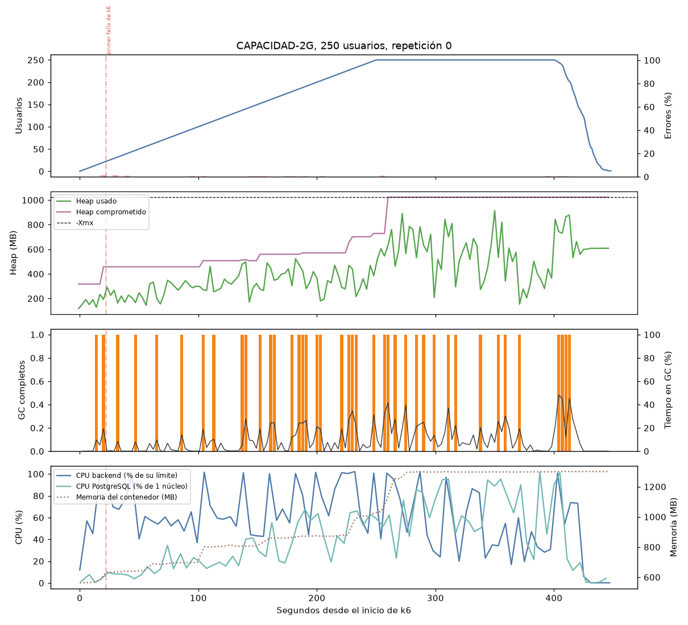

### CAPACIDAD-2G, 250 usuarios, repetición 0

- Duración observada: 428 s; 19965 peticiones, 21 con fallo.
- **Primer fallo a los 22 s, con 22 usuarios activos.**

| t (s) | Operación | Estado | Duración (ms) | Error de k6 |
|---|---|---|---|---|
| 22.0 | cita | 400 | 84 |  |
| 32.0 | cita | 400 | 40 |  |
| 42.0 | cita | 400 | 42 |  |
| 95.0 | iniciar | 400 | 27 |  |
| 98.0 | cita | 400 | 16 |  |
| 109.0 | cita | 400 | 26 |  |
| 146.0 | iniciar | 400 | 48 |  |
| 147.0 | cita | 400 | 8 |  |
| 152.0 | cita | 400 | 13 |  |
| 177.0 | cita | 400 | 29 |  |
| 183.0 | cita | 400 | 44 |  |
| 191.0 | cita | 400 | 81 |  |

- Operaciones con fallos en los 30 s siguientes al primero: cita (3).
- **Qué ocurre primero** (segundos desde el inicio de k6): 16 s: cpu del backend al tope; 22 s: primer fallo de k6.
- **En los 30 s previos al primer fallo:** heap usado al inicio 157 MB, heap usado máx. 247 MB de 1024, RssAnon máx. 629 MB, contenedor 638 MB de 2048, CPU del backend 76 %, CPU de PostgreSQL 4 %, tiempo en GC 5.9 % con 3 GC completos.

### CAPACIDAD-2G, 250 usuarios, repetición 0

- Duración observada: 428 s; 19905 peticiones, 76 con fallo.
- **Primer fallo a los 33 s, con 33 usuarios activos.**

| t (s) | Operación | Estado | Duración (ms) | Error de k6 |
|---|---|---|---|---|
| 33.0 | cita | 400 | 42 |  |
| 42.0 | cita | 400 | 38 |  |
| 92.0 | cita | 400 | 8 |  |
| 97.0 | cita | 400 | 18 |  |
| 98.0 | cita | 400 | 29 |  |
| 126.0 | cita | 400 | 8 |  |
| 127.0 | iniciar | 400 | 14 |  |
| 138.0 | cita | 400 | 38 |  |
| 145.0 | cita | 400 | 134 |  |
| 173.0 | cita | 400 | 23 |  |
| 191.0 | cita | 400 | 48 |  |
| 192.0 | cita | 400 | 66 |  |

- Operaciones con fallos en los 30 s siguientes al primero: cita (2).
- **Qué ocurre primero** (segundos desde el inicio de k6): 17 s: cpu del backend al tope; 33 s: primer fallo de k6; 407 s: primera rafaga de gc completo; 410 s: heap usado sobre 90pct del tope.
- **En los 30 s previos al primer fallo:** heap usado al inicio 154 MB, heap usado máx. 335 MB de 1024, RssAnon máx. 669 MB, contenedor 677 MB de 2048, CPU del backend 71 %, CPU de PostgreSQL 7 %, tiempo en GC 3.9 % con 3 GC completos.

### CAPACIDAD-2G, 250 usuarios, repetición 0

- Duración observada: 428 s; 19948 peticiones, 22 con fallo.
- **Primer fallo a los 51 s, con 51 usuarios activos.**

| t (s) | Operación | Estado | Duración (ms) | Error de k6 |
|---|---|---|---|---|
| 51.0 | cita | 400 | 51 |  |
| 64.0 | cita | 400 | 41 |  |
| 73.0 | cita | 400 | 40 |  |
| 74.0 | cita | 400 | 33 |  |
| 81.0 | cita | 400 | 31 |  |
| 145.0 | cita | 400 | 37 |  |
| 158.0 | iniciar | 400 | 26 |  |
| 192.0 | cita | 400 | 120 |  |
| 193.0 | cita | 400 | 68 |  |
| 206.0 | iniciar | 400 | 9 |  |
| 250.0 | cita | 400 | 68 |  |
| 254.0 | iniciar | 400 | 78 |  |

- Operaciones con fallos en los 30 s siguientes al primero: cita (5).
- **Qué ocurre primero** (segundos desde el inicio de k6): 18 s: cpu del backend al tope; 51 s: primer fallo de k6.
- **En los 30 s previos al primer fallo:** heap usado al inicio 177 MB, heap usado máx. 322 MB de 1024, RssAnon máx. 651 MB, contenedor 660 MB de 2048, CPU del backend 61 %, CPU de PostgreSQL 15 %, tiempo en GC 2.1 % con 2 GC completos.

### CAPACIDAD-2G, 250 usuarios, repetición 0

- Duración observada: 427 s; 19936 peticiones, 29 con fallo.
- **Primer fallo a los 51 s, con 51 usuarios activos.**

| t (s) | Operación | Estado | Duración (ms) | Error de k6 |
|---|---|---|---|---|
| 51.0 | cita | 400 | 56 |  |
| 64.0 | cita | 400 | 13 |  |
| 73.0 | cita | 400 | 34 |  |
| 74.0 | cita | 400 | 20 |  |
| 81.0 | cita | 400 | 35 |  |
| 127.0 | iniciar | 400 | 21 |  |
| 145.0 | cita | 400 | 53 |  |
| 154.0 | iniciar | 400 | 15 |  |
| 158.0 | iniciar | 400 | 25 |  |
| 191.0 | cita | 400 | 11 |  |
| 193.0 | cita | 400 | 8 |  |
| 197.0 | iniciar | 400 | 15 |  |

- Operaciones con fallos en los 30 s siguientes al primero: cita (5).
- **Qué ocurre primero** (segundos desde el inicio de k6): 16 s: cpu del backend al tope; 51 s: primer fallo de k6.
- **En los 30 s previos al primer fallo:** heap usado al inicio 184 MB, heap usado máx. 322 MB de 1024, RssAnon máx. 688 MB, contenedor 696 MB de 2048, CPU del backend 91 %, CPU de PostgreSQL 7 %, tiempo en GC 1.7 % con 2 GC completos.

### CAPACIDAD-2G, 250 usuarios, repetición 0

- Duración observada: 428 s; 19990 peticiones, 91 con fallo.
- **Primer fallo a los 33 s, con 33 usuarios activos.**

| t (s) | Operación | Estado | Duración (ms) | Error de k6 |
|---|---|---|---|---|
| 33.0 | cita | 400 | 45 |  |
| 42.0 | cita | 400 | 39 |  |
| 92.0 | cita | 400 | 20 |  |
| 97.0 | cita | 400 | 7 |  |
| 98.0 | cita | 400 | 29 |  |
| 109.0 | cita | 400 | 44 |  |
| 146.0 | iniciar | 400 | 14 |  |
| 173.0 | cita | 400 | 24 |  |
| 191.0 | cita | 400 | 27 |  |
| 192.0 | cita | 400 | 14 |  |
| 198.0 | iniciar | 400 | 38 |  |
| 211.0 | cita | 400 | 34 |  |

- Operaciones con fallos en los 30 s siguientes al primero: cita (2).
- **Qué ocurre primero** (segundos desde el inicio de k6): 19 s: cpu del backend al tope; 33 s: primer fallo de k6.
- **En los 30 s previos al primer fallo:** heap usado al inicio 153 MB, heap usado máx. 320 MB de 1024, RssAnon máx. 655 MB, contenedor 663 MB de 2048, CPU del backend 86 %, CPU de PostgreSQL 10 %, tiempo en GC 3.6 % con 3 GC completos.

### CAPACIDAD-2G, 250 usuarios, repetición 0

- Duración observada: 428 s; 20007 peticiones, 19 con fallo.
- **Primer fallo a los 22 s, con 22 usuarios activos.**

| t (s) | Operación | Estado | Duración (ms) | Error de k6 |
|---|---|---|---|---|
| 22.0 | cita | 400 | 63 |  |
| 33.0 | cita | 400 | 39 |  |
| 43.0 | cita | 400 | 45 |  |
| 98.0 | cita | 400 | 13 |  |
| 109.0 | cita | 400 | 49 |  |
| 148.0 | cita | 400 | 24 |  |
| 151.0 | cita | 400 | 25 |  |
| 177.0 | cita | 400 | 18 |  |
| 182.0 | cita | 400 | 58 |  |
| 190.0 | cita | 400 | 46 |  |
| 198.0 | iniciar | 400 | 26 |  |
| 250.0 | iniciar | 400 | 15 |  |

- Operaciones con fallos en los 30 s siguientes al primero: cita (3).
- **Qué ocurre primero** (segundos desde el inicio de k6): 17 s: cpu del backend al tope; 22 s: primer fallo de k6.
- **En los 30 s previos al primer fallo:** heap usado al inicio 179 MB, heap usado máx. 300 MB de 1024, RssAnon máx. 634 MB, contenedor 642 MB de 2048, CPU del backend 65 %, CPU de PostgreSQL 7 %, tiempo en GC 4.2 % con 2 GC completos.

### CAPACIDAD-2G, 250 usuarios, repetición 0

- Duración observada: 429 s; 20009 peticiones, 18 con fallo.
- **Primer fallo a los 22 s, con 22 usuarios activos.**

| t (s) | Operación | Estado | Duración (ms) | Error de k6 |
|---|---|---|---|---|
| 22.0 | cita | 400 | 61 |  |
| 32.0 | cita | 400 | 33 |  |
| 42.0 | cita | 400 | 35 |  |
| 98.0 | cita | 400 | 25 |  |
| 109.0 | cita | 400 | 12 |  |
| 147.0 | cita | 400 | 15 |  |
| 151.0 | cita | 400 | 11 |  |
| 159.0 | iniciar | 400 | 40 |  |
| 177.0 | cita | 400 | 10 |  |
| 190.0 | cita | 400 | 44 |  |
| 250.0 | iniciar | 400 | 71 |  |
| 254.0 | iniciar | 400 | 23 |  |

- Operaciones con fallos en los 30 s siguientes al primero: cita (3).
- **Qué ocurre primero** (segundos desde el inicio de k6): 17 s: cpu del backend al tope; 22 s: primer fallo de k6.
- **En los 30 s previos al primer fallo:** heap usado al inicio 166 MB, heap usado máx. 305 MB de 1024, RssAnon máx. 647 MB, contenedor 655 MB de 2048, CPU del backend 64 %, CPU de PostgreSQL 4 %, tiempo en GC 5.3 % con 3 GC completos.

### CAPACIDAD-2G, 250 usuarios, repetición 0

- Duración observada: 428 s; 19982 peticiones, 85 con fallo.
- **Primer fallo a los 32 s, con 32 usuarios activos.**

| t (s) | Operación | Estado | Duración (ms) | Error de k6 |
|---|---|---|---|---|
| 32.0 | cita | 400 | 38 |  |
| 42.0 | cita | 400 | 39 |  |
| 92.0 | cita | 400 | 24 |  |
| 97.0 | cita | 400 | 17 |  |
| 98.0 | cita | 400 | 9 |  |
| 145.0 | cita | 400 | 24 |  |
| 150.0 | iniciar | 400 | 47 |  |
| 174.0 | cita | 400 | 23 |  |
| 191.0 | cita | 400 | 49 |  |
| 191.0 | cita | 400 | 37 |  |
| 197.0 | iniciar | 400 | 33 |  |
| 198.0 | iniciar | 400 | 14 |  |

- Operaciones con fallos en los 30 s siguientes al primero: cita (2).
- **Qué ocurre primero** (segundos desde el inicio de k6): 17 s: cpu del backend al tope; 32 s: primer fallo de k6; 407 s: heap usado sobre 90pct del tope.
- **En los 30 s previos al primer fallo:** heap usado al inicio 151 MB, heap usado máx. 324 MB de 1024, RssAnon máx. 647 MB, contenedor 655 MB de 2048, CPU del backend 70 %, CPU de PostgreSQL 8 %, tiempo en GC 3.6 % con 3 GC completos.

### CAPACIDAD-2G, 250 usuarios, repetición 0

- Duración observada: 428 s; 19977 peticiones, 24 con fallo.
- **Primer fallo a los 22 s, con 22 usuarios activos.**

| t (s) | Operación | Estado | Duración (ms) | Error de k6 |
|---|---|---|---|---|
| 22.0 | cita | 400 | 44 |  |
| 32.0 | cita | 400 | 44 |  |
| 42.0 | cita | 400 | 26 |  |
| 95.0 | iniciar | 400 | 13 |  |
| 98.0 | cita | 400 | 15 |  |
| 108.0 | cita | 400 | 58 |  |
| 146.0 | iniciar | 400 | 43 |  |
| 147.0 | cita | 400 | 14 |  |
| 150.0 | cita | 400 | 32 |  |
| 177.0 | cita | 400 | 14 |  |
| 190.0 | cita | 400 | 56 |  |
| 253.0 | iniciar | 400 | 21 |  |

- Operaciones con fallos en los 30 s siguientes al primero: cita (3).
- **Qué ocurre primero** (segundos desde el inicio de k6): 18 s: cpu del backend al tope; 22 s: primer fallo de k6; 407 s: heap usado sobre 90pct del tope.
- **En los 30 s previos al primer fallo:** heap usado al inicio 197 MB, heap usado máx. 310 MB de 1024, RssAnon máx. 623 MB, contenedor 631 MB de 2048, CPU del backend 51 %, CPU de PostgreSQL 10 %, tiempo en GC 4.1 % con 2 GC completos.

### CAPACIDAD-2G, 250 usuarios, repetición 0

- Duración observada: 428 s; 19999 peticiones, 21 con fallo.
- **Primer fallo a los 52 s, con 52 usuarios activos.**

| t (s) | Operación | Estado | Duración (ms) | Error de k6 |
|---|---|---|---|---|
| 52.0 | cita | 400 | 33 |  |
| 65.0 | cita | 400 | 17 |  |
| 74.0 | cita | 400 | 24 |  |
| 75.0 | cita | 400 | 13 |  |
| 82.0 | cita | 400 | 25 |  |
| 128.0 | iniciar | 400 | 14 |  |
| 146.0 | cita | 400 | 35 |  |
| 147.0 | iniciar | 400 | 30 |  |
| 159.0 | iniciar | 400 | 36 |  |
| 192.0 | cita | 400 | 28 |  |
| 194.0 | cita | 400 | 35 |  |
| 197.0 | iniciar | 400 | 24 |  |

- Operaciones con fallos en los 30 s siguientes al primero: cita (5).
- **Qué ocurre primero** (segundos desde el inicio de k6): 19 s: cpu del backend al tope; 52 s: primer fallo de k6; 326 s: heap usado sobre 90pct del tope.
- **En los 30 s previos al primer fallo:** heap usado al inicio 193 MB, heap usado máx. 288 MB de 1024, RssAnon máx. 669 MB, contenedor 678 MB de 2048, CPU del backend 62 %, CPU de PostgreSQL 11 %, tiempo en GC 1.8 % con 2 GC completos.

### CAPACIDAD-2G, 250 usuarios, repetición 0

- Duración observada: 428 s; 19951 peticiones, 21 con fallo.
- **Primer fallo a los 22 s, con 22 usuarios activos.**

| t (s) | Operación | Estado | Duración (ms) | Error de k6 |
|---|---|---|---|---|
| 22.0 | cita | 400 | 74 |  |
| 32.0 | cita | 400 | 47 |  |
| 42.0 | cita | 400 | 36 |  |
| 98.0 | cita | 400 | 9 |  |
| 108.0 | cita | 400 | 49 |  |
| 147.0 | cita | 400 | 17 |  |
| 150.0 | cita | 400 | 32 |  |
| 158.0 | iniciar | 400 | 49 |  |
| 176.0 | cita | 400 | 19 |  |
| 182.0 | cita | 400 | 54 |  |
| 190.0 | cita | 400 | 51 |  |
| 208.0 | iniciar | 400 | 16 |  |

- Operaciones con fallos en los 30 s siguientes al primero: cita (3).
- **Qué ocurre primero** (segundos desde el inicio de k6): 17 s: cpu del backend al tope; 22 s: primer fallo de k6.
- **En los 30 s previos al primer fallo:** heap usado al inicio 191 MB, heap usado máx. 234 MB de 1024, RssAnon máx. 629 MB, contenedor 638 MB de 2048, CPU del backend 57 %, CPU de PostgreSQL 3 %, tiempo en GC 4.9 % con 2 GC completos.

### afin: fijo-CAPACIDAD-2G, 100 usuarios, repetición 1

- Duración observada: 286 s; 6330 peticiones, 8 con fallo.
- **Primer fallo a los 24 s, con 22 usuarios activos.**

| t (s) | Operación | Estado | Duración (ms) | Error de k6 |
|---|---|---|---|---|
| 24.0 | cita | 400 | 74 |  |
| 33.0 | cita | 400 | 46 |  |
| 43.0 | cita | 400 | 22 |  |
| 100.0 | cita | 400 | 24 |  |
| 108.0 | cita | 400 | 13 |  |
| 152.0 | cita | 400 | 30 |  |
| 178.0 | cita | 400 | 14 |  |
| 191.0 | cita | 400 | 8 |  |

- Operaciones con fallos en los 30 s siguientes al primero: cita (3).
- **Qué ocurre primero** (segundos desde el inicio de k6): 16 s: cpu del backend al tope; 24 s: primer fallo de k6.
- **En los 30 s previos al primer fallo:** heap usado al inicio 180 MB, heap usado máx. 348 MB de 1024, RssAnon máx. 628 MB, contenedor 637 MB de 2048, CPU del backend 57 %, CPU de PostgreSQL 1 %, tiempo en GC 3.8 % con 2 GC completos.

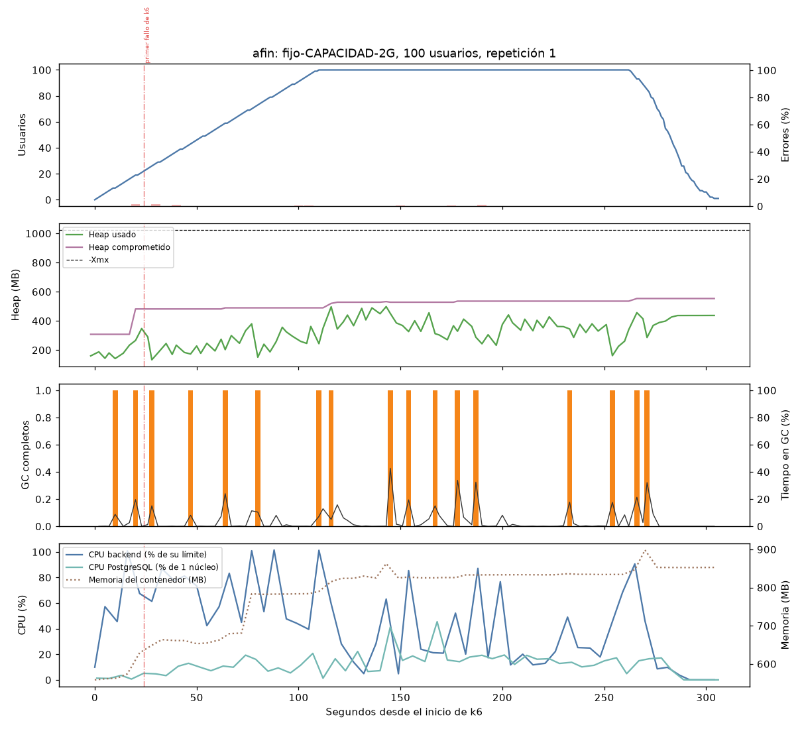

### afin: fijo-PRODUCCION-512M, 100 usuarios, repetición 1

- Duración observada: 345 s; 1577 peticiones, 555 con fallo.
- **Primer fallo a los 45 s, con 41 usuarios activos.**

| t (s) | Operación | Estado | Duración (ms) | Error de k6 |
|---|---|---|---|---|
| 45.0 | reporte_clinico | 0 | 30001 | request timeout |
| 89.0 | cita | 400 | 2737 |  |
| 109.0 | reporte_clinico | 0 | 30001 | request timeout |
| 112.0 | login | 0 | 30000 | request timeout |
| 113.0 | login | 0 | 30001 | request timeout |
| 114.0 | login | 0 | 30001 | request timeout |
| 115.0 | login | 0 | 30000 | request timeout |
| 116.0 | login | 0 | 30000 | request timeout |
| 117.0 | login | 0 | 30001 | request timeout |
| 118.0 | login | 0 | 30001 | request timeout |
| 119.0 | mascota | 0 | 30001 | request timeout |
| 119.0 | receta | 0 | 30000 | request timeout |

- Operaciones con fallos en los 30 s siguientes al primero: reporte_clinico (1).
- **Qué ocurre primero** (segundos desde el inicio de k6): 17 s: heap usado sobre 90pct del tope; 17 s: primera rafaga de gc completo; 17 s: contenedor sobre 80pct de memoria; 17 s: cpu del backend al tope; 45 s: primer fallo de k6; 47 s: primer OutOfMemoryError; 221 s: primer tiempo agotado del pool.
- **En los 30 s previos al primer fallo:** heap usado al inicio 147 MB, heap usado máx. 186 MB de 192, RssAnon máx. 417 MB, contenedor 426 MB de 512, CPU del backend 100 %, CPU de PostgreSQL 1 %, tiempo en GC 77.8 % con 82 GC completos.
- OutOfMemoryError en el registro: 45 líneas (ejemplo: `2026-11-27T05:01:48.625Z ERROR 1 --- [vargasvet] [nio-8080-exec-4] o.a.c.c.C.[.[.[.[dispatcherServlet]      : Servlet.service() for servlet [dispatcherServlet] `).
- Esperas de conexión agotadas en el registro: 29.

### afin: topologia-CAPACIDAD-2G, 100 usuarios, repetición 1

- Duración observada: 286 s; 6324 peticiones, 9 con fallo.
- **Primer fallo a los 24 s, con 22 usuarios activos.**

| t (s) | Operación | Estado | Duración (ms) | Error de k6 |
|---|---|---|---|---|
| 24.0 | cita | 400 | 42 |  |
| 34.0 | cita | 400 | 55 |  |
| 43.0 | cita | 400 | 37 |  |
| 100.0 | cita | 400 | 18 |  |
| 109.0 | cita | 400 | 8 |  |
| 152.0 | cita | 400 | 10 |  |
| 178.0 | cita | 400 | 15 |  |
| 192.0 | cita | 400 | 8 |  |
| 248.0 | iniciar | 400 | 21 |  |

- Operaciones con fallos en los 30 s siguientes al primero: cita (3).
- **Qué ocurre primero** (segundos desde el inicio de k6): 17 s: cpu del backend al tope; 24 s: primer fallo de k6.
- **En los 30 s previos al primer fallo:** heap usado al inicio 173 MB, heap usado máx. 328 MB de 1024, RssAnon máx. 636 MB, contenedor 645 MB de 2048, CPU del backend 52 %, CPU de PostgreSQL 4 %, tiempo en GC 4.7 % con 3 GC completos.

### afin: topologia-PRODUCCION-512M, 100 usuarios, repetición 1

- Duración observada: 344 s; 689 peticiones, 564 con fallo.
- **Primer fallo a los 45 s, con 41 usuarios activos.**

| t (s) | Operación | Estado | Duración (ms) | Error de k6 |
|---|---|---|---|---|
| 45.0 | reporte_clinico | 0 | 30001 | request timeout |
| 48.0 | login | 0 | 30000 | request timeout |
| 49.0 | login | 0 | 30000 | request timeout |
| 50.0 | login | 0 | 30001 | request timeout |
| 51.0 | login | 0 | 30001 | request timeout |
| 52.0 | citas_del_mes | 0 | 30001 | request timeout |
| 52.0 | lista_de_historias | 0 | 30000 | request timeout |
| 52.0 | login | 0 | 30001 | request timeout |
| 52.0 | apoderado | 0 | 30001 | request timeout |
| 53.0 | checkin | 0 | 30001 | request timeout |
| 53.0 | mascota | 0 | 30001 | request timeout |
| 53.0 | login | 0 | 30000 | request timeout |

- Operaciones con fallos en los 30 s siguientes al primero: login (26), apoderado (6), checkin (2), navegacion (2), reporte_clinico (1), citas_del_mes (1), lista_de_historias (1), mascota (1).
- **Qué ocurre primero** (segundos desde el inicio de k6): 17 s: primera rafaga de gc completo; 17 s: contenedor sobre 80pct de memoria; 17 s: cpu del backend al tope; 20 s: heap usado sobre 90pct del tope; 45 s: primer fallo de k6; 115 s: primer OutOfMemoryError.
- **En los 30 s previos al primer fallo:** heap usado al inicio 153 MB, heap usado máx. 186 MB de 192, RssAnon máx. 411 MB, contenedor 423 MB de 512, CPU del backend 100 %, CPU de PostgreSQL 0 %, tiempo en GC 81.5 % con 88 GC completos.
- OutOfMemoryError en el registro: 24 líneas (ejemplo: `Exception in thread "http-nio-8080-Acceptor" java.lang.OutOfMemoryError: Java heap space`).

### afin: fijo-CAPACIDAD-2G, 100 usuarios, repetición 2

- Duración observada: 286 s; 6289 peticiones, 16 con fallo.
- **Primer fallo a los 33 s, con 30 usuarios activos.**

| t (s) | Operación | Estado | Duración (ms) | Error de k6 |
|---|---|---|---|---|
| 33.0 | cita | 400 | 64 |  |
| 43.0 | cita | 400 | 44 |  |
| 97.0 | cita | 400 | 42 |  |
| 98.0 | cita | 400 | 40 |  |
| 100.0 | cita | 400 | 29 |  |
| 109.0 | cita | 400 | 17 |  |
| 153.0 | cita | 400 | 27 |  |
| 168.0 | iniciar | 400 | 48 |  |
| 181.0 | cita | 400 | 32 |  |
| 195.0 | cita | 400 | 25 |  |
| 252.0 | cita | 400 | 65 |  |
| 254.0 | cita | 400 | 9 |  |

- Operaciones con fallos en los 30 s siguientes al primero: cita (2).
- **Qué ocurre primero** (segundos desde el inicio de k6): 18 s: cpu del backend al tope; 33 s: primer fallo de k6.
- **En los 30 s previos al primer fallo:** heap usado al inicio 164 MB, heap usado máx. 282 MB de 1024, RssAnon máx. 651 MB, contenedor 659 MB de 2048, CPU del backend 84 %, CPU de PostgreSQL 8 %, tiempo en GC 3.8 % con 2 GC completos.

### afin: fijo-PRODUCCION-512M, 100 usuarios, repetición 2

- Duración observada: 345 s; 734 peticiones, 562 con fallo.
- **Primer fallo a los 28 s, con 26 usuarios activos.**

| t (s) | Operación | Estado | Duración (ms) | Error de k6 |
|---|---|---|---|---|
| 28.0 | cita | 400 | 1153 |  |
| 45.0 | reporte_clinico | 0 | 30001 | request timeout |
| 51.0 | login | 0 | 30001 | request timeout |
| 52.0 | login | 0 | 30000 | request timeout |
| 54.0 | login | 0 | 30000 | request timeout |
| 55.0 | login | 0 | 30001 | request timeout |
| 56.0 | login | 0 | 30000 | request timeout |
| 57.0 | login | 0 | 30000 | request timeout |
| 58.0 | login | 0 | 30001 | request timeout |
| 59.0 | login | 0 | 30000 | request timeout |
| 60.0 | login | 0 | 30000 | request timeout |
| 61.0 | login | 0 | 30000 | request timeout |

- Operaciones con fallos en los 30 s siguientes al primero: login (7), cita (1), reporte_clinico (1).
- **Qué ocurre primero** (segundos desde el inicio de k6): 17 s: heap usado sobre 90pct del tope; 17 s: primera rafaga de gc completo; 17 s: contenedor sobre 80pct de memoria; 17 s: cpu del backend al tope; 28 s: primer fallo de k6; 79 s: primer tiempo agotado del pool; 79 s: primer OutOfMemoryError.
- **En los 30 s previos al primer fallo:** heap usado al inicio 144 MB, heap usado máx. 185 MB de 192, RssAnon máx. 415 MB, contenedor 423 MB de 512, CPU del backend 74 %, CPU de PostgreSQL 5 %, tiempo en GC 18.5 % con 16 GC completos.
- OutOfMemoryError en el registro: 5 líneas (ejemplo: `Exception in thread "http-nio-8080-Acceptor" java.lang.OutOfMemoryError: Java heap space`).
- Esperas de conexión agotadas en el registro: 6.

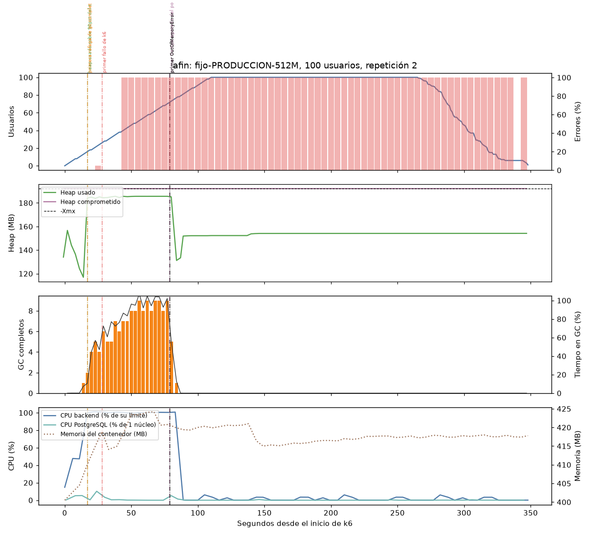

### afin: topologia-CAPACIDAD-2G, 100 usuarios, repetición 2

- Duración observada: 285 s; 6276 peticiones, 12 con fallo.
- **Primer fallo a los 66 s, con 60 usuarios activos.**

| t (s) | Operación | Estado | Duración (ms) | Error de k6 |
|---|---|---|---|---|
| 66.0 | cita | 400 | 47 |  |
| 74.0 | cita | 400 | 23 |  |
| 76.0 | cita | 400 | 49 |  |
| 82.0 | cita | 400 | 38 |  |
| 127.0 | iniciar | 400 | 12 |  |
| 147.0 | cita | 400 | 166 |  |
| 194.0 | cita | 400 | 11 |  |
| 230.0 | iniciar | 400 | 11 |  |
| 234.0 | cita | 400 | 21 |  |
| 251.0 | cita | 400 | 25 |  |
| 263.0 | cita | 400 | 11 |  |
| 263.0 | cita | 400 | 11 |  |

- Operaciones con fallos en los 30 s siguientes al primero: cita (4).
- **Qué ocurre primero** (segundos desde el inicio de k6): 18 s: cpu del backend al tope; 66 s: primer fallo de k6.
- **En los 30 s previos al primer fallo:** heap usado al inicio 152 MB, heap usado máx. 303 MB de 1024, RssAnon máx. 702 MB, contenedor 711 MB de 2048, CPU del backend 100 %, CPU de PostgreSQL 10 %, tiempo en GC 3.7 % con 2 GC completos.

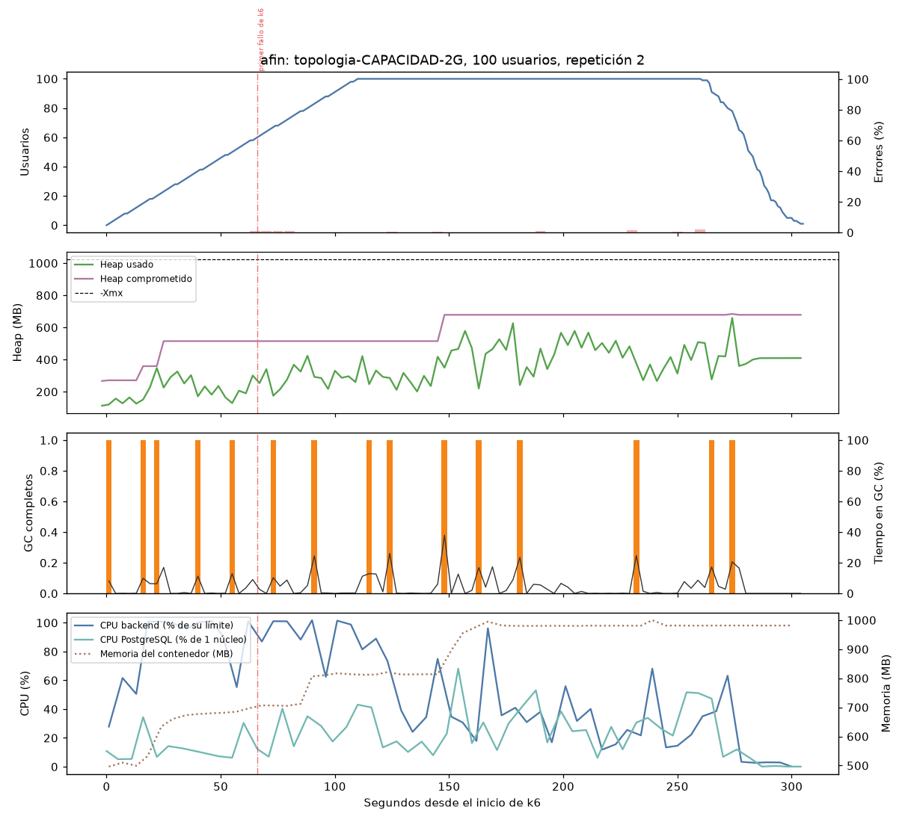

### afin: topologia-PRODUCCION-512M, 100 usuarios, repetición 2

- Duración observada: 346 s; 740 peticiones, 565 con fallo.
- **Primer fallo a los 29 s, con 27 usuarios activos.**

| t (s) | Operación | Estado | Duración (ms) | Error de k6 |
|---|---|---|---|---|
| 29.0 | cita | 400 | 1627 |  |
| 46.0 | reporte_clinico | 0 | 30000 | request timeout |
| 51.0 | login | 0 | 30001 | request timeout |
| 53.0 | login | 0 | 30001 | request timeout |
| 54.0 | login | 0 | 30000 | request timeout |
| 55.0 | login | 0 | 30000 | request timeout |
| 56.0 | login | 0 | 30001 | request timeout |
| 57.0 | login | 0 | 30000 | request timeout |
| 58.0 | login | 0 | 30001 | request timeout |
| 59.0 | login | 0 | 30000 | request timeout |
| 60.0 | login | 0 | 30001 | request timeout |
| 61.0 | login | 0 | 30001 | request timeout |

- Operaciones con fallos en los 30 s siguientes al primero: login (8), cita (1), reporte_clinico (1).
- **Qué ocurre primero** (segundos desde el inicio de k6): 17 s: heap usado sobre 90pct del tope; 17 s: primera rafaga de gc completo; 17 s: contenedor sobre 80pct de memoria; 19 s: cpu del backend al tope; 29 s: primer fallo de k6; 199 s: primer OutOfMemoryError.
- **En los 30 s previos al primer fallo:** heap usado al inicio 148 MB, heap usado máx. 186 MB de 192, RssAnon máx. 414 MB, contenedor 422 MB de 512, CPU del backend 45 %, CPU de PostgreSQL 8 %, tiempo en GC 22.7 % con 21 GC completos.
- OutOfMemoryError en el registro: 26 líneas (ejemplo: `Exception in thread "http-nio-8080-Acceptor" java.lang.OutOfMemoryError: Java heap space`).

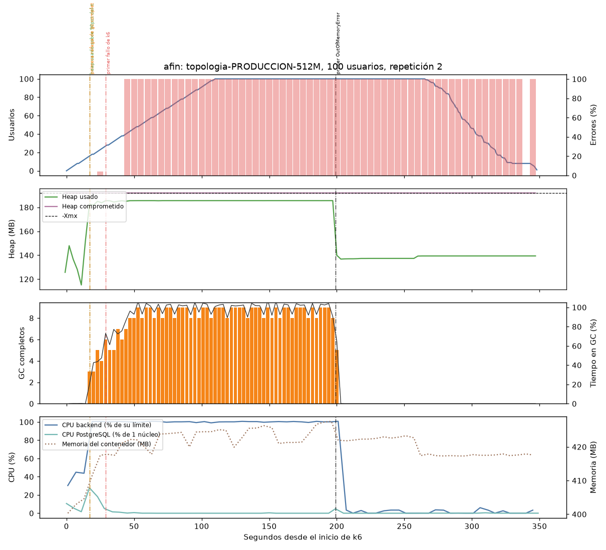

### afin: fijo-CAPACIDAD-2G, 100 usuarios, repetición 3

- Duración observada: 287 s; 6261 peticiones, 11 con fallo.
- **Primer fallo a los 24 s, con 22 usuarios activos.**

| t (s) | Operación | Estado | Duración (ms) | Error de k6 |
|---|---|---|---|---|
| 24.0 | cita | 400 | 184 |  |
| 34.0 | cita | 400 | 58 |  |
| 44.0 | cita | 400 | 70 |  |
| 101.0 | cita | 400 | 25 |  |
| 109.0 | cita | 400 | 57 |  |
| 112.0 | iniciar | 400 | 13 |  |
| 153.0 | cita | 400 | 23 |  |
| 169.0 | iniciar | 400 | 73 |  |
| 183.0 | cita | 400 | 12 |  |
| 195.0 | cita | 400 | 11 |  |
| 247.0 | iniciar | 400 | 10 |  |

- Operaciones con fallos en los 30 s siguientes al primero: cita (3).
- **Qué ocurre primero** (segundos desde el inicio de k6): 16 s: cpu del backend al tope; 24 s: primer fallo de k6.
- **En los 30 s previos al primer fallo:** heap usado al inicio 164 MB, heap usado máx. 275 MB de 1024, RssAnon máx. 589 MB, contenedor 596 MB de 2048, CPU del backend 94 %, CPU de PostgreSQL 6 %, tiempo en GC 4.5 % con 2 GC completos.

### afin: fijo-PRODUCCION-512M, 100 usuarios, repetición 3

- Duración observada: 346 s; 765 peticiones, 566 con fallo.
- **Primer fallo a los 45 s, con 41 usuarios activos.**

| t (s) | Operación | Estado | Duración (ms) | Error de k6 |
|---|---|---|---|---|
| 45.0 | reporte_clinico | 0 | 30001 | request timeout |
| 55.0 | login | 0 | 30000 | request timeout |
| 56.0 | login | 0 | 30001 | request timeout |
| 57.0 | login | 0 | 30001 | request timeout |
| 58.0 | login | 0 | 30000 | request timeout |
| 59.0 | login | 0 | 30000 | request timeout |
| 60.0 | login | 0 | 30000 | request timeout |
| 60.0 | cerrar_consulta | 0 | 30000 | request timeout |
| 61.0 | login | 0 | 30001 | request timeout |
| 62.0 | login | 0 | 30000 | request timeout |
| 63.0 | login | 0 | 30001 | request timeout |
| 64.0 | panel | 0 | 30001 | request timeout |

- Operaciones con fallos en los 30 s siguientes al primero: login (20), apoderado (6), navegacion (4), reporte_clinico (1), cerrar_consulta (1), panel (1), mascota (1), notificaciones (1).
- **Qué ocurre primero** (segundos desde el inicio de k6): 17 s: heap usado sobre 90pct del tope; 17 s: primera rafaga de gc completo; 17 s: contenedor sobre 80pct de memoria; 19 s: cpu del backend al tope; 45 s: primer fallo de k6; 216 s: primer OutOfMemoryError; 297 s: primer tiempo agotado del pool.
- **En los 30 s previos al primer fallo:** heap usado al inicio 149 MB, heap usado máx. 186 MB de 192, RssAnon máx. 418 MB, contenedor 426 MB de 512, CPU del backend 100 %, CPU de PostgreSQL 4 %, tiempo en GC 55.1 % con 48 GC completos.
- OutOfMemoryError en el registro: 38 líneas (ejemplo: `Exception in thread "http-nio-8080-Acceptor" java.lang.OutOfMemoryError: Java heap space`).
- Esperas de conexión agotadas en el registro: 1.

### afin: topologia-CAPACIDAD-2G, 100 usuarios, repetición 3

- Duración observada: 284 s; 6282 peticiones, 9 con fallo.
- **Primer fallo a los 24 s, con 22 usuarios activos.**

| t (s) | Operación | Estado | Duración (ms) | Error de k6 |
|---|---|---|---|---|
| 24.0 | cita | 400 | 148 |  |
| 34.0 | cita | 400 | 62 |  |
| 44.0 | cita | 400 | 34 |  |
| 101.0 | cita | 400 | 25 |  |
| 110.0 | cita | 400 | 24 |  |
| 154.0 | cita | 400 | 75 |  |
| 181.0 | cita | 400 | 28 |  |
| 195.0 | cita | 400 | 16 |  |
| 247.0 | iniciar | 400 | 26 |  |

- Operaciones con fallos en los 30 s siguientes al primero: cita (3).
- **Qué ocurre primero** (segundos desde el inicio de k6): 19 s: cpu del backend al tope; 24 s: primer fallo de k6.
- **En los 30 s previos al primer fallo:** heap usado al inicio 154 MB, heap usado máx. 302 MB de 1024, RssAnon máx. 583 MB, contenedor 590 MB de 2048, CPU del backend 75 %, CPU de PostgreSQL 9 %, tiempo en GC 3.8 % con 2 GC completos.

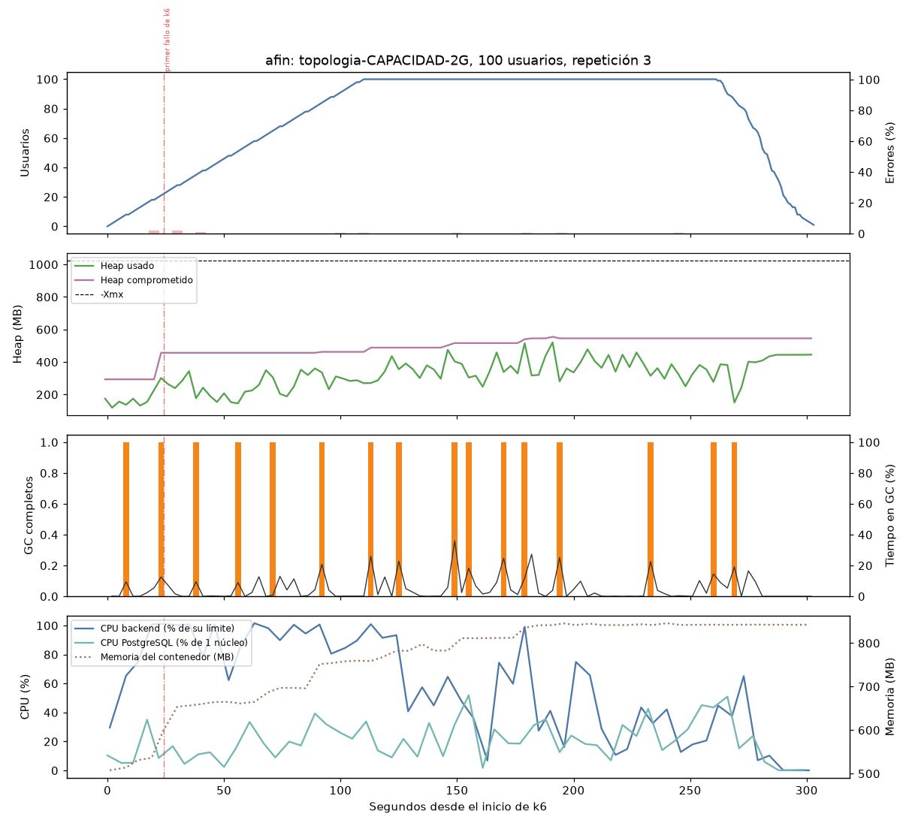

### afin: topologia-PRODUCCION-512M, 100 usuarios, repetición 3

- Duración observada: 346 s; 753 peticiones, 568 con fallo.
- **Primer fallo a los 45 s, con 41 usuarios activos.**

| t (s) | Operación | Estado | Duración (ms) | Error de k6 |
|---|---|---|---|---|
| 45.0 | reporte_clinico | 0 | 30001 | request timeout |
| 52.0 | login | 0 | 30000 | request timeout |
| 53.0 | login | 0 | 30001 | request timeout |
| 54.0 | login | 0 | 30001 | request timeout |
| 55.0 | login | 0 | 30001 | request timeout |
| 56.0 | login | 0 | 30000 | request timeout |
| 57.0 | login | 0 | 30000 | request timeout |
| 59.0 | login | 0 | 30001 | request timeout |
| 60.0 | login | 0 | 30001 | request timeout |
| 61.0 | login | 0 | 30000 | request timeout |
| 62.0 | login | 0 | 30001 | request timeout |
| 62.0 | apoderado | 0 | 30001 | request timeout |

- Operaciones con fallos en los 30 s siguientes al primero: login (22), apoderado (7), navegacion (3), checkin (2), reporte_clinico (1), actualizar_mascota (1), lista_de_historias (1), notificaciones (1).
- **Qué ocurre primero** (segundos desde el inicio de k6): 13 s: contenedor sobre 80pct de memoria; 16 s: heap usado sobre 90pct del tope; 16 s: primera rafaga de gc completo; 16 s: cpu del backend al tope; 45 s: primer fallo de k6; 92 s: primer tiempo agotado del pool; 92 s: primer OutOfMemoryError.
- **En los 30 s previos al primer fallo:** heap usado al inicio 147 MB, heap usado máx. 185 MB de 192, RssAnon máx. 419 MB, contenedor 427 MB de 512, CPU del backend 100 %, CPU de PostgreSQL 1 %, tiempo en GC 59.9 % con 54 GC completos.
- OutOfMemoryError en el registro: 13 líneas (ejemplo: `Exception in thread "http-nio-8080-Acceptor" java.lang.OutOfMemoryError: Java heap space`).
- Esperas de conexión agotadas en el registro: 6.

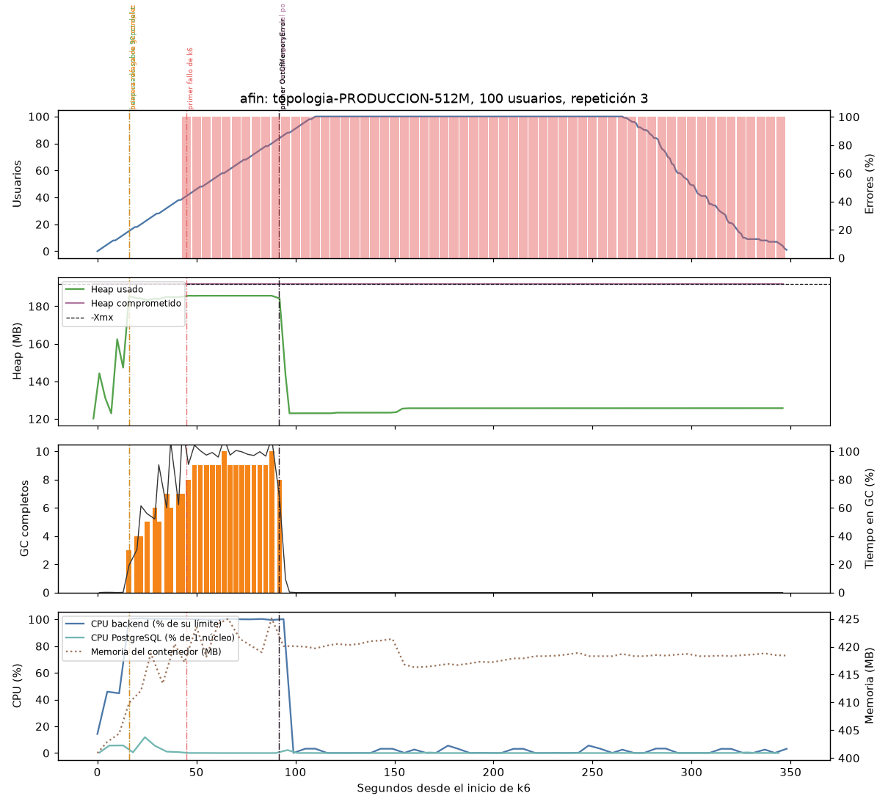

### heap: EXP-HEAP-192M, 100 usuarios, repetición 1

- Duración observada: 345 s; 704 peticiones, 560 con fallo.
- **Primer fallo a los 45 s, con 41 usuarios activos.**

| t (s) | Operación | Estado | Duración (ms) | Error de k6 |
|---|---|---|---|---|
| 45.0 | reporte_clinico | 0 | 30001 | request timeout |
| 49.0 | login | 0 | 30000 | request timeout |
| 50.0 | login | 0 | 30000 | request timeout |
| 51.0 | login | 0 | 30000 | request timeout |
| 52.0 | lista_de_historias | 0 | 30001 | request timeout |
| 52.0 | login | 0 | 30001 | request timeout |
| 53.0 | login | 0 | 30001 | request timeout |
| 54.0 | login | 0 | 30001 | request timeout |
| 55.0 | mascota | 0 | 30001 | request timeout |
| 55.0 | iniciar | 0 | 30001 | request timeout |
| 55.0 | panel | 0 | 30000 | request timeout |
| 55.0 | login | 0 | 30001 | request timeout |

- Operaciones con fallos en los 30 s siguientes al primero: login (25), mascota (3), apoderado (3), panel (2), cancelar_cita (2), reporte_clinico (1), lista_de_historias (1), iniciar (1).
- **Qué ocurre primero** (segundos desde el inicio de k6): 14 s: contenedor sobre 80pct de memoria; 17 s: heap usado sobre 90pct del tope; 17 s: primera rafaga de gc completo; 19 s: cpu del backend al tope; 45 s: primer fallo de k6; 167 s: primer OutOfMemoryError; 227 s: primer tiempo agotado del pool.
- **En los 30 s previos al primer fallo:** heap usado al inicio 146 MB, heap usado máx. 186 MB de 192, RssAnon máx. 413 MB, contenedor 422 MB de 512, CPU del backend 100 %, CPU de PostgreSQL 2 %, tiempo en GC 71.3 % con 67 GC completos.
- OutOfMemoryError en el registro: 35 líneas (ejemplo: `Exception in thread "http-nio-8080-exec-38" java.lang.OutOfMemoryError: Java heap space`).
- Esperas de conexión agotadas en el registro: 5.

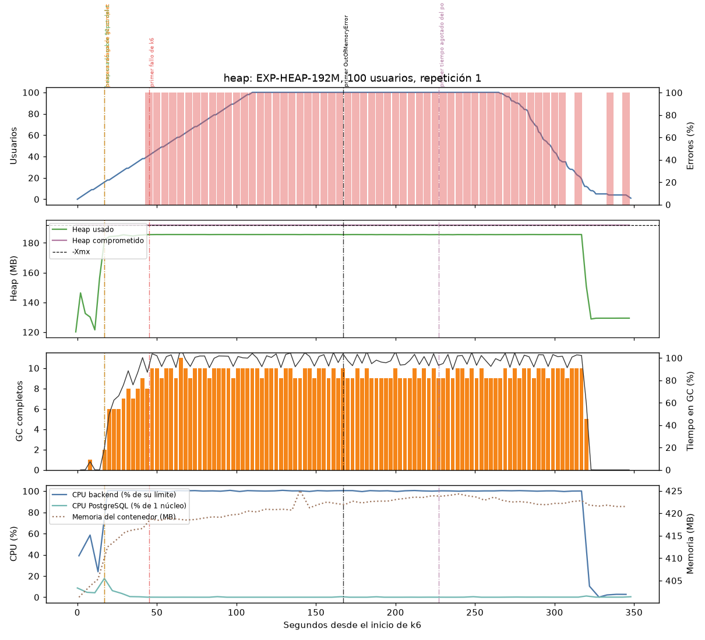

### heap: EXP-HEAP-192M, 50 usuarios, repetición 1

- Duración observada: 289 s; 417 peticiones, 258 con fallo.
- **Primer fallo a los 45 s, con 41 usuarios activos.**

| t (s) | Operación | Estado | Duración (ms) | Error de k6 |
|---|---|---|---|---|
| 45.0 | reporte_clinico | 0 | 30001 | request timeout |
| 50.0 | login | 0 | 30000 | request timeout |
| 51.0 | login | 0 | 30000 | request timeout |
| 52.0 | login | 0 | 30001 | request timeout |
| 53.0 | login | 0 | 30001 | request timeout |
| 54.0 | login | 0 | 30000 | request timeout |
| 55.0 | historia | 0 | 30001 | request timeout |
| 55.0 | login | 0 | 30001 | request timeout |
| 56.0 | login | 0 | 30000 | request timeout |
| 57.0 | propietarios | 0 | 30001 | request timeout |
| 57.0 | login | 0 | 30001 | request timeout |
| 57.0 | consulta | 0 | 30000 | request timeout |

- Operaciones con fallos en los 30 s siguientes al primero: login (24), apoderado (3), cita (2), cancelar_cita (2), navegacion (2), reporte_clinico (1), historia (1), propietarios (1).
- **Qué ocurre primero** (segundos desde el inicio de k6): 16 s: cpu del backend al tope; 17 s: heap usado sobre 90pct del tope; 17 s: primera rafaga de gc completo; 17 s: contenedor sobre 80pct de memoria; 45 s: primer fallo de k6; 87 s: primer OutOfMemoryError.
- **En los 30 s previos al primer fallo:** heap usado al inicio 151 MB, heap usado máx. 186 MB de 192, RssAnon máx. 418 MB, contenedor 427 MB de 512, CPU del backend 100 %, CPU de PostgreSQL 1 %, tiempo en GC 69.6 % con 66 GC completos.
- OutOfMemoryError en el registro: 17 líneas (ejemplo: `Exception in thread "http-nio-8080-Acceptor" java.lang.OutOfMemoryError: Java heap space`).

### heap: EXP-HEAP-192M-citas6000, 100 usuarios, repetición 1

- Duración observada: 284 s; 6218 peticiones, 7 con fallo.
- **Primer fallo a los 99 s, con 90 usuarios activos.**

| t (s) | Operación | Estado | Duración (ms) | Error de k6 |
|---|---|---|---|---|
| 99.0 | cita | 400 | 20 |  |
| 99.0 | iniciar | 400 | 12 |  |
| 168.0 | iniciar | 400 | 16 |  |
| 191.0 | cita | 400 | 10 |  |
| 230.0 | iniciar | 400 | 149 |  |
| 255.0 | iniciar | 400 | 65 |  |
| 282.0 | cita | 400 | 10 |  |

- Operaciones con fallos en los 30 s siguientes al primero: cita (1), iniciar (1).
- **Qué ocurre primero** (segundos desde el inicio de k6): 16 s: primera rafaga de gc completo; 16 s: contenedor sobre 80pct de memoria; 16 s: cpu del backend al tope; 61 s: heap usado sobre 90pct del tope; 99 s: primer fallo de k6.
- **En los 30 s previos al primer fallo:** heap usado al inicio 148 MB, heap usado máx. 163 MB de 192, RssAnon máx. 424 MB, contenedor 432 MB de 512, CPU del backend 55 %, CPU de PostgreSQL 7 %, tiempo en GC 4.5 % con 5 GC completos.

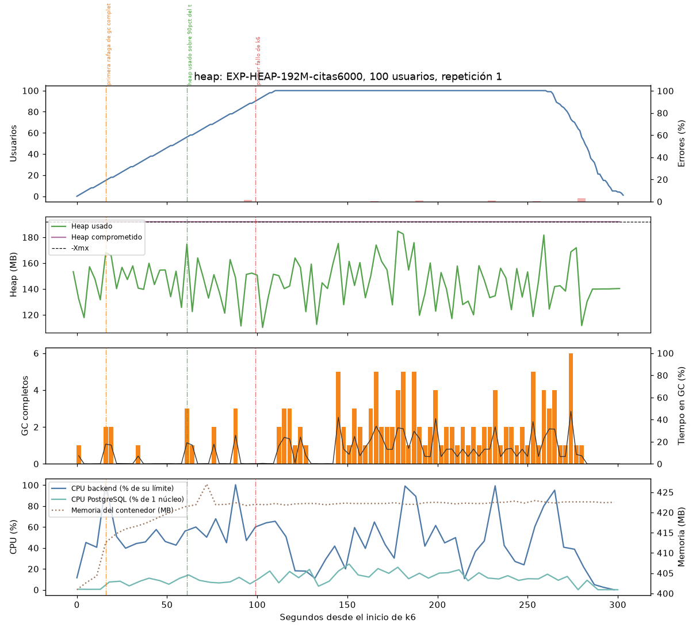

### heap: EXP-HEAP-192M-citas6000, 50 usuarios, repetición 1

- Duración observada: 230 s; 2776 peticiones, 2 con fallo.
- **Primer fallo a los 98 s, con 50 usuarios activos.**

| t (s) | Operación | Estado | Duración (ms) | Error de k6 |
|---|---|---|---|---|
| 98.0 | cita | 400 | 20 |  |
| 190.0 | cita | 400 | 26 |  |

- Operaciones con fallos en los 30 s siguientes al primero: cita (1).
- **Qué ocurre primero** (segundos desde el inicio de k6): 16 s: heap usado sobre 90pct del tope; 16 s: primera rafaga de gc completo; 16 s: contenedor sobre 80pct de memoria; 16 s: cpu del backend al tope; 98 s: primer fallo de k6.
- **En los 30 s previos al primer fallo:** heap usado al inicio 142 MB, heap usado máx. 173 MB de 192, RssAnon máx. 420 MB, contenedor 429 MB de 512, CPU del backend 11 %, CPU de PostgreSQL 5 %, tiempo en GC 6.0 % con 7 GC completos.

### heap: EXP-HEAP-192M-sin-informes, 100 usuarios, repetición 1

- Duración observada: 287 s; 6335 peticiones, 12 con fallo.
- **Primer fallo a los 52 s, con 48 usuarios activos.**

| t (s) | Operación | Estado | Duración (ms) | Error de k6 |
|---|---|---|---|---|
| 52.0 | cita | 400 | 41 |  |
| 65.0 | cita | 400 | 16 |  |
| 74.0 | cita | 400 | 34 |  |
| 74.0 | cita | 400 | 25 |  |
| 82.0 | cita | 400 | 12 |  |
| 146.0 | cita | 400 | 35 |  |
| 168.0 | iniciar | 400 | 16 |  |
| 191.0 | cita | 400 | 11 |  |
| 194.0 | cita | 400 | 32 |  |
| 251.0 | cita | 400 | 11 |  |
| 262.0 | cita | 400 | 22 |  |
| 263.0 | cita | 400 | 12 |  |

- Operaciones con fallos en los 30 s siguientes al primero: cita (5).
- **Qué ocurre primero** (segundos desde el inicio de k6): 17 s: contenedor sobre 80pct de memoria; 17 s: cpu del backend al tope; 52 s: primer fallo de k6.
- **En los 30 s previos al primer fallo:** heap usado al inicio 136 MB, heap usado máx. 156 MB de 192, RssAnon máx. 419 MB, contenedor 426 MB de 512, CPU del backend 48 %, CPU de PostgreSQL 7 %, tiempo en GC 1.7 % con 2 GC completos.

### heap: EXP-HEAP-192M-sin-informes, 50 usuarios, repetición 1

- Duración observada: 231 s; 2817 peticiones, 8 con fallo.
- **Primer fallo a los 52 s, con 48 usuarios activos.**

| t (s) | Operación | Estado | Duración (ms) | Error de k6 |
|---|---|---|---|---|
| 52.0 | cita | 400 | 39 |  |
| 65.0 | cita | 400 | 31 |  |
| 74.0 | cita | 400 | 14 |  |
| 74.0 | cita | 400 | 11 |  |
| 81.0 | cita | 400 | 13 |  |
| 146.0 | cita | 400 | 17 |  |
| 191.0 | cita | 400 | 11 |  |
| 194.0 | cita | 400 | 12 |  |

- Operaciones con fallos en los 30 s siguientes al primero: cita (5).
- **Qué ocurre primero** (segundos desde el inicio de k6): 17 s: contenedor sobre 80pct de memoria; 52 s: primer fallo de k6.
- **En los 30 s previos al primer fallo:** heap usado al inicio 136 MB, heap usado máx. 158 MB de 192, RssAnon máx. 416 MB, contenedor 424 MB de 512, CPU del backend 52 %, CPU de PostgreSQL 6 %, tiempo en GC 1.4 % con 2 GC completos.

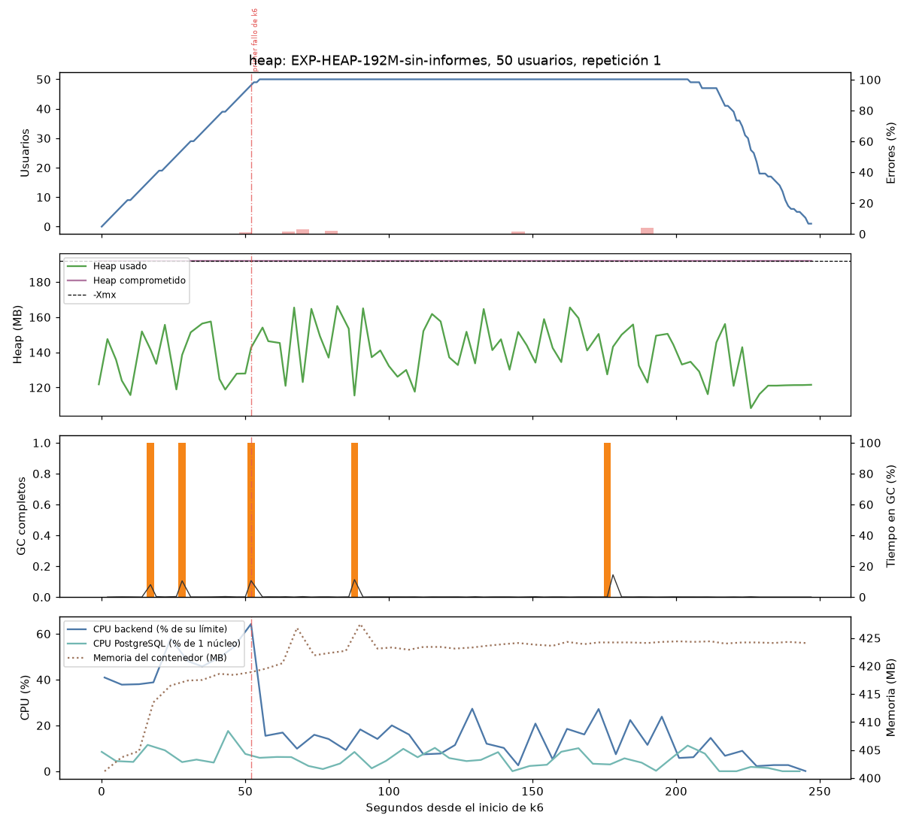

### heap: EXP-HEAP-256M, 100 usuarios, repetición 1

- Duración observada: 339 s; 3670 peticiones, 365 con fallo.
- **Primer fallo a los 33 s, con 30 usuarios activos.**

| t (s) | Operación | Estado | Duración (ms) | Error de k6 |
|---|---|---|---|---|
| 33.0 | cita | 400 | 18 |  |
| 43.0 | cita | 400 | 22 |  |
| 95.0 | cita | 400 | 64 |  |
| 102.0 | cita | 400 | 27 |  |
| 109.0 | cita | 400 | 13 |  |
| 128.0 | iniciar | 400 | 1098 |  |
| 130.0 | iniciar | 400 | 608 |  |
| 130.0 | iniciar | 400 | 732 |  |
| 131.0 | iniciar | 400 | 551 |  |
| 135.0 | iniciar | 400 | 28 |  |
| 141.0 | cita | 400 | 11 |  |
| 147.0 | cita | 400 | 55 |  |

- Operaciones con fallos en los 30 s siguientes al primero: cita (2).
- **Qué ocurre primero** (segundos desde el inicio de k6): -1 s: contenedor sobre 80pct de memoria; 17 s: cpu del backend al tope; 20 s: heap usado sobre 90pct del tope; 20 s: primera rafaga de gc completo; 33 s: primer fallo de k6; 189 s: primer OutOfMemoryError; 189 s: primer tiempo agotado del pool.
- **En los 30 s previos al primer fallo:** heap usado al inicio 146 MB, heap usado máx. 244 MB de 256, RssAnon máx. 476 MB, contenedor 484 MB de 512, CPU del backend 48 %, CPU de PostgreSQL 4 %, tiempo en GC 8.0 % con 7 GC completos.
- OutOfMemoryError en el registro: 17 líneas (ejemplo: `Exception in thread "http-nio-8080-Acceptor" java.lang.OutOfMemoryError: Java heap space`).
- Esperas de conexión agotadas en el registro: 43.

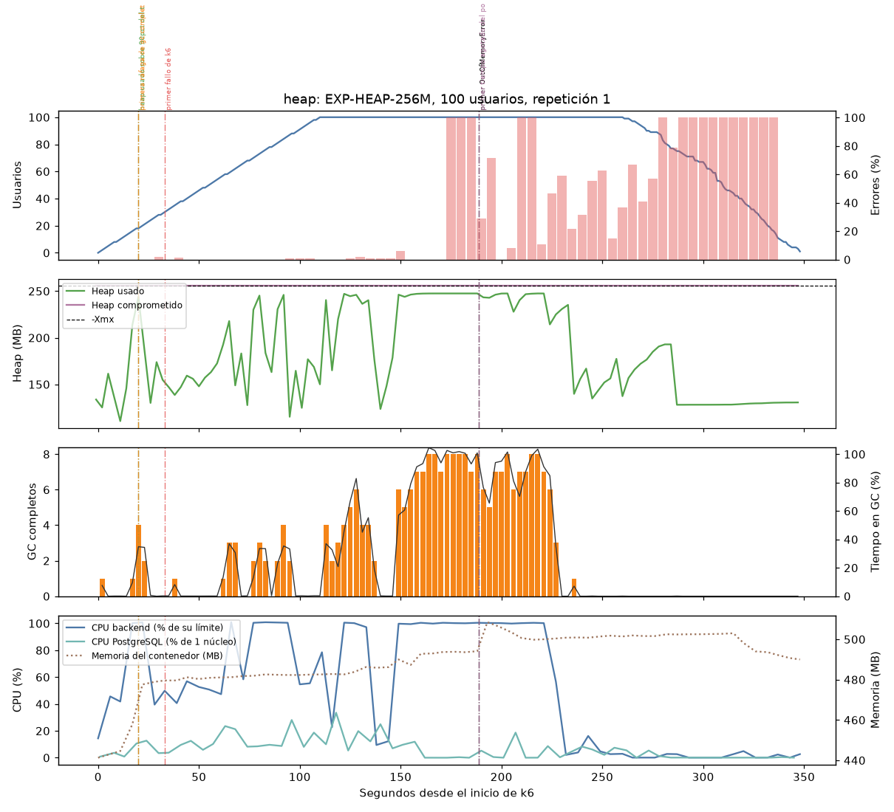

### heap: EXP-HEAP-256M, 50 usuarios, repetición 1

- Duración observada: 232 s; 2791 peticiones, 8 con fallo.
- **Primer fallo a los 34 s, con 31 usuarios activos.**

| t (s) | Operación | Estado | Duración (ms) | Error de k6 |
|---|---|---|---|---|
| 34.0 | cita | 400 | 21 |  |
| 43.0 | cita | 400 | 28 |  |
| 94.0 | cita | 400 | 26 |  |
| 101.0 | cita | 400 | 12 |  |
| 109.0 | cita | 400 | 12 |  |
| 153.0 | cita | 400 | 32 |  |
| 179.0 | cita | 400 | 12 |  |
| 192.0 | cita | 400 | 13 |  |

- Operaciones con fallos en los 30 s siguientes al primero: cita (2).
- **Qué ocurre primero** (segundos desde el inicio de k6): -1 s: contenedor sobre 80pct de memoria; 17 s: cpu del backend al tope; 20 s: heap usado sobre 90pct del tope; 20 s: primera rafaga de gc completo; 34 s: primer fallo de k6.
- **En los 30 s previos al primer fallo:** heap usado al inicio 150 MB, heap usado máx. 236 MB de 256, RssAnon máx. 476 MB, contenedor 484 MB de 512, CPU del backend 47 %, CPU de PostgreSQL 5 %, tiempo en GC 7.2 % con 6 GC completos.

### heap: EXP-HEAP-288M, 100 usuarios, repetición 1

- Duración observada: 41 s; 213 peticiones, 88 con fallo.
- **Primer fallo a los 20 s, con 19 usuarios activos.**

| t (s) | Operación | Estado | Duración (ms) | Error de k6 |
|---|---|---|---|---|
| 20.0 | login | 0 | 878 | EOF |
| 20.0 | reporte_clinico | 0 | 0 | read: connection reset by peer |
| 20.0 | reporte_de_ventas | 0 | 0 | read: connection reset by peer |
| 20.0 | pacientes_inactivos | 0 | 1 | read: connection reset by peer |
| 20.0 | apoderado | 0 | 0 | dial: connection refused |
| 20.0 | login | 0 | 0 | dial: connection refused |
| 21.0 | login | 0 | 0 | dial: connection refused |
| 21.0 | apoderado | 0 | 0 | dial: connection refused |
| 21.0 | navegacion | 0 | 0 | dial: connection refused |
| 21.0 | privacidad | 0 | 0 | dial: connection refused |
| 21.0 | cumplimiento | 0 | 0 | dial: connection refused |
| 21.0 | notificaciones | 0 | 0 | dial: connection refused |

- Operaciones con fallos en los 30 s siguientes al primero: login (21), apoderado (13), navegacion (7), privacidad (7), cumplimiento (7), notificaciones (7), avisos_de_cumplimiento (7), panel (7).
- **Qué ocurre primero** (segundos desde el inicio de k6): -1 s: contenedor sobre 80pct de memoria; 16 s: cpu del backend al tope; 20 s: primer fallo de k6; 20 s: primera rafaga de gc completo.
- **En los 30 s previos al primer fallo:** heap usado al inicio 168 MB, heap usado máx. 242 MB de 288, RssAnon máx. 499 MB, contenedor 507 MB de 512, CPU del backend 44 %, CPU de PostgreSQL 1 %, tiempo en GC 7.3 % con 4 GC completos.

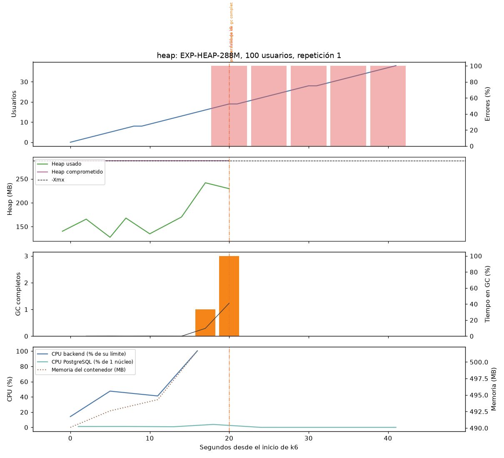

### heap: EXP-HEAP-288M, 50 usuarios, repetición 1

- Duración observada: 41 s; 213 peticiones, 89 con fallo.
- **Primer fallo a los 19 s, con 18 usuarios activos.**

| t (s) | Operación | Estado | Duración (ms) | Error de k6 |
|---|---|---|---|---|
| 19.0 | login | 0 | 418 | EOF |
| 19.0 | panel | 0 | 0 | EOF |
| 19.0 | reporte_clinico | 0 | 1 | EOF |
| 19.0 | reporte_de_ventas | 0 | 0 | read: connection reset by peer |
| 19.0 | pacientes_inactivos | 0 | 0 | read: connection reset by peer |
| 19.0 | apoderado | 0 | 0 | dial: connection refused |
| 20.0 | login | 0 | 0 | dial: connection refused |
| 21.0 | login | 0 | 0 | dial: connection refused |
| 21.0 | apoderado | 0 | 0 | dial: connection refused |
| 21.0 | navegacion | 0 | 0 | dial: connection refused |
| 21.0 | privacidad | 0 | 0 | dial: connection refused |
| 21.0 | cumplimiento | 0 | 0 | dial: connection refused |

- Operaciones con fallos en los 30 s siguientes al primero: login (21), apoderado (13), panel (8), navegacion (7), privacidad (7), cumplimiento (7), notificaciones (7), avisos_de_cumplimiento (7).
- **Qué ocurre primero** (segundos desde el inicio de k6): -2 s: contenedor sobre 80pct de memoria; 16 s: cpu del backend al tope; 19 s: primer fallo de k6.
- **En los 30 s previos al primer fallo:** heap usado al inicio 170 MB, heap usado máx. 241 MB de 288, RssAnon máx. 495 MB, contenedor 503 MB de 512, CPU del backend 44 %, CPU de PostgreSQL 2 %, tiempo en GC 1.7 % con 1 GC completos.

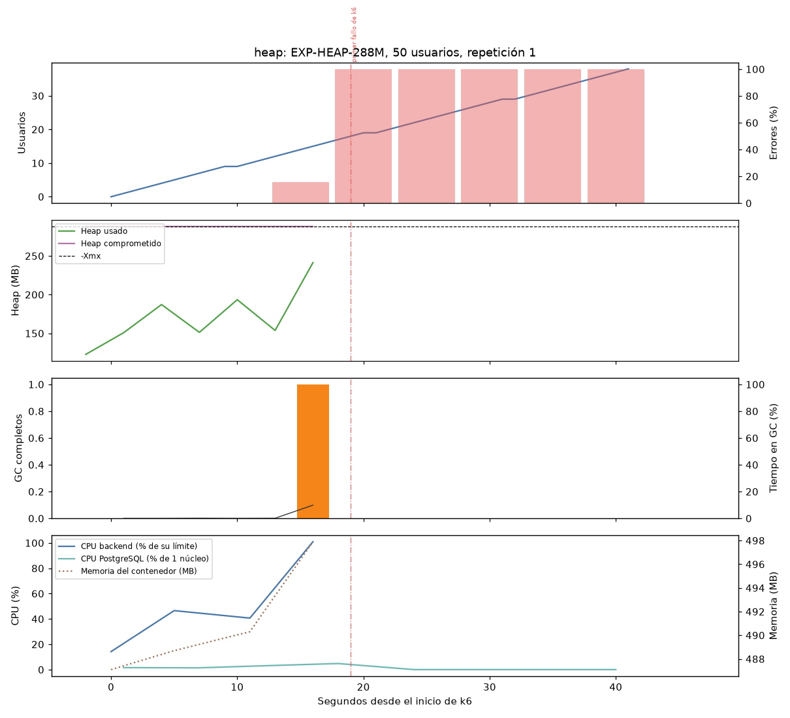

### heap: EXP-HEAP-192M, 100 usuarios, repetición 2

- Duración observada: 347 s; 703 peticiones, 560 con fallo.
- **Primer fallo a los 45 s, con 41 usuarios activos.**

| t (s) | Operación | Estado | Duración (ms) | Error de k6 |
|---|---|---|---|---|
| 45.0 | reporte_clinico | 0 | 30001 | request timeout |
| 49.0 | login | 0 | 30001 | request timeout |
| 50.0 | login | 0 | 30000 | request timeout |
| 52.0 | login | 0 | 30001 | request timeout |
| 53.0 | login | 0 | 30001 | request timeout |
| 54.0 | login | 0 | 30001 | request timeout |
| 55.0 | apoderado | 0 | 30000 | request timeout |
| 55.0 | login | 0 | 30000 | request timeout |
| 55.0 | panel | 0 | 30001 | request timeout |
| 55.0 | apoderado | 0 | 30001 | request timeout |
| 55.0 | panel | 0 | 30001 | request timeout |
| 56.0 | login | 0 | 30000 | request timeout |

- Operaciones con fallos en los 30 s siguientes al primero: login (24), apoderado (5), panel (2), cancelar_cita (2), reporte_clinico (1), iniciar (1), cita (1), historia (1).
- **Qué ocurre primero** (segundos desde el inicio de k6): 17 s: heap usado sobre 90pct del tope; 17 s: primera rafaga de gc completo; 17 s: contenedor sobre 80pct de memoria; 19 s: cpu del backend al tope; 45 s: primer fallo de k6; 102 s: primer tiempo agotado del pool; 102 s: primer OutOfMemoryError.
- **En los 30 s previos al primer fallo:** heap usado al inicio 150 MB, heap usado máx. 186 MB de 192, RssAnon máx. 418 MB, contenedor 427 MB de 512, CPU del backend 100 %, CPU de PostgreSQL 1 %, tiempo en GC 77.4 % con 78 GC completos.
- OutOfMemoryError en el registro: 18 líneas (ejemplo: `Exception in thread "http-nio-8080-Acceptor" java.lang.OutOfMemoryError: Java heap space`).
- Esperas de conexión agotadas en el registro: 1.

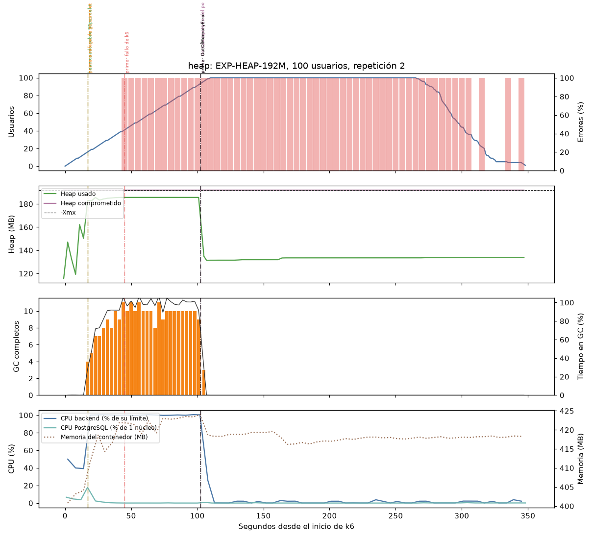

### heap: EXP-HEAP-192M, 50 usuarios, repetición 2

- Duración observada: 285 s; 383 peticiones, 259 con fallo.
- **Primer fallo a los 45 s, con 41 usuarios activos.**

| t (s) | Operación | Estado | Duración (ms) | Error de k6 |
|---|---|---|---|---|
| 45.0 | reporte_clinico | 0 | 30000 | request timeout |
| 48.0 | login | 0 | 30000 | request timeout |
| 49.0 | login | 0 | 30000 | request timeout |
| 50.0 | login | 0 | 30000 | request timeout |
| 51.0 | login | 0 | 30001 | request timeout |
| 52.0 | citas_del_mes | 0 | 30001 | request timeout |
| 52.0 | lista_de_historias | 0 | 30001 | request timeout |
| 52.0 | login | 0 | 30000 | request timeout |
| 53.0 | apoderado | 0 | 30000 | request timeout |
| 53.0 | mascota | 0 | 30001 | request timeout |
| 53.0 | checkin | 0 | 30000 | request timeout |
| 54.0 | login | 0 | 30001 | request timeout |

- Operaciones con fallos en los 30 s siguientes al primero: login (25), apoderado (6), checkin (2), navegacion (2), reporte_clinico (1), citas_del_mes (1), lista_de_historias (1), mascota (1).
- **Qué ocurre primero** (segundos desde el inicio de k6): 14 s: contenedor sobre 80pct de memoria; 17 s: heap usado sobre 90pct del tope; 17 s: primera rafaga de gc completo; 17 s: cpu del backend al tope; 45 s: primer fallo de k6; 173 s: primer OutOfMemoryError.
- **En los 30 s previos al primer fallo:** heap usado al inicio 151 MB, heap usado máx. 186 MB de 192, RssAnon máx. 411 MB, contenedor 421 MB de 512, CPU del backend 101 %, CPU de PostgreSQL 1 %, tiempo en GC 81.4 % con 95 GC completos.
- OutOfMemoryError en el registro: 27 líneas (ejemplo: `Exception in thread "http-nio-8080-Acceptor" java.lang.OutOfMemoryError: Java heap space`).

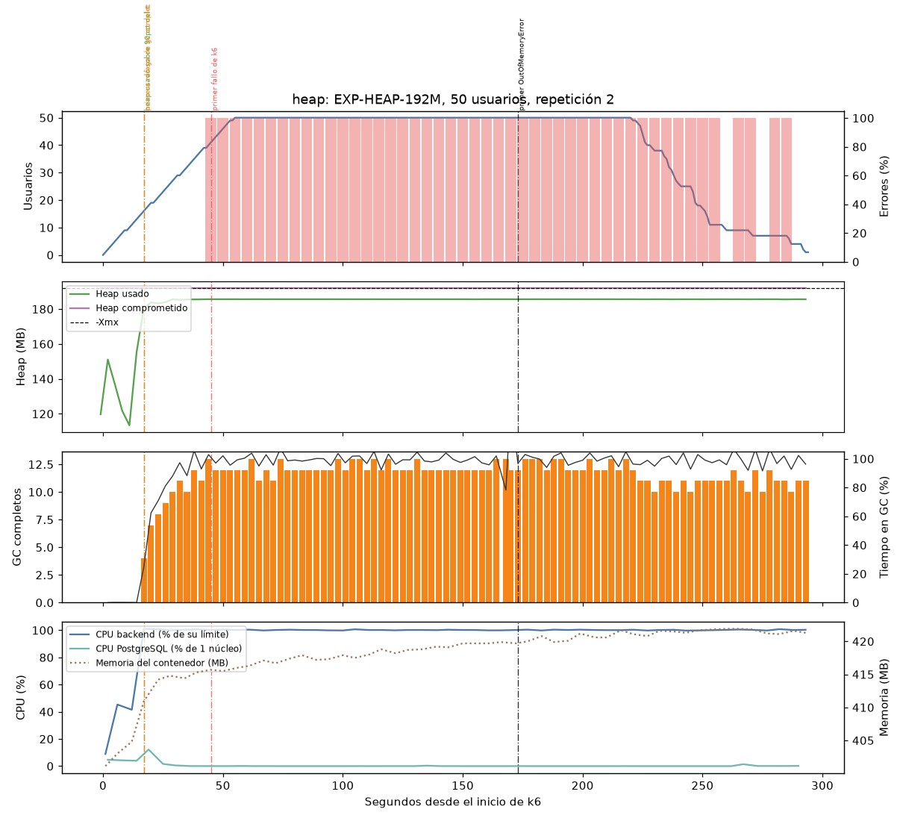

### heap: EXP-HEAP-192M-citas6000, 100 usuarios, repetición 2

- Duración observada: 287 s; 6264 peticiones, 5 con fallo.
- **Primer fallo a los 100 s, con 91 usuarios activos.**

| t (s) | Operación | Estado | Duración (ms) | Error de k6 |
|---|---|---|---|---|
| 100.0 | cita | 400 | 51 |  |
| 109.0 | cita | 400 | 13 |  |
| 150.0 | iniciar | 400 | 17 |  |
| 153.0 | cita | 400 | 15 |  |
| 168.0 | iniciar | 400 | 16 |  |

- Operaciones con fallos en los 30 s siguientes al primero: cita (2).
- **Qué ocurre primero** (segundos desde el inicio de k6): 17 s: primera rafaga de gc completo; 17 s: contenedor sobre 80pct de memoria; 19 s: cpu del backend al tope; 62 s: heap usado sobre 90pct del tope; 100 s: primer fallo de k6.
- **En los 30 s previos al primer fallo:** heap usado al inicio 143 MB, heap usado máx. 185 MB de 192, RssAnon máx. 421 MB, contenedor 430 MB de 512, CPU del backend 46 %, CPU de PostgreSQL 9 %, tiempo en GC 5.6 % con 7 GC completos.

### heap: EXP-HEAP-192M-citas6000, 50 usuarios, repetición 2

- Duración observada: 231 s; 2785 peticiones, 3 con fallo.
- **Primer fallo a los 99 s, con 50 usuarios activos.**

| t (s) | Operación | Estado | Duración (ms) | Error de k6 |
|---|---|---|---|---|
| 99.0 | cita | 400 | 21 |  |
| 108.0 | cita | 400 | 11 |  |
| 152.0 | cita | 400 | 28 |  |

- Operaciones con fallos en los 30 s siguientes al primero: cita (2).
- **Qué ocurre primero** (segundos desde el inicio de k6): 14 s: contenedor sobre 80pct de memoria; 17 s: primera rafaga de gc completo; 99 s: primer fallo de k6; 146 s: heap usado sobre 90pct del tope.
- **En los 30 s previos al primer fallo:** heap usado al inicio 150 MB, heap usado máx. 164 MB de 192, RssAnon máx. 417 MB, contenedor 425 MB de 512, CPU del backend 13 %, CPU de PostgreSQL 1 %, tiempo en GC 4.7 % con 6 GC completos.

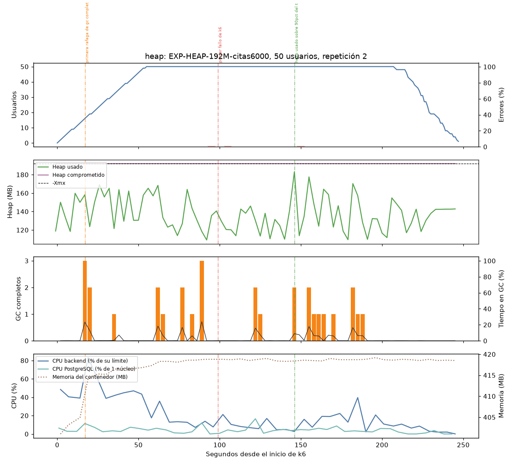

### heap: EXP-HEAP-192M-sin-informes, 100 usuarios, repetición 2

- Duración observada: 286 s; 6366 peticiones, 12 con fallo.
- **Primer fallo a los 33 s, con 30 usuarios activos.**

| t (s) | Operación | Estado | Duración (ms) | Error de k6 |
|---|---|---|---|---|
| 33.0 | cita | 400 | 42 |  |
| 43.0 | cita | 400 | 21 |  |
| 98.0 | cita | 400 | 16 |  |
| 108.0 | cita | 400 | 37 |  |
| 150.0 | iniciar | 400 | 12 |  |
| 151.0 | cita | 400 | 21 |  |
| 178.0 | cita | 400 | 10 |  |
| 191.0 | cita | 400 | 10 |  |
| 250.0 | cita | 400 | 11 |  |
| 280.0 | cita | 400 | 11 |  |
| 281.0 | cita | 400 | 11 |  |
| 284.0 | cita | 400 | 14 |  |

- Operaciones con fallos en los 30 s siguientes al primero: cita (2).
- **Qué ocurre primero** (segundos desde el inicio de k6): 17 s: contenedor sobre 80pct de memoria; 33 s: primer fallo de k6.
- **En los 30 s previos al primer fallo:** heap usado al inicio 140 MB, heap usado máx. 163 MB de 192, RssAnon máx. 415 MB, contenedor 423 MB de 512, CPU del backend 40 %, CPU de PostgreSQL 5 %, tiempo en GC 1.5 % con 2 GC completos.

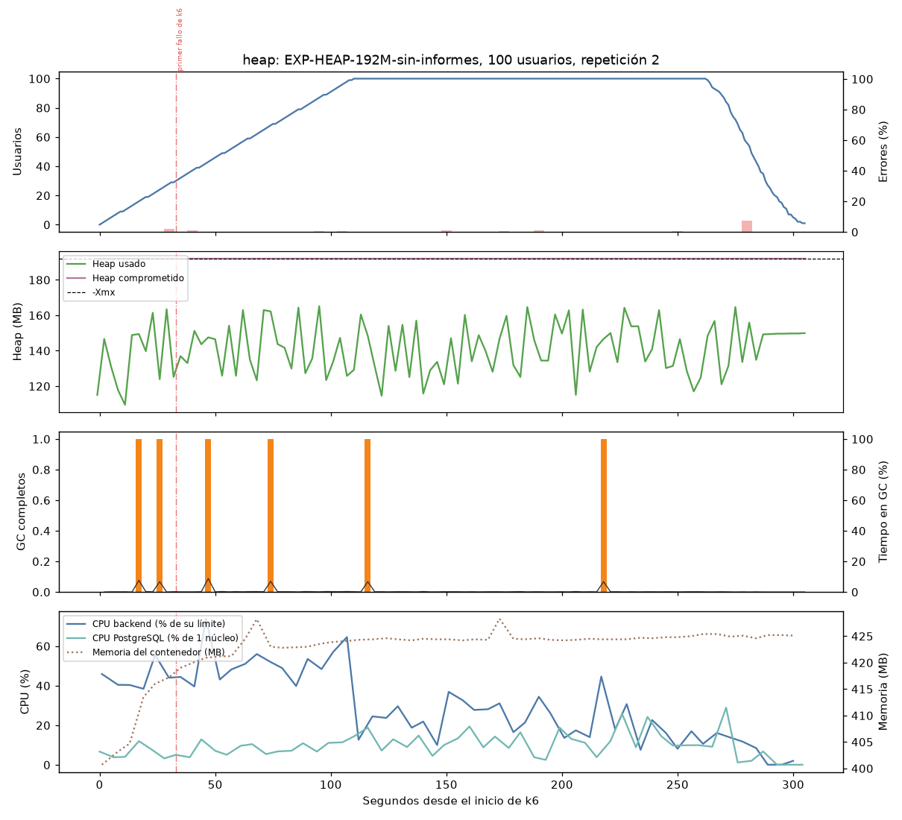

### heap: EXP-HEAP-192M-sin-informes, 50 usuarios, repetición 2

- Duración observada: 231 s; 2810 peticiones, 7 con fallo.
- **Primer fallo a los 33 s, con 30 usuarios activos.**

| t (s) | Operación | Estado | Duración (ms) | Error de k6 |
|---|---|---|---|---|
| 33.0 | cita | 400 | 48 |  |
| 43.0 | cita | 400 | 16 |  |
| 99.0 | cita | 400 | 22 |  |
| 108.0 | cita | 400 | 13 |  |
| 150.0 | cita | 400 | 24 |  |
| 177.0 | cita | 400 | 12 |  |
| 191.0 | cita | 400 | 12 |  |

- Operaciones con fallos en los 30 s siguientes al primero: cita (2).
- **Qué ocurre primero** (segundos desde el inicio de k6): 14 s: contenedor sobre 80pct de memoria; 33 s: primer fallo de k6.
- **En los 30 s previos al primer fallo:** heap usado al inicio 145 MB, heap usado máx. 167 MB de 192, RssAnon máx. 415 MB, contenedor 423 MB de 512, CPU del backend 45 %, CPU de PostgreSQL 4 %, tiempo en GC 1.5 % con 2 GC completos.

### heap: EXP-HEAP-256M, 100 usuarios, repetición 2

- Duración observada: 200 s; 3544 peticiones, 429 con fallo.
- **Primer fallo a los 52 s, con 48 usuarios activos.**

| t (s) | Operación | Estado | Duración (ms) | Error de k6 |
|---|---|---|---|---|
| 52.0 | cita | 400 | 43 |  |
| 67.0 | cita | 400 | 35 |  |
| 74.0 | cita | 400 | 41 |  |
| 76.0 | cita | 400 | 27 |  |
| 82.0 | cita | 400 | 11 |  |
| 148.0 | cita | 400 | 526 |  |
| 174.0 | reporte_clinico | 0 | 30001 | request timeout |
| 175.0 | reporte_clinico | 0 | 30000 | request timeout |
| 179.0 | privacidad | 0 | 1 | EOF |
| 179.0 | cita | 0 | 1143 | EOF |
| 179.0 | cita | 0 | 4423 | EOF |
| 179.0 | mascota | 0 | 12164 | EOF |

- Operaciones con fallos en los 30 s siguientes al primero: cita (5).
- **Qué ocurre primero** (segundos desde el inicio de k6): -1 s: contenedor sobre 80pct de memoria; 17 s: heap usado sobre 90pct del tope; 17 s: primera rafaga de gc completo; 17 s: cpu del backend al tope; 52 s: primer fallo de k6; 177 s: primer OutOfMemoryError.
- **En los 30 s previos al primer fallo:** heap usado al inicio 158 MB, heap usado máx. 187 MB de 256, RssAnon máx. 478 MB, contenedor 486 MB de 512, CPU del backend 45 %, CPU de PostgreSQL 5 %, tiempo en GC 1.6 % con 1 GC completos.
- OutOfMemoryError en el registro: 3 líneas (ejemplo: `java.lang.OutOfMemoryError: Java heap space`).

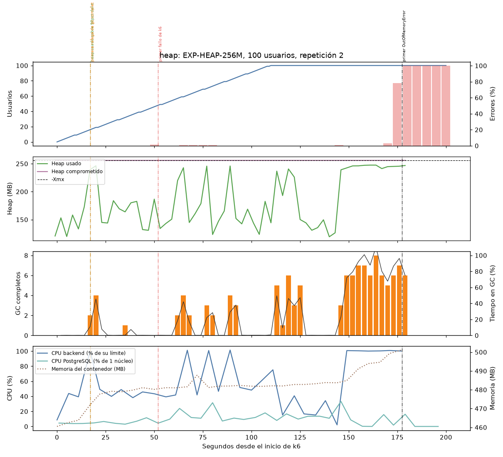

### heap: EXP-HEAP-256M, 50 usuarios, repetición 2

- Duración observada: 231 s; 2800 peticiones, 7 con fallo.
- **Primer fallo a los 52 s, con 48 usuarios activos.**

| t (s) | Operación | Estado | Duración (ms) | Error de k6 |
|---|---|---|---|---|
| 52.0 | cita | 400 | 41 |  |
| 67.0 | cita | 400 | 12 |  |
| 74.0 | cita | 400 | 14 |  |
| 76.0 | cita | 400 | 29 |  |
| 81.0 | cita | 400 | 11 |  |
| 146.0 | cita | 400 | 38 |  |
| 194.0 | cita | 400 | 11 |  |

- Operaciones con fallos en los 30 s siguientes al primero: cita (5).
- **Qué ocurre primero** (segundos desde el inicio de k6): -1 s: contenedor sobre 80pct de memoria; 17 s: primera rafaga de gc completo; 19 s: cpu del backend al tope; 52 s: primer fallo de k6; 62 s: heap usado sobre 90pct del tope.
- **En los 30 s previos al primer fallo:** heap usado al inicio 161 MB, heap usado máx. 184 MB de 256, RssAnon máx. 478 MB, contenedor 486 MB de 512, CPU del backend 42 %, CPU de PostgreSQL 6 %, tiempo en GC 1.4 % con 2 GC completos.

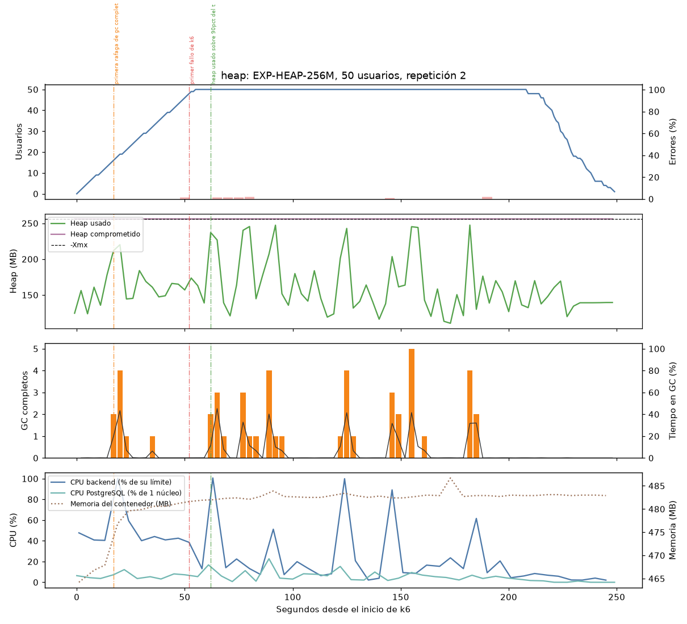

### heap: EXP-HEAP-288M, 100 usuarios, repetición 2

- Duración observada: 37 s; 181 peticiones, 74 con fallo.
- **Primer fallo a los 17 s, con 16 usuarios activos.**

| t (s) | Operación | Estado | Duración (ms) | Error de k6 |
|---|---|---|---|---|
| 17.0 | cumplimiento | 0 | 0 | EOF |
| 17.0 | reporte_clinico | 0 | 0 | EOF |
| 17.0 | notificaciones | 0 | 0 | read: connection reset by peer |
| 17.0 | reporte_de_ventas | 0 | 0 | read: connection reset by peer |
| 17.0 | avisos_de_cumplimiento | 0 | 0 | read: connection reset by peer |
| 17.0 | pacientes_inactivos | 0 | 0 | EOF |
| 17.0 | panel | 0 | 0 | read: connection reset by peer |
| 17.0 | login | 0 | 0 | dial: connection refused |
| 18.0 | login | 0 | 0 | dial: connection refused |
| 19.0 | login | 0 | 0 | dial: connection refused |
| 20.0 | apoderado | 0 | 0 | dial: connection refused |
| 20.0 | login | 0 | 0 | dial: connection refused |

- Operaciones con fallos en los 30 s siguientes al primero: login (19), apoderado (10), cumplimiento (6), notificaciones (6), avisos_de_cumplimiento (6), panel (6), navegacion (5), privacidad (5).
- **Qué ocurre primero** (segundos desde el inicio de k6): -1 s: contenedor sobre 80pct de memoria; 17 s: primer fallo de k6.
- **En los 30 s previos al primer fallo:** heap usado al inicio 148 MB, heap usado máx. 184 MB de 288, RssAnon máx. 489 MB, contenedor 496 MB de 512, CPU del backend 41 %, CPU de PostgreSQL 5 %, tiempo en GC 1.5 % con 1 GC completos.

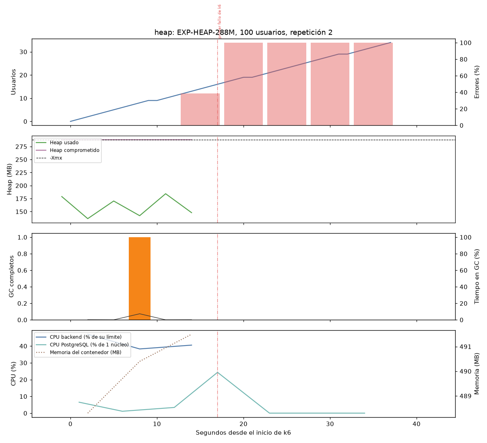

### heap: EXP-HEAP-288M, 50 usuarios, repetición 2

- Duración observada: 37 s; 181 peticiones, 70 con fallo.
- **Primer fallo a los 17 s, con 16 usuarios activos.**

| t (s) | Operación | Estado | Duración (ms) | Error de k6 |
|---|---|---|---|---|
| 17.0 | login | 0 | 192 | EOF |
| 17.0 | reporte_clinico | 0 | 0 | read: connection reset by peer |
| 17.0 | reporte_de_ventas | 0 | 0 | EOF |
| 17.0 | pacientes_inactivos | 0 | 0 | EOF |
| 18.0 | login | 0 | 0 | dial: connection refused |
| 19.0 | login | 0 | 0 | dial: connection refused |
| 20.0 | apoderado | 0 | 0 | dial: connection refused |
| 20.0 | login | 0 | 0 | dial: connection refused |
| 21.0 | login | 0 | 0 | dial: connection refused |
| 21.0 | apoderado | 0 | 0 | dial: connection refused |
| 21.0 | navegacion | 0 | 0 | dial: connection refused |
| 21.0 | privacidad | 0 | 0 | dial: connection refused |

- Operaciones con fallos en los 30 s siguientes al primero: login (19), apoderado (10), navegacion (5), privacidad (5), cumplimiento (5), notificaciones (5), avisos_de_cumplimiento (5), panel (5).
- **Qué ocurre primero** (segundos desde el inicio de k6): -1 s: contenedor sobre 80pct de memoria; 17 s: primer fallo de k6; 17 s: cpu del backend al tope.
- **En los 30 s previos al primer fallo:** heap usado al inicio 161 MB, heap usado máx. 206 MB de 288, RssAnon máx. 489 MB, contenedor 498 MB de 512, CPU del backend 41 %, CPU de PostgreSQL 4 %, tiempo en GC 2.6 % con 1 GC completos.

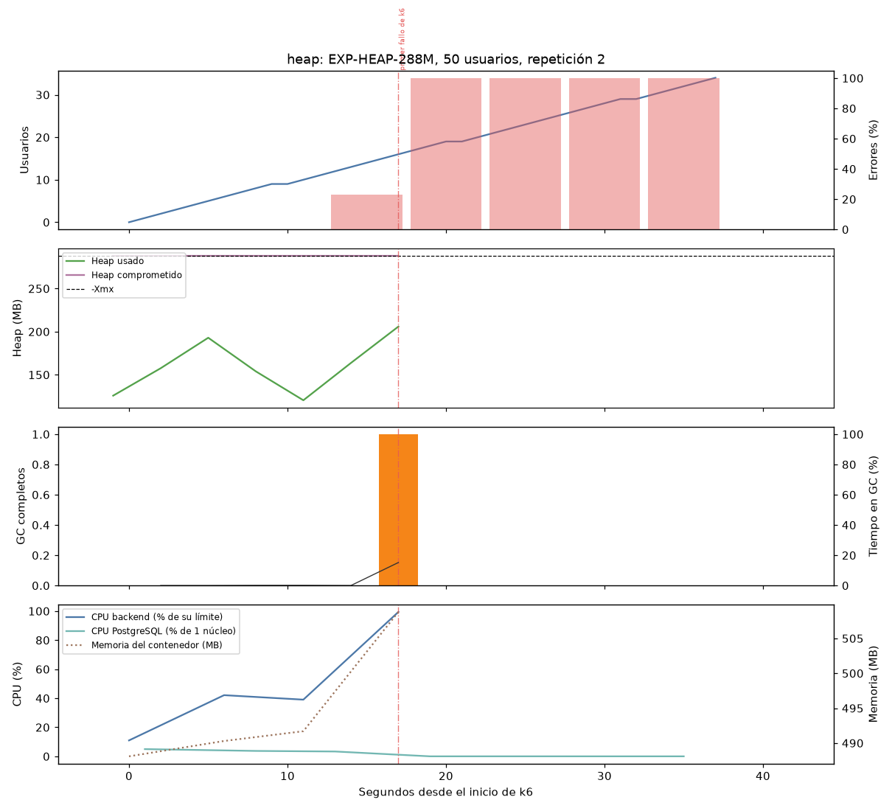

### heap: EXP-HEAP-192M, 100 usuarios, repetición 3

- Duración observada: 344 s; 694 peticiones, 563 con fallo.
- **Primer fallo a los 45 s, con 41 usuarios activos.**

| t (s) | Operación | Estado | Duración (ms) | Error de k6 |
|---|---|---|---|---|
| 45.0 | reporte_clinico | 0 | 30001 | request timeout |
| 48.0 | login | 0 | 30000 | request timeout |
| 49.0 | login | 0 | 30001 | request timeout |
| 51.0 | login | 0 | 30001 | request timeout |
| 51.0 | lista_de_historias | 0 | 30000 | request timeout |
| 52.0 | login | 0 | 30001 | request timeout |
| 52.0 | apoderado | 0 | 30001 | request timeout |
| 52.0 | mascota | 0 | 30001 | request timeout |
| 52.0 | checkin | 0 | 30001 | request timeout |
| 53.0 | apoderado | 0 | 30001 | request timeout |
| 53.0 | login | 0 | 30000 | request timeout |
| 54.0 | apoderado | 0 | 30000 | request timeout |

- Operaciones con fallos en los 30 s siguientes al primero: login (25), apoderado (6), checkin (2), reporte_clinico (1), lista_de_historias (1), mascota (1), privacidad (1), avisos_de_cumplimiento (1).
- **Qué ocurre primero** (segundos desde el inicio de k6): 16 s: primera rafaga de gc completo; 16 s: contenedor sobre 80pct de memoria; 18 s: cpu del backend al tope; 19 s: heap usado sobre 90pct del tope; 45 s: primer fallo de k6; 182 s: primer OutOfMemoryError; 182 s: primer tiempo agotado del pool.
- **En los 30 s previos al primer fallo:** heap usado al inicio 151 MB, heap usado máx. 186 MB de 192, RssAnon máx. 412 MB, contenedor 422 MB de 512, CPU del backend 100 %, CPU de PostgreSQL 1 %, tiempo en GC 79.3 % con 84 GC completos.
- OutOfMemoryError en el registro: 35 líneas (ejemplo: `Exception in thread "http-nio-8080-Acceptor" java.lang.OutOfMemoryError: Java heap space`).
- Esperas de conexión agotadas en el registro: 1.

### heap: EXP-HEAP-192M, 50 usuarios, repetición 3

- Duración observada: 284 s; 1063 peticiones, 214 con fallo.
- **Primer fallo a los 37 s, con 34 usuarios activos.**

| t (s) | Operación | Estado | Duración (ms) | Error de k6 |
|---|---|---|---|---|
| 37.0 | login | 0 | 10015 | EOF |
| 37.0 | apoderado | 0 | 10010 | EOF |
| 39.0 | reporte_clinico | 500 | 23925 |  |
| 70.0 | cita | 400 | 42 |  |
| 93.0 | checkin | 0 | 9231 | EOF |
| 93.0 | reporte_clinico | 500 | 24349 |  |
| 93.0 | cancelar_cita | 401 | 11025 |  |
| 94.0 | iniciar | 400 | 874 |  |
| 94.0 | cita | 400 | 461 |  |
| 94.0 | cita | 400 | 124 |  |
| 118.0 | reporte_clinico | 0 | 30001 | request timeout |
| 125.0 | cancelar_cita | 0 | 20209 | EOF |

- Operaciones con fallos en los 30 s siguientes al primero: login (1), apoderado (1), reporte_clinico (1).
- **Qué ocurre primero** (segundos desde el inicio de k6): 17 s: heap usado sobre 90pct del tope; 17 s: primera rafaga de gc completo; 17 s: contenedor sobre 80pct de memoria; 17 s: cpu del backend al tope; 37 s: primer fallo de k6; 39 s: primer OutOfMemoryError.
- **En los 30 s previos al primer fallo:** heap usado al inicio 151 MB, heap usado máx. 186 MB de 192, RssAnon máx. 411 MB, contenedor 419 MB de 512, CPU del backend 100 %, CPU de PostgreSQL 3 %, tiempo en GC 54.5 % con 64 GC completos.
- OutOfMemoryError en el registro: 24 líneas (ejemplo: `java.lang.OutOfMemoryError: Java heap space`).

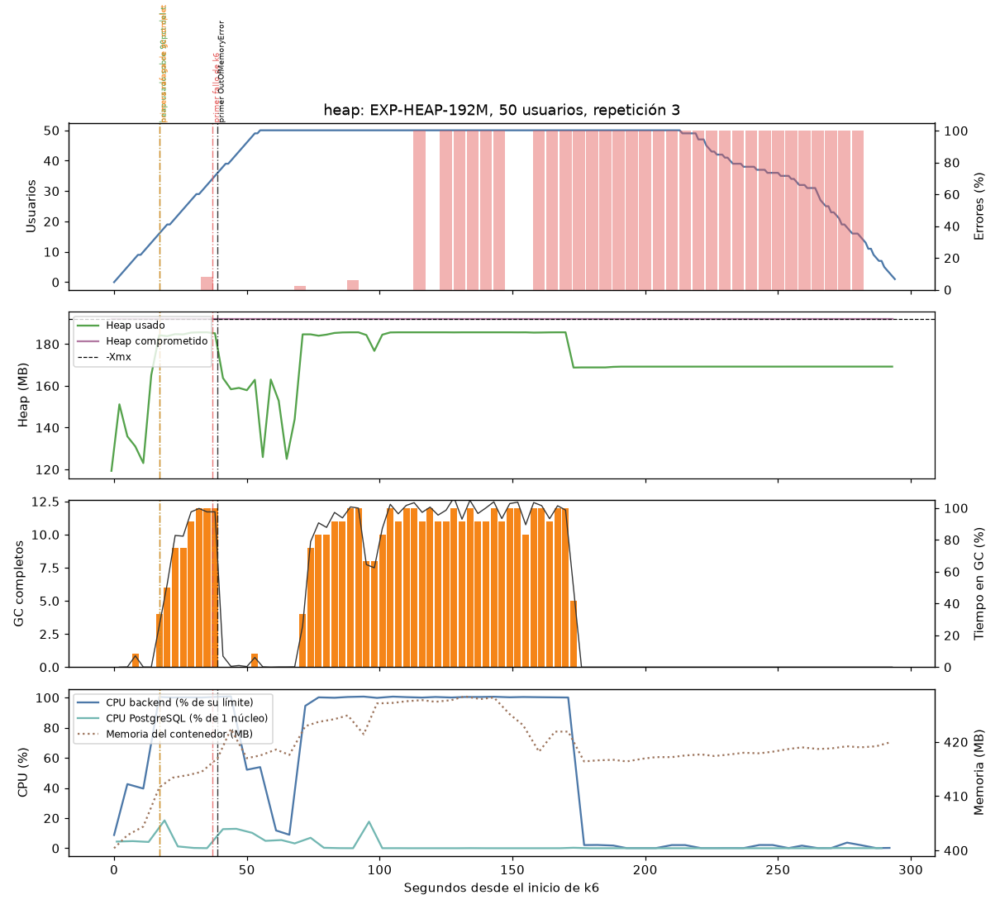

### heap: EXP-HEAP-192M-citas6000, 100 usuarios, repetición 3

- Duración observada: 286 s; 6254 peticiones, 16 con fallo.
- **Primer fallo a los 99 s, con 90 usuarios activos.**

| t (s) | Operación | Estado | Duración (ms) | Error de k6 |
|---|---|---|---|---|
| 99.0 | cita | 400 | 49 |  |
| 109.0 | cita | 400 | 12 |  |
| 153.0 | cita | 400 | 32 |  |
| 168.0 | iniciar | 400 | 252 |  |
| 168.0 | iniciar | 400 | 17 |  |
| 228.0 | cita | 400 | 16 |  |
| 233.0 | cita | 400 | 13 |  |
| 235.0 | cita | 400 | 11 |  |
| 258.0 | cita | 400 | 10 |  |
| 259.0 | cita | 400 | 43 |  |
| 262.0 | cita | 400 | 10 |  |
| 264.0 | cita | 400 | 279 |  |

- Operaciones con fallos en los 30 s siguientes al primero: cita (2).
- **Qué ocurre primero** (segundos desde el inicio de k6): 17 s: primera rafaga de gc completo; 17 s: contenedor sobre 80pct de memoria; 62 s: heap usado sobre 90pct del tope; 63 s: cpu del backend al tope; 99 s: primer fallo de k6.
- **En los 30 s previos al primer fallo:** heap usado al inicio 133 MB, heap usado máx. 158 MB de 192, RssAnon máx. 415 MB, contenedor 424 MB de 512, CPU del backend 47 %, CPU de PostgreSQL 8 %, tiempo en GC 6.1 % con 7 GC completos.

### heap: EXP-HEAP-192M-citas6000, 50 usuarios, repetición 3

- Duración observada: 231 s; 2776 peticiones, 3 con fallo.
- **Primer fallo a los 99 s, con 50 usuarios activos.**

| t (s) | Operación | Estado | Duración (ms) | Error de k6 |
|---|---|---|---|---|
| 99.0 | cita | 400 | 19 |  |
| 109.0 | cita | 400 | 14 |  |
| 153.0 | cita | 400 | 11 |  |

- Operaciones con fallos en los 30 s siguientes al primero: cita (2).
- **Qué ocurre primero** (segundos desde el inicio de k6): 14 s: contenedor sobre 80pct de memoria; 17 s: heap usado sobre 90pct del tope; 17 s: primera rafaga de gc completo; 17 s: cpu del backend al tope; 99 s: primer fallo de k6.
- **En los 30 s previos al primer fallo:** heap usado al inicio 146 MB, heap usado máx. 160 MB de 192, RssAnon máx. 417 MB, contenedor 425 MB de 512, CPU del backend 12 %, CPU de PostgreSQL 4 %, tiempo en GC 5.0 % con 6 GC completos.

### heap: EXP-HEAP-192M-sin-informes, 100 usuarios, repetición 3

- Duración observada: 287 s; 6359 peticiones, 12 con fallo.
- **Primer fallo a los 52 s, con 48 usuarios activos.**

| t (s) | Operación | Estado | Duración (ms) | Error de k6 |
|---|---|---|---|---|
| 52.0 | cita | 400 | 41 |  |
| 58.0 | cita | 400 | 13 |  |
| 74.0 | cita | 400 | 18 |  |
| 98.0 | cita | 400 | 19 |  |
| 128.0 | iniciar | 400 | 14 |  |
| 146.0 | cita | 400 | 24 |  |
| 168.0 | iniciar | 400 | 17 |  |
| 191.0 | cita | 400 | 13 |  |
| 194.0 | cita | 400 | 16 |  |
| 250.0 | cita | 400 | 11 |  |
| 262.0 | cita | 400 | 27 |  |
| 262.0 | cita | 400 | 14 |  |

- Operaciones con fallos en los 30 s siguientes al primero: cita (3).
- **Qué ocurre primero** (segundos desde el inicio de k6): 14 s: contenedor sobre 80pct de memoria; 52 s: primer fallo de k6.
- **En los 30 s previos al primer fallo:** heap usado al inicio 131 MB, heap usado máx. 150 MB de 192, RssAnon máx. 417 MB, contenedor 425 MB de 512, CPU del backend 48 %, CPU de PostgreSQL 7 %, tiempo en GC 1.6 % con 2 GC completos.

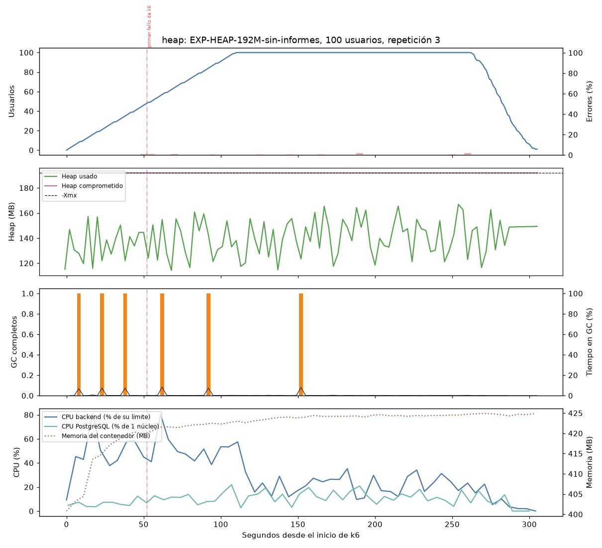

### heap: EXP-HEAP-192M-sin-informes, 50 usuarios, repetición 3

- Duración observada: 231 s; 2810 peticiones, 7 con fallo.
- **Primer fallo a los 52 s, con 48 usuarios activos.**

| t (s) | Operación | Estado | Duración (ms) | Error de k6 |
|---|---|---|---|---|
| 52.0 | cita | 400 | 42 |  |
| 58.0 | cita | 400 | 13 |  |
| 74.0 | cita | 400 | 14 |  |
| 98.0 | cita | 400 | 12 |  |
| 146.0 | cita | 400 | 24 |  |
| 191.0 | cita | 400 | 12 |  |
| 194.0 | cita | 400 | 27 |  |

- Operaciones con fallos en los 30 s siguientes al primero: cita (3).
- **Qué ocurre primero** (segundos desde el inicio de k6): 14 s: contenedor sobre 80pct de memoria; 52 s: primer fallo de k6.
- **En los 30 s previos al primer fallo:** heap usado al inicio 150 MB, heap usado máx. 165 MB de 192, RssAnon máx. 419 MB, contenedor 427 MB de 512, CPU del backend 45 %, CPU de PostgreSQL 6 %, tiempo en GC 1.7 % con 2 GC completos.

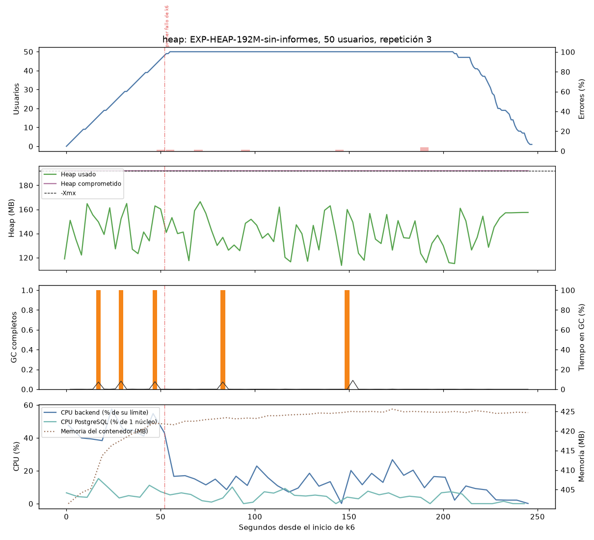

### heap: EXP-HEAP-256M, 100 usuarios, repetición 3

- Duración observada: 348 s; 3452 peticiones, 434 con fallo.
- **Primer fallo a los 23 s, con 21 usuarios activos.**

| t (s) | Operación | Estado | Duración (ms) | Error de k6 |
|---|---|---|---|---|
| 23.0 | cita | 400 | 19 |  |
| 33.0 | cita | 400 | 20 |  |
| 42.0 | cita | 400 | 33 |  |
| 101.0 | cita | 400 | 11 |  |
| 108.0 | cita | 400 | 35 |  |
| 174.0 | reporte_clinico | 0 | 30001 | request timeout |
| 175.0 | reporte_clinico | 0 | 30001 | request timeout |
| 180.0 | citas_del_mes | 0 | 30001 | request timeout |
| 180.0 | iniciar | 0 | 30001 | request timeout |
| 181.0 | consulta | 0 | 30001 | request timeout |
| 181.0 | consulta_lectura | 0 | 30000 | request timeout |
| 181.0 | citas_del_mes | 0 | 30001 | request timeout |

- Operaciones con fallos en los 30 s siguientes al primero: cita (3).
- **Qué ocurre primero** (segundos desde el inicio de k6): -2 s: contenedor sobre 80pct de memoria; 18 s: cpu del backend al tope; 20 s: primera rafaga de gc completo; 23 s: primer fallo de k6; 62 s: heap usado sobre 90pct del tope; 302 s: primer tiempo agotado del pool; 302 s: primer OutOfMemoryError.
- **En los 30 s previos al primer fallo:** heap usado al inicio 155 MB, heap usado máx. 193 MB de 256, RssAnon máx. 476 MB, contenedor 484 MB de 512, CPU del backend 47 %, CPU de PostgreSQL 7 %, tiempo en GC 7.7 % con 6 GC completos.
- OutOfMemoryError en el registro: 36 líneas (ejemplo: `Exception in thread "http-nio-8080-Poller" java.lang.OutOfMemoryError: Java heap space`).
- Esperas de conexión agotadas en el registro: 34.

### heap: EXP-HEAP-256M, 50 usuarios, repetición 3

- Duración observada: 231 s; 2784 peticiones, 8 con fallo.
- **Primer fallo a los 24 s, con 22 usuarios activos.**

| t (s) | Operación | Estado | Duración (ms) | Error de k6 |
|---|---|---|---|---|
| 24.0 | cita | 400 | 21 |  |
| 33.0 | cita | 400 | 15 |  |
| 42.0 | cita | 400 | 40 |  |
| 100.0 | cita | 400 | 31 |  |
| 108.0 | cita | 400 | 13 |  |
| 152.0 | cita | 400 | 12 |  |
| 178.0 | cita | 400 | 11 |  |
| 191.0 | cita | 400 | 12 |  |

- Operaciones con fallos en los 30 s siguientes al primero: cita (3).
- **Qué ocurre primero** (segundos desde el inicio de k6): -2 s: contenedor sobre 80pct de memoria; 16 s: primera rafaga de gc completo; 16 s: cpu del backend al tope; 19 s: heap usado sobre 90pct del tope; 24 s: primer fallo de k6.
- **En los 30 s previos al primer fallo:** heap usado al inicio 154 MB, heap usado máx. 242 MB de 256, RssAnon máx. 478 MB, contenedor 490 MB de 512, CPU del backend 46 %, CPU de PostgreSQL 4 %, tiempo en GC 11.0 % con 8 GC completos.

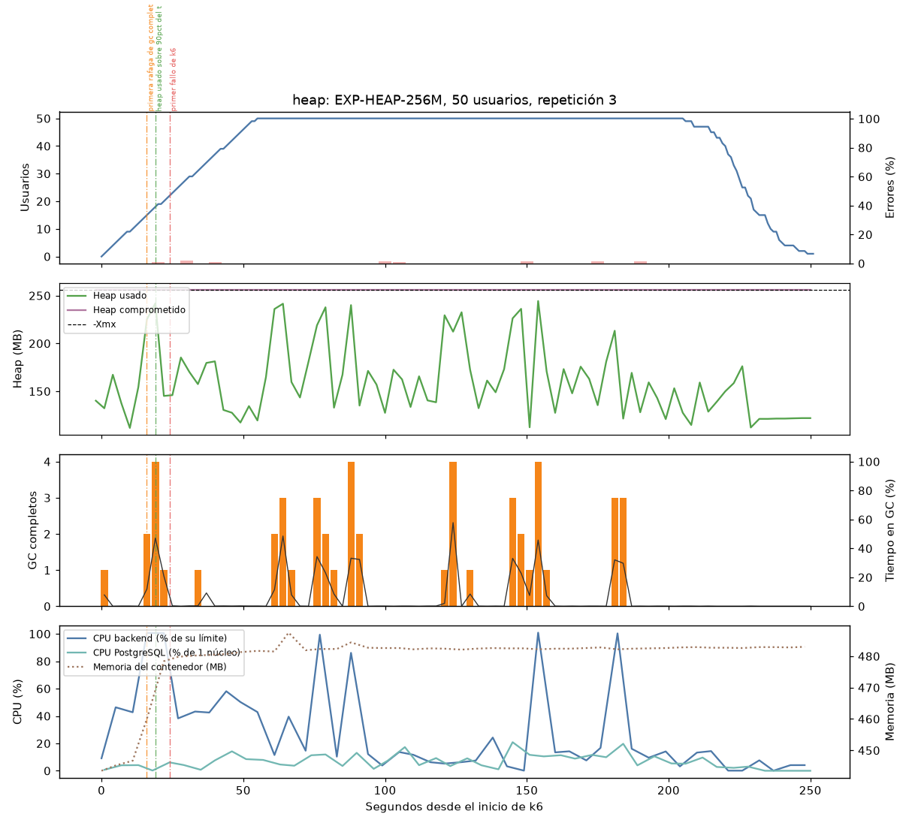

### heap: EXP-HEAP-288M, 100 usuarios, repetición 3

- Duración observada: 41 s; 213 peticiones, 85 con fallo.
- **Primer fallo a los 20 s, con 19 usuarios activos.**

| t (s) | Operación | Estado | Duración (ms) | Error de k6 |
|---|---|---|---|---|
| 20.0 | login | 0 | 924 | EOF |
| 20.0 | apoderado | 0 | 13 | EOF |
| 20.0 | login | 0 | 0 | dial: connection refused |
| 21.0 | login | 0 | 0 | dial: connection refused |
| 21.0 | apoderado | 0 | 0 | dial: connection refused |
| 22.0 | navegacion | 0 | 0 | dial: connection refused |
| 22.0 | privacidad | 0 | 0 | dial: connection refused |
| 22.0 | cumplimiento | 0 | 0 | dial: connection refused |
| 22.0 | notificaciones | 0 | 0 | dial: connection refused |
| 22.0 | avisos_de_cumplimiento | 0 | 0 | dial: connection refused |
| 22.0 | panel | 0 | 0 | dial: connection refused |
| 22.0 | lista_de_historias | 0 | 0 | dial: connection refused |

- Operaciones con fallos en los 30 s siguientes al primero: login (21), apoderado (13), navegacion (7), privacidad (7), cumplimiento (7), notificaciones (7), avisos_de_cumplimiento (7), panel (7).
- **Qué ocurre primero** (segundos desde el inicio de k6): -1 s: contenedor sobre 80pct de memoria; 17 s: cpu del backend al tope; 20 s: primer fallo de k6; 20 s: primera rafaga de gc completo.
- **En los 30 s previos al primer fallo:** heap usado al inicio 163 MB, heap usado máx. 256 MB de 288, RssAnon máx. 494 MB, contenedor 506 MB de 512, CPU del backend 43 %, CPU de PostgreSQL 4 %, tiempo en GC 7.4 % con 4 GC completos.

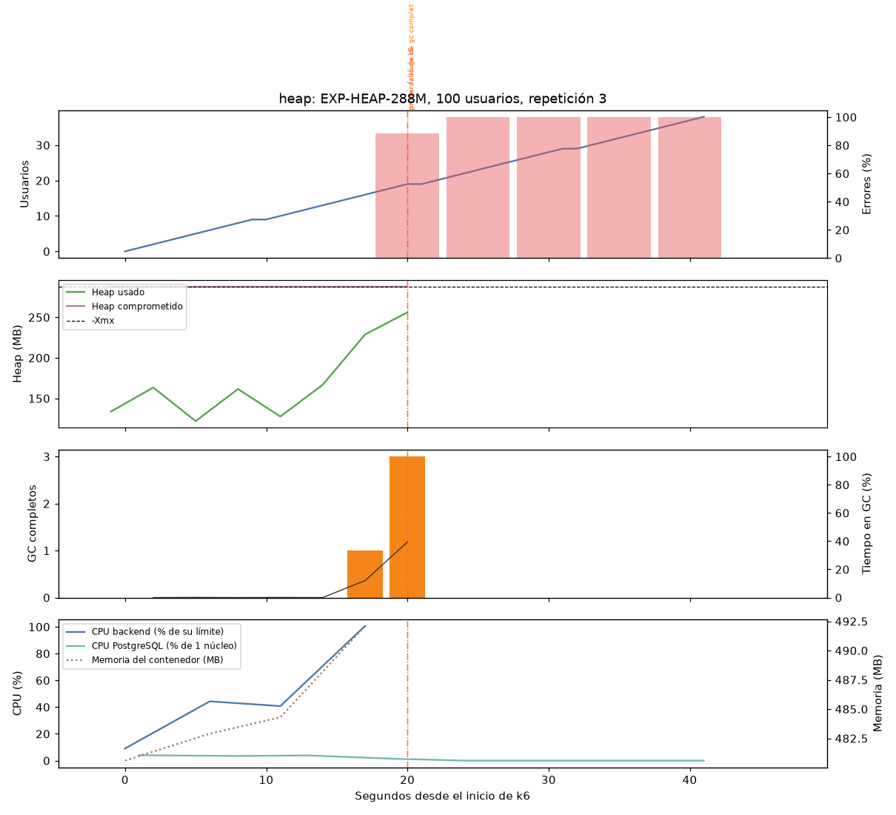

### heap: EXP-HEAP-288M, 50 usuarios, repetición 3

- Duración observada: 41 s; 220 peticiones, 85 con fallo.
- **Primer fallo a los 20 s, con 19 usuarios activos.**

| t (s) | Operación | Estado | Duración (ms) | Error de k6 |
|---|---|---|---|---|
| 20.0 | apoderado | 0 | 84 | EOF |
| 20.0 | login | 0 | 0 | dial: connection refused |
| 21.0 | login | 0 | 0 | dial: connection refused |
| 21.0 | apoderado | 0 | 0 | dial: connection refused |
| 21.0 | navegacion | 0 | 0 | dial: connection refused |
| 21.0 | privacidad | 0 | 0 | dial: connection refused |
| 21.0 | cumplimiento | 0 | 0 | dial: connection refused |
| 21.0 | notificaciones | 0 | 0 | dial: connection refused |
| 21.0 | avisos_de_cumplimiento | 0 | 0 | dial: connection refused |
| 21.0 | panel | 0 | 0 | dial: connection refused |
| 22.0 | lista_de_historias | 0 | 0 | dial: connection refused |
| 22.0 | citas_del_mes | 0 | 0 | dial: connection refused |

- Operaciones con fallos en los 30 s siguientes al primero: login (20), apoderado (14), navegacion (7), privacidad (7), cumplimiento (7), notificaciones (7), avisos_de_cumplimiento (7), panel (7).
- **Qué ocurre primero** (segundos desde el inicio de k6): -1 s: contenedor sobre 80pct de memoria; 19 s: cpu del backend al tope; 20 s: primer fallo de k6; 20 s: heap usado sobre 90pct del tope; 20 s: primera rafaga de gc completo.
- **En los 30 s previos al primer fallo:** heap usado al inicio 160 MB, heap usado máx. 263 MB de 288, RssAnon máx. 489 MB, contenedor 497 MB de 512, CPU del backend 45 %, CPU de PostgreSQL 6 %, tiempo en GC 7.1 % con 4 GC completos.

### heap: EXP-HEAP-192M-nmt, 100 usuarios, repetición 4

- Duración observada: 344 s; 692 peticiones, 563 con fallo.
- **Primer fallo a los 45 s, con 41 usuarios activos.**

| t (s) | Operación | Estado | Duración (ms) | Error de k6 |
|---|---|---|---|---|
| 45.0 | reporte_clinico | 0 | 30001 | request timeout |
| 49.0 | login | 0 | 30000 | request timeout |
| 50.0 | login | 0 | 30001 | request timeout |
| 51.0 | login | 0 | 30001 | request timeout |
| 52.0 | citas_del_mes | 0 | 30001 | request timeout |
| 52.0 | lista_de_historias | 0 | 30001 | request timeout |
| 52.0 | login | 0 | 30001 | request timeout |
| 52.0 | apoderado | 0 | 30001 | request timeout |
| 53.0 | login | 0 | 30001 | request timeout |
| 53.0 | apoderado | 0 | 30001 | request timeout |
| 54.0 | apoderado | 0 | 30001 | request timeout |
| 54.0 | login | 0 | 30001 | request timeout |

- Operaciones con fallos en los 30 s siguientes al primero: login (25), apoderado (6), navegacion (2), reporte_clinico (1), citas_del_mes (1), lista_de_historias (1), cita (1), notificaciones (1).
- **Qué ocurre primero** (segundos desde el inicio de k6): -2 s: contenedor sobre 80pct de memoria; 16 s: heap usado sobre 90pct del tope; 16 s: primera rafaga de gc completo; 18 s: cpu del backend al tope; 45 s: primer fallo de k6; 330 s: primer OutOfMemoryError.
- **En los 30 s previos al primer fallo:** heap usado al inicio 143 MB, heap usado máx. 186 MB de 192, RssAnon máx. 422 MB, contenedor 431 MB de 512, CPU del backend 100 %, CPU de PostgreSQL 1 %, tiempo en GC 77.6 % con 75 GC completos.
- OutOfMemoryError en el registro: 22 líneas (ejemplo: `Exception in thread "http-nio-8080-Acceptor" java.lang.OutOfMemoryError: Java heap space`).

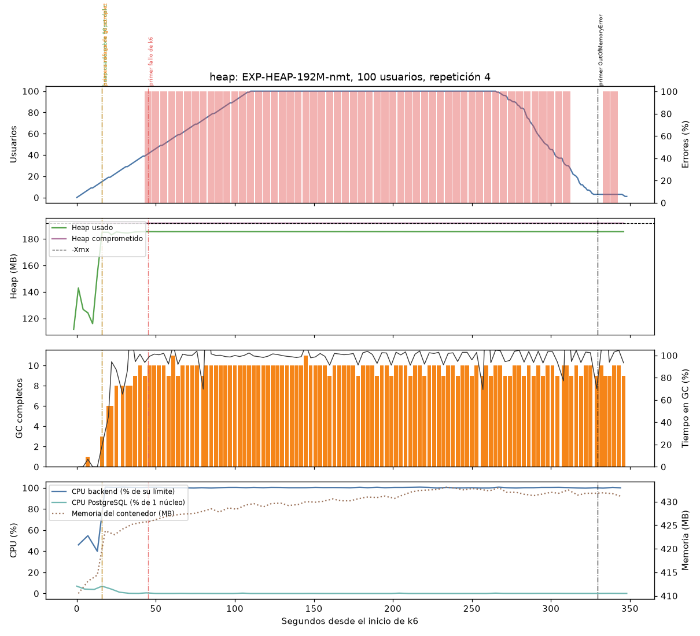

### heap: EXP-HEAP-192M-nmt, 50 usuarios, repetición 4

- Duración observada: 281 s; 721 peticiones, 228 con fallo.
- **Primer fallo a los 45 s, con 41 usuarios activos.**

| t (s) | Operación | Estado | Duración (ms) | Error de k6 |
|---|---|---|---|---|
| 45.0 | reporte_clinico | 0 | 30001 | request timeout |
| 49.0 | login | 0 | 30001 | request timeout |
| 50.0 | login | 0 | 30000 | request timeout |
| 51.0 | login | 0 | 30001 | request timeout |
| 52.0 | cita | 400 | 1151 |  |
| 52.0 | login | 0 | 30000 | request timeout |
| 53.0 | login | 0 | 30001 | request timeout |
| 54.0 | login | 0 | 30001 | request timeout |
| 56.0 | login | 0 | 30000 | request timeout |
| 60.0 | cita | 400 | 17 |  |
| 74.0 | login | 0 | 30000 | request timeout |
| 75.0 | reporte_de_ventas | 0 | 30000 | request timeout |

- Operaciones con fallos en los 30 s siguientes al primero: login (9), cita (2), reporte_clinico (1), reporte_de_ventas (1).
- **Qué ocurre primero** (segundos desde el inicio de k6): -1 s: contenedor sobre 80pct de memoria; 17 s: heap usado sobre 90pct del tope; 17 s: primera rafaga de gc completo; 17 s: cpu del backend al tope; 45 s: primer fallo de k6; 51 s: primer OutOfMemoryError; 221 s: primer tiempo agotado del pool.
- **En los 30 s previos al primer fallo:** heap usado al inicio 161 MB, heap usado máx. 186 MB de 192, RssAnon máx. 427 MB, contenedor 436 MB de 512, CPU del backend 100 %, CPU de PostgreSQL 1 %, tiempo en GC 75.9 % con 75 GC completos.
- OutOfMemoryError en el registro: 16 líneas (ejemplo: `Exception in thread "http-nio-8080-Acceptor" java.lang.OutOfMemoryError: Java heap space`).
- Esperas de conexión agotadas en el registro: 7.

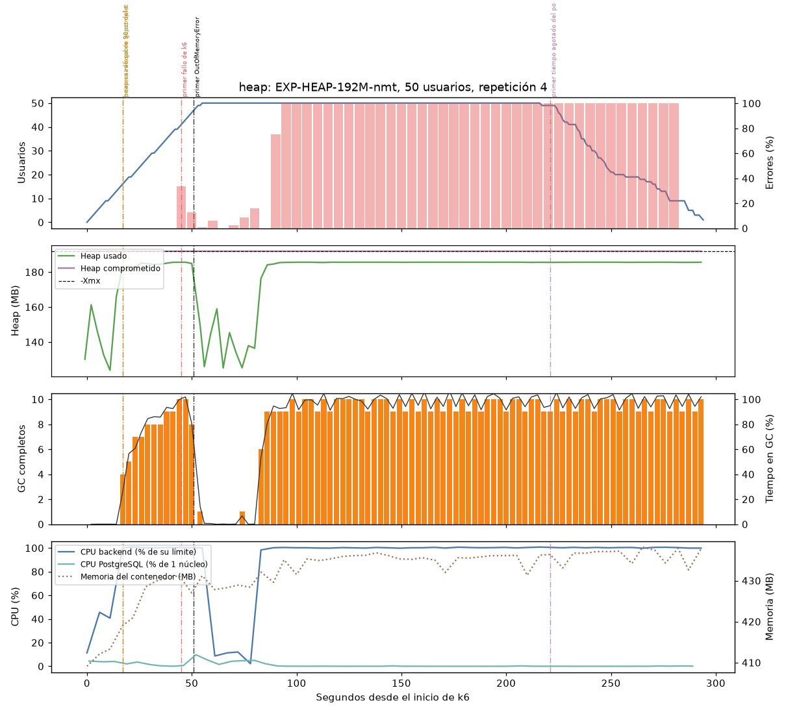

### heap: EXP-HEAP-256M-nmt, 100 usuarios, repetición 4

- Duración observada: 188 s; 3476 peticiones, 455 con fallo.
- **Primer fallo a los 33 s, con 30 usuarios activos.**

| t (s) | Operación | Estado | Duración (ms) | Error de k6 |
|---|---|---|---|---|
| 33.0 | cita | 400 | 50 |  |
| 43.0 | cita | 400 | 14 |  |
| 94.0 | cita | 400 | 17 |  |
| 101.0 | cita | 400 | 18 |  |
| 109.0 | cita | 400 | 20 |  |
| 140.0 | cita | 400 | 21 |  |
| 148.0 | cita | 400 | 491 |  |
| 167.0 | cancelar_cita | 0 | 8751 | EOF |
| 168.0 | reporte_clinico | 500 | 22910 |  |
| 168.0 | reporte_de_ventas | 0 | 100 | EOF |
| 168.0 | pacientes_inactivos | 0 | 0 | EOF |
| 168.0 | checkin | 0 | 17062 | unexpected EOF |

- Operaciones con fallos en los 30 s siguientes al primero: cita (2).
- **Qué ocurre primero** (segundos desde el inicio de k6): -1 s: contenedor sobre 80pct de memoria; 19 s: cpu del backend al tope; 20 s: primera rafaga de gc completo; 33 s: primer fallo de k6; 65 s: heap usado sobre 90pct del tope; 169 s: primer OutOfMemoryError.
- **En los 30 s previos al primer fallo:** heap usado al inicio 165 MB, heap usado máx. 219 MB de 256, RssAnon máx. 485 MB, contenedor 493 MB de 512, CPU del backend 40 %, CPU de PostgreSQL 4 %, tiempo en GC 6.8 % con 6 GC completos.
- OutOfMemoryError en el registro: 3 líneas (ejemplo: `java.lang.OutOfMemoryError: Java heap space`).

### heap: EXP-HEAP-256M-nmt, 50 usuarios, repetición 4

- Duración observada: 232 s; 2791 peticiones, 8 con fallo.
- **Primer fallo a los 33 s, con 30 usuarios activos.**

| t (s) | Operación | Estado | Duración (ms) | Error de k6 |
|---|---|---|---|---|
| 33.0 | cita | 400 | 22 |  |
| 43.0 | cita | 400 | 21 |  |
| 94.0 | cita | 400 | 17 |  |
| 101.0 | cita | 400 | 14 |  |
| 109.0 | cita | 400 | 12 |  |
| 152.0 | cita | 400 | 12 |  |
| 178.0 | cita | 400 | 12 |  |
| 192.0 | cita | 400 | 27 |  |

- Operaciones con fallos en los 30 s siguientes al primero: cita (2).
- **Qué ocurre primero** (segundos desde el inicio de k6): -1 s: contenedor sobre 80pct de memoria; 19 s: cpu del backend al tope; 20 s: heap usado sobre 90pct del tope; 20 s: primera rafaga de gc completo; 33 s: primer fallo de k6.
- **En los 30 s previos al primer fallo:** heap usado al inicio 158 MB, heap usado máx. 243 MB de 256, RssAnon máx. 485 MB, contenedor 494 MB de 512, CPU del backend 42 %, CPU de PostgreSQL 4 %, tiempo en GC 7.2 % con 6 GC completos.

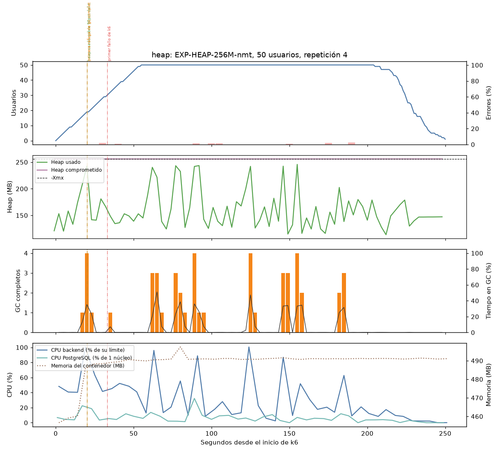

### heap: EXP-HEAP-288M-nmt, 100 usuarios, repetición 4

- Duración observada: 37 s; 181 peticiones, 70 con fallo.
- **Primer fallo a los 17 s, con 16 usuarios activos.**

| t (s) | Operación | Estado | Duración (ms) | Error de k6 |
|---|---|---|---|---|
| 17.0 | login | 0 | 39 | EOF |
| 17.0 | reporte_clinico | 0 | 2 | read: connection reset by peer |
| 17.0 | reporte_de_ventas | 0 | 0 | read: connection reset by peer |
| 17.0 | pacientes_inactivos | 0 | 0 | read: connection reset by peer |
| 18.0 | login | 0 | 0 | dial: connection refused |
| 19.0 | login | 0 | 0 | dial: connection refused |
| 20.0 | apoderado | 0 | 0 | dial: connection refused |
| 20.0 | login | 0 | 0 | dial: connection refused |
| 21.0 | login | 0 | 0 | dial: connection refused |
| 21.0 | apoderado | 0 | 0 | dial: connection refused |
| 22.0 | navegacion | 0 | 0 | dial: connection refused |
| 22.0 | privacidad | 0 | 0 | dial: connection refused |

- Operaciones con fallos en los 30 s siguientes al primero: login (19), apoderado (10), navegacion (5), privacidad (5), cumplimiento (5), notificaciones (5), avisos_de_cumplimiento (5), panel (5).
- **Qué ocurre primero** (segundos desde el inicio de k6): -1 s: contenedor sobre 80pct de memoria; 17 s: primer fallo de k6; 17 s: cpu del backend al tope.
- **En los 30 s previos al primer fallo:** heap usado al inicio 169 MB, heap usado máx. 173 MB de 288, RssAnon máx. 491 MB, contenedor 498 MB de 512, CPU del backend 44 %, CPU de PostgreSQL 4 %, tiempo en GC 0.0 % con 1 GC completos.

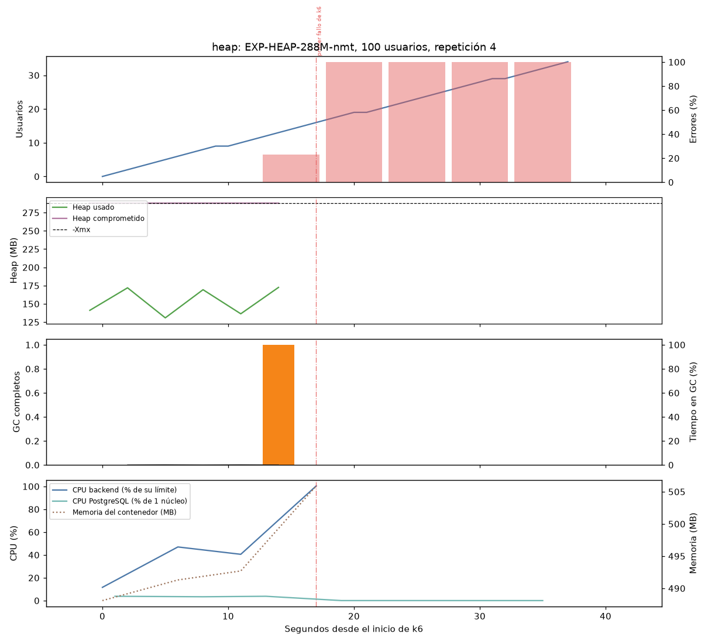

### heap: EXP-HEAP-288M-nmt, 50 usuarios, repetición 4

- Duración observada: 37 s; 181 peticiones, 71 con fallo.
- **Primer fallo a los 17 s, con 16 usuarios activos.**

| t (s) | Operación | Estado | Duración (ms) | Error de k6 |
|---|---|---|---|---|
| 17.0 | login | 0 | 175 | EOF |
| 17.0 | panel | 0 | 163 | unexpected EOF |
| 17.0 | reporte_clinico | 0 | 1873 | EOF |
| 17.0 | reporte_de_ventas | 0 | 0 | read: connection reset by peer |
| 17.0 | pacientes_inactivos | 0 | 0 | read: connection reset by peer |
| 18.0 | login | 0 | 0 | dial: connection refused |
| 19.0 | login | 0 | 0 | dial: connection refused |
| 20.0 | apoderado | 0 | 0 | dial: connection refused |
| 20.0 | login | 0 | 0 | dial: connection refused |
| 21.0 | login | 0 | 0 | dial: connection refused |
| 21.0 | apoderado | 0 | 0 | dial: connection refused |
| 22.0 | navegacion | 0 | 0 | dial: connection refused |

- Operaciones con fallos en los 30 s siguientes al primero: login (19), apoderado (10), panel (6), navegacion (5), privacidad (5), cumplimiento (5), notificaciones (5), avisos_de_cumplimiento (5).
- **Qué ocurre primero** (segundos desde el inicio de k6): -1 s: contenedor sobre 80pct de memoria; 17 s: primer fallo de k6.
- **En los 30 s previos al primer fallo:** heap usado al inicio 151 MB, heap usado máx. 217 MB de 288, RssAnon máx. 469 MB, contenedor 476 MB de 512, CPU del backend 40 %, CPU de PostgreSQL 5 %, tiempo en GC 2.0 % con 1 GC completos.

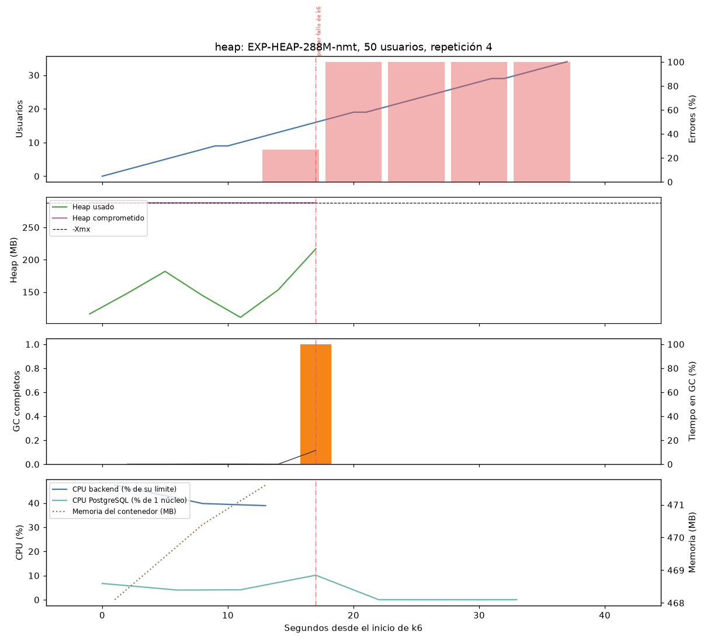

### pool: POOL-10, 250 usuarios, repetición 1

- Duración observada: 428 s; 19911 peticiones, 26 con fallo.
- **Primer fallo a los 22 s, con 22 usuarios activos.**

| t (s) | Operación | Estado | Duración (ms) | Error de k6 |
|---|---|---|---|---|
| 22.0 | cita | 400 | 84 |  |
| 33.0 | cita | 400 | 31 |  |
| 42.0 | cita | 400 | 49 |  |
| 99.0 | cita | 400 | 27 |  |
| 109.0 | cita | 400 | 22 |  |
| 148.0 | cita | 400 | 13 |  |
| 152.0 | cita | 400 | 7 |  |
| 177.0 | cita | 400 | 26 |  |
| 190.0 | cita | 400 | 48 |  |
| 197.0 | iniciar | 400 | 22 |  |
| 198.0 | iniciar | 400 | 16 |  |
| 250.0 | iniciar | 400 | 13 |  |

- Operaciones con fallos en los 30 s siguientes al primero: cita (3).
- **Qué ocurre primero** (segundos desde el inicio de k6): 19 s: cpu del backend al tope; 22 s: primer fallo de k6.
- **En los 30 s previos al primer fallo:** heap usado al inicio 189 MB, heap usado máx. 285 MB de 1024, RssAnon máx. 616 MB, contenedor 624 MB de 2048, CPU del backend 46 %, CPU de PostgreSQL 11 %, tiempo en GC 4.3 % con 2 GC completos.

### pool: POOL-20, 250 usuarios, repetición 1

- Duración observada: 428 s; 19965 peticiones, 21 con fallo.
- **Primer fallo a los 22 s, con 22 usuarios activos.**

| t (s) | Operación | Estado | Duración (ms) | Error de k6 |
|---|---|---|---|---|
| 22.0 | cita | 400 | 84 |  |
| 32.0 | cita | 400 | 40 |  |
| 42.0 | cita | 400 | 42 |  |
| 95.0 | iniciar | 400 | 27 |  |
| 98.0 | cita | 400 | 16 |  |
| 109.0 | cita | 400 | 26 |  |
| 146.0 | iniciar | 400 | 48 |  |
| 147.0 | cita | 400 | 8 |  |
| 152.0 | cita | 400 | 13 |  |
| 177.0 | cita | 400 | 29 |  |
| 183.0 | cita | 400 | 44 |  |
| 191.0 | cita | 400 | 81 |  |

- Operaciones con fallos en los 30 s siguientes al primero: cita (3).
- **Qué ocurre primero** (segundos desde el inicio de k6): 16 s: cpu del backend al tope; 22 s: primer fallo de k6.
- **En los 30 s previos al primer fallo:** heap usado al inicio 157 MB, heap usado máx. 247 MB de 1024, RssAnon máx. 629 MB, contenedor 638 MB de 2048, CPU del backend 76 %, CPU de PostgreSQL 4 %, tiempo en GC 5.9 % con 3 GC completos.

### pool: POOL-40, 250 usuarios, repetición 1

- Duración observada: 428 s; 19905 peticiones, 76 con fallo.
- **Primer fallo a los 33 s, con 33 usuarios activos.**

| t (s) | Operación | Estado | Duración (ms) | Error de k6 |
|---|---|---|---|---|
| 33.0 | cita | 400 | 42 |  |
| 42.0 | cita | 400 | 38 |  |
| 92.0 | cita | 400 | 8 |  |
| 97.0 | cita | 400 | 18 |  |
| 98.0 | cita | 400 | 29 |  |
| 126.0 | cita | 400 | 8 |  |
| 127.0 | iniciar | 400 | 14 |  |
| 138.0 | cita | 400 | 38 |  |
| 145.0 | cita | 400 | 134 |  |
| 173.0 | cita | 400 | 23 |  |
| 191.0 | cita | 400 | 48 |  |
| 192.0 | cita | 400 | 66 |  |

- Operaciones con fallos en los 30 s siguientes al primero: cita (2).
- **Qué ocurre primero** (segundos desde el inicio de k6): 17 s: cpu del backend al tope; 33 s: primer fallo de k6; 407 s: primera rafaga de gc completo; 410 s: heap usado sobre 90pct del tope.
- **En los 30 s previos al primer fallo:** heap usado al inicio 154 MB, heap usado máx. 335 MB de 1024, RssAnon máx. 669 MB, contenedor 677 MB de 2048, CPU del backend 71 %, CPU de PostgreSQL 7 %, tiempo en GC 3.9 % con 3 GC completos.

### pool: POOL-80, 250 usuarios, repetición 1

- Duración observada: 428 s; 19948 peticiones, 22 con fallo.
- **Primer fallo a los 51 s, con 51 usuarios activos.**

| t (s) | Operación | Estado | Duración (ms) | Error de k6 |
|---|---|---|---|---|
| 51.0 | cita | 400 | 51 |  |
| 64.0 | cita | 400 | 41 |  |
| 73.0 | cita | 400 | 40 |  |
| 74.0 | cita | 400 | 33 |  |
| 81.0 | cita | 400 | 31 |  |
| 145.0 | cita | 400 | 37 |  |
| 158.0 | iniciar | 400 | 26 |  |
| 192.0 | cita | 400 | 120 |  |
| 193.0 | cita | 400 | 68 |  |
| 206.0 | iniciar | 400 | 9 |  |
| 250.0 | cita | 400 | 68 |  |
| 254.0 | iniciar | 400 | 78 |  |

- Operaciones con fallos en los 30 s siguientes al primero: cita (5).
- **Qué ocurre primero** (segundos desde el inicio de k6): 18 s: cpu del backend al tope; 51 s: primer fallo de k6.
- **En los 30 s previos al primer fallo:** heap usado al inicio 177 MB, heap usado máx. 322 MB de 1024, RssAnon máx. 651 MB, contenedor 660 MB de 2048, CPU del backend 61 %, CPU de PostgreSQL 15 %, tiempo en GC 2.1 % con 2 GC completos.

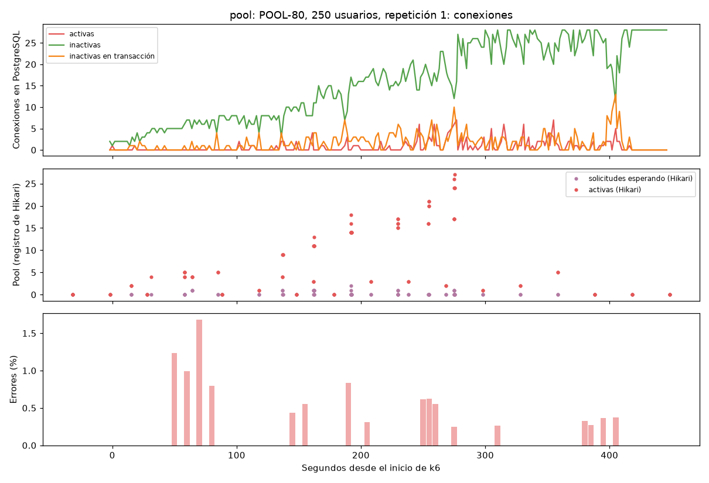

### pool: POOL-10, 250 usuarios, repetición 2

- Duración observada: 427 s; 19936 peticiones, 29 con fallo.
- **Primer fallo a los 51 s, con 51 usuarios activos.**

| t (s) | Operación | Estado | Duración (ms) | Error de k6 |
|---|---|---|---|---|
| 51.0 | cita | 400 | 56 |  |
| 64.0 | cita | 400 | 13 |  |
| 73.0 | cita | 400 | 34 |  |
| 74.0 | cita | 400 | 20 |  |
| 81.0 | cita | 400 | 35 |  |
| 127.0 | iniciar | 400 | 21 |  |
| 145.0 | cita | 400 | 53 |  |
| 154.0 | iniciar | 400 | 15 |  |
| 158.0 | iniciar | 400 | 25 |  |
| 191.0 | cita | 400 | 11 |  |
| 193.0 | cita | 400 | 8 |  |
| 197.0 | iniciar | 400 | 15 |  |

- Operaciones con fallos en los 30 s siguientes al primero: cita (5).
- **Qué ocurre primero** (segundos desde el inicio de k6): 16 s: cpu del backend al tope; 51 s: primer fallo de k6.
- **En los 30 s previos al primer fallo:** heap usado al inicio 184 MB, heap usado máx. 322 MB de 1024, RssAnon máx. 688 MB, contenedor 696 MB de 2048, CPU del backend 91 %, CPU de PostgreSQL 7 %, tiempo en GC 1.7 % con 2 GC completos.

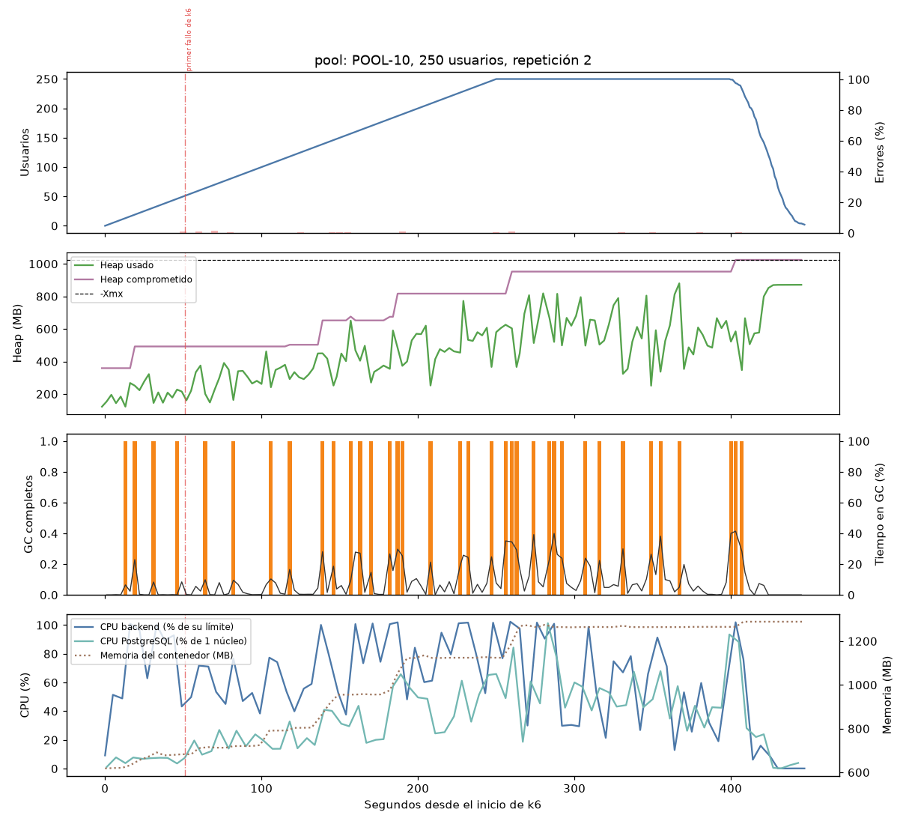

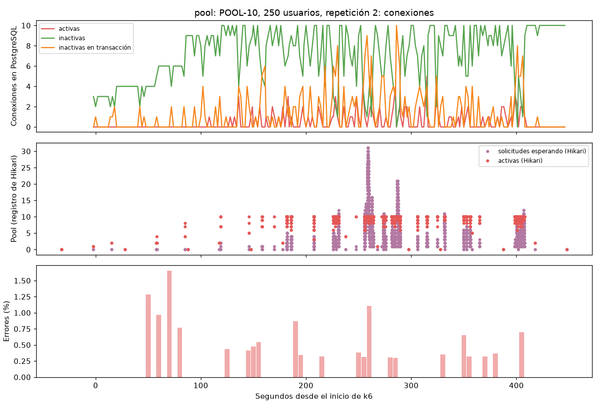

### pool: POOL-20, 250 usuarios, repetición 2

- Duración observada: 428 s; 19990 peticiones, 91 con fallo.
- **Primer fallo a los 33 s, con 33 usuarios activos.**

| t (s) | Operación | Estado | Duración (ms) | Error de k6 |
|---|---|---|---|---|
| 33.0 | cita | 400 | 45 |  |
| 42.0 | cita | 400 | 39 |  |
| 92.0 | cita | 400 | 20 |  |
| 97.0 | cita | 400 | 7 |  |
| 98.0 | cita | 400 | 29 |  |
| 109.0 | cita | 400 | 44 |  |
| 146.0 | iniciar | 400 | 14 |  |
| 173.0 | cita | 400 | 24 |  |
| 191.0 | cita | 400 | 27 |  |
| 192.0 | cita | 400 | 14 |  |
| 198.0 | iniciar | 400 | 38 |  |
| 211.0 | cita | 400 | 34 |  |

- Operaciones con fallos en los 30 s siguientes al primero: cita (2).
- **Qué ocurre primero** (segundos desde el inicio de k6): 19 s: cpu del backend al tope; 33 s: primer fallo de k6.
- **En los 30 s previos al primer fallo:** heap usado al inicio 153 MB, heap usado máx. 320 MB de 1024, RssAnon máx. 655 MB, contenedor 663 MB de 2048, CPU del backend 86 %, CPU de PostgreSQL 10 %, tiempo en GC 3.6 % con 3 GC completos.

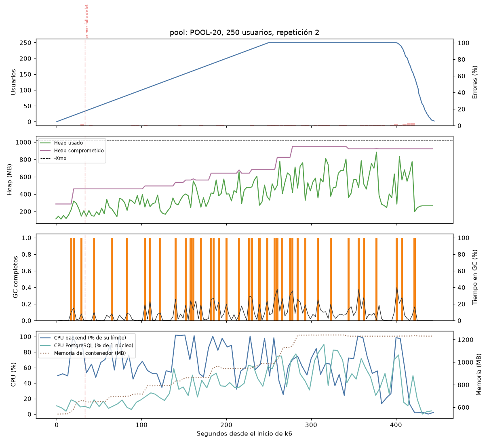

### pool: POOL-40, 250 usuarios, repetición 2

- Duración observada: 428 s; 20007 peticiones, 19 con fallo.
- **Primer fallo a los 22 s, con 22 usuarios activos.**

| t (s) | Operación | Estado | Duración (ms) | Error de k6 |
|---|---|---|---|---|
| 22.0 | cita | 400 | 63 |  |
| 33.0 | cita | 400 | 39 |  |
| 43.0 | cita | 400 | 45 |  |
| 98.0 | cita | 400 | 13 |  |
| 109.0 | cita | 400 | 49 |  |
| 148.0 | cita | 400 | 24 |  |
| 151.0 | cita | 400 | 25 |  |
| 177.0 | cita | 400 | 18 |  |
| 182.0 | cita | 400 | 58 |  |
| 190.0 | cita | 400 | 46 |  |
| 198.0 | iniciar | 400 | 26 |  |
| 250.0 | iniciar | 400 | 15 |  |

- Operaciones con fallos en los 30 s siguientes al primero: cita (3).
- **Qué ocurre primero** (segundos desde el inicio de k6): 17 s: cpu del backend al tope; 22 s: primer fallo de k6.
- **En los 30 s previos al primer fallo:** heap usado al inicio 179 MB, heap usado máx. 300 MB de 1024, RssAnon máx. 634 MB, contenedor 642 MB de 2048, CPU del backend 65 %, CPU de PostgreSQL 7 %, tiempo en GC 4.2 % con 2 GC completos.

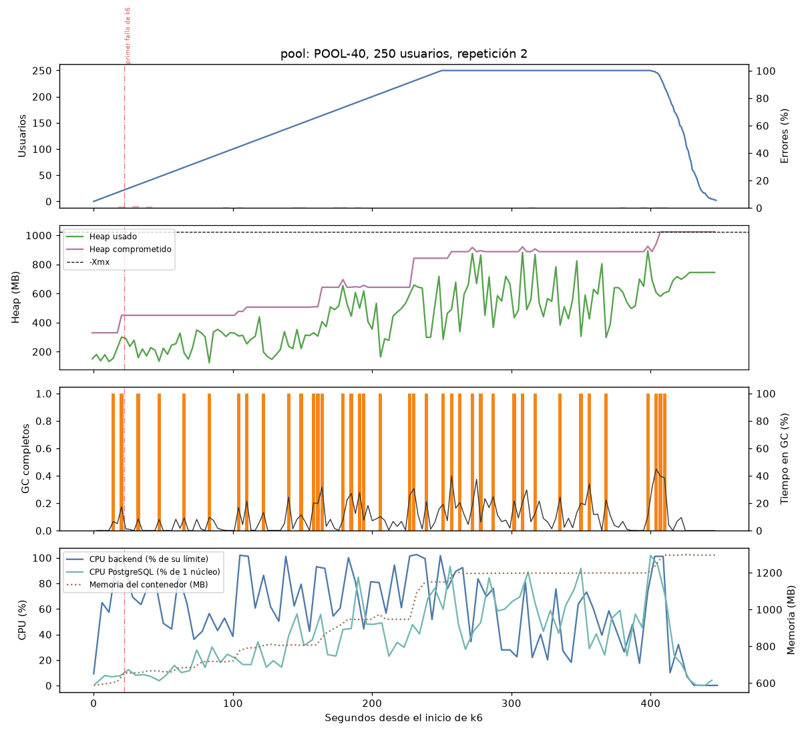

### pool: POOL-80, 250 usuarios, repetición 2

- Duración observada: 429 s; 20009 peticiones, 18 con fallo.
- **Primer fallo a los 22 s, con 22 usuarios activos.**

| t (s) | Operación | Estado | Duración (ms) | Error de k6 |
|---|---|---|---|---|
| 22.0 | cita | 400 | 61 |  |
| 32.0 | cita | 400 | 33 |  |
| 42.0 | cita | 400 | 35 |  |
| 98.0 | cita | 400 | 25 |  |
| 109.0 | cita | 400 | 12 |  |
| 147.0 | cita | 400 | 15 |  |
| 151.0 | cita | 400 | 11 |  |
| 159.0 | iniciar | 400 | 40 |  |
| 177.0 | cita | 400 | 10 |  |
| 190.0 | cita | 400 | 44 |  |
| 250.0 | iniciar | 400 | 71 |  |
| 254.0 | iniciar | 400 | 23 |  |

- Operaciones con fallos en los 30 s siguientes al primero: cita (3).
- **Qué ocurre primero** (segundos desde el inicio de k6): 17 s: cpu del backend al tope; 22 s: primer fallo de k6.
- **En los 30 s previos al primer fallo:** heap usado al inicio 166 MB, heap usado máx. 305 MB de 1024, RssAnon máx. 647 MB, contenedor 655 MB de 2048, CPU del backend 64 %, CPU de PostgreSQL 4 %, tiempo en GC 5.3 % con 3 GC completos.

### pool: POOL-10, 250 usuarios, repetición 3

- Duración observada: 428 s; 19982 peticiones, 85 con fallo.
- **Primer fallo a los 32 s, con 32 usuarios activos.**

| t (s) | Operación | Estado | Duración (ms) | Error de k6 |
|---|---|---|---|---|
| 32.0 | cita | 400 | 38 |  |
| 42.0 | cita | 400 | 39 |  |
| 92.0 | cita | 400 | 24 |  |
| 97.0 | cita | 400 | 17 |  |
| 98.0 | cita | 400 | 9 |  |
| 145.0 | cita | 400 | 24 |  |
| 150.0 | iniciar | 400 | 47 |  |
| 174.0 | cita | 400 | 23 |  |
| 191.0 | cita | 400 | 49 |  |
| 191.0 | cita | 400 | 37 |  |
| 197.0 | iniciar | 400 | 33 |  |
| 198.0 | iniciar | 400 | 14 |  |

- Operaciones con fallos en los 30 s siguientes al primero: cita (2).
- **Qué ocurre primero** (segundos desde el inicio de k6): 17 s: cpu del backend al tope; 32 s: primer fallo de k6; 407 s: heap usado sobre 90pct del tope.
- **En los 30 s previos al primer fallo:** heap usado al inicio 151 MB, heap usado máx. 324 MB de 1024, RssAnon máx. 647 MB, contenedor 655 MB de 2048, CPU del backend 70 %, CPU de PostgreSQL 8 %, tiempo en GC 3.6 % con 3 GC completos.

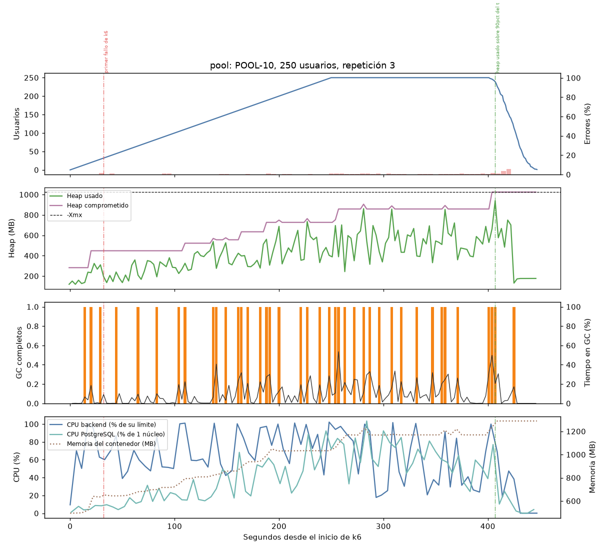

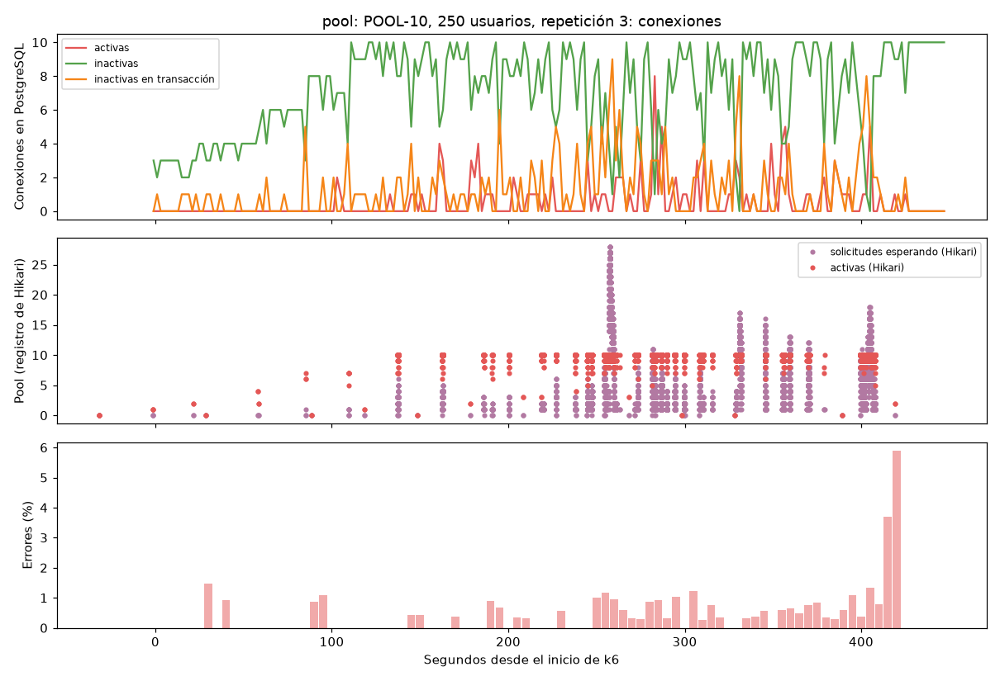

### pool: POOL-20, 250 usuarios, repetición 3

- Duración observada: 428 s; 19977 peticiones, 24 con fallo.
- **Primer fallo a los 22 s, con 22 usuarios activos.**

| t (s) | Operación | Estado | Duración (ms) | Error de k6 |
|---|---|---|---|---|
| 22.0 | cita | 400 | 44 |  |
| 32.0 | cita | 400 | 44 |  |
| 42.0 | cita | 400 | 26 |  |
| 95.0 | iniciar | 400 | 13 |  |
| 98.0 | cita | 400 | 15 |  |
| 108.0 | cita | 400 | 58 |  |
| 146.0 | iniciar | 400 | 43 |  |
| 147.0 | cita | 400 | 14 |  |
| 150.0 | cita | 400 | 32 |  |
| 177.0 | cita | 400 | 14 |  |
| 190.0 | cita | 400 | 56 |  |
| 253.0 | iniciar | 400 | 21 |  |

- Operaciones con fallos en los 30 s siguientes al primero: cita (3).
- **Qué ocurre primero** (segundos desde el inicio de k6): 18 s: cpu del backend al tope; 22 s: primer fallo de k6; 407 s: heap usado sobre 90pct del tope.
- **En los 30 s previos al primer fallo:** heap usado al inicio 197 MB, heap usado máx. 310 MB de 1024, RssAnon máx. 623 MB, contenedor 631 MB de 2048, CPU del backend 51 %, CPU de PostgreSQL 10 %, tiempo en GC 4.1 % con 2 GC completos.

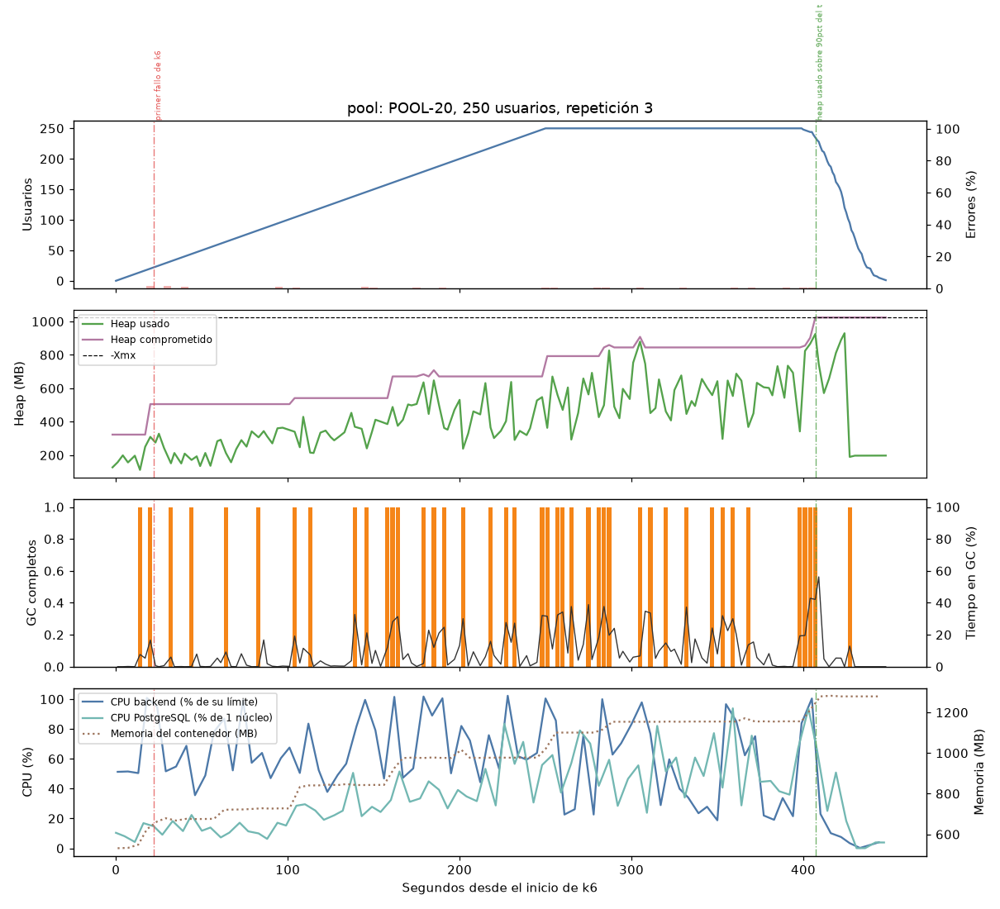

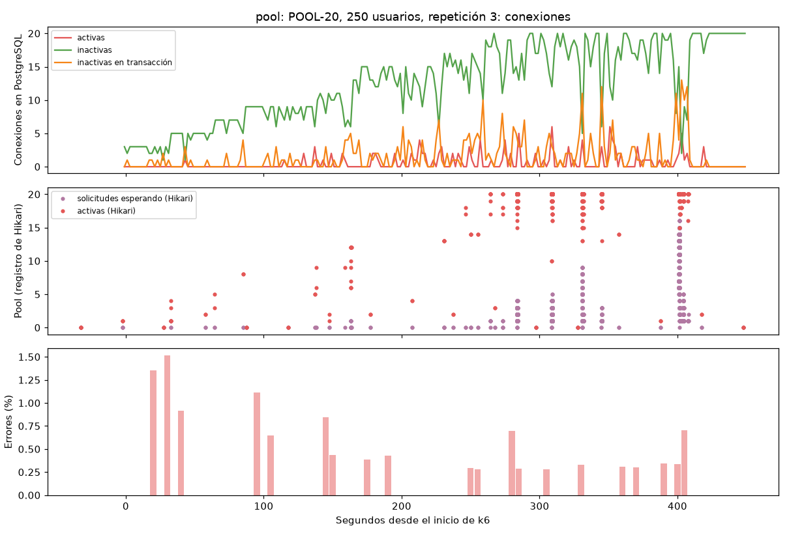

### pool: POOL-40, 250 usuarios, repetición 3

- Duración observada: 428 s; 19999 peticiones, 21 con fallo.
- **Primer fallo a los 52 s, con 52 usuarios activos.**

| t (s) | Operación | Estado | Duración (ms) | Error de k6 |
|---|---|---|---|---|
| 52.0 | cita | 400 | 33 |  |
| 65.0 | cita | 400 | 17 |  |
| 74.0 | cita | 400 | 24 |  |
| 75.0 | cita | 400 | 13 |  |
| 82.0 | cita | 400 | 25 |  |
| 128.0 | iniciar | 400 | 14 |  |
| 146.0 | cita | 400 | 35 |  |
| 147.0 | iniciar | 400 | 30 |  |
| 159.0 | iniciar | 400 | 36 |  |
| 192.0 | cita | 400 | 28 |  |
| 194.0 | cita | 400 | 35 |  |
| 197.0 | iniciar | 400 | 24 |  |

- Operaciones con fallos en los 30 s siguientes al primero: cita (5).
- **Qué ocurre primero** (segundos desde el inicio de k6): 19 s: cpu del backend al tope; 52 s: primer fallo de k6; 326 s: heap usado sobre 90pct del tope.
- **En los 30 s previos al primer fallo:** heap usado al inicio 193 MB, heap usado máx. 288 MB de 1024, RssAnon máx. 669 MB, contenedor 678 MB de 2048, CPU del backend 62 %, CPU de PostgreSQL 11 %, tiempo en GC 1.8 % con 2 GC completos.

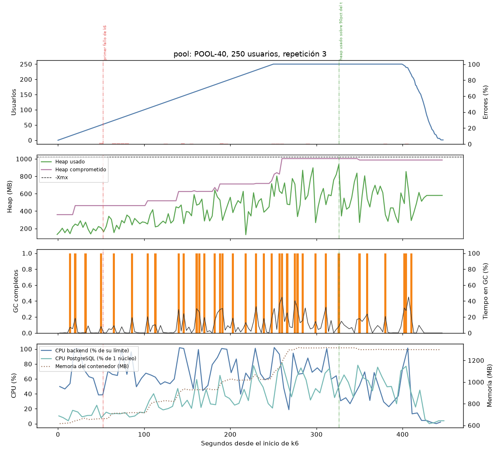

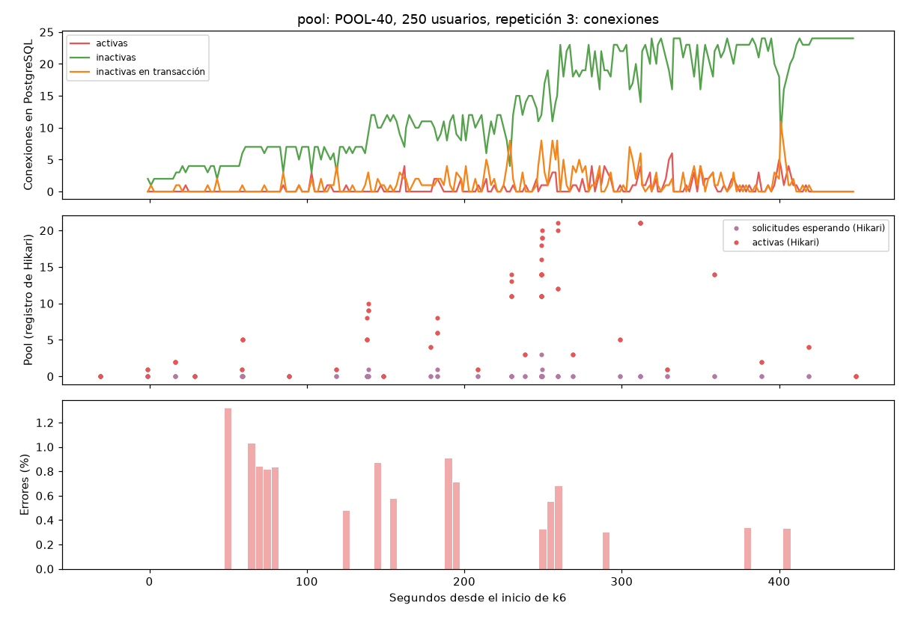

### pool: POOL-80, 250 usuarios, repetición 3

- Duración observada: 428 s; 19951 peticiones, 21 con fallo.
- **Primer fallo a los 22 s, con 22 usuarios activos.**

| t (s) | Operación | Estado | Duración (ms) | Error de k6 |
|---|---|---|---|---|
| 22.0 | cita | 400 | 74 |  |
| 32.0 | cita | 400 | 47 |  |
| 42.0 | cita | 400 | 36 |  |
| 98.0 | cita | 400 | 9 |  |
| 108.0 | cita | 400 | 49 |  |
| 147.0 | cita | 400 | 17 |  |
| 150.0 | cita | 400 | 32 |  |
| 158.0 | iniciar | 400 | 49 |  |
| 176.0 | cita | 400 | 19 |  |
| 182.0 | cita | 400 | 54 |  |
| 190.0 | cita | 400 | 51 |  |
| 208.0 | iniciar | 400 | 16 |  |

- Operaciones con fallos en los 30 s siguientes al primero: cita (3).
- **Qué ocurre primero** (segundos desde el inicio de k6): 17 s: cpu del backend al tope; 22 s: primer fallo de k6.
- **En los 30 s previos al primer fallo:** heap usado al inicio 191 MB, heap usado máx. 234 MB de 1024, RssAnon máx. 629 MB, contenedor 638 MB de 2048, CPU del backend 57 %, CPU de PostgreSQL 3 %, tiempo en GC 4.9 % con 2 GC completos.

